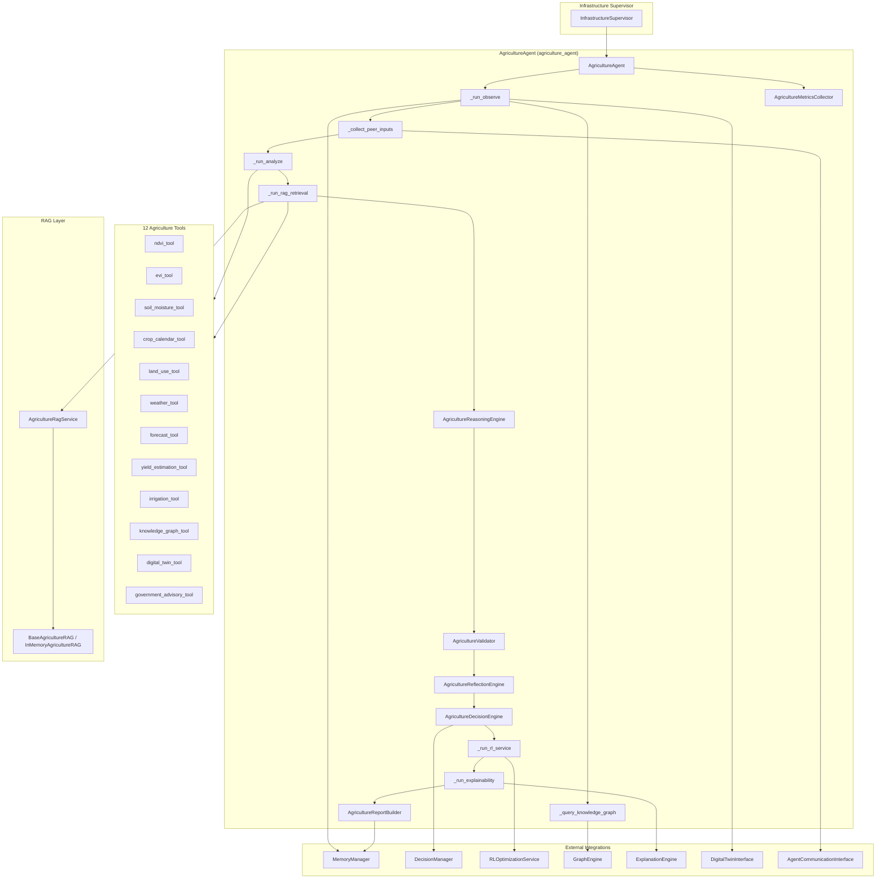
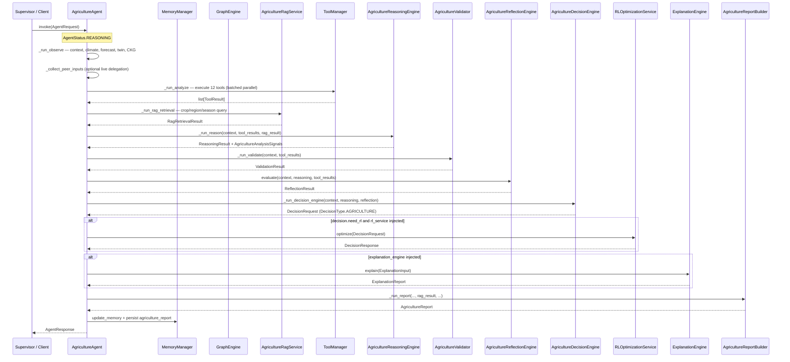
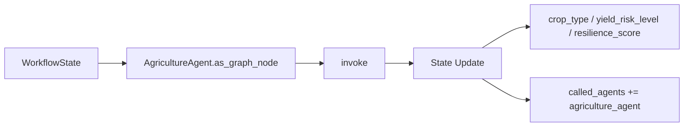
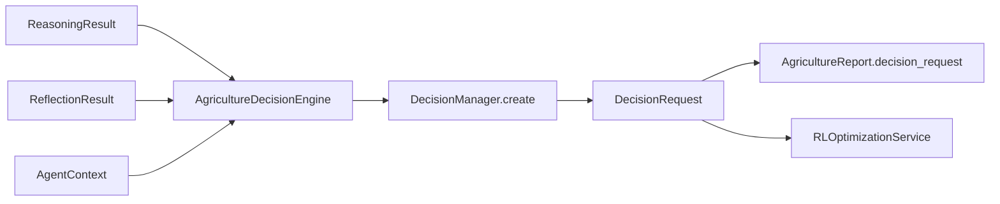
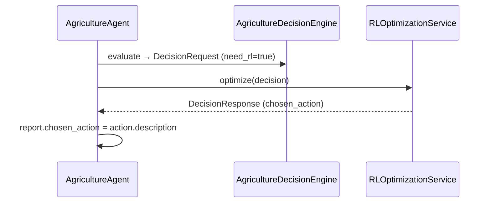
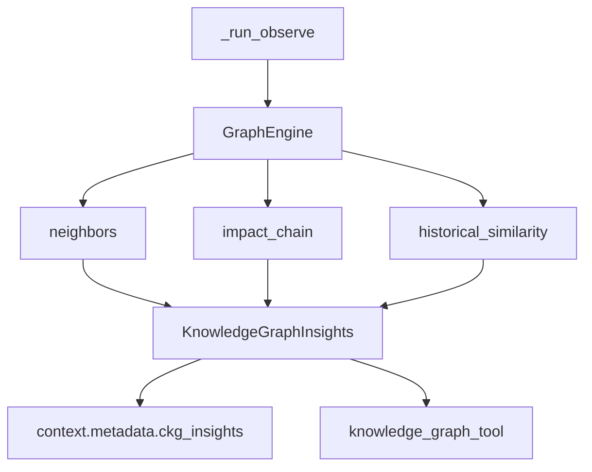
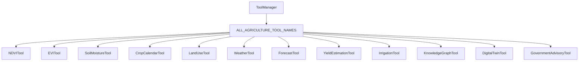
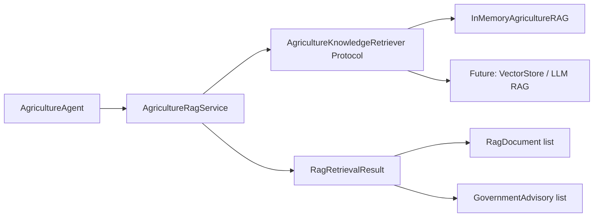
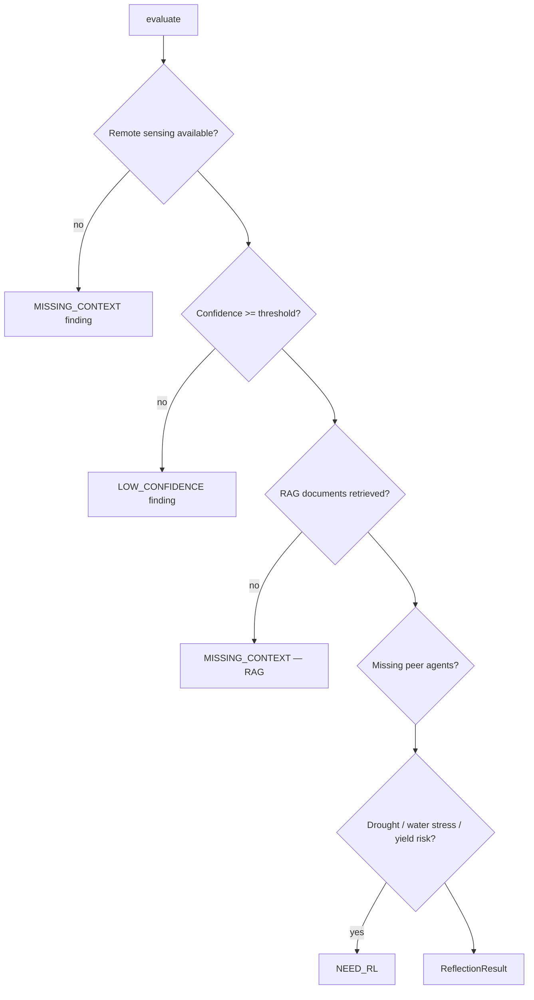
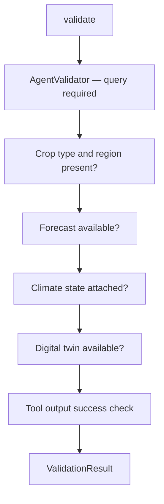

# Agriculture Agent

> **Component:** Agriculture Agent (Prompt 16)  
> **Status:** ✅ Complete  
> **Version:** 0.3.0  
> **Last Updated:** 2026-07-09  
> **Agent ID:** `agriculture_agent`  
> **Source:** `backend/agents/specialized/agriculture/`

---

## Purpose

The **Agriculture Agent** (`AgricultureAgent`) is a production-grade autonomous climate agent for precision agriculture and climate-informed crop advisory. It is registered under the **Infrastructure Supervisor** domain and adopts the unified **Decision Framework** end-to-end — producing `backend.decision.DecisionRequest` objects with `DecisionType.AGRICULTURE` and consuming `DecisionResponse` objects from `RLOptimizationService.optimize()` directly.

The agent combines remote sensing (NDVI/EVI), soil moisture analysis, crop phenology, weather and forecast intelligence, provider-agnostic RAG knowledge retrieval (`agriculture_rag.py`), government advisories, Climate Knowledge Graph (CKG) queries, and peer-agent hazard context to generate actionable recommendations for farmers and policymakers across India's major cropping systems.

---

## Responsibilities

| Responsibility | Owner Module |
|----------------|--------------|
| Crop health assessment via remote sensing | `agriculture_tools.py` (`ndvi_tool`, `evi_tool`) |
| Soil moisture and irrigation scheduling | `agriculture_tools.py` (`soil_moisture_tool`, `irrigation_tool`) |
| Crop phenology and calendar alignment | `agriculture_tools.py` (`crop_calendar_tool`) |
| Yield risk estimation | `agriculture_tools.py` (`yield_estimation_tool`) |
| Drought, heat, flood, and pest stress detection | `agriculture_tools.py` (`weather_tool`), `agriculture_reasoning.py` |
| Provider-agnostic RAG knowledge retrieval | `agriculture_rag.py` (`AgricultureRagService`) |
| Government advisory surfacing | `agriculture_tools.py` (`government_advisory_tool`) |
| Climate Knowledge Graph agricultural entity resolution | `agriculture_agent.py` → `GraphEngine` |
| Peer-agent hazard context (water, heat, flood) | `agriculture_agent.py` → `AgentCommunicationInterface` |
| Unified decision request construction | `agriculture_reasoning.py` (`AgricultureDecisionEngine`) |
| RL-optimized irrigation/crop action selection | `agriculture_agent.py` → `RLOptimizationService` |
| Full-pipeline explainability | `agriculture_agent.py` → `ExplanationEngine` |
| Professional agriculture report generation | `agriculture_report.py` |
| Input/output validation | `agriculture_validator.py` |
| Confidence-based reflection and delegation | `agriculture_reflection.py` |
| Invocation metrics and observability | `agriculture_metrics.py` |
| LangGraph workflow node exposure | `agriculture_agent.as_graph_node()` |

---

## Architecture



**Design distinction:** AgricultureAgent is the first Hyperion specialized agent to integrate a dedicated **RAG retrieval step** between tool analysis and reasoning. The RAG layer is provider-agnostic via `AgricultureKnowledgeRetriever` protocol, defaulting to `InMemoryAgricultureRAG` with a seeded ICAR/IMD advisory corpus.

---

## Folder Structure

```
backend/agents/specialized/agriculture/
├── __init__.py                  # Public exports
├── agriculture_agent.py         # AgricultureAgent — main orchestrator
├── agriculture_context.py       # AgricultureInputs, RAG models, CKG insights
├── agriculture_rag.py             # Provider-agnostic RAG (AgricultureRagService)
├── agriculture_metrics.py       # AgricultureMetricsCollector, AgricultureExecutionMetrics
├── agriculture_models.py        # Enums, action types, crop constants
├── agriculture_reasoning.py     # 10-stage reasoning + AgricultureDecisionEngine
├── agriculture_reflection.py    # Self-evaluation and inter-agent delegation
├── agriculture_report.py        # AgricultureReport, AgricultureReportBuilder
├── agriculture_tools.py         # 12 AbstractTool implementations
└── agriculture_validator.py     # Domain-specific validation rules

backend/tests/specialized/agriculture/
├── conftest.py                  # Fixtures, scenario builders, InMemoryAgricultureRAG
├── test_agriculture_unit.py     # 8 unit tests
└── test_agriculture_integration.py # 9 integration tests
```

---

## Workflow

The AgricultureAgent implements an internal LangGraph-style pipeline with a dedicated RAG step:

**Observe → Analyze → Retrieve Knowledge (RAG) → Reason → Validate → Decision → RL → XAI → Report**

Reflection and peer-agent consultation are integrated as sub-phases within this flow.



### Workflow Phases

| Phase | Method | Description |
|-------|--------|-------------|
| 1. Observe | `_run_observe` | Parse `AgricultureInputs`, hydrate climate state, forecast, twin, CKG insights |
| 2. Peer Consult | `_collect_peer_inputs` | Merge pre-supplied or live-delegated peer agent outputs |
| 3. Analyze | `_run_analyze` | Execute all 12 agriculture tools in two parallel batches (10 + 2) |
| 4. RAG Retrieve | `_run_rag_retrieval` | Query `AgricultureRagService` for crop calendars and government advisories |
| 5. Reason | `_run_reason` | 10-stage agricultural reasoning pipeline (includes RAG integration step) |
| 6. Validate | `_run_validate` | Crop data, forecast, climate state, twin, tool output checks |
| 7. Reflect | `_agriculture_reflection.evaluate` | Confidence check, RAG coverage, RL/delegation signals |
| 8. Decide | `_run_decision_engine` | Build unified `DecisionRequest` via `AgricultureDecisionEngine` |
| 9. RL Optimize | `_run_rl_service` | Call `RLOptimizationService.optimize()` when `need_rl` |
| 10. Explain | `_run_explainability` | Full-pipeline explanation via `ExplanationEngine` |
| 11. Report | `_run_report` | Assemble `AgricultureReport` with RAG, decision, RL, XAI artifacts |

---

## Execution Pipeline


**RAG query construction:** Dynamic query built from `{crop_type} {season} agriculture advisory {state/region} climate adaptation`, filtered by crop, region, state, and season.

**RAG → Tools → Reasoning chain:** RAG results are stored in context before reasoning; `government_advisory_tool` surfaces RAG advisories during the analyze phase on subsequent invocations when rag_result is in parameters.

---

## LangGraph Integration

`AgricultureAgent.as_graph_node()` extends the base implementation:

1. Calls `super().as_graph_node(state)` to run `invoke()` and merge standard workflow updates.
2. Enriches `update["metadata"]` with agriculture-specific fields when `last_agriculture_report` is set:

| Metadata Key | Source |
|--------------|--------|
| `crop_type` | `report.metadata.crop_type` |
| `yield_risk_level` | `report.yield_risk.risk_level.value` |
| `resilience_score` | `report.resilience_score` |

The node is registerable under `InfrastructureSupervisor` and composable into infrastructure supervisor graphs.



---

## Decision Framework Integration

AgricultureAgent uses the unified decision schema via `AgricultureDecisionEngine` embedded in `agriculture_reasoning.py`.



### DecisionRequest Construction

| Field | Source |
|-------|--------|
| `decision_type` | `DecisionType.AGRICULTURE` |
| `agent_id` | `"agriculture_agent"` |
| `objectives` | Maximize yield, minimize crop stress, optimize water use, protect critical growth stages |
| `possible_actions` | Mapped from `AgricultureActionType` catalog (8 action types) |
| `constraints` | Water availability, phenology stage, budget |
| `risk` | `RiskAssessment` from yield risk score and stress signals |
| `priority` | CRITICAL (yield risk severe+) → LOW (minimal risk) |
| `need_rl` | Reflection flag OR drought/water stress/yield risk ≥ 0.5 |
| `need_simulation` | From reflection (digital twin field scenario) |
| `need_other_agents` | water_resource, heatwave, flood, urban_planning |
| `need_human` | Critical yield risk during critical phenology stage |
| `context` | `DecisionContext` with crop, season, RAG references, peer outputs |

### AgricultureActionType Catalog

| Action | Description | Typical Trigger |
|--------|-------------|-----------------|
| `INCREASE_IRRIGATION` | Increase irrigation frequency and duration | Soil moisture deficit |
| `REDUCE_IRRIGATION` | Reduce irrigation to prevent waterlogging | Excess rainfall / high moisture |
| `CHANGE_CROP_SCHEDULE` | Adjust sowing/harvest schedule | Phenology misalignment |
| `ALTERNATIVE_CROP` | Recommend drought-resilient alternative variety | Severe drought / low NDVI trend |
| `EMERGENCY_IRRIGATION` | Deploy emergency irrigation for critical stage | Critical stage + moisture < 35% FC |
| `WATER_CONSERVATION` | Implement micro-irrigation measures | Water stress from peer agents |
| `CROP_PROTECTION` | Apply crop protection for pest/disease risk | Pest favorability signal |
| `GOVERNMENT_ASSISTANCE` | Activate government assistance programs | Drought / disaster conditions |

---

## RL Integration

AgricultureAgent uses **`RLOptimizationService.optimize()` directly**.



### RL Invocation Logic (`_run_rl_service`)

```python
if not decision.need_rl or not self._rl_service:
    return None
try:
    return await self._rl_service.optimize(decision)
except RLOptimizationError:
    return None  # non-blocking; report still generated
```

### RL Recommendation Criteria

Reflection sets `needs_rl = true` when:

- `drought_risk` signal is true, **or**
- `water_stress` signal is true, **or**
- `yield_risk_score >= 0.5`

---

## Explainability Integration

When `ExplanationEngine` is injected, `_run_explainability()` builds a full-pipeline `ExplanationInput`:

| Artifact | XAI Consumption |
|----------|-----------------|
| `ReasoningResult.steps` | Step-by-step crop advisory trace |
| `reasoning.trace` on report | Human-readable reasoning chain |
| `decision_request.rationale` | Decision justification strings |
| `rl_response` + `chosen_action` | RL action contrastive explanation |
| `AgricultureAnalysisSignals` | Structured stress/yield signal metadata |
| `RagRetrievalResult.documents` | RAG evidence linking for advisory provenance |
| `ReflectionResult` + `ValidationResult` | Confidence and data-quality context |
| `AgentResponse.metadata.explainability_summary` | Executive XAI summary |

Reports include RAG document references, pre-RL decision payload, and post-RL response — enabling traceable explanations from knowledge retrieval through action selection.

---

## Climate Knowledge Graph Integration

AgricultureAgent queries `GraphEngine` directly during `_run_observe` via `_query_knowledge_graph()`:



| Query | Purpose | Output Field |
|-------|---------|--------------|
| `neighbors(entity_id)` | Crop and water resource nodes | `crop_dependencies`, `water_dependencies` |
| `impact_chain(entity_id, max_depth=3)` | Historical crop impact chains | `historical_impacts` |
| `historical_similarity(entity_id)` | Regional crop suitability analogs | `regional_suitability` |

CKG insights propagate into tool parameters and are surfaced by `knowledge_graph_tool`. Query count tracked via `AgricultureMetricsCollector.record_ckg_query()`.

---

## Memory Integration

| Operation | Domain | Key Pattern | Content |
|-----------|--------|-------------|---------|
| Context retrieval | WORKING, SESSION, VECTOR | session-scoped | Prior conversation and analyses |
| Climate state | via `retrieve_climate_state` | — | `ClimateState` measurements |
| Report persistence | WORKING | `agriculture_report:{request_id}` | Full `AgricultureReport.model_dump()` |
| RAG results | WORKING (via context) | session-scoped | `RagRetrievalResult` in request context |
| Memory references | — | — | Stored in `report.references` |

Memory writes tracked via `AgricultureMetricsCollector.record_memory_write()`. All access flows through injected `MemoryManager`.

---

## Inter-Agent Communication

AgricultureAgent supports bidirectional inter-agent communication via injected `AgentCommunicationInterface`.

### Peer Agent Map

| Agent ID | Domain | Typical Consultation Trigger |
|----------|--------|------------------------------|
| `water_resource_agent` | water_stress | Irrigation scheduling, reservoir supply |
| `heatwave_agent` | heatwave | Heat stress during grain filling / flowering |
| `flood_agent` | flood | Waterlogging, standing water in fields |
| `urban_planning_agent` | urban | Peri-urban land-use interface |

### Consultation Modes

1. **Pre-supplied:** `peer_agent_outputs` in request context.
2. **Live delegation:** `consult_agents` list triggers `call_other_agents()` during observe.
3. **Decision-driven:** `decision.need_other_agents` triggers post-decision delegation.

Peer outputs normalized to `PeerAgentOutput` and integrated into drought/flood/heat stress reasoning.

---

## Tool Architecture

AgricultureAgent registers **12 tools** via `create_agriculture_tools()`.



### Tool Reference

| Tool Name | Class | Category | Primary Outputs |
|-----------|-------|----------|-----------------|
| `ndvi_tool` | `NDVITool` | GEOSPATIAL | `health_status`, `declining_vigor`, `crop_health_score` |
| `evi_tool` | `EVITool` | GEOSPATIAL | `canopy_density`, `evi_score`, `evi_trend` |
| `soil_moisture_tool` | `SoilMoistureTool` | ANALYSIS | `moisture_deficit_pct`, `irrigation_needed`, `soil_moisture_score` |
| `crop_calendar_tool` | `CropCalendarTool` | ANALYSIS | `phenology_stage`, `critical_stage` |
| `land_use_tool` | `LandUseTool` | GEOSPATIAL | `suitable_for_crop`, `area_hectares` |
| `weather_tool` | `WeatherTool` | ANALYSIS | `heat_stress`, `drought_indicator`, `pest_favorability` |
| `forecast_tool` | `ForecastTool` | FORECAST | `drought_persistence_likely`, `favorable_for_irrigation_deferral` |
| `yield_estimation_tool` | `YieldEstimationTool` | ANALYSIS | `estimated_yield_pct`, `yield_risk_score` |
| `irrigation_tool` | `IrrigationTool` | PLANNING | `recommendation_type`, `irrigation_volume_mm`, `frequency_days` |
| `knowledge_graph_tool` | `KnowledgeGraphTool` | ANALYSIS | CKG crop/water dependencies, regional suitability |
| `digital_twin_tool` | `DigitalTwinTool` | SIMULATION | `agriculture_layers`, `field_scenario` |
| `government_advisory_tool` | `GovernmentAdvisoryTool` | ANALYSIS | RAG-sourced advisories, `has_government_advisory` |

### RAG Architecture (`agriculture_rag.py`)



| Component | Description |
|-----------|-------------|
| `AgricultureKnowledgeRetriever` | Runtime-checkable protocol for any RAG backend |
| `BaseAgricultureRAG` | Abstract base class for RAG implementations |
| `InMemoryAgricultureRAG` | Seeded corpus (ICAR, IMD, crop calendars) for tests/dev |
| `AgricultureRagService` | Facade with `retrieve_for_context()` convenience method |
| `SEEDED_AGRICULTURE_KNOWLEDGE` | In-memory corpus: wheat rabi, paddy kharif, cotton, drought advisories |

### Tool Execution Policy

- All 12 tools run on every invocation (batched parallel: 10 + 2).
- `rag_result` and `ckg_insights` injected into tool parameters after RAG step.
- `government_advisory_tool` reads RAG results from context to surface advisories.

---

## Reflection Process

`AgricultureReflectionEngine` evaluates analysis completeness:



### Inter-Agent Delegation Matrix

| Condition | Suggested Agent |
|-----------|-----------------|
| Drought / low soil moisture | `water_resource_agent` |
| Heat stress during critical stage | `heatwave_agent` |
| Excess rainfall / waterlogging | `flood_agent` |
| Peri-urban land pressure | `urban_planning_agent` |

---

## Validation Pipeline

`AgricultureValidator` extends the framework validator:



| Check | Field | Strict Severity | Default Severity |
|-------|-------|-----------------|------------------|
| Crop type | `crop_type` | 0.85 | 0.55 |
| Region / state | `region_id` / `state` | 0.8 | 0.5 |
| Forecast consistency | `forecast` | 0.7 | 0.4 |
| Climate state | `climate_state` | 0.75 | 0.45 |
| Digital twin | `digital_twin` | 0.6 | 0.35 |
| Failed tools | per tool | — | 0.65 |

When `validation.valid` is false, report confidence is capped at `0.5`.

---

## Metrics

`AgricultureMetricsCollector` extends `AgentMetricsCollector` with agriculture-specific dimensions.

### AgricultureExecutionMetrics

| Metric | Description |
|--------|-------------|
| `reasoning_time_ms` | Total reasoning pipeline duration |
| `tool_usage_count` | Number of tools executed |
| `tools_used` | Deduplicated list of tool names |
| `memory_reads` / `memory_writes` | Memory operation counts |
| `confidence` | Final report confidence |
| `resilience_score` | Agricultural resilience score 0–1 |
| `peer_agents_consulted` | Count of peer agents with outputs |
| `rag_retrievals` | RAG document retrieval count |
| `decision_requests` | Count of decision framework calls |
| `rl_calls` | Count of successful RL service invocations |
| `knowledge_graph_queries` | CKG query count during observe |
| `explainability_calls` | XAI engine invocations |
| `total_duration_ms` | End-to-end invocation time |

Accessible via `agent.last_agriculture_metrics.finalize_agriculture()` after invocation.

---

## Public APIs

### `AgricultureAgent`

| Method / Property | Description |
|-------------------|-------------|
| `create(memory, *, rl_service, rag_service, explanation_engine, graph_engine, ...)` | Async factory |
| `invoke(request: AgentRequest)` | Full agriculture analysis pipeline |
| `declare_capabilities()` | Returns 12 `AgentCapability` entries |
| `as_graph_node(state: WorkflowState)` | LangGraph node with crop/yield metadata |
| `required_inputs()` | Returns `["query"]` |
| `last_agriculture_report` | Most recent `AgricultureReport` |
| `last_agriculture_metrics` | Most recent `AgricultureMetricsCollector` |
| `AGENT_ID` / `agent_id` | Constant `"agriculture_agent"` |

### Factory

```python
agent = await AgricultureAgent.create(
    memory_manager,
    rl_service=rl_optimization_service,
    rag_service=AgricultureRagService(retriever=InMemoryAgricultureRAG()),
    explanation_engine=explanation_engine,
    graph_engine=graph_engine,
    agent_communication=comm_interface,
    digital_twin=twin_interface,
)
response = await agent.invoke(request)
```

### Response Metadata

| Key | Type | Description |
|-----|------|-------------|
| `agriculture_report_id` | `str` | UUID of generated report |
| `crop_type` | `str` | Crop under analysis |
| `yield_risk_level` | `str` | `YieldRiskLevel` value |
| `resilience_score` | `float` | Agricultural resilience 0–1 |
| `confidence` | `float` | Overall confidence 0–1 |
| `recommendations` | `list[str]` | Crop advisory recommendations |
| `rag_document_count` | `int` | Number of RAG documents retrieved |
| `need_rl` | `bool` | Whether RL was requested |
| `chosen_action` | `str \| null` | RL-selected action |
| `decision_request` | `dict` | Serialized `DecisionRequest` |
| `rl_response` | `dict \| null` | Serialized `DecisionResponse` |
| `explainability_summary` | `str \| null` | XAI executive summary |
| `metrics` | `dict` | `AgricultureExecutionMetrics` |

### Domain Exports (`agriculture/__init__.py`)

Key public types: `AgricultureAgent`, `AgricultureReport`, `AgricultureInputs`, `AgricultureRagService`, `InMemoryAgricultureRAG`, `YieldRiskLevel`, `AgricultureActionType`, `AGRICULTURE_AGENT_ID`.

---

## Private Methods

| Method | Purpose |
|--------|---------|
| `_run_observe` | Build context, parse inputs, retrieve memory/climate/forecast/twin/CKG |
| `_collect_peer_inputs` | Merge pre-supplied or live-delegated peer outputs |
| `_query_knowledge_graph` | Execute CKG queries; populate `KnowledgeGraphInsights` |
| `_run_analyze` | Execute 12 tools in batched parallel |
| `_run_rag_retrieval` | Query `AgricultureRagService.retrieve_for_context()` |
| `_run_reason` | Delegate to `AgricultureReasoningEngine.run()` with RAG result |
| `_run_validate` | Delegate to `AgricultureValidator.validate()` |
| `_run_decision_engine` | Delegate to `AgricultureDecisionEngine.evaluate()` |
| `_run_rl_service` | Call RL service when `need_rl` |
| `_run_explainability` | Call `ExplanationEngine.explain()` |
| `_run_report` | Delegate to `AgricultureReportBuilder.build()` |
| `_build_tool_specs` | Create tool specs with rag_result and ckg_insights |
| `_persist_agriculture_report` | Store report in WORKING memory |
| `_to_agent_report` / `_agriculture_report_to_response` | Report conversion helpers |

---

## Configuration

| Parameter | Default | Description |
|-----------|---------|-------------|
| `confidence_threshold` | `0.45` | Reflection low-confidence gate |
| `AGRICULTURE_AGENT_ID` | `"agriculture_agent"` | Canonical agent identifier |
| `rag_service` | `AgricultureRagService()` | Default in-memory RAG if not injected |
| RAG `limit` | `5` | Max documents per retrieval |
| Tool execution mode | `PARALLEL` (batched) | Two batches of 10 + 2 |

### Request Context Keys

| Key | Type | Description |
|-----|------|-------------|
| `region_id` | `str` | Farm region identifier |
| `state` | `str` | Indian state |
| `crop_type` | `str` | Crop under analysis (wheat, paddy, cotton, millet) |
| `season` | `str` | rabi / kharif / zaid |
| `ndvi` / `evi` | `float` | Remote sensing indices |
| `ndvi_trend` | `float` | NDVI trend slope |
| `soil_moisture_pct` | `float` | Current soil moisture |
| `field_capacity_pct` | `float` | Field capacity reference |
| `temperature_c` / `max_temp_c` | `float` | Weather temperatures |
| `rainfall_mm_7d` / `rainfall_mm_30d` | `float` | Rainfall totals |
| `crop_calendar` | `list[dict]` | Phenology stage definitions |
| `day_of_year` | `int` | Current day for phenology lookup |
| `peer_agent_outputs` | `dict` | Pre-supplied peer assessments |
| `consult_agents` | `list[str]` | Agent IDs for live delegation |

### Test Scenarios

| Scenario Builder | Description |
|------------------|-------------|
| `build_punjab_wheat_context()` | Rabi wheat, heat stress during grain filling |
| `build_tamil_nadu_paddy_context()` | Kharif paddy, flood risk in delta |
| `build_maharashtra_cotton_context()` | Kharif cotton, water stress during flowering |
| `build_karnataka_drought_context()` | Severe drought, millet promotion |

---

## Error Handling

| Exception | When Raised | Behavior |
|-----------|-------------|----------|
| `AgentInvocationError` | Any unhandled pipeline exception | Status → `FAILED`, metrics finalized |
| `RLOptimizationError` | RL service failure | Warning logged; report without `rl_response` |
| `ToolValidationError` | Invalid tool input | Tool returns `success=False` |

RAG retrieval failures return empty `RagRetrievalResult` — pipeline continues with reduced advisory confidence. CKG query failures are non-blocking.

---

## Logging

Logger namespace: `backend.agents.specialized.agriculture.agriculture_agent`

| Event | Level | Key Fields |
|-------|-------|------------|
| `agriculture_observe_complete` | INFO | `region_id`, `crop` |
| `agriculture_rl_optimization_failed` | WARNING | `decision_id`, `error` |
| `agriculture_agent_failed` | ERROR | `request_id`, `error` |

RAG retrieval logged at DEBUG in `agriculture_rag.py` with document count.

---

## Performance Considerations

| Phase | Typical Duration (unit tests) |
|-------|-------------------------------|
| Tool execution (12 batched parallel) | 5–25 ms |
| RAG retrieval (in-memory) | 1–5 ms |
| CKG queries | 2–10 ms |
| Reasoning (10 steps) | 3–10 ms |
| Decision engine | 1–3 ms |
| Report build | 1–2 ms |
| RL service (mock) | < 1 ms |

RAG in-memory retrieval is fast; production vector-store backends will dominate latency when wired.

---

## Scalability

- **Stateless invocations** with cached `last_*` for debugging.
- **Horizontal scaling** behind `InfrastructureSupervisor`.
- **Pluggable RAG:** Swap `InMemoryAgricultureRAG` for vector DB or external knowledge API without agent changes.
- **Tool isolation:** Independent testability per tool.
- **Async throughout:** All I/O uses `async/await`.

---

## Security

- No direct external API calls in agent layer (RAG retriever is injected).
- Tool inputs validated via Pydantic (`AgricultureInputs`) and JSON Schema.
- Inter-agent calls require explicit `AgentCommunicationInterface`.
- RAG corpus is read-only from agent perspective; write access controlled by retriever implementation.
- Government advisory content sourced from trusted retriever backends only.

---

## Testing Summary

| Test File | Count | Scope |
|-----------|-------|-------|
| `backend/tests/specialized/agriculture/test_agriculture_unit.py` | **8** | Tools, RAG, inputs, reasoning, decision engine |
| `backend/tests/specialized/agriculture/test_agriculture_integration.py` | **9** | Full invoke, RL, XAI, CKG, RAG, supervisor, LangGraph |
| **Total** | **17** | All passing (v0.3.0) |

### Unit Tests (`test_agriculture_unit.py`)

| Test | Validates |
|------|-----------|
| `test_agriculture_tools_registered` | All 12 tools registered |
| `test_ndvi_tool_punjab_wheat` | Punjab wheat NDVI health status |
| `test_soil_moisture_tool_karnataka_drought` | Karnataka drought moisture deficit |
| `test_agriculture_inputs_from_context` | Context → `AgricultureInputs` parsing |
| `test_rag_retrieval_wheat` | RAG returns wheat rabi calendar documents |
| `test_rag_retrieval_karnataka_drought` | RAG returns drought management advisory |
| `test_agriculture_reasoning_drought` | Drought reasoning with ≥ 9 steps |
| `test_agriculture_decision_engine` | `DecisionType.AGRICULTURE`, unified schema |

### Integration Tests (`test_agriculture_integration.py`)

| Test | Validates |
|------|-----------|
| `test_agriculture_agent_punjab_wheat` | End-to-end Punjab wheat advisory |
| `test_agriculture_agent_tamil_nadu_paddy` | Tamil Nadu paddy flood risk |
| `test_agriculture_agent_maharashtra_cotton` | Maharashtra cotton water stress |
| `test_agriculture_agent_karnataka_drought` | Karnataka drought millet advisory |
| `test_agriculture_agent_with_rl_xai_ckg_rag` | Full stack: RL, XAI, CKG, RAG |
| `test_agriculture_agent_live_peer_consultation` | Live peer delegation |
| `test_agriculture_as_graph_node` | LangGraph metadata enrichment |
| `test_agriculture_infrastructure_supervisor_slot` | InfrastructureSupervisor registration |
| `test_agriculture_report_sections` | Complete report field population |

---

## Known Limitations

| Limitation | Impact | Mitigation Path |
|------------|--------|-----------------|
| In-memory RAG corpus only in default config | Limited advisory coverage | Wire production vector store / ICAR API |
| All 12 tools run every invocation | No query-aware tool filtering | Capability-driven tool selection |
| Yield estimation is heuristic | NDVI × moisture approximation | Integrate crop simulation models |
| Phenology from static calendar + day_of_year | No satellite phenology detection | Add S2 time-series phenology |
| Real RL service enum gaps | Tests use mock RL | Resolve `ClimateVariable` gaps |
| No multi-field batch analysis | Single region per invocation | Add batch invoke API |

---

## Future Improvements

- Wire production RAG backend (Qdrant, Azure AI Search, ICAR knowledge API).
- Integrate WOFOST/DSSAT crop simulation for yield forecasting.
- Add satellite-derived actual phenology stage detection.
- Support multi-crop rotation planning across seasons.
- LLM-augmented farmer-facing advisory narratives in local languages.
- Real-time integration with PM-KISAN / state drought relief scheme APIs.
- Query-aware tool selection for low-risk monitoring scenarios.

---

## Related Documents

- [Specialized Agent Framework](./specialized_framework.md)
- [Urban Planning Agent](./urban_planning_agent.md)
- [Water Resource Agent](./water_resource_agent.md)
- [Agent → Decision → RL Flow](../diagrams/agent_decision_rl_flow.md)
- [RL Optimization Service](../rl/README.md)
- [Infrastructure Supervisor](../domain/domain_supervisors.md)
- [Decision Framework](../decision/decision_framework.md)
