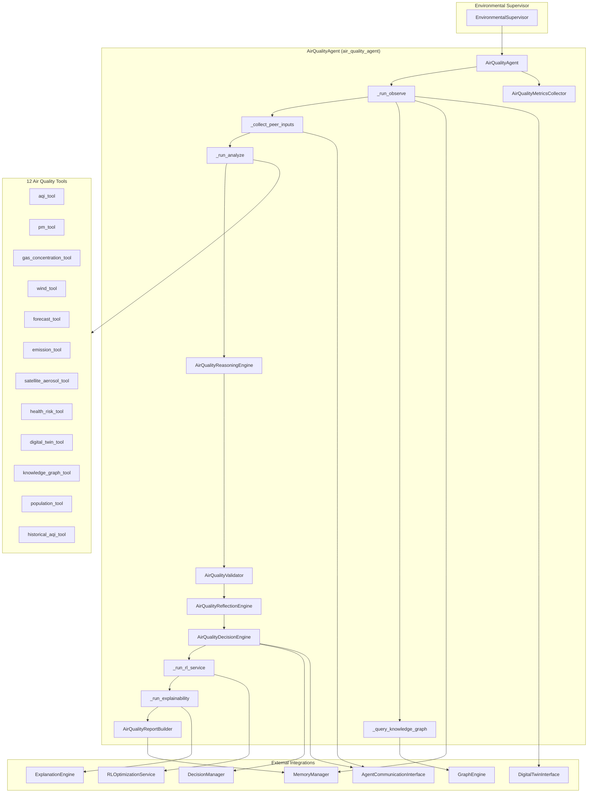
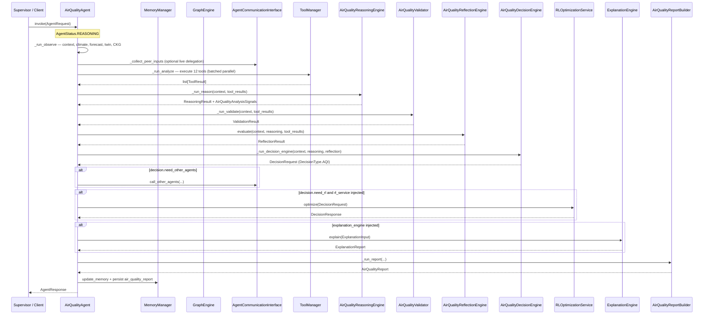
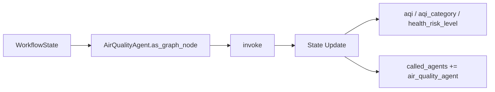
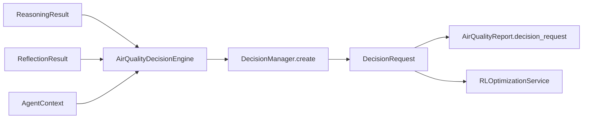
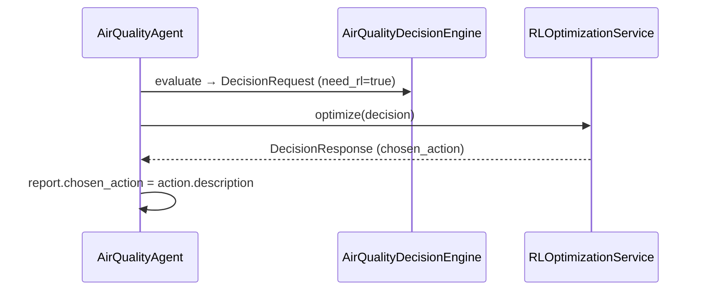
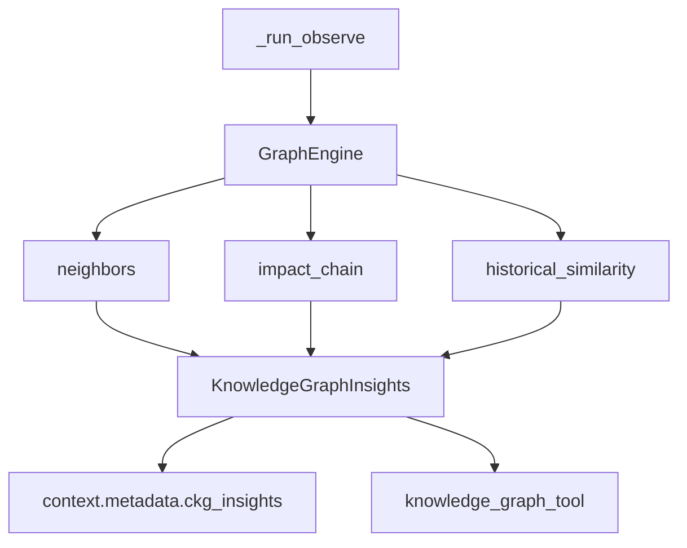
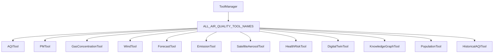
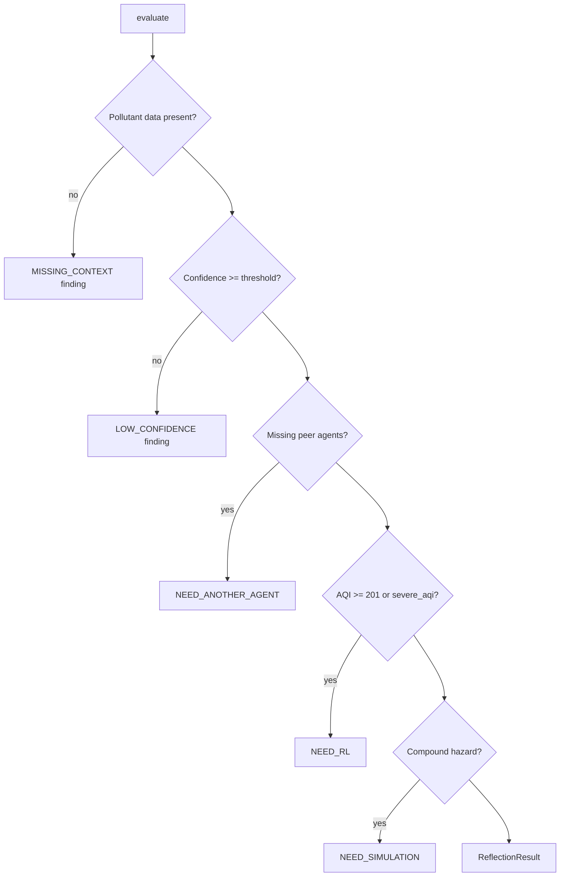
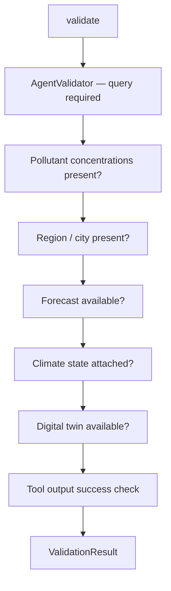

# Air Quality Agent

> **Component:** Air Quality Agent (Prompt 17)  
> **Status:** ✅ Complete  
> **Version:** 0.3.0  
> **Last Updated:** 2026-07-09  
> **Agent ID:** `air_quality_agent`  
> **Source:** `backend/agents/specialized/air_quality/`

---

## Purpose

The **Air Quality Agent** (`AirQualityAgent`) is a production-grade autonomous climate agent for atmospheric pollution analysis, population health risk assessment, and air quality mitigation planning. It is registered under the **Environmental Supervisor** domain and adopts the unified **Decision Framework** end-to-end — producing `backend.decision.DecisionRequest` objects with `DecisionType.AQI` and consuming `DecisionResponse` objects from `RLOptimizationService.optimize()` directly.

The agent evaluates particulate matter (PM2.5, PM10), gaseous pollutants (NO₂, SO₂, O₃, CO), satellite aerosol optical depth, emission inventories, wind transport, and population exposure using **Indian CPCB AQI** breakpoint methodology. It generates actionable mitigation recommendations — including GRAP-aligned measures — for policymakers, public health officials, and emergency coordinators responding to severe pollution episodes, stubble burning, dust storms, and coastal industrial plumes.

---

## Responsibilities

| Responsibility | Owner Module |
|----------------|--------------|
| CPCB AQI computation and category classification | `air_quality_tools.py` (`aqi_tool`), `air_quality_models.py` |
| PM2.5 / PM10 analysis and source attribution | `air_quality_tools.py` (`pm_tool`) |
| Gaseous pollutant and ozone formation analysis | `air_quality_tools.py` (`gas_concentration_tool`) |
| Wind transport, stagnation, and dispersion | `air_quality_tools.py` (`wind_tool`) |
| Emission inventory and hotspot attribution | `air_quality_tools.py` (`emission_tool`) |
| Satellite aerosol, fire, smoke, and dust detection | `air_quality_tools.py` (`satellite_aerosol_tool`) |
| Population exposure and health risk quantification | `air_quality_tools.py` (`health_risk_tool`, `population_tool`) |
| Historical AQI trend and anomaly detection | `air_quality_tools.py` (`historical_aqi_tool`) |
| Air quality forecast trend analysis | `air_quality_tools.py` (`forecast_tool`) |
| Climate Knowledge Graph pollution entity resolution | `air_quality_agent.py` → `GraphEngine` |
| Peer-agent compound hazard context | `air_quality_agent.py` → `AgentCommunicationInterface` |
| Unified decision request construction | `air_quality_reasoning.py` (`AirQualityDecisionEngine`) |
| RL-optimized mitigation action selection | `air_quality_agent.py` → `RLOptimizationService` |
| Full-pipeline explainability | `air_quality_agent.py` → `ExplanationEngine` |
| Professional air quality report generation | `air_quality_report.py` |
| Input/output validation | `air_quality_validator.py` |
| Confidence-based reflection and delegation | `air_quality_reflection.py` |
| Invocation metrics and observability | `air_quality_metrics.py` |
| LangGraph workflow node exposure | `air_quality_agent.as_graph_node()` |

---

## Architecture



**Design distinction:** AirQualityAgent implements CPCB-compliant AQI sub-index calculation with PM2.5/PM10 breakpoint tables in `air_quality_models.py`. The `AQITool` selects the dominant pollutant sub-index as the composite AQI — matching Indian regulatory practice.

---

## Folder Structure

```
backend/agents/specialized/air_quality/
├── __init__.py                  # Public exports
├── air_quality_agent.py         # AirQualityAgent — main orchestrator
├── air_quality_context.py       # AirQualityInputs, CKG insights, peer models
├── air_quality_metrics.py       # AirQualityMetricsCollector, AirQualityExecutionMetrics
├── air_quality_models.py        # CPCB breakpoints, AQI categories, action types
├── air_quality_reasoning.py     # 9-stage reasoning + AirQualityDecisionEngine
├── air_quality_reflection.py    # Self-evaluation and inter-agent delegation
├── air_quality_report.py        # AirQualityReport, AirQualityReportBuilder
├── air_quality_tools.py         # 12 AbstractTool implementations
└── air_quality_validator.py     # Domain-specific validation rules

backend/tests/specialized/air_quality/
├── conftest.py                  # Fixtures, scenario builders, MockRLOptimizationService
├── test_air_quality_unit.py     # 8 unit tests
└── test_air_quality_integration.py # 9 integration tests
```

---

## Workflow

The AirQualityAgent implements an internal LangGraph-style pipeline:

**Observe → Analyze → Reason → Validate → Decision → RL → XAI → Report**

Reflection and peer-agent consultation are integrated as sub-phases within this flow.



### Workflow Phases

| Phase | Method | Description |
|-------|--------|-------------|
| 1. Observe | `_run_observe` | Parse `AirQualityInputs`, hydrate climate state, forecast, twin, CKG insights |
| 2. Peer Consult | `_collect_peer_inputs` | Merge pre-supplied or live-delegated peer agent outputs |
| 3. Analyze | `_run_analyze` | Execute all 12 air quality tools in two parallel batches (10 + 2) |
| 4. Reason | `_run_reason` | 9-stage atmospheric pollution reasoning pipeline |
| 5. Validate | `_run_validate` | Pollutant data, forecast, climate state, twin, tool output checks |
| 6. Reflect | `_air_quality_reflection.evaluate` | Confidence check, RL/simulation/delegation signals |
| 7. Decide | `_run_decision_engine` | Build unified `DecisionRequest` via `AirQualityDecisionEngine` |
| 8. RL Optimize | `_run_rl_service` | Call `RLOptimizationService.optimize()` when `need_rl` |
| 9. Explain | `_run_explainability` | Full-pipeline explanation via `ExplanationEngine` |
| 10. Report | `_run_report` | Assemble `AirQualityReport` with decision + RL + XAI artifacts |

---

## Execution Pipeline

```mermaid
flowchart LR
    REQ[AgentRequest] --> OBS[Observe + CKG]
    OBS --> PEER[Peer Inputs]
    PEER --> TOOLS[12 Tools Parallel]
    TOOLS --> REASON[9-Stage Reasoning]
    REASON --> VALID[Validator]
    VALID --> REFLECT[Reflection]
    REFLECT --> DECIDE[DecisionType.AQI]
    DECIDE --> RL[RL Service]
    RL --> XAI[Explainability]
    XAI --> REPORT[AirQualityReport]
    REPORT --> RESP[AgentResponse]
```



### Reasoning Stages (9 steps)

| Step | Focus |
|------|-------|
| Observe | Context and pollutant inventory |
| Meteorology | Temperature, humidity, inversion, mixing height |
| Source Attribution | Emission inventory dominant source |
| Transport | Wind speed, direction, stagnation |
| Dispersion | Mixing height, calm conditions |
| AQI Assessment | CPCB composite AQI and category |
| Exposure | Population density and exposure zones |
| Health Risk | Respiratory/cardiovascular risk quantification |
| Mitigation | GRAP-aligned action portfolio |

---

## LangGraph Integration

`AirQualityAgent.as_graph_node()` extends the base implementation:

1. Calls `super().as_graph_node(state)` to run `invoke()` and merge standard workflow updates.
2. Enriches `update["metadata"]` with air-quality-specific fields when `last_air_quality_report` is set:

| Metadata Key | Source |
|--------------|--------|
| `aqi` | `report.aqi_assessment.aqi` |
| `aqi_category` | `report.aqi_assessment.category.value` |
| `health_risk_level` | `report.health_risk.risk_level.value` |

The node is registerable under `EnvironmentalSupervisor` alongside flood and heatwave agents.



---

## Decision Framework Integration

AirQualityAgent uses the unified decision schema via `AirQualityDecisionEngine` embedded in `air_quality_reasoning.py`.



### DecisionRequest Construction

| Field | Source |
|-------|--------|
| `decision_type` | `DecisionType.AQI` |
| `agent_id` | `"air_quality_agent"` |
| `objectives` | Minimize population exposure, reduce AQI, protect sensitive groups, cost-effective mitigation |
| `possible_actions` | Mapped from `AirQualityActionType` catalog (7 action types) |
| `constraints` | Public safety, economic impact, enforcement capacity |
| `risk` | `RiskAssessment` from AQI category and health risk score |
| `priority` | CRITICAL (AQI > 400) → LOW (AQI ≤ 100) |
| `need_rl` | Reflection flag OR AQI ≥ 201 with multi-action portfolio |
| `need_simulation` | From reflection (compound hazard detected) |
| `need_other_agents` | heatwave, urban_planning, disaster, agriculture, cyclone |
| `need_human` | Severe/hazardous AQI or critical health risk |
| `context` | `DecisionContext` with city, dominant pollutant, emission source |

### AirQualityActionType Catalog

| Action | Description | Typical Trigger |
|--------|-------------|-----------------|
| `TRAFFIC_RESTRICTIONS` | Odd-even traffic restrictions in high-exposure corridors | Traffic-dominant source, AQI ≥ 201 |
| `INDUSTRIAL_EMISSION_REDUCTION` | Temporary industrial emission curtailment | Industrial hotspot, AQI ≥ 301 |
| `PUBLIC_HEALTH_ADVISORY` | Public health advisory for sensitive groups | AQI ≥ 101 |
| `SCHOOL_CLOSURE` | Close schools during severe AQI episodes | AQI ≥ 301 |
| `MASK_ADVISORY` | N95 mask distribution and outdoor mask advisory | AQI ≥ 201 |
| `VEHICLE_RESTRICTIONS` | Restrict diesel commercial vehicles | Traffic + industrial compound |
| `EMERGENCY_AIR_QUALITY_ALERT` | GRAP Stage III/IV emergency measures | AQI ≥ 401 or hazardous |

---

## RL Integration

AirQualityAgent uses **`RLOptimizationService.optimize()` directly**.



### RL Invocation Logic (`_run_rl_service`)

```python
if not decision.need_rl or not self._rl_service:
    return None
try:
    return await self._rl_service.optimize(decision)
except RLOptimizationError:
    return None  # non-blocking; report still generated
```

### RL Recommendation Criteria

Reflection sets `needs_rl = true` when:

- AQI ≥ 201, **or**
- ≥ 3 mitigation strategies in reasoning metadata, **or**
- `severe_aqi` signal is true

---

## Explainability Integration

When `ExplanationEngine` is injected, `_run_explainability()` builds a full-pipeline `ExplanationInput`:

| Artifact | XAI Consumption |
|----------|-----------------|
| `ReasoningResult.steps` | Step-by-step pollution analysis trace |
| `reasoning.trace` on report | Human-readable reasoning chain |
| `decision_request.rationale` | Decision justification strings |
| `rl_response` + `chosen_action` | RL mitigation action explanation |
| `AirQualityAnalysisSignals` | Source, transport, health signal metadata |
| `aqi_assessment` metadata | CPCB category and dominant pollutant evidence |
| `AgentResponse.metadata.explainability_summary` | Executive XAI summary |

Reports include pre-RL and post-RL payloads — enabling contrastive explanations of why a specific GRAP-aligned measure was selected over alternatives.

---

## Climate Knowledge Graph Integration

AirQualityAgent queries `GraphEngine` directly during `_run_observe` via `_query_knowledge_graph()`:



| Query | Purpose | Output Field |
|-------|---------|--------------|
| `neighbors(entity_id)` | Industrial, transport, population nodes | `emission_sources`, `population_nodes`, `infrastructure_nodes` |
| `impact_chain(entity_id, max_depth=3)` | Historical pollution impact chains | `historical_pollution` |
| `historical_similarity(entity_id)` | Compound hazard analog events | `compound_hazards` |

CKG insights propagate into `knowledge_graph_tool` parameters. Query count tracked via `AirQualityMetricsCollector.record_ckg_query()`.

---

## Memory Integration

| Operation | Domain | Key Pattern | Content |
|-----------|--------|-------------|---------|
| Context retrieval | WORKING, SESSION, VECTOR | session-scoped | Prior conversation and analyses |
| Climate state | via `retrieve_climate_state` | — | `ClimateState` measurements |
| Report persistence | WORKING | `air_quality_report:{request_id}` | Full `AirQualityReport.model_dump()` |
| Memory references | — | — | Stored in `report.references` |

Memory writes tracked via `AirQualityMetricsCollector.record_memory_write()`. All access flows through injected `MemoryManager`.

---

## Inter-Agent Communication

AirQualityAgent supports bidirectional inter-agent communication via injected `AgentCommunicationInterface`.

### Peer Agent Map

| Agent ID | Domain | Typical Consultation Trigger |
|----------|--------|------------------------------|
| `heatwave_agent` | heatwave | Compound heat–AQI, ozone formation amplification |
| `urban_planning_agent` | urban | Traffic corridor hotspots, green cover mitigation |
| `disaster_response_agent` | disaster | Public health emergency coordination |
| `agriculture_agent` | agriculture | Stubble burning source attribution |
| `cyclone_agent` | cyclone | Coastal dispersion pattern changes |

### Consultation Modes

1. **Pre-supplied:** `peer_agent_outputs` in request context.
2. **Live delegation:** `consult_agents` list triggers `call_other_agents()` during observe.
3. **Decision-driven:** `decision.need_other_agents` triggers post-decision delegation.

---

## Tool Architecture

AirQualityAgent registers **12 tools** via `create_air_quality_tools()`.



### Tool Reference

| Tool Name | Class | Category | Primary Outputs |
|-----------|-------|----------|-----------------|
| `aqi_tool` | `AQITool` | ANALYSIS | `aqi`, `category`, `dominant_pollutant`, `sub_indices`, `severe_aqi` |
| `pm_tool` | `PMTool` | ANALYSIS | `pm25_pm10_ratio`, `dust_indicator`, `biomass_burning_indicator` |
| `gas_concentration_tool` | `GasConcentrationTool` | ANALYSIS | `ozone_formation_likely`, `industrial_gas_signature`, `traffic_signature` |
| `wind_tool` | `WindTool` | ANALYSIS | `stagnation`, `transport_potential`, `dispersion_favorable` |
| `forecast_tool` | `ForecastTool` | PREDICTION | `forecast_aqi_24h`, `deteriorating_trend`, `persistence_likely` |
| `emission_tool` | `EmissionTool` | ANALYSIS | `dominant_source`, `biomass_burning_significant`, `dust_significant` |
| `satellite_aerosol_tool` | `SatelliteAerosolTool` | ANALYSIS | `aod_550`, `smoke_plume_detected`, `dust_plume_detected` |
| `health_risk_tool` | `HealthRiskTool` | ANALYSIS | `health_risk_level`, `exposed_population`, `vulnerable_groups` |
| `digital_twin_tool` | `DigitalTwinTool` | INTEGRATION | `pollution_hotspots`, `emission_sources_mapped` |
| `knowledge_graph_tool` | `KnowledgeGraphTool` | INTEGRATION | CKG emission sources, compound hazards |
| `population_tool` | `PopulationTool` | ANALYSIS | `exposure_zones`, `high_density_area`, `exposure_score` |
| `historical_aqi_tool` | `HistoricalAQITool` | ANALYSIS | `trend`, `anomaly_detected`, `severe_episode_count` |

### CPCB AQI Methodology

The `AQITool` computes sub-indices using CPCB 24-hour breakpoint tables:

| Pollutant | Breakpoint Source |
|-----------|-------------------|
| PM2.5 | `PM25_BREAKPOINTS` (0–500 µg/m³ → 0–500 index) |
| PM10 | `PM10_BREAKPOINTS` (0–600 µg/m³ → 0–500 index) |
| NO₂, SO₂, O₃, CO | Linear scaling with pollutant-specific coefficients |

Composite AQI = maximum sub-index; dominant pollutant = argmax(sub_indices).

### AQI Category Bands (CPCB)

| AQI Range | Category | Health Implication |
|-----------|----------|-------------------|
| 0–50 | Good | Minimal impact |
| 51–100 | Satisfactory | Minor breathing discomfort to sensitive people |
| 101–200 | Moderate | Breathing discomfort to people with lung/heart disease |
| 201–300 | Poor | Breathing discomfort to most people on prolonged exposure |
| 301–400 | Very Poor | Respiratory illness on prolonged exposure |
| 401–500 | Severe | Serious health impacts even on healthy people |
| > 500 | Hazardous | Health emergency conditions |

### Tool Execution Policy

- All 12 tools run on every invocation (batched parallel: 10 + 2).
- `AQITool` requires at least one pollutant concentration — raises `ToolValidationError` otherwise.
- Tool parameters merged from `context.request.context` plus `digital_twin_state` and `ckg_insights`.

---

## Reflection Process

`AirQualityReflectionEngine` evaluates analysis completeness:



### Inter-Agent Delegation Matrix

| Condition | Suggested Agent |
|-----------|-----------------|
| AQI ≥ 301 + high temperature | `heatwave_agent` |
| Traffic/industrial dominant source in dense urban area | `urban_planning_agent` |
| Biomass burning / stubble smoke | `agriculture_agent` |
| Severe AQI + high exposed population | `disaster_response_agent` |
| Coastal stagnation / cyclone circulation | `cyclone_agent` |

---

## Validation Pipeline

`AirQualityValidator` extends the framework validator:



| Check | Field | Strict Severity | Default Severity |
|-------|-------|-----------------|------------------|
| Pollutant data | `pollutants` | 0.9 | 0.65 |
| Region identifier | `region_id` / `city_name` | 0.85 | 0.55 |
| Forecast consistency | `forecast` | 0.7 | 0.4 |
| Climate state | `climate_state` | 0.75 | 0.45 |
| Digital twin | `digital_twin` | 0.6 | 0.35 |
| Failed tools | per tool | — | 0.65 |

When `validation.valid` is false, report confidence is capped at `0.5`.

---

## Metrics

`AirQualityMetricsCollector` extends `AgentMetricsCollector` with air-quality-specific dimensions.

### AirQualityExecutionMetrics

| Metric | Description |
|--------|-------------|
| `reasoning_time_ms` | Total reasoning pipeline duration |
| `tool_usage_count` | Number of tools executed |
| `tools_used` | Deduplicated list of tool names |
| `memory_reads` / `memory_writes` | Memory operation counts |
| `confidence` | Final report confidence |
| `aqi` | Computed composite AQI |
| `aqi_category` | `AQICategory` enum |
| `health_risk_score` | Population health risk score 0–1 |
| `peer_agents_consulted` | Count of peer agents with outputs |
| `decision_requests` | Count of decision framework calls |
| `rl_calls` | Count of successful RL service invocations |
| `knowledge_graph_queries` | CKG query count during observe |
| `explainability_calls` | XAI engine invocations |
| `total_duration_ms` | End-to-end invocation time |

Accessible via `agent.last_air_quality_metrics.finalize_air_quality()` after invocation.

---

## Public APIs

### `AirQualityAgent`

| Method / Property | Description |
|-------------------|-------------|
| `create(memory, *, rl_service, explanation_engine, graph_engine, ...)` | Async factory |
| `invoke(request: AgentRequest)` | Full air quality analysis pipeline |
| `declare_capabilities()` | Returns 12 `AgentCapability` entries |
| `as_graph_node(state: WorkflowState)` | LangGraph node with AQI metadata |
| `required_inputs()` | Returns `["query"]` |
| `last_air_quality_report` | Most recent `AirQualityReport` |
| `last_air_quality_metrics` | Most recent `AirQualityMetricsCollector` |
| `AGENT_ID` / `agent_id` | Constant `"air_quality_agent"` |

### Factory

```python
agent = await AirQualityAgent.create(
    memory_manager,
    rl_service=rl_optimization_service,
    explanation_engine=explanation_engine,
    graph_engine=graph_engine,
    agent_communication=comm_interface,
    digital_twin=twin_interface,
)
response = await agent.invoke(request)
```

### Response Metadata

| Key | Type | Description |
|-----|------|-------------|
| `air_quality_report_id` | `str` | UUID of generated report |
| `aqi` | `int` | Composite CPCB AQI |
| `aqi_category` | `str` | `AQICategory` value |
| `dominant_pollutant` | `str` | Pollutant driving composite AQI |
| `health_risk_level` | `str` | `HealthRiskLevel` value |
| `confidence` | `float` | Overall confidence 0–1 |
| `recommendations` | `list[str]` | Mitigation recommendations |
| `evidence` | `list[dict]` | Supporting evidence artifacts |
| `need_rl` | `bool` | Whether RL was requested |
| `chosen_action` | `str \| null` | RL-selected mitigation action |
| `decision_request` | `dict` | Serialized `DecisionRequest` |
| `rl_response` | `dict \| null` | Serialized `DecisionResponse` |
| `explainability_summary` | `str \| null` | XAI executive summary |
| `metrics` | `dict` | `AirQualityExecutionMetrics` |

### Domain Exports (`air_quality/__init__.py`)

Key public types: `AirQualityAgent`, `AirQualityReport`, `AirQualityInputs`, `AQICategory`, `AQIAssessment`, `AirQualityActionType`, `AIR_QUALITY_AGENT_ID`.

---

## Private Methods

| Method | Purpose |
|--------|---------|
| `_run_observe` | Build context, parse inputs, retrieve memory/climate/forecast/twin/CKG |
| `_collect_peer_inputs` | Merge pre-supplied or live-delegated peer outputs |
| `_query_knowledge_graph` | Execute CKG queries; populate `KnowledgeGraphInsights` |
| `_run_analyze` | Execute 12 tools in batched parallel |
| `_run_reason` | Delegate to `AirQualityReasoningEngine.run()` |
| `_run_validate` | Delegate to `AirQualityValidator.validate()` |
| `_run_decision_engine` | Delegate to `AirQualityDecisionEngine.evaluate()` |
| `_run_rl_service` | Call RL service when `need_rl` |
| `_run_explainability` | Call `ExplanationEngine.explain()` |
| `_run_report` | Delegate to `AirQualityReportBuilder.build()` |
| `_build_tool_specs` | Create tool specs with ckg_insights |
| `_persist_air_quality_report` | Store report in WORKING memory |
| `_to_agent_report` / `_air_quality_report_to_response` | Report conversion helpers |

---

## Configuration

| Parameter | Default | Description |
|-----------|---------|-------------|
| `confidence_threshold` | `0.45` | Reflection low-confidence gate |
| `AIR_QUALITY_AGENT_ID` | `"air_quality_agent"` | Canonical agent identifier |
| Tool execution mode | `PARALLEL` (batched) | Two batches of 10 + 2 |
| `requires_climate_state` | `True` (metadata flag) | Set during observe phase |
| AQI methodology | CPCB 24-hour | PM2.5/PM10 breakpoint tables |

### Request Context Keys

| Key | Type | Description |
|-----|------|-------------|
| `region_id` | `str` | Geographic region identifier |
| `city_name` | `str` | City name for reporting |
| `pollutants` | `dict` | PM2.5, PM10, NO₂, SO₂, O₃, CO concentrations (µg/m³) |
| `temperature_c` | `float` | Air temperature |
| `humidity_pct` | `float` | Relative humidity |
| `wind_speed_ms` | `float` | Wind speed m/s |
| `wind_direction_deg` | `float` | Wind direction degrees |
| `mixing_height_m` | `float` | Atmospheric mixing height |
| `inversion_present` | `bool` | Temperature inversion flag |
| `forecast_aqi_24h` / `forecast_aqi_72h` | `int` | AQI forecast values |
| `population_total` | `int` | Total population in study area |
| `population_density` | `float` | People per km² |
| `sensitive_population_pct` | `float` | Sensitive group fraction |
| `emission_inventory` | `dict` | Source share percentages |
| `satellite_aerosol` | `dict` | AOD, fire hotspots, plume flags |
| `historical_aqi` | `list[int]` | Recent AQI time series |
| `peer_agent_outputs` | `dict` | Pre-supplied peer assessments |
| `consult_agents` | `list[str]` | Agent IDs for live delegation |

### Test Scenarios

| Scenario Builder | Description |
|------------------|-------------|
| `build_delhi_severe_pollution_context()` | Winter severe pollution, inversion, AQI ~310 |
| `build_punjab_stubble_burning_context()` | Biomass burning smoke transport |
| `build_rajasthan_dust_storm_context()` | Coarse PM dominance, high wind transport |
| `build_mumbai_coastal_pollution_context()` | Industrial + traffic coastal plume |

---

## Error Handling

| Exception | When Raised | Behavior |
|-----------|-------------|----------|
| `AgentInvocationError` | Any unhandled pipeline exception | Status → `FAILED`, metrics finalized |
| `RLOptimizationError` | RL service failure | Warning logged; report without `rl_response` |
| `ToolValidationError` | Missing pollutant data in `aqi_tool` | Tool returns `success=False`; validator records issue |

CKG query failures are non-blocking. The agent does **not** fail when RL optimization fails — mitigation falls back to decision-engine ranked actions.

---

## Logging

Logger namespace: `backend.agents.specialized.air_quality.air_quality_agent`

| Event | Level | Key Fields |
|-------|-------|------------|
| `air_quality_observe_complete` | INFO | `region_id`, `city` |
| `air_quality_rl_optimization_failed` | WARNING | `decision_id`, `error` |
| `air_quality_agent_failed` | ERROR | `request_id`, `error` |
| `ckg_*_skipped` | DEBUG | `error` (per CKG query) |

---

## Performance Considerations

| Phase | Typical Duration (unit tests) |
|-------|-------------------------------|
| Tool execution (12 batched parallel) | 5–25 ms |
| CKG queries | 2–10 ms |
| Reasoning (9 steps) | 3–8 ms |
| Decision engine | 1–3 ms |
| Report build | 1–2 ms |
| RL service (mock) | < 1 ms |
| Explainability (when injected) | 5–15 ms |

AQI computation is O(pollutants) — negligible versus tool I/O. Batched parallel execution minimizes wall-clock latency.

---

## Scalability

- **Stateless invocations** with cached `last_*` for debugging.
- **Horizontal scaling** behind `EnvironmentalSupervisor`.
- **Tool isolation:** Each tool independently testable.
- **Async throughout:** All I/O uses `async/await`.
- **CKG graceful degradation:** Missing `GraphEngine` skips CKG without failure.

---

## Security

- No direct external API calls in agent layer.
- Pollutant inputs validated via Pydantic (`AirQualityInputs`) and JSON Schema.
- `AQITool.validate_input()` enforces minimum pollutant data requirement.
- Inter-agent calls require explicit `AgentCommunicationInterface`.
- Decision constraints enforce public safety risk ceilings.
- Health risk outputs include vulnerable group classifications — handle per data governance policy.

---

## Testing Summary

| Test File | Count | Scope |
|-----------|-------|-------|
| `backend/tests/specialized/air_quality/test_air_quality_unit.py` | **8** | Tools, AQI, inputs, reasoning, decision engine |
| `backend/tests/specialized/air_quality/test_air_quality_integration.py` | **9** | Full invoke, RL, XAI, CKG, supervisor, LangGraph |
| **Total** | **17** | All passing (v0.3.0) |

### Unit Tests (`test_air_quality_unit.py`)

| Test | Validates |
|------|-----------|
| `test_air_quality_tools_registered` | All 12 tools registered |
| `test_aqi_tool_delhi_severe` | Delhi severe AQI ≥ 301, PM2.5 dominant |
| `test_pm_tool_punjab_stubble` | Punjab stubble biomass burning indicator |
| `test_satellite_aerosol_tool_rajasthan_dust` | Rajasthan dust plume detection |
| `test_air_quality_inputs_from_context` | Context → `AirQualityInputs` parsing |
| `test_air_quality_reasoning_delhi_severe` | Delhi severe reasoning with AQI assessment |
| `test_air_quality_reasoning_rajasthan_dust` | Dust storm coarse PM reasoning |
| `test_air_quality_decision_engine` | `DecisionType.AQI`, unified schema |

### Integration Tests (`test_air_quality_integration.py`)

| Test | Validates |
|------|-----------|
| `test_air_quality_agent_delhi_severe` | End-to-end Delhi severe pollution episode |
| `test_air_quality_agent_punjab_stubble` | Punjab stubble burning smoke transport |
| `test_air_quality_agent_rajasthan_dust` | Rajasthan dust storm analysis |
| `test_air_quality_agent_mumbai_coastal` | Mumbai coastal industrial pollution |
| `test_air_quality_agent_with_rl_xai_ckg` | Mock RL, ExplanationEngine, GraphEngine |
| `test_air_quality_agent_live_peer_consultation` | Live peer delegation |
| `test_air_quality_as_graph_node` | LangGraph metadata enrichment |
| `test_air_quality_environmental_supervisor_slot` | EnvironmentalSupervisor registration |
| `test_air_quality_report_sections` | Complete report field population |

### Test Fixtures (`conftest.py`)

| Fixture / Builder | Purpose |
|-------------------|---------|
| `build_delhi_severe_pollution_context()` | Delhi winter severe (PM2.5 285, inversion) |
| `build_punjab_stubble_burning_context()` | Punjab biomass burning (42 fire hotspots) |
| `build_rajasthan_dust_storm_context()` | Rajasthan dust (PM10 380, coarse dominant) |
| `build_mumbai_coastal_pollution_context()` | Mumbai industrial + traffic (AQI ~145) |
| `MockAirQualityComm` | Inter-agent communication stub |
| `MockRLOptimizationService` | RL stub returning `DecisionResponse` |
| `air_quality_agent` | Agent without RL/XAI/CKG |
| `air_quality_agent_full` | Agent with mock RL, XAI, and CKG |

---

## Known Limitations

| Limitation | Impact | Mitigation Path |
|------------|--------|-----------------|
| Gaseous pollutant sub-indices use linear scaling | Less precise than full CPCB tables for NO₂/SO₂/O₃/CO | Add complete CPCB breakpoint tables |
| All 12 tools run every invocation | No query-aware tool filtering | Capability-driven tool selection |
| Emission inventory from static context | No live CPCB/industrial registry integration | Wire emission inventory APIs |
| Real RL service enum gaps | Tests use mock RL | Resolve `ClimateVariable` gaps in RL encoder |
| Satellite aerosol from context dict | No live MODIS/VIIRS feed | Integrate satellite data pipeline |
| No chemical transport model | Transport is heuristic wind-based | Add WRF-Chem or GAINS linkage |

---

## Future Improvements

- Add complete CPCB breakpoint tables for all six pollutants.
- Integrate live CPCB/NAMP monitoring station feeds.
- Wire MODIS/VIIRS satellite aerosol and fire detection APIs.
- Add chemical transport model coupling for source-receptor analysis.
- Auto-invoke GRAP stage escalation based on AQI persistence forecasts.
- LLM-augmented public health advisory generation in Hindi/regional languages.
- Multi-city pollution episode batch analysis.
- Compound heat–AQI unified risk scoring with HeatwaveAgent.

---

## Related Documents

- [Specialized Agent Framework](./specialized_framework.md)
- [Heatwave Agent](./heatwave_agent.md)
- [Urban Planning Agent](./urban_planning_agent.md)
- [Agriculture Agent](./agriculture_agent.md)
- [Agent → Decision → RL Flow](../diagrams/agent_decision_rl_flow.md)
- [RL Optimization Service](../rl/README.md)
- [Environmental Supervisor](../domain/domain_supervisors.md)
- [Decision Framework](../decision/decision_framework.md)
