# Cyclone Agent

> **Component:** Cyclone Agent (Prompt 13)  
> **Status:** ✅ Complete  
> **Version:** 0.3.0  
> **Last Updated:** 2026-07-09  
> **Agent ID:** `cyclone_agent`  
> **Source:** `backend/agents/specialized/cyclone/`

---

## Purpose

The **Cyclone Agent** (`CycloneAgent`) is a production-grade autonomous climate agent that detects, tracks, and forecasts tropical cyclones affecting India — with emphasis on Bay of Bengal and Arabian Sea basins. It assesses cyclogenesis, rapid intensification, landfall probability, storm surge, rainfall impacts, coastal population exposure, and critical infrastructure risk.

The agent integrates the **unified Decision Framework** (`DecisionType.CYCLONE`), **RL Optimization Service**, **Explainability Framework** (`ExplanationEngine`), and **Climate Knowledge Graph** (`GraphEngine`) end-to-end. It operates under the **Emergency Supervisor** alongside the Disaster Response Agent, responding to queries about cyclone genesis, track evolution, IMD intensity classification, evacuation timing, and compound cyclone–flood events.

---

## Responsibilities

| Responsibility | Owner Module |
|----------------|--------------|
| Cyclone detection and IMD intensity classification | `cyclone_reasoning.py`, `cyclone_models.py` |
| Cyclogenesis and rapid intensification assessment | `cyclone_tools.py` (`sst_tool`, `ocean_heat_tool`, `pressure_tool`) |
| Track forecast and landfall probability | `cyclone_tools.py` (`forecast_tool`, `insat_tool`) |
| Storm surge and coastal inundation estimation | `cyclone_tools.py` (`storm_surge_tool`) |
| Rainfall impact and inland flood coordination signals | `cyclone_reasoning.py`, `cyclone_reflection.py` |
| Historical cyclone analog comparison | `cyclone_tools.py` (`historical_cyclone_tool`) |
| Population and infrastructure exposure | `cyclone_tools.py` (`population_tool`, `infrastructure_tool`) |
| Climate Knowledge Graph enrichment | `cyclone_agent.py` → `_query_knowledge_graph` |
| Unified decision request construction | `cyclone_reasoning.py` (`CycloneDecisionEngine`) |
| RL-optimized evacuation and resource allocation | `cyclone_agent.py` → `RLOptimizationService` |
| Explainability report generation | `cyclone_agent.py` → `ExplanationEngine` |
| Professional cyclone report generation | `cyclone_report.py` |
| Input/output validation | `cyclone_validator.py` |
| Confidence-based reflection and delegation | `cyclone_reflection.py` |
| Invocation metrics and observability | `cyclone_metrics.py` |
| LangGraph workflow node exposure | `cyclone_agent.as_graph_node()` |

---

## Architecture

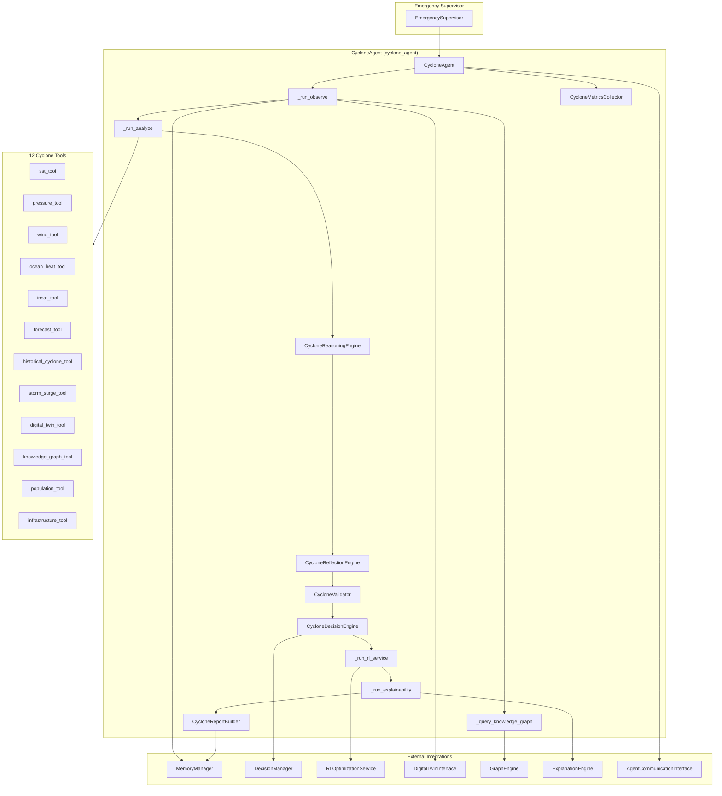

**Design distinction:** CycloneAgent extends the HeatwaveAgent pattern with explicit **CKG queries during Observe** and **Explainability as a first-class pipeline phase** before report generation. Tool execution is batched (10 + 2) to respect `MAX_TOOL_CALLS_PER_INVOCATION`.

---

## Folder Structure

```
backend/agents/specialized/cyclone/
├── __init__.py                  # Public exports
├── cyclone_agent.py             # CycloneAgent — main orchestrator
├── cyclone_context.py           # CycloneInputs, signals, domain models
├── cyclone_metrics.py           # CycloneMetricsCollector, CycloneExecutionMetrics
├── cyclone_models.py            # Enums, action types, agent IDs, IMD wind thresholds
├── cyclone_reasoning.py         # 11-stage reasoning + CycloneDecisionEngine
├── cyclone_reflection.py        # Self-evaluation and inter-agent delegation
├── cyclone_report.py            # CycloneReport, CycloneReportBuilder
├── cyclone_tools.py             # 12 AbstractTool implementations
└── cyclone_validator.py         # Domain-specific validation rules

backend/tests/specialized/cyclone/
├── conftest.py                  # Fixtures: Fani, Amphan, Biparjoy, Michaung, genesis, RI
├── test_cyclone_unit.py         # 13 unit tests
└── test_cyclone_integration.py  # 11 integration tests
```

---

## Class Diagram

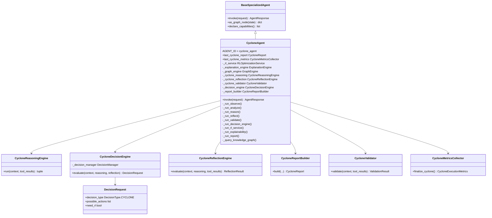

---

## Workflow

The CycloneAgent implements an internal LangGraph-style pipeline:

**Observe → Analyze → Reason → Reflect → Validate → Decision Framework → RL Service → Explainability → Report**

| Phase | Method | Description |
|-------|--------|-------------|
| 1. Observe | `_run_observe` | Parse `CycloneInputs`, hydrate climate state, forecast, digital twin, CKG insights |
| 2. Analyze | `_run_analyze` | Execute all 12 cyclone tools in two parallel batches (10 + 2) |
| 3. Reason | `_run_reason` | 11-stage tropical cyclone reasoning pipeline |
| 4. Reflect | `_run_reflect` | Confidence check, RL/simulation/delegation signals |
| 5. Validate | `_run_validate` | SST, pressure, wind, forecast, climate state checks |
| 6. Decide | `_run_decision_engine` | Build unified `DecisionRequest` via `CycloneDecisionEngine` |
| 7. Delegate | `call_other_agents` | Invoke peer agents when `decision.need_other_agents` |
| 8. RL Optimize | `_run_rl_service` | Call `RLOptimizationService.optimize()` when `need_rl` |
| 9. Explain | `_run_explainability` | Generate full-pipeline explanation via `ExplanationEngine` |
| 10. Report | `_run_report` | Assemble `CycloneReport` with decision + RL + XAI artifacts |

### Reference Scenarios

| Scenario | Region / Event | Test Fixture | Key Signals |
|----------|----------------|--------------|-------------|
| Odisha Fani | Bay of Bengal landfall | `build_fani_context()` | Extreme severity, high landfall probability, evacuation |
| Gujarat Tauktae | Arabian Sea landfall | `build_biparjoy_context()` (analog) | Arabian Sea basin, Gujarat coast, storm surge |
| Chennai coastal | Tamil Nadu rainfall impact | `build_michaung_context()` | Heavy rainfall, flood delegation |
| Bengal landfall | West Bengal / Kolkata corridor | `build_amphan_context()` | Super cyclonic intensity, extreme storm surge |

Additional fixtures: `build_genesis_context()` (cyclogenesis monitoring), `build_rapid_intensification_context()` (RI detection).

---

## Execution Pipeline

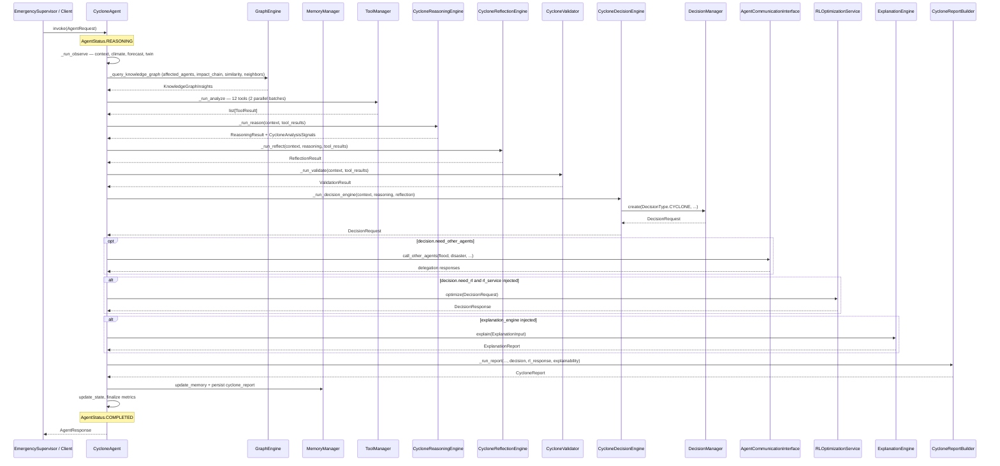

---

## LangGraph Integration

`CycloneAgent.as_graph_node()` extends the base implementation:

1. Calls `super().as_graph_node(state)` to run `invoke()` and merge standard workflow updates.
2. Enriches `update["metadata"]` with cyclone-specific fields when `last_cyclone_report` is set:

| Metadata Key | Source |
|--------------|--------|
| `cyclone_risk_level` | `report.risk_level.value` |
| `cyclone_severity` | `report.severity.value` |
| `cyclone_category` | `report.category.value` |

The node is registerable under `EmergencySupervisor` and composable into emergency domain graphs without modifying upstream graph topology.

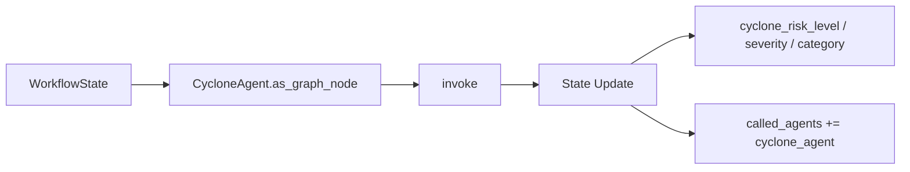

---

## Decision Framework Integration

CycloneAgent uses the unified decision layer via `CycloneDecisionEngine` in `cyclone_reasoning.py`.

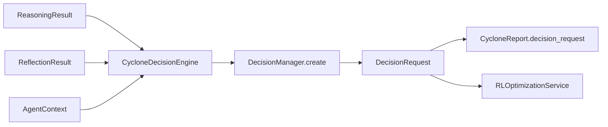

### DecisionRequest Construction

| Field | Source |
|-------|--------|
| `decision_type` | `DecisionType.CYCLONE` |
| `agent_id` | `"cyclone_agent"` |
| `objectives` | Minimize casualties, protect coastal population, maintain critical infra, optimize evacuation |
| `possible_actions` | Mapped from `CycloneActionType` catalog (8 action types) |
| `constraints` | Budget (100–300), time (landfall horizon), population (2M cap), safety |
| `risk` | `RiskAssessment` from composite score and severity |
| `priority` | CRITICAL (extreme) → LOW (none) |
| `need_rl` | Reflection flag OR severe/extreme + composite ≥ 0.65 |
| `need_simulation` | From reflection (high severity or storm surge) |
| `need_other_agents` | flood, water_resource, disaster_response, urban_planning, air_quality |
| `need_human` | Extreme severity |
| `context` | `DecisionContext` with basin, cyclone name, landfall horizon |

### CycloneActionType Catalog

| Action | Description | Typical Trigger |
|--------|-------------|-----------------|
| `COASTAL_WARNING` | Issue coastal cyclone warning | All active scenarios |
| `DISASTER_READINESS` | Activate disaster readiness protocol | Moderate+ severity |
| `SCHOOL_CLOSURE` | Close schools in landfall corridor | Moderate+ severity |
| `TRANSPORT_SUSPENSION` | Suspend coastal rail and ferry | High+ severity |
| `POWER_GRID_PROTECTION` | Protect coastal power grid | High+ severity |
| `EMERGENCY_RESOURCE_ALLOCATION` | Deploy emergency relief resources | High+ severity |
| `RESERVOIR_PREPARATION` | Prepare reservoirs for cyclone inflow | Heavy rainfall signal |
| `EVACUATION` | Execute phased coastal evacuation | High storm surge or severe/extreme |

---

## RL Integration

CycloneAgent uses **`RLOptimizationService.optimize()` directly** when `decision.need_rl` is true.

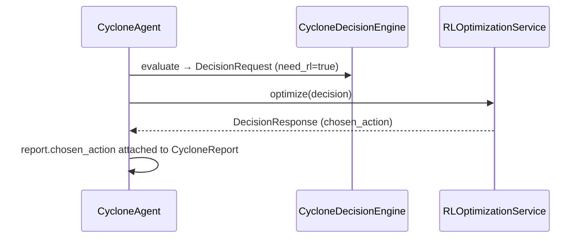

### RL Invocation Logic (`_run_rl_service`)

```python
if not decision.need_rl or not self._rl_service:
    return None
try:
    return await self._rl_service.optimize(decision)
except RLOptimizationError:
    return None  # non-blocking; report still generated
```

### RL Recommendation Criteria

Reflection and decision engine set `need_rl = true` when:

- Severity is `SEVERE` or `EXTREME`, **and**
- `composite_score >= 0.65`

---

## Explainability Integration

CycloneAgent is among the first specialized agents to invoke `ExplanationEngine.explain()` as a dedicated pipeline phase.

| Artifact | XAI Consumption |
|----------|-----------------|
| `ReasoningResult.steps` | 11-stage cyclone analysis trace |
| `reasoning.trace` on report | Human-readable reasoning chain in `CycloneReport` |
| `decision_request.rationale` | Decision justification strings |
| `rl_response` + `chosen_action` | RL action explanation via `ExplanationType.FULL_PIPELINE` |
| `CycloneAnalysisSignals` | Structured signal metadata for evidence linking |
| `explainability_report` | Full `ExplanationReport` attached to `CycloneReport` |
| `AgentResponse.metadata.explainability_summary` | Executive summary for API consumers |

When `explanation_engine` is not injected, the explainability phase is skipped (`None`) and metrics record zero explainability calls.

---

## Climate Knowledge Graph Integration

Unlike HeatwaveAgent (indirect CKG access), CycloneAgent performs **explicit GraphEngine queries** during `_run_observe`:

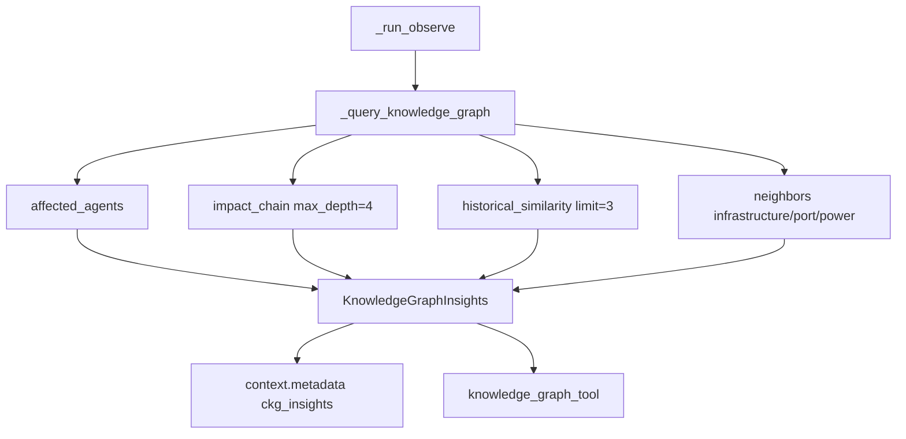

| Query | Output Field | Purpose |
|-------|--------------|---------|
| `affected_agents` | `dependent_agents` | Identify downstream agent dependencies |
| `impact_chain` | `cascade_chains`, `affected_regions` | Cascade hazard propagation |
| `historical_similarity` | `historical_analogs` | Prior cyclone event analogs |
| `neighbors` | `affected_infrastructure` | Ports, power plants, infrastructure nodes |

CKG query count is tracked via `CycloneMetricsCollector.record_ckg_query()`. Individual query failures are logged at DEBUG and do not fail the invocation.

---

## Memory Integration

| Operation | Domain | Key Pattern | Content |
|-----------|--------|-------------|---------|
| Context retrieval | WORKING, SESSION, VECTOR | session-scoped | Prior conversation and analyses |
| Climate state | via `retrieve_climate_state` | — | `ClimateState` measurements |
| Report persistence | WORKING | `cyclone_report:{request_id}` | Full `CycloneReport.model_dump()` |
| CKG insights | WORKING (via context) | — | Serialized `KnowledgeGraphInsights` |
| Memory references | — | — | Stored in `report.references` |

Memory writes are tracked via `CycloneMetricsCollector.record_memory_write()`. All access flows through injected `MemoryManager` — no direct Redis/Qdrant access in the agent layer.

---

## Inter-Agent Communication

CycloneAgent delegates to peer agents via `AgentCommunicationInterface` when reflection or the decision engine sets `need_other_agents`:

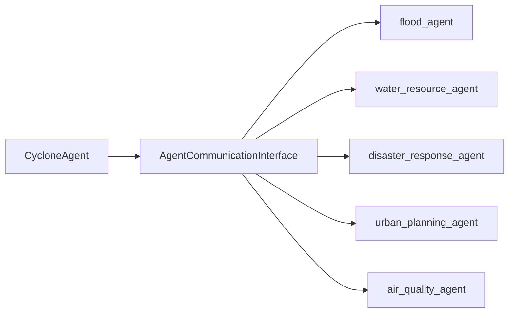

### Inter-Agent Delegation Matrix

| Condition | Suggested Agent |
|-----------|-----------------|
| Heavy rainfall or high/severe/extreme severity | `flood_agent` |
| Moderate+ severity or heavy rainfall | `water_resource_agent` |
| Severe/extreme severity | `disaster_response_agent` |
| Infrastructure at risk | `urban_planning_agent` |
| Rapid intensification likely/confirmed | `air_quality_agent` |

Delegation occurs after decision evaluation when `decision.need_other_agents` is populated and `agent_communication` is injected. Results appear in `AgentResponse.delegated_to`.

---

## Tool Architecture

CycloneAgent registers **12 tools** via `create_cyclone_tools()`. All tools extend `AbstractTool` with `get_input_schema()`, `validate_input()`, and `_execute()`.

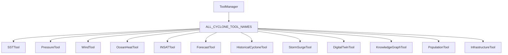

### Tool Reference

| Tool Name | Class | Category | Primary Outputs |
|-----------|-------|----------|-----------------|
| `sst_tool` | `SSTTool` | ANALYSIS | `warm_sst`, `genesis_favorable`, `sst_score` |
| `pressure_tool` | `PressureTool` | ANALYSIS | `low_pressure`, `cyclone_center_likely`, `pressure_score` |
| `wind_tool` | `WindTool` | ANALYSIS | IMD `category`, `destructive_winds`, `wind_score` |
| `ocean_heat_tool` | `OceanHeatTool` | ANALYSIS | `ri_favorable`, `ri_likely`, `ocean_heat_score` |
| `insat_tool` | `INSATTool` | ANALYSIS | `organized_convection`, `eye_detected`, `satellite_score` |
| `forecast_tool` | `ForecastTool` | FORECAST | `landfall_probability`, `landfall_threat`, track/rainfall |
| `historical_cyclone_tool` | `HistoricalCycloneTool` | RETRIEVAL | `historical_analog`, `top_analogs` |
| `storm_surge_tool` | `StormSurgeTool` | ANALYSIS | `surge_height_m`, `high_storm_surge`, `surge_score` |
| `digital_twin_tool` | `DigitalTwinTool` | SIMULATION | `cyclone_layers`, coastal defense status |
| `knowledge_graph_tool` | `KnowledgeGraphTool` | ANALYSIS | CKG insights surfaced to reasoning |
| `population_tool` | `PopulationTool` | ANALYSIS | `total_coastal_population`, `vulnerability_score` |
| `infrastructure_tool` | `InfrastructureTool` | ANALYSIS | `infrastructure_at_risk`, per-asset risk levels |

### Tool Execution Policy

- All 12 tools run on every invocation, split into two parallel batches (10 + 2) to respect framework tool-call limits.
- Tool parameters merge from `context.request.context` plus `digital_twin_state` and `ckg_insights`.
- Inputs parsed through `CycloneInputs.from_request_context()`.

---

## Reflection Process

`CycloneReflectionEngine` evaluates analysis completeness and sets delegation flags:

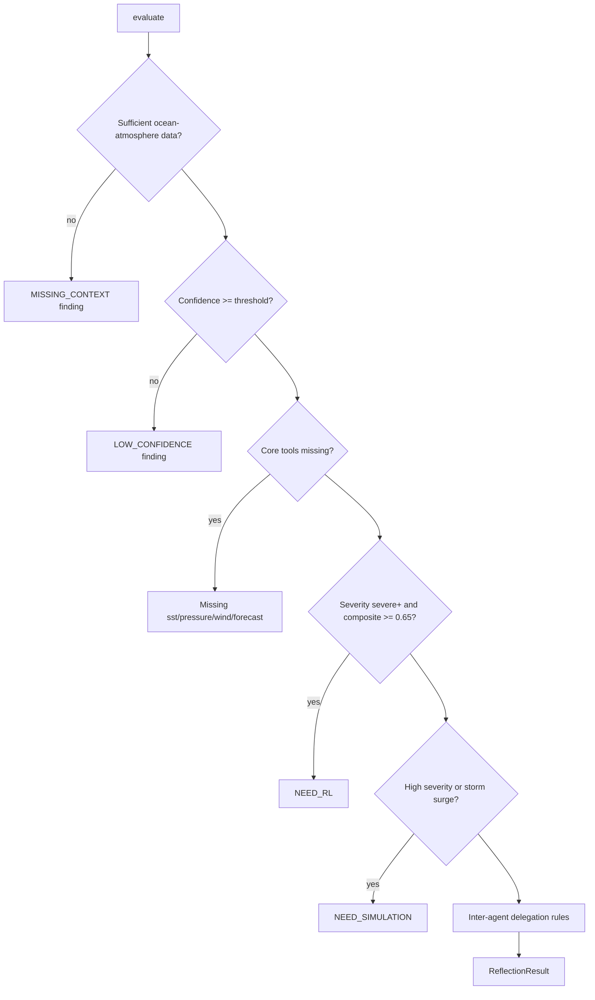

Sufficient data requires ≥ 5 successful tools and at least one ocean-atmosphere source (SST, pressure, or wind).

---

## Validation Pipeline

`CycloneValidator` extends the framework validator with cyclone-specific rules:

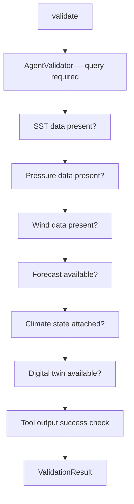

| Check | Field | Strict Severity | Default Severity |
|-------|-------|-----------------|------------------|
| SST required | `sst` | 0.9 | 0.6 |
| Pressure required | `pressure` | 0.85 | 0.55 |
| Wind required | `wind` | 0.85 | 0.5 |
| Forecast consistency | `forecast` | 0.7 | 0.4 |
| Climate state | `climate_state` | 0.75 | 0.45 |
| Digital twin | `digital_twin` | 0.6 | 0.3 |
| Failed tools | per tool | — | 0.65 |

When `validation.valid` is false, report confidence is capped at `0.5`.

---

## Metrics

`CycloneMetricsCollector` extends `AgentMetricsCollector` with cyclone-specific dimensions.

### CycloneExecutionMetrics

| Metric | Description |
|--------|-------------|
| `reasoning_time_ms` | Total reasoning pipeline duration |
| `tool_usage_count` | Number of tools executed |
| `tools_used` | Deduplicated list of tool names |
| `memory_reads` / `memory_writes` | Memory operation counts |
| `confidence` | Final report confidence |
| `cyclone_severity` | `CycloneSeverity` enum |
| `cyclone_risk_level` | `CycloneRiskLevel` enum |
| `decision_requests` | Count of decision framework calls (always ≥ 1) |
| `rl_calls` | Count of successful RL service invocations |
| `knowledge_graph_queries` | CKG queries during observe |
| `explainability_calls` | ExplanationEngine invocations |
| `total_duration_ms` | End-to-end invocation time |

Accessible via `agent.last_cyclone_metrics.finalize_cyclone()` after invocation.

---

## Public APIs

### `CycloneAgent`

| Method / Property | Description |
|-------------------|-------------|
| `create(memory, *, rl_service, explanation_engine, graph_engine, ...)` | Async factory; calls `initialize()` |
| `invoke(request: AgentRequest)` | Full cyclone analysis pipeline |
| `declare_capabilities()` | Returns 12 `AgentCapability` entries |
| `as_graph_node(state: WorkflowState)` | LangGraph node; adds cyclone metadata to state |
| `required_inputs()` | Returns `["query"]` |
| `last_cyclone_report` | Most recent `CycloneReport` after invocation |
| `last_cyclone_metrics` | Most recent `CycloneMetricsCollector` |
| `AGENT_ID` / `agent_id` | Constant `"cyclone_agent"` |

### Factory

```python
agent = await CycloneAgent.create(
    memory_manager,
    rl_service=rl_optimization_service,
    explanation_engine=explanation_engine,
    graph_engine=graph_engine,
    agent_communication=comm_interface,
    digital_twin=twin_interface,
)
response = await agent.invoke(request)
```

### Response Metadata

`AgentResponse.metadata` includes:

| Key | Type | Description |
|-----|------|-------------|
| `cyclone_report_id` | `str` | UUID of generated report |
| `cyclone_name` | `str` | Cyclone name if known |
| `basin` | `str` | `CycloneBasin` value |
| `risk_level` | `str` | `CycloneRiskLevel` value |
| `severity` | `str` | `CycloneSeverity` value |
| `category` | `str` | IMD `CycloneCategory` value |
| `confidence` | `float` | Overall confidence 0–1 |
| `landfall_probability` | `float` | Forecast landfall probability |
| `estimated_intensity_kt` | `float` | Estimated max sustained wind |
| `storm_surge_m` | `float` | Estimated surge height |
| `recommendations` | `list[str]` | Mitigation recommendations |
| `evidence` | `list[dict]` | Evidence trail |
| `need_rl` | `bool` | Whether RL was requested |
| `decision_request` | `dict` | Serialized `DecisionRequest` |
| `rl_response` | `dict \| null` | Serialized `DecisionResponse` |
| `explainability_summary` | `str \| null` | XAI executive summary |
| `metrics` | `dict` | `CycloneExecutionMetrics` |

### Domain Exports (`cyclone/__init__.py`)

Key public types: `CycloneAgent`, `CycloneReport`, `CycloneInputs`, `CycloneSeverity`, `CycloneRiskLevel`, `CycloneCategory`, `CycloneActionType`, `CYCLONE_AGENT_ID`.

---

## Private Methods

| Method | Purpose |
|--------|---------|
| `_run_observe` | Build `AgentContext`, parse `CycloneInputs`, retrieve memory/climate/forecast/twin, query CKG |
| `_query_knowledge_graph` | Execute GraphEngine queries; populate `KnowledgeGraphInsights` |
| `_run_analyze` | Build tool specs from `ALL_CYCLONE_TOOL_NAMES`, execute in two parallel batches |
| `_run_reason` | Delegate to `CycloneReasoningEngine.run()` |
| `_run_reflect` | Delegate to `CycloneReflectionEngine.evaluate()` |
| `_run_validate` | Delegate to `CycloneValidator.validate()` |
| `_run_decision_engine` | Delegate to `CycloneDecisionEngine.evaluate()` |
| `_run_rl_service` | Call `self._rl_service.optimize(decision)` when `need_rl`; swallow `RLOptimizationError` |
| `_run_explainability` | Build `ExplanationInput` and call `ExplanationEngine.explain()` |
| `_run_report` | Delegate to `CycloneReportBuilder.build()` |
| `_build_tool_specs` | Create `ToolCallSpec` for each registered cyclone tool |
| `_on_select_tools` | Hook override; returns same specs as `_build_tool_specs` |
| `_persist_cyclone_report` | Store report JSON in `MemoryDomain.WORKING` |
| `_to_agent_report` | Convert `CycloneReport` → framework `AgentReport` |
| `_cyclone_report_to_response` | Convert report + metrics → `AgentResponse` |
| `_hydrate_digital_twin` | Inherited; loads twin state when interface available |

---

## Configuration

| Parameter | Default | Description |
|-----------|---------|-------------|
| `confidence_threshold` | `0.45` | Reflection low-confidence gate |
| `CYCLONE_AGENT_ID` | `"cyclone_agent"` | Canonical agent identifier |
| Tool execution mode | `PARALLEL` (batched) | 10 + 2 tools per invocation |
| `requires_climate_state` | `True` (metadata flag) | Set during observe phase |
| `strict_validation` | `False` | Request context flag for strict validator mode |

### Request Context Keys

| Key | Type | Description |
|-----|------|-------------|
| `region_id` | `str` | Geographic region identifier |
| `cyclone_name` | `str` | Named cyclone (e.g., Fani, Amphan) |
| `basin` | `str` | `bay_of_bengal` or `arabian_sea` |
| `sst_c` | `float` | Sea surface temperature °C |
| `sea_level_pressure_hpa` | `float` | Mean sea level pressure |
| `wind_speed_kt` | `float` | Sustained wind speed (knots) |
| `ocean_heat_content_kj_cm2` | `float` | Ocean heat content |
| `cloud_top_temp_c` | `float` | INSAT cloud top temperature |
| `landfall_probability` | `float` | Forecast landfall probability 0–1 |
| `landfall_hours` | `float` | Hours to forecast landfall |
| `max_wind_kt_forecast` | `float` | Forecast peak intensity |
| `forecast_rainfall_24h_mm` | `float` | 24-hour rainfall forecast |
| `districts` / `coastal_states` | `list[str]` | Affected administrative areas |
| `historical_cyclones` | `list[dict]` | Prior cyclone events for analog matching |
| `track_points` | `list[dict]` | Forecast track waypoints |
| `digital_twin_state` | `dict` | Twin coastal/cyclone layers |
| `insat_available` | `bool` | INSAT imagery availability flag |
| `population_density` | `float` | People per km² |
| `critical_infrastructure` | `list[dict]` | Ports, power plants, hospitals |

---

## Error Handling

| Exception | When Raised | Behavior |
|-----------|-------------|----------|
| `AgentInvocationError` | Any unhandled pipeline exception | Status → `FAILED`, metrics finalized, error logged |
| `RLOptimizationError` | RL service failure | Logged as warning; report generated without `rl_response` |
| `ToolValidationError` | Invalid tool input (SST/pressure/wind missing) | Tool returns `success=False`; validator records issue |

The agent does **not** fail the entire invocation when RL optimization or individual CKG queries fail — mitigation falls back to decision-engine ranked actions.

---

## Logging

Logger namespace: `backend.agents.specialized.cyclone.cyclone_agent`

| Event | Level | Key Fields |
|-------|-------|------------|
| `cyclone_observe_complete` | INFO | `region_id`, `basin` |
| `cyclone_decision_evaluated` | DEBUG | `decision_id`, `need_rl` |
| `cyclone_rl_optimization_failed` | WARNING | `decision_id`, `error` |
| `cyclone_agent_failed` | ERROR | `request_id`, `error` |
| `ckg_*_skipped` | DEBUG | Individual CKG query failures |

Reasoning steps are appended to `AgentContext` via `context.add_reasoning()` and reflection notes via `context.add_reflection()`.

---

## Performance Considerations

| Phase | Typical Duration (unit tests) |
|-------|-------------------------------|
| CKG queries (4 parallel-safe) | 2–15 ms |
| Tool execution (12, 2 batches) | 8–25 ms |
| Reasoning (11 steps) | 3–10 ms |
| Decision engine | 1–3 ms |
| Explainability (when injected) | 5–20 ms |
| Report build | 1–2 ms |
| RL service (mock) | < 1 ms |

Tool execution and CKG queries dominate wall-clock time. Two-batch parallel execution avoids framework tool-call limit violations while preserving concurrency within each batch.

---

## Scalability

- **Stateless invocations:** No instance state persists between requests except cached `last_*` properties for testing/debugging.
- **Horizontal scaling:** Multiple `CycloneAgent` instances can run behind `EmergencySupervisor` with shared `MemoryManager` and `GraphEngine`.
- **Tool isolation:** Each tool is independently testable and replaceable without pipeline changes.
- **Async throughout:** All I/O-bound operations use `async/await`.
- **Graceful degradation:** Missing CKG, RL, or XAI services skip those phases without failing the invocation.

---

## Security

- No direct external API calls in the cyclone agent layer.
- Tool inputs validated via Pydantic models (`CycloneInputs`) and JSON Schema (`get_input_schema()`).
- Inter-agent calls require explicit `AgentCommunicationInterface` injection.
- Decision constraints enforce budget caps and safety risk ceilings.
- Digital twin and CKG access mediated through injected interfaces — no raw file/network access.
- CKG query failures are contained; no sensitive graph data is logged at INFO level.

---

## Testing Summary

| Test File | Count | Scope |
|-----------|-------|-------|
| `backend/tests/specialized/cyclone/test_cyclone_unit.py` | **13** | Tools, inputs, reasoning, validator, decision engine |
| `backend/tests/specialized/cyclone/test_cyclone_integration.py` | **11** | Full agent invoke, RL/XAI/CKG, supervisor, LangGraph node |
| **Total** | **24** | All passing (v0.3.0) |

### Unit Tests (`test_cyclone_unit.py`)

| Test | Validates |
|------|-----------|
| `test_cyclone_tools_count` | 12 tools registered |
| `test_sst_tool_execution` | Warm SST, genesis favorable |
| `test_wind_tool_classifies_category` | IMD category for Fani-scale winds |
| `test_storm_surge_tool_high_surge_for_major_cyclone` | Surge ≥ 2 m for Amphan |
| `test_historical_cyclone_tool_finds_analog` | Historical analog matching |
| `test_cyclone_inputs_from_context` | Context parsing into `CycloneInputs` |
| `test_cyclone_reasoning_severe_for_fani` | Severe+ severity for Fani scenario |
| `test_cyclone_reasoning_genesis_scenario` | Genesis signals in pre-cyclone scenario |
| `test_cyclone_reflection_suggests_flood_agent` | Flood agent delegation |
| `test_cyclone_decision_engine_unified_request` | `DecisionType.CYCLONE`, unified schema |
| `test_cyclone_validator_passes_fani` | Validator returns valid for Fani |
| `test_rapid_intensification_detection` | RI status possible/likely/confirmed |
| `test_cyclone_agent_initialize` | 12 capabilities, core tools registered |

### Integration Tests (`test_cyclone_integration.py`)

| Test | Validates |
|------|-----------|
| `test_cyclone_agent_invoke_fani` | End-to-end Odisha Fani landfall |
| `test_cyclone_agent_amphan` | Bengal landfall, storm surge |
| `test_cyclone_agent_biparjoy_arabian_sea` | Gujarat / Arabian Sea track |
| `test_cyclone_agent_michaung` | Chennai coastal rainfall impact |
| `test_cyclone_genesis_scenario` | Pre-cyclone monitoring |
| `test_cyclone_rapid_intensification` | RI alert pipeline |
| `test_cyclone_agent_with_rl_xai_ckg` | Full RL + XAI + CKG integration |
| `test_cyclone_agent_inter_agent_delegation` | Peer agent coordination |
| `test_cyclone_as_graph_node` | LangGraph metadata enrichment |
| `test_cyclone_emergency_supervisor_slot` | EmergencySupervisor registration |
| `test_cyclone_report_evidence_and_confidence` | Report completeness |

### Reasoning Severity Thresholds

| Composite Score / Wind | Severity |
|------------------------|----------|
| Wind ≥ 90 kt or score ≥ 0.85 | `EXTREME` |
| Wind ≥ 65 kt or score ≥ 0.70 | `SEVERE` |
| Wind ≥ 48 kt or score ≥ 0.55 | `HIGH` |
| Wind ≥ 34 kt or score ≥ 0.35 | `MODERATE` |
| Cyclone detected or genesis likely | `LOW` |
| Otherwise | `NONE` |

Composite formula: `wind×0.35 + surge×0.25 + rainfall×0.15 + vulnerability×0.15 + track×0.10`

---

## Known Limitations

| Limitation | Impact | Mitigation Path |
|------------|--------|-----------------|
| All 12 tools run every invocation | No dynamic tool selection by query | Implement capability-driven tool filtering |
| Storm surge uses simplified wind-pressure model | Not a full hydrodynamic simulation | Integrate ADCIRC/SLOSH or digital twin surge layer |
| Population estimates are heuristic | `density × 50 × districts` approximation | Integrate census / GHSL API |
| INSAT cloud-top inferred when missing | Satellite score may be approximate | Wire live INSAT-3D ingestion |
| Two-batch tool execution adds latency | Sequential batch boundary | Raise framework tool limit or selective execution |
| `ClimateVariable.RIVER_DISCHARGE` enum gap | Real `RLOptimizationService` may fail in some environments | Add enum value; update `rl_state_encoder` |
| No rate limiting on inter-agent calls | Potential cascade under load | Add circuit breaker (framework roadmap) |

---

## Future Improvements

- Implement query-aware tool selection to skip irrelevant tools on genesis-only scenarios.
- Wire live IMD/JTWC track and intensity forecast APIs into `forecast_tool`.
- Integrate hydrodynamic storm surge models via digital twin or external service.
- Add LLM-augmented narrative generation for executive summaries.
- Support multi-cyclone concurrent tracking in a single basin invocation.
- Auto-trigger disaster response agent when severity reaches EXTREME.
- Expand CKG queries for evacuation route and shelter entity resolution.

---

## Related Documents

- [Specialized Agent Framework](./specialized_framework.md)
- [Disaster Response Agent](./disaster_response_agent.md)
- [Heatwave Agent](./heatwave_agent.md)
- [Flood Agent](./flood_agent.md)
- [Agent → Decision → RL Flow](../diagrams/agent_decision_rl_flow.md)
- [RL Optimization Service](../rl/README.md)
- [Emergency Supervisor](../domain/domain_supervisors.md)
- [Decision Framework](../decision/decision_framework.md)
