# Disaster Response Agent

> **Component:** Disaster Response Agent (Prompt 14)  
> **Status:** ✅ Complete  
> **Version:** 0.3.0  
> **Last Updated:** 2026-07-09  
> **Agent ID:** `disaster_response_agent`  
> **Source:** `backend/agents/specialized/disaster_response/`

---

## Purpose

The **Disaster Response Agent** (`DisasterResponseAgent`) is a production-grade autonomous coordination agent that synthesizes outputs from specialized hazard agents into actionable multi-hazard emergency response plans. It prioritizes concurrent hazards, estimates affected population and resource requirements, plans evacuation corridors and shelter activation, coordinates medical surge capacity, and produces recovery priorities.

The agent integrates the **unified Decision Framework** (`DecisionType.DISASTER`), **RL Optimization Service**, **Explainability Framework** (`ExplanationEngine`), and **Climate Knowledge Graph** (`GraphEngine`) end-to-end. It operates under the **Emergency Supervisor** as the orchestration hub for compound disasters — coordinating peers including flood, cyclone, heatwave, air quality, water resource, agriculture, and urban planning agents.

---

## Responsibilities

| Responsibility | Owner Module |
|----------------|--------------|
| Multi-hazard assessment and prioritization | `disaster_reasoning.py`, `disaster_models.py` |
| Live hazard agent consultation | `disaster_response_agent.py` → `_collect_hazard_inputs` |
| Emergency resource and relief inventory analysis | `disaster_tools.py` (`emergency_resource_tool`, `relief_inventory_tool`) |
| Evacuation and shelter planning | `disaster_tools.py` (`shelter_tool`, `road_network_tool`) |
| Medical surge and hospital capacity | `disaster_tools.py` (`hospital_tool`) |
| Critical infrastructure protection | `disaster_tools.py` (`critical_infrastructure_tool`) |
| Population exposure aggregation | `disaster_tools.py` (`population_tool`) |
| Emergency communication planning | `disaster_tools.py` (`communication_tool`) |
| Climate Knowledge Graph enrichment | `disaster_response_agent.py` → `_query_knowledge_graph` |
| Unified decision request construction | `disaster_reasoning.py` (`DisasterDecisionEngine`) |
| RL-optimized resource allocation | `disaster_response_agent.py` → `RLOptimizationService` |
| Explainability report generation | `disaster_response_agent.py` → `ExplanationEngine` |
| Professional disaster response report | `disaster_report.py` |
| Input/output validation | `disaster_validator.py` |
| Confidence-based reflection and delegation | `disaster_reflection.py` |
| Invocation metrics and observability | `disaster_metrics.py` |
| LangGraph workflow node exposure | `disaster_response_agent.as_graph_node()` |

---

## Architecture

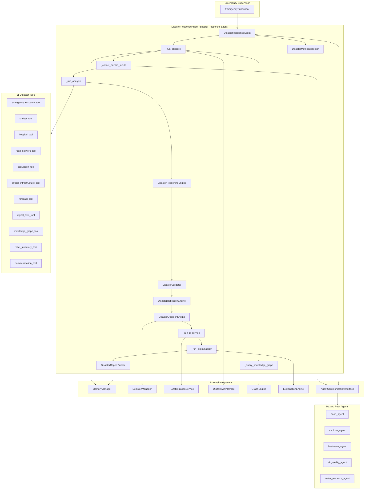

**Design distinction:** DisasterResponseAgent is a **coordination-layer agent** — it consumes structured outputs from hazard agents (`HazardAgentOutput`) rather than performing primary hazard detection. Its unique `_collect_hazard_inputs` phase can invoke peer agents live when outputs are missing.

---

## Folder Structure

```
backend/agents/specialized/disaster_response/
├── __init__.py                      # Public exports
├── disaster_response_agent.py       # DisasterResponseAgent — main orchestrator
├── disaster_context.py              # DisasterInputs, HazardAgentOutput, signals
├── disaster_metrics.py              # DisasterMetricsCollector, DisasterExecutionMetrics
├── disaster_models.py               # Enums, action types, hazard agent IDs
├── disaster_reasoning.py            # Multi-hazard reasoning + DisasterDecisionEngine
├── disaster_reflection.py           # Self-evaluation and hazard agent delegation
├── disaster_report.py               # DisasterResponseReport, DisasterReportBuilder
├── disaster_tools.py                # 11 AbstractTool implementations
└── disaster_validator.py            # Domain-specific validation rules

backend/tests/specialized/disaster_response/
├── conftest.py                      # Fixtures: compound, multi-hazard, live consult
├── test_disaster_unit.py            # 7 unit tests
└── test_disaster_integration.py     # 9 integration tests
```

---

## Class Diagram

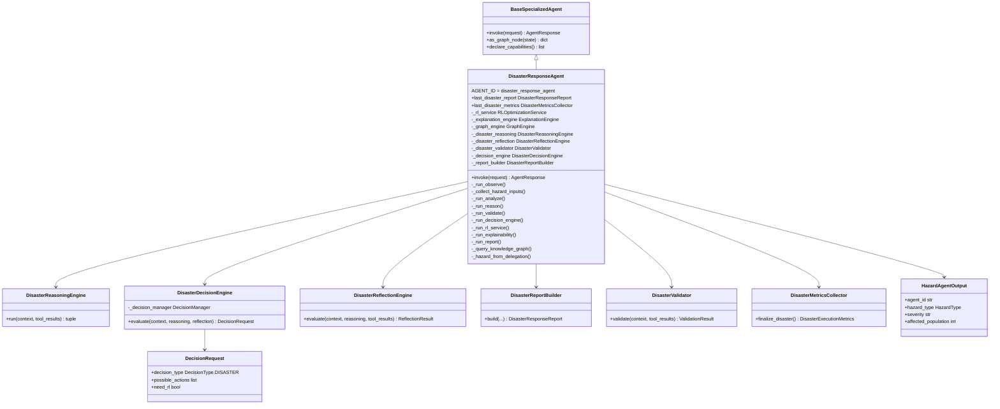

---

## Workflow

The DisasterResponseAgent implements an internal LangGraph-style pipeline:

**Observe → Collect Hazard Inputs → Analyze → Reason → Validate → Reflect → Decision Framework → RL Service → Explainability → Report**

| Phase | Method | Description |
|-------|--------|-------------|
| 1. Observe | `_run_observe` | Parse `DisasterInputs`, hydrate climate state, forecast, digital twin, CKG insights |
| 2. Collect Hazards | `_collect_hazard_inputs` | Merge pre-supplied hazard outputs or consult peer agents live |
| 3. Analyze | `_run_analyze` | Execute all 11 disaster tools in two parallel batches (10 + 1) |
| 4. Reason | `_run_reason` | Multi-hazard prioritization and response strategy pipeline |
| 5. Validate | `_run_validate` | Hazard outputs, forecast, climate state checks |
| 6. Reflect | `_disaster_reflection.evaluate` | Confidence check, missing hazard agents, RL/simulation signals |
| 7. Decide | `_run_decision_engine` | Build unified `DecisionRequest` via `DisasterDecisionEngine` |
| 8. Delegate | `call_other_agents` | Invoke additional peer agents from decision/reflection |
| 9. RL Optimize | `_run_rl_service` | Call `RLOptimizationService.optimize()` when `need_rl` |
| 10. Explain | `_run_explainability` | Generate full-pipeline explanation via `ExplanationEngine` |
| 11. Report | `_run_report` | Assemble `DisasterResponseReport` with all artifacts |

### Reference Scenarios

| Scenario | Description | Test Fixture | Key Signals |
|----------|-------------|--------------|-------------|
| Kerala floods | Single-hazard flood emergency | `build_single_flood_context()` (Chennai analog) | Flood-only, evacuation, shelter |
| Gujarat earthquake | Infrastructure-critical event | Pattern via `critical_infrastructure_tool` | Infrastructure protection, medical surge |
| Delhi heat emergency | Heatwave + water stress compound | `build_heatwave_water_stress_context()` | Cooling + water rationing coordination |
| Mumbai compound | Multi-hazard concurrent emergency | `build_multi_hazard_context()` | Flood + cyclone + heatwave, catastrophic priority |

Additional fixtures: `build_cyclone_flood_context()` (Odisha compound), `build_consult_agents_context()` (live peer consultation).

---

## Execution Pipeline

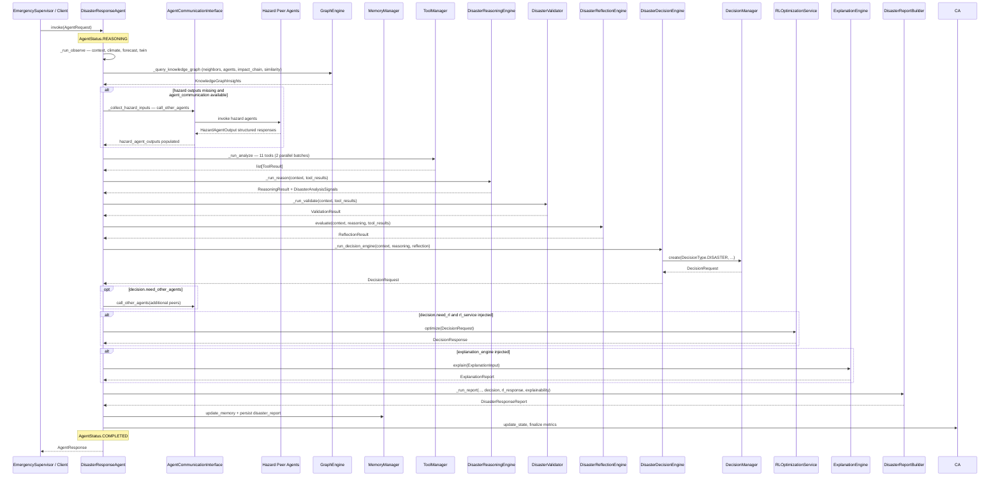

---

## LangGraph Integration

`DisasterResponseAgent.as_graph_node()` extends the base implementation:

1. Calls `super().as_graph_node(state)` to run `invoke()` and merge standard workflow updates.
2. Enriches `update["metadata"]` with disaster-specific fields when `last_disaster_report` is set:

| Metadata Key | Source |
|--------------|--------|
| `emergency_priority` | `report.emergency_priority.value` |
| `compound_disaster` | `report.metadata.compound_disaster` |
| `affected_population` | `report.affected_population` |

The node is registerable under `EmergencySupervisor` for emergency planning, evacuation, and disaster coordination tasks.

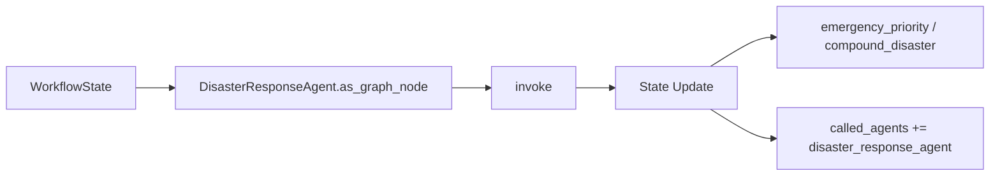

---

## Decision Framework Integration

DisasterResponseAgent uses the unified decision layer via `DisasterDecisionEngine` in `disaster_reasoning.py`.

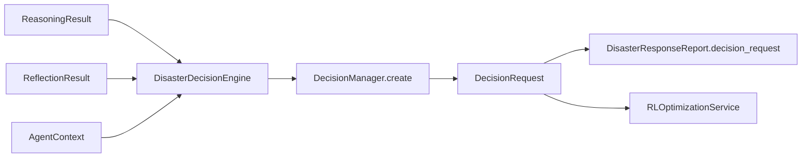

### DecisionRequest Construction

| Field | Source |
|-------|--------|
| `decision_type` | `DecisionType.DISASTER` |
| `agent_id` | `"disaster_response_agent"` |
| `objectives` | Save lives, protect vulnerable, maintain lifelines, optimize resources |
| `possible_actions` | Mapped from `DisasterActionType` catalog (8 action types) |
| `constraints` | Budget (200–500), time (72 h), population (5M cap), safety |
| `risk` | `RiskAssessment` from composite priority score and emergency level |
| `priority` | CRITICAL (catastrophic) → LOW (routine) |
| `need_rl` | Compound disaster OR resource gap OR severe/catastrophic priority |
| `need_simulation` | Compound disaster flag |
| `need_other_agents` | Missing hazard agents, infrastructure, resource gaps |
| `need_human` | Catastrophic emergency priority |
| `context` | `DecisionContext` with 72-hour planning horizon |

### DisasterActionType Catalog

| Action | Description | Typical Trigger |
|--------|-------------|-----------------|
| `EMERGENCY_COMMUNICATION` | Issue multi-channel emergency alerts | All active scenarios |
| `EMERGENCY_RESOURCE_DEPLOYMENT` | Deploy emergency relief resources | Elevated+ priority |
| `EVACUATION` | Execute phased population evacuation | Evacuation required signal |
| `MEDICAL_RESPONSE` | Deploy medical emergency teams | Medical surge required |
| `SHELTER_ACTIVATION` | Activate emergency shelters | High+ priority |
| `INFRASTRUCTURE_PROTECTION` | Protect critical infrastructure assets | High+ priority |
| `ROAD_CLOSURE` | Close vulnerable transport corridors | Infrastructure critical |
| `SEARCH_AND_RESCUE` | Launch search and rescue operations | Severe/catastrophic |

---

## RL Integration

DisasterResponseAgent uses **`RLOptimizationService.optimize()` directly** for multi-hazard resource allocation optimization.

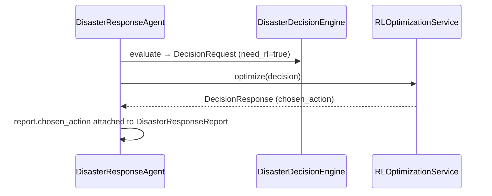

### RL Invocation Logic (`_run_rl_service`)

```python
if not decision.need_rl or not self._rl_service:
    return None
try:
    return await self._rl_service.optimize(decision)
except RLOptimizationError:
    return None  # non-blocking; report still generated
```

### RL Recommendation Criteria

Decision engine sets `need_rl = true` when any of:

- `compound_disaster` is true (≥ 2 concurrent hazards)
- `resource_gap` is true (inventory shortfall)
- Emergency priority is `SEVERE` or `CATASTROPHIC`

Reflection applies the same compound/resource/composite rules independently.

---

## Explainability Integration

| Artifact | XAI Consumption |
|----------|-----------------|
| `ReasoningResult.steps` | Multi-hazard prioritization and strategy trace |
| `reasoning.trace` on report | Human-readable coordination chain |
| `decision_request.rationale` | Emergency priority and compound disaster justification |
| `rl_response` + `chosen_action` | RL resource allocation explanation |
| `DisasterAnalysisSignals` | Compound flags, resource gap, evacuation signals |
| `priority_ranking` | Hazard priority ordering with rationale |
| `explainability_report` | Full `ExplanationReport` on `DisasterResponseReport` |
| `AgentResponse.metadata.explainability_summary` | Executive summary for API consumers |

Reports include pre-RL (`decision_request`) and post-RL (`rl_response`) payloads — enabling contrastive explanations of why a specific response action was selected across competing hazards.

---

## Climate Knowledge Graph Integration

DisasterResponseAgent performs **explicit GraphEngine queries** during `_run_observe`:

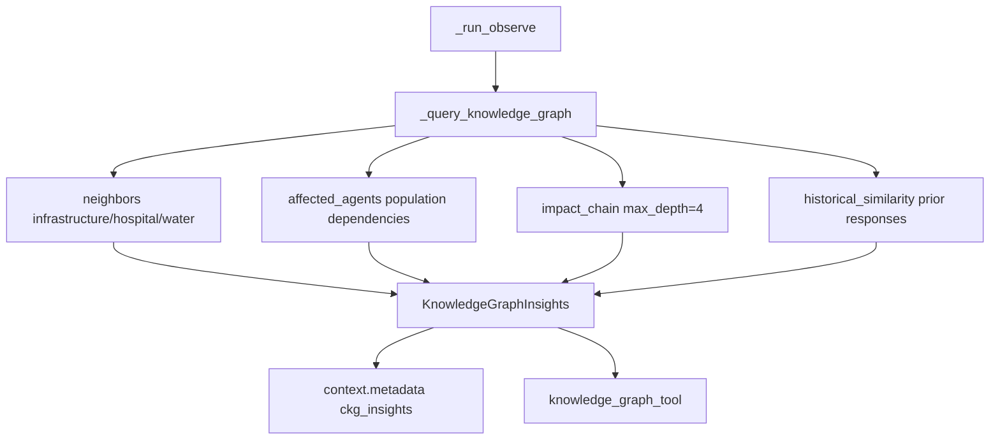

| Query | Output Field | Purpose |
|-------|--------------|---------|
| `neighbors` | `affected_infrastructure` | Hospitals, water treatment, ports, power |
| `affected_agents` | `population_dependencies` | Agent-population dependency mapping |
| `impact_chain` | `cascade_impacts` | Multi-hazard cascade propagation |
| `historical_similarity` | `historical_responses` | Prior disaster response analogs |

CKG query count tracked via `DisasterMetricsCollector.record_ckg_query()`. Query failures are non-blocking.

---

## Memory Integration

| Operation | Domain | Key Pattern | Content |
|-----------|--------|-------------|---------|
| Context retrieval | WORKING, SESSION, VECTOR | session-scoped | Prior coordination sessions |
| Climate state | via `retrieve_climate_state` | — | `ClimateState` measurements |
| Report persistence | WORKING | `disaster_report:{request_id}` | Full `DisasterResponseReport.model_dump()` |
| Hazard outputs | WORKING (via context) | — | Serialized `HazardAgentOutput` map |
| CKG insights | WORKING (via context) | — | Serialized `KnowledgeGraphInsights` |
| Memory references | — | — | Stored in `report.references` |

Memory writes tracked via `DisasterMetricsCollector.record_memory_write()`. All access flows through injected `MemoryManager`.

---

## Inter-Agent Communication

DisasterResponseAgent is the primary **inter-agent coordination hub** in the emergency domain.

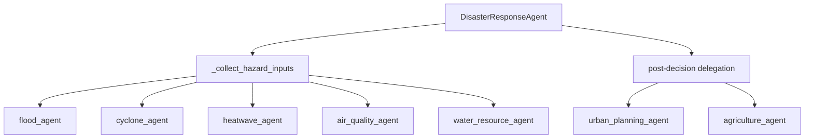

### Hazard Input Collection (`_collect_hazard_inputs`)

1. Reads pre-supplied `hazard_agent_outputs` from request context.
2. Identifies agents in `consult_agents` not yet present.
3. Invokes missing agents via `call_other_agents()` when `agent_communication` is injected.
4. Normalizes responses into `HazardAgentOutput` via `_hazard_from_delegation()`.

### Hazard Agent Mapping

| Agent ID | Hazard Type |
|----------|-------------|
| `flood_agent` | `FLOOD` |
| `cyclone_agent` | `CYCLONE` |
| `heatwave_agent` | `HEATWAVE` |
| `water_resource_agent` | `WATER_STRESS` |
| `air_quality_agent` | `AIR_QUALITY` |
| `agriculture_agent` | `AGRICULTURE` |

### Reflection Delegation Matrix

| Condition | Suggested Agent |
|-----------|-----------------|
| Missing hazard agents in consult list | Respective hazard agent |
| Flood in priority rankings | `flood_agent` |
| Heatwave in priority rankings | `heatwave_agent` |
| Infrastructure critical | `urban_planning_agent` |
| Resource gap | `water_resource_agent` |

---

## Tool Architecture

DisasterResponseAgent registers **11 tools** via `create_disaster_tools()`.

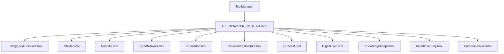

### Tool Reference

| Tool Name | Class | Category | Primary Outputs |
|-----------|-------|----------|-----------------|
| `emergency_resource_tool` | `EmergencyResourceTool` | ANALYSIS | Food, water, tents; `resource_gap` |
| `shelter_tool` | `ShelterTool` | PLANNING | Shelter capacity, `activation_required` |
| `hospital_tool` | `HospitalTool` | ANALYSIS | Bed capacity, ambulances, `medical_surge_required` |
| `road_network_tool` | `RoadNetworkTool` | ANALYSIS | Evacuation corridors, recommended closures |
| `population_tool` | `PopulationTool` | ANALYSIS | `total_affected_population`, vulnerable count |
| `critical_infrastructure_tool` | `CriticalInfrastructureTool` | ANALYSIS | Infrastructure assets, `protection_required` |
| `forecast_tool` | `ForecastTool` | FORECAST | Multi-hazard horizon, escalating flag |
| `digital_twin_tool` | `DigitalTwinTool` | SIMULATION | Emergency/disaster twin layers |
| `knowledge_graph_tool` | `KnowledgeGraphTool` | ANALYSIS | CKG coordination insights |
| `relief_inventory_tool` | `ReliefInventoryTool` | ANALYSIS | Inventory vs. need, `inventory_shortfall` |
| `communication_tool` | `CommunicationTool` | PLANNING | Alert channels, priority level |

### Tool Execution Policy

- All 11 tools run on every invocation (10 + 1 batch split).
- Tools consume aggregated `hazard_agent_outputs` for population and resource calculations.
- Parameters merge from `context.request.context` plus `digital_twin_state` and `ckg_insights`.

---

## Reflection Process

`DisasterReflectionEngine` evaluates coordination completeness:

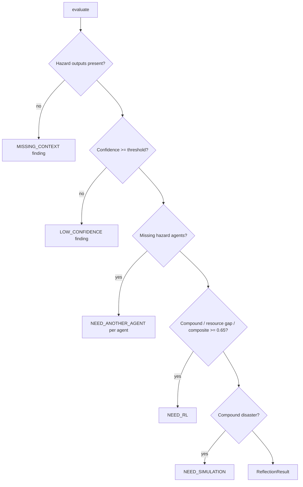

---

## Validation Pipeline

`DisasterValidator` extends the framework validator with disaster-specific rules:

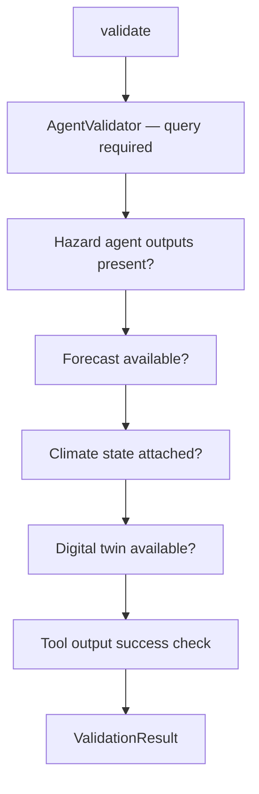

| Check | Field | Strict Severity | Default Severity |
|-------|-------|-----------------|------------------|
| Hazard outputs | `hazard_agent_outputs` | 0.85 | 0.55 |
| Incomplete hazard data | per agent | — | 0.6 |
| Forecast consistency | `forecast` | 0.65 | 0.35 |
| Climate state | `climate_state` | 0.7 | 0.4 |
| Digital twin | `digital_twin` | 0.55 | 0.3 |
| Failed tools | per tool | — | 0.6 |

When `validation.valid` is false, report confidence is capped at `0.5`.

---

## Metrics

`DisasterMetricsCollector` extends `AgentMetricsCollector` with disaster-specific dimensions.

### DisasterExecutionMetrics

| Metric | Description |
|--------|-------------|
| `reasoning_time_ms` | Total reasoning pipeline duration |
| `tool_usage_count` | Number of tools executed |
| `tools_used` | Deduplicated list of tool names |
| `memory_reads` / `memory_writes` | Memory operation counts |
| `confidence` | Final report confidence |
| `emergency_priority` | `EmergencyPriority` enum |
| `emergency_priority_score` | Composite hazard priority score |
| `hazard_agents_consulted` | Count of hazard agents with outputs |
| `decision_requests` | Count of decision framework calls |
| `rl_calls` | Count of successful RL service invocations |
| `knowledge_graph_queries` | CKG queries during observe |
| `explainability_calls` | ExplanationEngine invocations |
| `total_duration_ms` | End-to-end invocation time |

Accessible via `agent.last_disaster_metrics.finalize_disaster()` after invocation.

---

## Public APIs

### `DisasterResponseAgent`

| Method / Property | Description |
|-------------------|-------------|
| `create(memory, *, rl_service, explanation_engine, graph_engine, ...)` | Async factory; calls `initialize()` |
| `invoke(request: AgentRequest)` | Full disaster coordination pipeline |
| `declare_capabilities()` | Returns 11 `AgentCapability` entries |
| `as_graph_node(state: WorkflowState)` | LangGraph node; adds disaster metadata to state |
| `required_inputs()` | Returns `["query"]` |
| `last_disaster_report` | Most recent `DisasterResponseReport` |
| `last_disaster_metrics` | Most recent `DisasterMetricsCollector` |
| `AGENT_ID` / `agent_id` | Constant `"disaster_response_agent"` |

### Factory

```python
agent = await DisasterResponseAgent.create(
    memory_manager,
    rl_service=rl_optimization_service,
    explanation_engine=explanation_engine,
    graph_engine=graph_engine,
    agent_communication=comm_interface,
    digital_twin=twin_interface,
)
response = await agent.invoke(request)
```

### Response Metadata

| Key | Type | Description |
|-----|------|-------------|
| `disaster_report_id` | `str` | UUID of generated report |
| `emergency_priority` | `str` | `EmergencyPriority` value |
| `confidence` | `float` | Overall confidence 0–1 |
| `affected_population` | `int` | Total affected population |
| `compound_disaster` | `bool` | Multi-hazard compound flag |
| `priority_ranking` | `list[dict]` | Hazard priority ordering |
| `recommendations` | `list[str]` | Response recommendations |
| `evidence` | `list[dict]` | Evidence trail |
| `need_rl` | `bool` | Whether RL was requested |
| `chosen_action` | `str \| null` | RL-selected action description |
| `decision_request` | `dict` | Serialized `DecisionRequest` |
| `rl_response` | `dict \| null` | Serialized `DecisionResponse` |
| `explainability_summary` | `str \| null` | XAI executive summary |
| `metrics` | `dict` | `DisasterExecutionMetrics` |

### Domain Exports (`disaster_response/__init__.py`)

Key public types: `DisasterResponseAgent`, `DisasterResponseReport`, `DisasterInputs`, `HazardAgentOutput`, `EmergencyPriority`, `HazardType`, `DisasterActionType`, `DISASTER_RESPONSE_AGENT_ID`, `ALL_HAZARD_AGENTS`.

---

## Private Methods

| Method | Purpose |
|--------|---------|
| `_run_observe` | Build `AgentContext`, parse `DisasterInputs`, retrieve memory/climate/forecast/twin, query CKG |
| `_collect_hazard_inputs` | Merge or fetch hazard agent outputs via `call_other_agents` |
| `_hazard_from_delegation` | Normalize peer agent response → `HazardAgentOutput` |
| `_query_knowledge_graph` | Execute GraphEngine queries; populate `KnowledgeGraphInsights` |
| `_run_analyze` | Build tool specs from `ALL_DISASTER_TOOL_NAMES`, execute in two batches |
| `_run_reason` | Delegate to `DisasterReasoningEngine.run()` |
| `_run_validate` | Delegate to `DisasterValidator.validate()` |
| `_run_decision_engine` | Delegate to `DisasterDecisionEngine.evaluate()` |
| `_run_rl_service` | Call `self._rl_service.optimize(decision)` when `need_rl` |
| `_run_explainability` | Build `ExplanationInput` and call `ExplanationEngine.explain()` |
| `_run_report` | Delegate to `DisasterReportBuilder.build()` |
| `_build_tool_specs` | Create `ToolCallSpec` for each registered disaster tool |
| `_on_select_tools` | Hook override; returns same specs as `_build_tool_specs` |
| `_persist_disaster_report` | Store report JSON in `MemoryDomain.WORKING` |
| `_to_agent_report` | Convert `DisasterResponseReport` → framework `AgentReport` |
| `_disaster_report_to_response` | Convert report + metrics → `AgentResponse` |

---

## Configuration

| Parameter | Default | Description |
|-----------|---------|-------------|
| `confidence_threshold` | `0.45` | Reflection low-confidence gate |
| `DISASTER_RESPONSE_AGENT_ID` | `"disaster_response_agent"` | Canonical agent identifier |
| Tool execution mode | `PARALLEL` (batched) | 10 + 1 tools per invocation |
| `requires_climate_state` | `True` (metadata flag) | Set during observe phase |
| `strict_validation` | `False` | Request context flag for strict validator mode |
| Default planning horizon | `72` hours | Forecast and decision time constraint |

### Request Context Keys

| Key | Type | Description |
|-----|------|-------------|
| `region_id` | `str` | Geographic region identifier |
| `districts` | `list[str]` | Affected administrative districts |
| `hazard_agent_outputs` | `dict[str, dict]` | Pre-supplied hazard agent structured outputs |
| `consult_agents` | `list[str]` | Agent IDs to consult live if outputs missing |
| `population_density` | `float` | People per km² |
| `relief_inventory` | `dict` | Available food, water, medical kits, vehicles |
| `evacuation_corridors` | `list[str]` | Named evacuation routes |
| `hospitals` | `list[dict]` | Hospital bed capacity data |
| `critical_infrastructure` | `list[dict]` | Power, water, transport, healthcare assets |
| `digital_twin_state` | `dict` | Emergency/disaster twin layers |
| `forecast_horizon_hours` | `float` | Multi-hazard planning horizon |
| `forecast_available` | `bool` | Forecast availability flag |

---

## Error Handling

| Exception | When Raised | Behavior |
|-----------|-------------|----------|
| `AgentInvocationError` | Any unhandled pipeline exception | Status → `FAILED`, metrics finalized, error logged |
| `RLOptimizationError` | RL service failure | Logged as warning; report generated without `rl_response` |
| Tool failures | Individual tool errors | Tool returns `success=False`; validator records issue |
| Hazard agent delegation failure | Peer agent unavailable | Skipped; coordination proceeds with available outputs |
| CKG query failure | GraphEngine error | Logged at DEBUG; empty insights returned |

The agent does **not** fail when RL optimization, CKG queries, or individual hazard consultations fail — response planning falls back to available hazard data and decision-engine ranked actions.

---

## Logging

Logger namespace: `backend.agents.specialized.disaster_response.disaster_response_agent`

| Event | Level | Key Fields |
|-------|-------|------------|
| `disaster_observe_complete` | INFO | `region_id`, `hazard_count` |
| `disaster_decision_evaluated` | DEBUG | `decision_id`, `need_rl` |
| `disaster_rl_optimization_failed` | WARNING | `decision_id`, `error` |
| `disaster_response_agent_failed` | ERROR | `request_id`, `error` |
| `ckg_*_skipped` | DEBUG | Individual CKG query failures |

Reasoning and reflection notes appended to `AgentContext` via `add_reasoning()` and `add_reflection()`.

---

## Performance Considerations

| Phase | Typical Duration (unit tests) |
|-------|-------------------------------|
| Hazard agent consultation (live) | 10–50 ms per agent |
| CKG queries | 2–15 ms |
| Tool execution (11, 2 batches) | 6–20 ms |
| Reasoning (8 steps) | 2–8 ms |
| Decision engine | 1–3 ms |
| Explainability (when injected) | 5–20 ms |
| Report build | 1–3 ms |
| RL service (mock) | < 1 ms |

Live hazard agent consultation dominates wall-clock time when `consult_agents` is populated without pre-supplied outputs. Pre-supplying `hazard_agent_outputs` avoids peer round-trips.

---

## Scalability

- **Stateless invocations:** No instance state persists between requests except cached `last_*` properties.
- **Horizontal scaling:** Multiple instances behind `EmergencySupervisor` with shared `MemoryManager`.
- **Hazard input flexibility:** Supports both pre-computed hazard outputs (batch) and live consultation (real-time).
- **Tool isolation:** Each tool independently testable and replaceable.
- **Async throughout:** All I/O-bound operations use `async/await`.
- **Graceful degradation:** Missing CKG, RL, XAI, or hazard agents do not fail the invocation.

---

## Security

- No direct external API calls in the disaster response agent layer.
- Tool inputs validated via Pydantic models (`DisasterInputs`, `HazardAgentOutput`).
- Inter-agent calls require explicit `AgentCommunicationInterface` injection.
- Decision constraints enforce budget caps (up to 500 for catastrophic) and safety ceilings.
- Hazard agent responses normalized through `_hazard_from_delegation()` — no arbitrary code execution.
- Digital twin and CKG access mediated through injected interfaces.

---

## Testing Summary

| Test File | Count | Scope |
|-----------|-------|-------|
| `backend/tests/specialized/disaster_response/test_disaster_unit.py` | **7** | Tools, inputs, reasoning, decision engine |
| `backend/tests/specialized/disaster_response/test_disaster_integration.py` | **9** | Full agent invoke, RL/XAI/CKG, live consult, supervisor |
| **Total** | **16** | All passing (v0.3.0) |

### Unit Tests (`test_disaster_unit.py`)

| Test | Validates |
|------|-----------|
| `test_disaster_tools_registered` | 11 tools match `ALL_DISASTER_TOOL_NAMES` |
| `test_emergency_resource_tool` | Resource gap detection for compound hazard |
| `test_population_tool_compound` | Population ≥ 750K for multi-hazard |
| `test_disaster_inputs_from_context` | Context parsing into `DisasterInputs` |
| `test_disaster_reasoning_prioritizes_cyclone` | Cyclone ranked above flood in compound |
| `test_disaster_decision_engine_compound` | `DecisionType.DISASTER`, need_rl, emergency priority |
| `test_shelter_tool_activation` | Shelter activation for compound scenario |

### Integration Tests (`test_disaster_integration.py`)

| Test | Validates |
|------|-----------|
| `test_disaster_agent_cyclone_flood_compound` | Odisha cyclone + flood compound response |
| `test_disaster_agent_heatwave_water_stress` | Delhi heat + water stress analog |
| `test_disaster_agent_multi_hazard_emergency` | Mumbai-style 3-hazard emergency plan |
| `test_disaster_agent_with_rl_xai_ckg` | Full RL + XAI + CKG integration |
| `test_disaster_agent_live_hazard_consultation` | Live peer agent consultation |
| `test_disaster_agent_single_hazard` | Kerala/Chennai flood-only response |
| `test_disaster_as_graph_node` | LangGraph metadata enrichment |
| `test_disaster_emergency_supervisor_slot` | EmergencySupervisor registration |
| `test_disaster_report_sections` | Report completeness (medical, recovery, evidence) |

### Emergency Priority Thresholds

| Composite Priority Score | Emergency Priority |
|--------------------------|-------------------|
| Compound + score ≥ 0.6 | `CATASTROPHIC` |
| Score ≥ 0.8 | `SEVERE` |
| Score ≥ 0.6 | `HIGH` |
| Score ≥ 0.4 | `ELEVATED` |
| Score < 0.4 | `ROUTINE` |

Per-hazard score: `SEVERITY_SCORES[severity] × hazard.confidence`

---

## Known Limitations

| Limitation | Impact | Mitigation Path |
|------------|--------|-----------------|
| Hazard outputs may be pre-supplied stubs | Live consultation optional in tests | Production wiring to real hazard agent pipeline |
| Resource estimates are heuristic | Food/water based on population ratios | Integrate NDMA/state relief inventory APIs |
| No dedicated earthquake tool | Gujarat earthquake modeled via infrastructure tool | Add seismic hazard agent and tool |
| All 11 tools run every invocation | No dynamic selection by hazard type | Capability-driven tool filtering |
| Single coordination pass | No iterative re-prioritization loop | Add feedback loop from hazard agent updates |
| `ClimateVariable.RIVER_DISCHARGE` enum gap | Real RL service may fail in some environments | Add enum value; update `rl_state_encoder` |
| No rate limiting on hazard consultations | Potential cascade under compound load | Circuit breaker on inter-agent calls |

---

## Future Improvements

- Add dedicated earthquake/seismic hazard agent integration.
- Implement iterative coordination loop with hazard agent re-consultation.
- Wire NDMA and state emergency operations center (EOC) data feeds.
- Auto-invoke cyclone and flood agents when only partial hazard context supplied.
- Integrate real-time relief logistics tracking into `relief_inventory_tool`.
- Add LLM-augmented inter-agency briefing document generation.
- Support geographic multi-region coordination in a single invocation.
- Expand CKG queries for shelter, hospital, and logistics node resolution.

---

## Related Documents

- [Specialized Agent Framework](./specialized_framework.md)
- [Cyclone Agent](./cyclone_agent.md)
- [Heatwave Agent](./heatwave_agent.md)
- [Flood Agent](./flood_agent.md)
- [Agent → Decision → RL Flow](../diagrams/agent_decision_rl_flow.md)
- [RL Optimization Service](../rl/README.md)
- [Emergency Supervisor](../domain/domain_supervisors.md)
- [Decision Framework](../decision/decision_framework.md)
