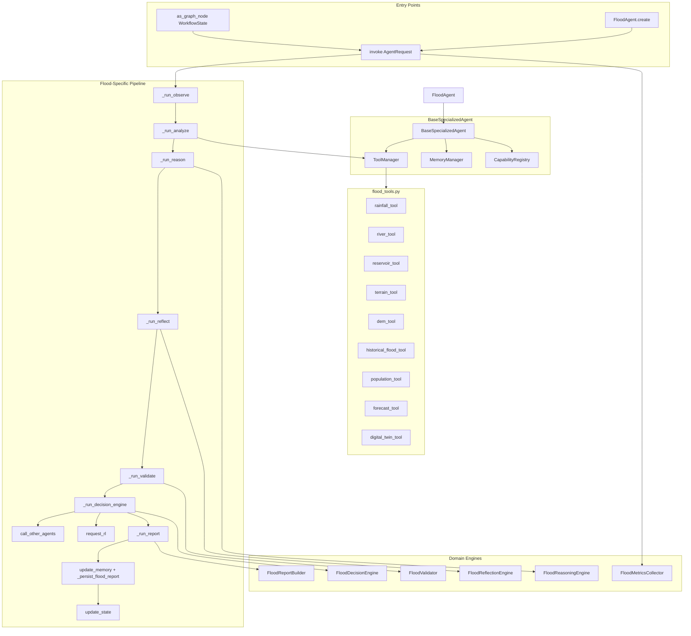
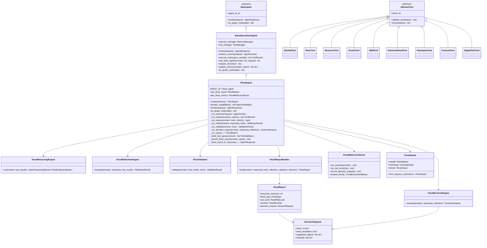
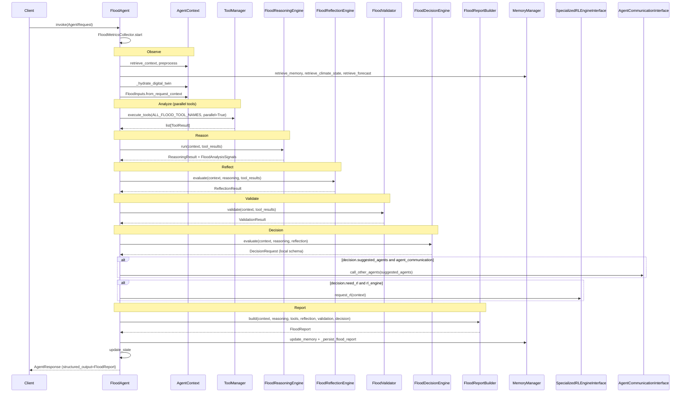
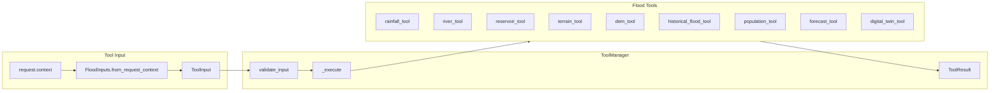
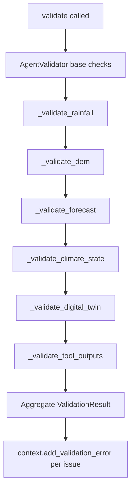

# Flood Agent

> **Component:** Specialized Climate Agent — Flood Risk Analysis  
> **Status:** ✅ Complete  
> **Version:** 0.2.0  
> **Last Updated:** 2026-07-07  
> **Source:** `backend/agents/specialized/flood/`, `backend/tests/specialized/flood/`  
> **Agent ID:** `flood_agent`  
> **Role:** Reference implementation for all specialized Hyperion climate agents

---

## Purpose

The Flood Agent (`FloodAgent`) is a production-grade, autonomous flood risk assessment agent for the Hyperion Climate Twin platform. It ingests hydrological, meteorological, terrain, population, forecast, and digital-twin inputs; executes a domain-specific tool suite in parallel; reasons over composite flood signals; self-evaluates via reflection; validates data completeness; produces structured decision requests; optionally delegates to peer agents and requests RL policies; and emits an enterprise `FloodReport` suitable for supervisors, dashboards, and audit trails.

`FloodAgent` extends `BaseSpecializedAgent` and serves as the **canonical reference implementation** for future specialized agents (water resource, heatwave, cyclone, etc.). Its workflow deliberately reorders the framework default: tools run **before** domain reasoning (Analyze → Reason), enabling evidence-backed hydrological inference rather than reasoning on empty tool outputs.

---

## Responsibilities

| Responsibility | Owner Module | Description |
|----------------|--------------|-------------|
| Flood risk assessment | `flood_agent.py` | End-to-end invocation orchestration |
| Capability declaration | `flood_agent.py` | 10 registered capabilities for supervisor routing |
| Context hydration | `flood_agent.py`, `flood_context.py` | Parse `FloodInputs`, climate state, forecast, digital twin |
| Parallel tool execution | `flood_tools.py` | 9 domain tools via `ToolManager` |
| Hydrological reasoning | `flood_reasoning.py` | 10-stage signal composition pipeline |
| Self-evaluation | `flood_reflection.py` | Confidence, data gaps, delegation signals |
| Input/output validation | `flood_validator.py` | Rainfall, DEM, forecast, climate, twin checks |
| Downstream routing | `flood_decision_engine.py` | Rule-based `DecisionRequest` (local schema) |
| Report generation | `flood_report.py` | `FloodReport` with executive summary and actions |
| Metrics | `flood_metrics.py` | `FloodExecutionMetrics` with severity/risk dimensions |
| Type definitions | `flood_models.py` | Enums, agent IDs, severity/risk bands |
| LangGraph exposure | `flood_agent.py` | `as_graph_node()` with flood metadata enrichment |
| Memory persistence | `flood_agent.py` | Working-memory flood report + framework report store |
| Inter-agent delegation | `flood_agent.py` | `call_other_agents()` when decision suggests peers |
| RL policy requests | `flood_agent.py` | `request_rl()` via `SpecializedRLEngineInterface` |

---

## Architecture

`FloodAgent` composes framework infrastructure with flood-specific engines. It **overrides** `BaseSpecializedAgent.invoke()` rather than using the framework's default ordering (reason → reflect → tools → validate).



### Workflow vs. Framework Default

| Phase | FloodAgent Order | BaseSpecializedAgent Default |
|-------|------------------|------------------------------|
| Observe | `retrieve_context` → memory → climate → forecast → twin | Same |
| Analyze (tools) | **Before reasoning** | After reasoning |
| Reason | `FloodReasoningEngine` on tool outputs | Generic `ReasoningEngine` first |
| Reflect | `FloodReflectionEngine` | Generic `ReflectionEngine` |
| Validate | `FloodValidator` | `AgentValidator` |
| Decision | `FloodDecisionEngine` → local `DecisionRequest` | Reflection-driven delegation |
| RL | After decision (`decision.need_rl`) | After reflection (`reflection.needs_rl`) |
| Report | `FloodReportBuilder` → `FloodReport` | `AgentReport` via `generate_report()` |

---

## Folder Structure

```
backend/agents/specialized/flood/
├── __init__.py                 # Public package exports
├── flood_agent.py              # FloodAgent — main orchestrator
├── flood_models.py             # FloodType, FloodSeverity, FloodRiskLevel, agent IDs
├── flood_context.py            # FloodInputs, DecisionRequest, domain models
├── flood_tools.py              # 9 AbstractTool implementations + factory
├── flood_reasoning.py          # FloodReasoningEngine — 10-stage pipeline
├── flood_reflection.py         # FloodReflectionEngine — self-evaluation
├── flood_validator.py          # FloodValidator — domain validation rules
├── flood_decision_engine.py    # FloodDecisionEngine — rule-based routing
├── flood_report.py             # FloodReport, FloodReportBuilder
└── flood_metrics.py            # FloodMetricsCollector, FloodExecutionMetrics

backend/tests/specialized/flood/
├── conftest.py                 # Fixtures: build_flood_context, flood_agent, mocks
├── test_flood_unit.py          # 12 unit tests (tools, engines, models)
└── test_flood_integration.py   # 11 integration tests (full agent, supervisor, LangGraph)
```

---

## Class Diagram



---

## Execution Flow

### Primary Invocation Pipeline



### Reasoning Sub-Pipeline (`FloodReasoningEngine`)

Stages executed in order (see `FLOOD_REASONING_STAGES`):

1. **observe** — Region, districts, climate attachment
2. **identify_heavy_rainfall** — `rainfall_tool` + `forecast_tool` scores
3. **identify_river_overflow** — `river_tool` overflow and hydrology score
4. **check_terrain** — `terrain_tool` + `dem_tool` vulnerability
5. **check_reservoirs** — `reservoir_tool` stress signals
6. **compare_historical_events** — `historical_flood_tool` analog detection
7. **estimate_flood_probability** — Weighted composite (35/30/20/15)
8. **estimate_severity** — Depth + composite thresholds
9. **estimate_uncertainty** — Missing input penalty
10. **generate_recommendations** — Actionable guidance list

Composite score formula:

```
composite = rainfall_score × 0.35
          + hydrology_score × 0.30
          + terrain_score × 0.20
          + historical_score × 0.15
```

---

## Public APIs

### `FloodAgent`

| API | Signature | Description |
|-----|-----------|-------------|
| `AGENT_ID` | `ClassVar[str]` | `"flood_agent"` |
| `__init__` | `(*, memory, rl_engine=None, agent_communication=None, digital_twin=None, confidence_threshold=0.45)` | Construct agent with dependencies |
| `create` | `classmethod async (memory, *, rl_engine=None, ...) → FloodAgent` | Factory: construct + `initialize()` |
| `declare_capabilities` | `async () → list[AgentCapability]` | Returns 10 flood capabilities |
| `invoke` | `async (request: AgentRequest) → AgentResponse` | Full flood workflow entry point |
| `as_graph_node` | `async (state: WorkflowState) → dict[str, Any]` | LangGraph node; enriches metadata with flood fields |
| `last_flood_report` | `property → FloodReport \| None` | Last generated flood report |
| `last_flood_metrics` | `property → FloodMetricsCollector \| None` | Last invocation metrics collector |
| `required_inputs` | `async () → list[str]` | `["query"]` |

### Inherited from `BaseSpecializedAgent`

| API | Usage in FloodAgent |
|-----|---------------------|
| `memory_manager` | Working memory store/retrieve |
| `tool_manager` | 9 flood tool registration and parallel execution |
| `capability_registry` | 10 capabilities at init |
| `health()` / `health_check()` | Readiness probes |
| `call_other_agents()` | Post-decision delegation |
| `request_rl()` | Post-decision RL when `decision.need_rl` |
| `retrieve_context()` | Used in `_run_observe` |
| `execute_tools()` | Used in `_run_analyze` with `parallel=True` |
| `update_memory()` | Persists `AgentReport` after flood report |
| `update_state()` | Merges workflow state partial update |

### Package Exports (`flood/__init__.py`)

`FloodAgent`, `FloodReport`, `FloodReportBuilder`, `FloodReasoningEngine`, `FloodReflectionEngine`, `FloodValidator`, `FloodDecisionEngine`, `FloodMetricsCollector`, `FloodExecutionMetrics`, `FloodInputs`, `FloodAnalysisSignals`, `DecisionRequest`, `AffectedDistrict`, `FloodProbabilityEstimate`, `create_flood_tools`, and all `flood_models` enums/constants.

### `create_flood_tools()`

```python
def create_flood_tools() -> list[AbstractTool]
```

Returns all 9 registered flood tools for injection into `FloodAgent.__init__`.

---

## Private Methods

### `FloodAgent` (internal workflow)

| Method | Visibility | Description |
|--------|-----------|-------------|
| `_run_observe` | Private | Build `AgentContext`, parse `FloodInputs`, hydrate climate/forecast/twin |
| `_run_analyze` | Private | Build tool specs, execute all tools in parallel, record metrics |
| `_run_reason` | Private | Delegate to `FloodReasoningEngine.run()` |
| `_run_reflect` | Private | Delegate to `FloodReflectionEngine.evaluate()` |
| `_run_validate` | Private | Delegate to `FloodValidator.validate()` |
| `_run_decision_engine` | Private | Delegate to `FloodDecisionEngine.evaluate()` |
| `_run_report` | Private | Delegate to `FloodReportBuilder.build()` |
| `_build_tool_specs` | Private | All `ALL_FLOOD_TOOL_NAMES` with request context parameters |
| `_on_select_tools` | Protected hook | Returns `_build_tool_specs` (framework fallback) |
| `_persist_flood_report` | Private | Store `FloodReport` in `MemoryDomain.WORKING` at `flood_report:{request_id}` |
| `_to_agent_report` | Private | Convert `FloodReport` → framework `AgentReport` |
| `_flood_report_to_response` | Private | Convert `FloodReport` → `AgentResponse` with rich metadata |

### `FloodReasoningEngine`

| Method | Description |
|--------|-------------|
| `_resolve_inputs` | Read `FloodInputs` from context metadata |
| `_index_tool_outputs` | Map `ToolResult` list to `{tool_name: output}` dict |
| `_observe` | Observation reasoning step |
| `_analyze_rainfall` | Rainfall/forecast signal extraction |
| `_analyze_river` | River overflow signal extraction |
| `_analyze_terrain` | Terrain/DEM vulnerability |
| `_analyze_reservoir` | Reservoir stress detection |
| `_analyze_historical` | Historical analog comparison |
| `_estimate_probability` | Composite score and probability band |
| `_estimate_severity` | Severity from composite + depth |
| `_estimate_uncertainty` | Missing-input uncertainty model |
| `_generate_recommendations` | Recommendation list in step metadata |

### `FloodReflectionEngine`

| Method | Description |
|--------|-------------|
| `_resolve_inputs` | FloodInputs resolution |
| `_has_sufficient_data` | Requires ≥3 successful tools + rainfall |
| `_missing_tools` | Checks for `rainfall_tool`, `terrain_tool`, `dem_tool` |

### `FloodValidator`

| Method | Description |
|--------|-------------|
| `_validate_rainfall` | Rainfall data or successful `rainfall_tool` |
| `_validate_dem` | DEM availability for depth estimation |
| `_validate_forecast` | Forecast references or rainfall forecast fields |
| `_validate_climate_state` | `context.climate_state` attachment |
| `_validate_digital_twin` | Twin state or climate twin reference |
| `_validate_tool_outputs` | Failed tool result aggregation |

### `FloodDecisionEngine`

| Method | Description |
|--------|-------------|
| `_resolve_inputs` | FloodInputs from context |
| `_risk_level` | Map composite + severity → `FloodRiskLevel` |

### `FloodReportBuilder`

| Method | Description |
|--------|-------------|
| `_classify_flood_type` | FLASH / RIVER / URBAN / COASTAL / RESERVOIR_OVERFLOW |
| `_resolve_probability` | Extract `FloodProbabilityEstimate` from reasoning |
| `_risk_from_score` | Ordinal risk level from composite |
| `_estimate_depth` | DEM + twin + river overflow depth synthesis |
| `_build_affected_districts` | Per-district depth and population |
| `_extract_recommendations` | From reasoning step metadata |
| `_build_required_actions` | `RequiredAction` list from decision + reflection |
| `_executive_summary` | Natural-language summary string |

---

## LangGraph Integration

`FloodAgent` inherits `BaseSpecializedAgent.as_graph_node()` and **extends** it to inject flood-specific metadata.

### Node Behavior

1. `as_graph_node(state: WorkflowState)` (inherited) extracts query from `conversation`, `messages`, or `metadata.query`.
2. Builds `AgentRequest` with `climate_state`, `workflow_state`, and `session_id` from state.
3. Calls `invoke(request)` — flood-specific pipeline.
4. Calls `update_state()` with `_last_report` (converted from `FloodReport`).
5. Appends assistant turn to `conversation` if present.
6. **Flood override:** merges `flood_risk_level`, `flood_severity`, `flood_type` into `update["metadata"]` from `last_flood_report`.

### State Keys Written

| Key | Content |
|-----|---------|
| `called_agents` | Includes `"flood_agent"` |
| `agent_status` | `AgentStatus.COMPLETED` |
| `tool_outputs` | Dict of tool name → output |
| `memory_references` | Working memory keys |
| `metadata.flood_risk_level` | e.g. `"high"`, `"severe"` |
| `metadata.flood_severity` | e.g. `"major"`, `"catastrophic"` |
| `metadata.flood_type` | e.g. `"river"`, `"urban"` |
| `rl_outputs` | Present if RL engine injected and called |
| `conversation` | Updated with assistant response |
| `error` | Set if `response.failed` |

### Integration Pattern

Domain supervisors (e.g. `EnvironmentalSupervisor`) register `FloodAgent` and route flood-related queries. The agent can be embedded as a standalone LangGraph node without modifying the climate supervisor graph.

---

## Memory Integration

All memory access flows through `MemoryManager` — no direct backend store access.

### Read Path (Observe Phase)

| Operation | Domain | Key / Query | Purpose |
|-----------|--------|-------------|---------|
| `search()` | Vector (default) | `query` + `session_id`, `VECTOR_SEARCH_TOP_K` | Semantic prior analyses |
| `retrieve()` | `WORKING` | `{agent_id}:latest` | Last agent report |
| `retrieve()` | `CLIMATE` | `current_state` | Hydrate `ClimateState` if not on request |
| `search()` | `VECTOR` | `document_type=forecast_summary` | Forecast payload enrichment |

Metrics: each read increments `memory_reads` on `FloodMetricsCollector`.

### Write Path (Report Phase)

| Operation | Domain | Key | Value |
|-----------|--------|-----|-------|
| `store()` (framework) | `WORKING` | `flood_agent:{request_id}` | `AgentReport.model_dump()` |
| `store()` (flood-specific) | `WORKING` | `flood_report:{request_id}` | `FloodReport.model_dump()` |
| `store()` (if conversation) | `CONVERSATION` | `turn:{request_id}` | Assistant turn content |

Metadata on flood report store: `{"agent_id": "flood_agent", "type": "flood_report"}`.

### Digital Twin Hydration

- If `twin_id` in request context and `DigitalTwinInterface` injected → `digital_twin.get_state(twin_id)`.
- Else reads `workflow_state.digital_twin_state`.
- Hydrated state passed to tools via `context.digital_twin_state` and `digital_twin_tool`.

---

## Decision Framework Integration

The Flood Agent uses a **local decision schema** defined in `flood_context.py` — **not** the unified `backend.decision.DecisionRequest` / `DecisionResponse` types used by the Heatwave agent.

### Local `DecisionRequest` Model

```python
class DecisionRequest(BaseModel):
    request_id: str
    need_rl: bool
    need_water_resource_agent: bool
    need_disaster_agent: bool
    need_cyclone_agent: bool
    need_air_quality_agent: bool
    need_urban_planning_agent: bool
    need_simulation: bool
    need_forecast_update: bool
    need_reservoir_optimization: bool
    suggested_agents: list[str]
    rationale: list[str]
    priority: str  # "normal" | "high" | "critical"
    metadata: dict[str, Any]
```

### `FloodDecisionEngine` Rules

| Flag | Trigger Conditions |
|------|-------------------|
| `need_rl` | Severity MAJOR/CATASTROPHIC, composite ≥ 0.65, uncertainty < 0.5 |
| `need_water_resource_agent` | `reservoir_stressed` signal or reservoir ≥ 80% |
| `need_disaster_agent` | Severity MAJOR or CATASTROPHIC |
| `need_cyclone_agent` | Query contains "cyclone", "storm surge", or "coastal" |
| `need_air_quality_agent` | Composite ≥ 0.5 and query contains "pollution" |
| `need_urban_planning_agent` | `urban_pluvial_risk` or urban_density > 0.5 |
| `need_simulation` | Reflection flag, severity ≥ MODERATE, or composite ≥ 0.45 |
| `need_forecast_update` | No forecast or rainfall_score ≥ 0.5 (with composite ≥ 0.3) |
| `need_reservoir_optimization` | `need_water` and composite ≥ 0.4 |

### Suggested Agent IDs

| Constant | Agent ID |
|----------|----------|
| `AGENT_WATER_RESOURCE` | `water_resource_agent` |
| `AGENT_DISASTER` | `disaster_response_agent` |
| `AGENT_CYCLONE` | `cyclone_agent` |
| `AGENT_AIR_QUALITY` | `air_quality_agent` |
| `AGENT_URBAN_PLANNING` | `urban_planning_agent` |

### Priority Mapping

| Risk Level | Priority |
|------------|----------|
| SEVERE, EXTREME | `critical` |
| HIGH | `high` |
| Other | `normal` |

The local `DecisionRequest` is embedded in `FloodReport.decision_request` and surfaced in `AgentResponse.metadata["decision_request"]`. Future migration to `backend.decision.DecisionManager.evaluate()` is planned (see Future Improvements).

---

## RL Integration

The Flood Agent requests RL policies via `BaseSpecializedAgent.request_rl()`, which calls `SpecializedRLEngineInterface.request_policy()`.

### Invocation Conditions

RL is requested when **both**:
1. `FloodDecisionEngine` sets `decision.need_rl = True`
2. `rl_engine: SpecializedRLEngineInterface` was injected at construction

Reflection can also flag `needs_rl` independently, but the agent gates the actual call on `decision.need_rl` (not `reflection.needs_rl`).

### `request_rl()` Behavior

```python
scenario_id = context.scenario.scenario_id or request.current_scenario or request_id
policy = await rl_engine.request_policy(scenario_id, context={
    "query": context.query,
    "agent_id": "flood_agent",
    "climate_state": context.climate_state.model_dump() if present,
})
context.rl_outputs.policy = policy
```

Metrics: increments `rl_calls` on base metrics collector.

### RL Trigger Thresholds

| Condition | Threshold |
|-----------|-----------|
| Severity | MAJOR or CATASTROPHIC |
| Composite score | ≥ 0.65 |
| Uncertainty | < 0.5 |

Reflection uses a slightly different RL threshold (composite ≥ 0.7) for `needs_rl` finding only.

### Interface Contract

```python
class SpecializedRLEngineInterface(ABC):
    async def request_policy(self, scenario_id: str, *, context: dict | None) -> dict
    async def evaluate_action(self, action: dict, *, context: dict | None) -> dict
```

Implementation is deferred to the RL subsystem (`backend/rl/`). Tests run without RL engine injection unless explicitly mocked.

---

## Knowledge Graph Integration

The Flood Agent does **not** directly query `backend.knowledge_graph.GraphEngine` (Climate Knowledge Graph). Graph context is available indirectly through the memory layer.

### Current Integration

| Mechanism | Status |
|-----------|--------|
| `MemoryManager.graph` (`NetworkXKnowledgeGraph`) | Available via framework; flood agent does not call `search_graph()` explicitly |
| `MemoryDomain.KNOWLEDGE_GRAPH` | Not used in flood-specific code paths |
| `WorkflowState.knowledge_graph_references` | Not populated by `FloodAgent` |
| `AgentResponse.knowledge_graph_references` | Left empty; flood report references use memory keys only |

### Indirect Graph Access

- `retrieve_memory()` performs vector search which may traverse `HybridRetriever` graph augmentation when configured on `MemoryManager`.
- Historical flood events are passed as structured `HistoricalFloodEvent` list in request context, not retrieved from CKG.

### Future Wiring

Planned: entity linking for districts, rivers, and reservoirs via CKG queries in `_run_observe` (see Future Improvements).

---

## Explainability Integration

The Flood Agent produces artifacts consumable by `backend.xai.ExplanationEngine` but does **not** auto-invoke explainability during `invoke()`.

### XAI-Ready Outputs

| Artifact | XAI Consumer | Content |
|----------|--------------|---------|
| `ReasoningResult.steps` | `explain_pipeline()` | 10+ `ReasoningStep` entries with phase, confidence, metadata |
| `ReasoningResult.trace` | `ExplanationInput.reasoning_trace` | String trace via `context.add_reasoning()` |
| `FloodReport.reasoning` | Report audit | Full reasoning string list |
| `FloodReport.metadata.signals` | Evidence engine | `FloodAnalysisSignals` composite breakdown |
| `FloodReport.decision_request.rationale` | `explain_decision()` | Human-readable decision justification |
| `FloodReport.confidence` | Confidence engine | Overall confidence (capped if validation fails) |
| `FloodReport.tool_outputs` | Evidence engine | Per-tool outputs with duration |
| `AgentResponse.metadata` | Full pipeline metadata | Risk, severity, probability, metrics, decision_request |

### Reasoning Trace Enrichment

Each `FloodReasoningEngine` step includes:
- `phase`: `ReasoningPhase` (OBSERVE, THINK, VERIFY, REFLECT, ACT)
- `confidence`: Per-step float
- `metadata.stage`: Named stage from `FLOOD_REASONING_STAGES`
- `metadata.recommendations`: On final ACT step

### Post-Hoc Explainability Pattern

```python
from backend.xai import ExplanationEngine, ExplanationInput

report = flood_agent.last_flood_report
explanation = await ExplanationEngine().explain_pipeline(ExplanationInput(
    agent_id="flood_agent",
    reasoning_trace=report.reasoning,
    structured_output=report.model_dump(),
    decision_payload=report.decision_request.model_dump(),
))
```

---

## Tool Architecture

Nine dedicated tools in `flood_tools.py`, all extending `AbstractTool`. Registered via `create_flood_tools()` at agent construction.



### Tool Catalog

| Tool Name | Class | Category | Required Inputs | Key Outputs |
|-----------|-------|----------|-----------------|-------------|
| `rainfall_tool` | `RainfallTool` | FORECAST | `rainfall_mm` or `rainfall_forecast_24h_mm` | `heavy_rainfall`, `flash_flood_risk`, `rainfall_score` |
| `river_tool` | `RiverTool` | ANALYSIS | (defaults if missing) | `overflow`, `bank_margin_m`, `hydrology_score` |
| `reservoir_tool` | `ReservoirTool` | ANALYSIS | (defaults if missing) | `stressed`, `overflow_risk`, `reservoir_score` |
| `terrain_tool` | `TerrainTool` | GEOSPATIAL | (defaults if missing) | `terrain_vulnerable`, `runoff_index`, `terrain_score` |
| `dem_tool` | `DEMTool` | GEOSPATIAL | `dem_resolution_m` or `mean_elevation_m` | `low_lying`, `estimated_depth_potential_m` |
| `historical_flood_tool` | `HistoricalFloodTool` | RETRIEVAL | `region_id` (optional) | `historical_analog`, `max_historical_depth_m` |
| `population_tool` | `PopulationTool` | ANALYSIS | `districts` (optional) | `total_population_at_risk` |
| `forecast_tool` | `ForecastTool` | FORECAST | (defaults if missing) | `worsening_trend`, `forecast_score` |
| `digital_twin_tool` | `DigitalTwinTool` | SIMULATION | `twin_id` (optional) | `inundation_depth_m`, `flood_layers` |

### Tool Selection Strategy

`FloodAgent._build_tool_specs()` executes **all** registered `ALL_FLOOD_TOOL_NAMES` on every invocation (no selective pruning). Tools with missing required inputs may fail validation (`RainfallTool`, `DEMTool`) but do not block other parallel tools.

### Execution Mode

```python
await self.execute_tools(context, tool_specs, parallel=True)
```

`ToolExecutionMode.PARALLEL` — all specs dispatched concurrently via `ToolManager`.

### Threshold Constants (Rule-Based Scoring)

| Signal | Threshold |
|--------|-------------|
| Heavy rainfall | current ≥ 50 mm OR forecast_24h ≥ 80 mm OR intensity ≥ 15 mm/hr |
| Flash flood risk | intensity ≥ 25 mm/hr OR (current ≥ 30 AND antecedent ≥ 100) |
| River overflow | level ≥ banks OR margin < 0.5 m |
| Reservoir stressed | level ≥ 85% OR spillway active |
| Reservoir overflow | level ≥ 95% OR spillway active |
| Terrain vulnerable | slope > 15° OR drainage < 0.3 OR moisture > 0.8 |
| Low lying (DEM) | mean elevation < 20 m |

---

## Validation Pipeline

`FloodValidator` extends framework `AgentValidator` with flood-specific rules.

### Pipeline Stages



### Validation Rules

| Check | Field | Strict Severity | Default Severity | Blocking (strict) |
|-------|-------|-----------------|------------------|-------------------|
| Rainfall data | `rainfall` | 0.9 | 0.6 | Yes (≥ 0.8) |
| DEM data | `dem` | 0.85 | 0.5 | Yes (≥ 0.8) |
| Forecast | `forecast` | 0.7 | 0.4 | No |
| Climate state | `climate_state` | 0.75 | 0.45 | No |
| Digital twin | `digital_twin` | 0.6 | 0.35 | No |
| Failed tools | per tool | 0.65 | 0.65 | No |

### Validity Determination

- **strict=False** (default): `valid = True` unless any issue has severity ≥ 0.9
- **strict=True**: `valid = True` only if no issue has severity ≥ 0.8

Invalid validation caps report confidence at 0.5 in `FloodReportBuilder.build()`.

---

## Reflection Pipeline

`FloodReflectionEngine` performs post-reasoning self-evaluation.

### Reflection Signals

| `ReflectionSignal` | Trigger |
|--------------------|---------|
| `MISSING_CONTEXT` | < 3 successful tools or no rainfall; missing expected tools |
| `LOW_CONFIDENCE` | `overall_confidence < confidence_threshold` (default 0.45) |
| `NEED_RL` | Severity MAJOR/CATASTROPHIC and composite ≥ 0.7 |
| `NEED_SIMULATION` | Severity ≥ MODERATE or terrain vulnerable |
| `NEED_ANOTHER_AGENT` | Reservoir stress, major severity, cyclone keywords, urban pluvial |
| `SUFFICIENT` | No issues found |

### Expected Tools Check

`_missing_tools()` flags absence of: `rainfall_tool`, `terrain_tool`, `dem_tool`.

### Delegation Suggestions

Reflection and decision engine both populate `suggested_agents`; the agent uses **decision engine** output for `call_other_agents()`.

### Retry Policy

`should_retry_reasoning = True` when `LOW_CONFIDENCE` finding present. FloodAgent does **not** currently re-run reasoning on retry flag (no automatic retry loop).

---

## Metrics

`FloodMetricsCollector` extends `AgentMetricsCollector` with flood-specific dimensions.

### `FloodExecutionMetrics` Fields

| Field | Type | Description |
|-------|------|-------------|
| `agent_id` | `str` | `"flood_agent"` |
| `request_id` | `str` | Request correlation ID |
| `reasoning_time_ms` | `float` | Sum of reasoning step durations |
| `tool_usage_count` | `int` | Number of tools executed |
| `memory_reads` | `int` | Memory read operations |
| `memory_writes` | `int` | Memory write operations (report + framework) |
| `confidence` | `float` | Final report confidence |
| `flood_severity` | `FloodSeverity` | Classified severity |
| `flood_risk_level` | `FloodRiskLevel` | Ordinal risk level |
| `decision_requests` | `int` | Decision engine invocations (always 1) |
| `tools_used` | `list[str]` | Deduplicated successful tool names |
| `total_duration_ms` | `float` | Wall-clock invocation time |

### Collection Points

| Event | Method |
|-------|--------|
| Invocation start | `FloodMetricsCollector(agent_id, request_id)` |
| Tools complete | `record_tools(count, duration_ms)`, `record_tool_name(name)` |
| Reasoning complete | `record_reasoning(duration_ms)` |
| Reflection complete | `record_reflection()` |
| Validation complete | `record_validation()` |
| Decision evaluated | `record_decision_request()` |
| Flood report finalized | `set_severity()`, `set_risk_level()`, `set_confidence()` |
| Memory write | `record_memory_write()` |
| End | `finalize_flood()` → attached to `FloodReport.metrics` and `AgentResponse.metadata["metrics"]` |

### Access

```python
await flood_agent.invoke(request)
metrics = flood_agent.last_flood_metrics.finalize_flood()
```

---

## Logging

| Logger | Module |
|--------|--------|
| `backend.agents.specialized.flood.flood_agent` | Main agent lifecycle |
| `backend.agents.specialized.flood.flood_reasoning` | Reasoning completion |
| `backend.agents.specialized.flood.flood_reflection` | Reflection completion |
| `backend.agents.specialized.flood.flood_validator` | Validation summary |
| `backend.agents.specialized.flood.flood_decision_engine` | Decision evaluation |
| `backend.agents.specialized.flood.flood_report` | Report generation |
| `specialized.flood_agent` | Framework-level errors (via `BaseSpecializedAgent`) |

### Structured Log Events

| Event | Level | Key Fields |
|-------|-------|------------|
| `flood_observe_complete` | INFO | `region_id` |
| `flood_reasoning_completed` | DEBUG | `agent_id`, `composite_score`, `severity` |
| `flood_reflection_completed` | DEBUG | `agent_id`, `needs_rl`, `suggested_agents` |
| `flood_validation_completed` | DEBUG | `agent_id`, `valid`, `issues` |
| `flood_decision_evaluated` | DEBUG | `agent_id`, `suggested_agents`, `need_rl`, `need_simulation` |
| `flood_report_generated` | INFO | `agent_id`, `risk_level`, `severity` |
| `flood_agent_failed` | ERROR | `request_id`, `error` |
| `specialized_agent_failed` | ERROR | `agent_id`, `request_id`, `error` |

---

## Error Handling

| Exception | When Raised | Recovery |
|-----------|-------------|----------|
| `AgentInvocationError` | Any unhandled exception in `invoke()` | Status → `FAILED`; metrics finalized; error re-raised with `agent_id`, `request_id` |
| `ToolValidationError` | `RainfallTool` / `DEMTool` missing required inputs | Tool returns `success=False`; validator records issue |
| `AgentInitializationError` | `invoke()` before init (handled by auto-init) | Auto `initialize()` on first invoke |

### Failure Behavior

```python
except Exception as exc:
    self._status = AgentStatus.FAILED
    metrics.finalize()
    logger.error("flood_agent_failed", ...)
    raise AgentInvocationError(...) from exc
```

Tool failures are non-fatal: individual tools can fail while the pipeline continues with degraded confidence and validation issues.

### Delegation Errors

`call_other_agents()` catches per-agent exceptions and returns `AgentDelegationResult(success=False, error=...)`.

---

## Configuration

| Parameter | Default | Location | Description |
|-----------|---------|----------|-------------|
| `confidence_threshold` | `0.45` | `FloodAgent.__init__` | Reflection low-confidence threshold |
| `FLOOD_AGENT_ID` | `"flood_agent"` | `flood_models.py` | Canonical agent identifier |
| `VECTOR_SEARCH_TOP_K` | from `utils/constants` | Framework | Memory search depth |
| `ALL_FLOOD_TOOL_NAMES` | 9 tools | `flood_tools.py` | Full tool execution list |
| Tool parallel mode | `True` | `_run_analyze` | Parallel tool execution |

### Request Context Keys

| Key | Type | Purpose |
|-----|------|---------|
| `region_id` | `str` | Geographic region |
| `latitude`, `longitude` | `float` | GeoLocation |
| `rainfall_mm` | `float` | Current rainfall |
| `rainfall_forecast_24h_mm`, `rainfall_forecast_72h_mm` | `float` | Forecast accumulation |
| `rainfall_intensity_mm_per_hr` | `float` | Intensity for flash flood |
| `antecedent_rainfall_7d_mm` | `float` | Antecedent moisture |
| `river_level_m`, `river_banks_m` | `float` | River stage |
| `reservoir_level_pct` | `float` | Reservoir fill |
| `dem_resolution_m`, `mean_elevation_m` | `float` | Terrain/DEM |
| `districts` | `list[str]` | Affected districts |
| `historical_floods` | `list[dict]` | Historical events |
| `twin_id`, `digital_twin_state` | `str`, `dict` | Digital twin |
| `forecast_available`, `climate_state_available` | `bool` | Data availability flags |
| `session_id` | `str` | Memory scoping |

---

## Performance

| Aspect | Characteristic |
|--------|----------------|
| Tool execution | Dominant cost; 9 tools run in parallel |
| Reasoning | Pure Python; typically < 5 ms |
| Memory I/O | 3–5 async operations per invocation |
| Framework overhead | ~15–50 ms excluding tools |
| Parallel speedup | Wall-clock ≈ slowest tool when I/O bound |

### Hot Path Optimizations

- Tools execute in parallel (`ToolExecutionMode.PARALLEL`)
- Reasoning indexes tool outputs once via `_index_tool_outputs`
- No LLM calls in current implementation (deterministic rules)

### Typical Test Invocation Profile

Integration tests with in-memory `MemoryManager` complete full `invoke()` in < 500 ms.

---

## Scalability

| Dimension | Approach |
|-----------|----------|
| Horizontal scaling | Agent instance is stateless between invocations; scale workers |
| Tool parallelism | Configurable; default parallel for 9 tools |
| Memory | Async `MemoryManager` throughout; session-scoped keys prevent cross-tenant leakage when `session_id` set |
| Supervisor registration | `EnvironmentalSupervisor.register_agent(flood_agent)` — one instance per worker |
| LangGraph | Node adapter reads/writes `WorkflowState`; no instance affinity required |

### Bottlenecks

- All 9 tools run every invocation (no lazy/selective execution)
- No connection pooling at agent level for external data sources (tools are currently in-process deterministic)

---

## Security

| Control | Implementation |
|---------|----------------|
| Input validation | Pydantic models on `FloodInputs`, `ToolInput`, tool `validate_input()` |
| Tool sandboxing | Tools are in-process; no arbitrary code execution |
| No direct network I/O | Tools use request context only (no external API calls in current implementation) |
| Session scoping | Memory keys include `session_id` |
| Inter-agent calls | Require explicit `AgentCommunicationInterface` injection |
| Error detail leakage | `AgentInvocationError` includes `request_id` but not full stack in response metadata |

### Data Handling

- Flood reports stored in `MemoryDomain.WORKING` with agent metadata
- No PII-specific handling; population estimates are synthetic/rule-based

---

## Known Limitations

| Limitation | Impact |
|------------|--------|
| **Local decision schema** | `DecisionRequest` in `flood_context.py` is not unified with `backend.decision`; supervisor cannot route via `DecisionManager` without adapter |
| **`invoke()` override** | FloodAgent fully overrides `BaseSpecializedAgent.invoke()` with a different phase ordering; framework default pipeline is bypassed |
| **`invoke()` signature mismatch (fixed)** | Prior versions had a method signature mismatch between `FloodAgent` and `BaseSpecializedAgent` / LangGraph adapter expectations (`AgentRequest → AgentResponse`). Fixed to align with the framework contract; custom workflow body retained |
| **No automatic reasoning retry** | `should_retry_reasoning` from reflection is ignored |
| **All tools always run** | No capability-based or query-based tool pruning; wasted work on low-risk queries |
| **Rule-based scoring only** | No ML/LLM augmentation; thresholds are static |
| **No CKG integration** | District/river entities not linked to Climate Knowledge Graph |
| **No auto-XAI** | `ExplanationEngine` not called post-report |
| **RL engine optional** | Without injection, `need_rl` decisions have no effect |
| **Synthetic population** | `population_tool` uses density heuristic, not census data |
| **9 tools, not selective** | `DEMTool` and `RainfallTool` can fail validation on sparse inputs while pipeline continues |
| **Reflection vs. decision RL gates differ** | Reflection uses composite ≥ 0.7; decision engine uses ≥ 0.65 |

---

## Future Improvements

| Improvement | Priority | Description |
|-------------|----------|-------------|
| Unified decision schema | High | Migrate `DecisionRequest` to `backend.decision.DecisionRequest` + `DecisionManager.evaluate()` |
| Unified RL service | High | Replace `SpecializedRLEngineInterface` with `RLOptimizationService.optimize()` |
| Selective tool execution | Medium | Match tools to `declare_capabilities()` query routing |
| CKG entity linking | Medium | Resolve districts, rivers, reservoirs via `GraphEngine` |
| Auto explainability | Medium | Wire `ExplanationEngine.explain_pipeline()` after report generation |
| LLM-augmented reasoning | Low | Optional LLM stage behind feature flag |
| Real data adapters | High | Connect tools to hydrological APIs, DEM services, census data |
| Reasoning retry loop | Medium | Honor `should_retry_reasoning` with bounded retries |
| Coastal flood tool | Medium | Dedicated surge/tide tool (currently keyword-only cyclone routing) |
| Strict validation mode | Low | Honor `context.metadata["strict_validation"]` from test fixtures |
| Circuit breaker for delegation | Low | Fail-fast on repeated agent communication errors |

---

## Testing Summary

| Test File | Tests | Scope | Status |
|-----------|-------|-------|--------|
| `test_flood_unit.py` | 12 | Individual tools, `FloodInputs`, reasoning, validator, decision engine | ✅ |
| `test_flood_integration.py` | 11 | Full `invoke()`, metrics, delegation, LangGraph, supervisor, report structure | ✅ |
| **Total** | **23** | | ✅ All pass |

### Unit Tests (`test_flood_unit.py`)

| Test | Component |
|------|-----------|
| `test_rainfall_tool_heavy_rain` | `RainfallTool` — heavy rainfall detection |
| `test_river_tool_overflow` | `RiverTool` — bank overflow |
| `test_reservoir_tool_stressed` | `ReservoirTool` — stress at 95% |
| `test_terrain_tool_vulnerable` | `TerrainTool` — slope/drainage vulnerability |
| `test_dem_tool_low_lying` | `DEMTool` — low elevation depth potential |
| `test_historical_flood_analog` | `HistoricalFloodTool` — rainfall analog |
| `test_flood_inputs_from_context` | `FloodInputs.from_request_context` |
| `test_flood_reasoning_pipeline` | `FloodReasoningEngine` — ≥8 steps, composite > 0.3 |
| `test_flood_validator_strict` | `FloodValidator` — issue aggregation |
| `test_decision_engine_high_risk` | `FloodDecisionEngine` — water resource routing |
| `test_rainfall_tool_validation_error` | `RainfallTool` — missing input error |
| `test_dem_tool_validation_error` | `DEMTool` — missing DEM error |

### Integration Tests (`test_flood_integration.py`)

| Test | Scenario |
|------|----------|
| `test_flood_agent_initialize` | 10 capabilities, tool registration |
| `test_flood_agent_invoke_high_risk` | Chennai high-risk scenario — severity, depth, districts |
| `test_flood_agent_metrics` | `FloodExecutionMetrics` — tools, memory writes |
| `test_flood_agent_decision_request` | Reservoir overflow — water agent, simulation flags |
| `test_flood_agent_delegation` | Catastrophic scenario — delegation path |
| `test_flood_agent_as_graph_node` | LangGraph metadata enrichment |
| `test_flood_agent_health` | Health check passes |
| `test_environmental_supervisor_with_flood_agent` | Supervisor registration and routing |
| `test_flood_low_risk_scenario` | Low rainfall — minimal/moderate risk |
| `test_flood_coastal_query_decision` | Coastal query — cyclone agent flag |
| `test_flood_report_structure` | Full report field completeness |

### Test Fixtures (`conftest.py`)

- `build_flood_context()` — Realistic Chennai flood scenario (120 mm rainfall, 92% reservoir, urban density 0.7)
- `build_climate_state()` — Precipitation + soil moisture measurements
- `MockFloodComm` — `AgentCommunicationInterface` stub
- `flood_agent` — Pre-initialized `FloodAgent` with in-memory `MemoryManager`

### Run Commands

```bash
pytest backend/tests/specialized/flood/ -v
pytest backend/tests/specialized/flood/test_flood_unit.py -v
pytest backend/tests/specialized/flood/test_flood_integration.py -v
```

---

## Capabilities Registry

`FloodAgent.declare_capabilities()` registers 10 capabilities:

| ID | Name | Category | Required Tools |
|----|------|----------|----------------|
| `flood_risk_assessment` | Flood Risk Assessment | ANALYSIS | rainfall, river, terrain |
| `flash_flood_detection` | Flash Flood Detection | MONITORING | rainfall, terrain |
| `river_flood_analysis` | River Flood Analysis | ANALYSIS | river, historical_flood |
| `urban_flood_analysis` | Urban Flood Analysis | ANALYSIS | terrain, population |
| `coastal_flood_analysis` | Coastal Flood Analysis | ANALYSIS | forecast, digital_twin |
| `reservoir_overflow` | Reservoir Overflow Assessment | ANALYSIS | reservoir |
| `rainfall_impact` | Rainfall Impact Assessment | FORECAST | rainfall, forecast |
| `flood_severity` | Flood Severity Classification | INTERPRETATION | — |
| `flood_probability` | Flood Probability | PREDICTION | — |
| `population_exposure` | Affected Population Estimation | ANALYSIS | population |

---

## Domain Type Reference

### Enumerations (`flood_models.py`)

| Enum | Values |
|------|--------|
| `FloodType` | `flash`, `river`, `urban`, `coastal`, `reservoir_overflow`, `unknown` |
| `FloodRiskLevel` | `minimal`, `low`, `moderate`, `high`, `severe`, `extreme` |
| `FloodSeverity` | `none`, `minor`, `moderate`, `major`, `catastrophic` |
| `FloodProbabilityBand` | `very_low`, `low`, `medium`, `high`, `very_high` |

---

## Related Documents

- [Specialized Agent Framework](./specialized_framework.md)
- [Agent Foundation Layer](./foundation.md)
- [Decision Framework](../decision/decision_framework.md)
- [RL Service](../rl/README.md)
- [Specialized Agent Architecture](../diagrams/specialized_agent_architecture.md)
- [Agent Decision RL Flow](../diagrams/agent_decision_rl_flow.md)
