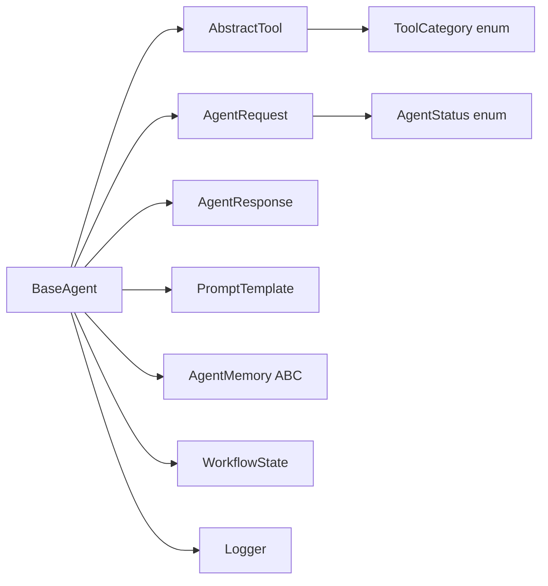

# Agent Foundation Layer

> **Component:** Project Foundation (Milestone 0)  
> **Status:** ✅ Complete  
> **Version:** 0.1.0  
> **Last Updated:** 2026-07-07  
> **Source:** `backend/agents/base/`, `backend/agents/tools/`, `backend/agents/schemas/`, `backend/agents/prompts/`

---

## Purpose

The agent foundation layer establishes the canonical lifecycle, tool interface, request/response schemas, and prompt templates that every Hyperion agent — supervisor, domain, or specialized — must conform to. It provides LangGraph integration via `as_graph_node()` and enforces consistent memory access patterns.

---

## Architecture

```
BaseAgent (ABC)
    ├── initialize() → _on_initialize()
    ├── invoke() → reason() → use_tools() → generate_response()
    ├── write_memory() / read_memory()
    └── as_graph_node() → LangGraph partial state update

AbstractTool (ABC)
    ├── validate_input()
    ├── execute()
    └── __call__() → validated pipeline

AgentRequest / AgentResponse (Pydantic)
PromptTemplate registry
```

---

## Files Added

| File | Purpose |
|------|---------|
| `backend/agents/base/base_agent.py` | `BaseAgent` abstract class |
| `backend/agents/base/__init__.py` | Package exports |
| `backend/agents/tools/abstract_tool.py` | `AbstractTool`, `ToolInput`, `ToolResult` |
| `backend/agents/schemas/request.py` | `AgentRequest` schema |
| `backend/agents/schemas/response.py` | `AgentResponse`, `ToolOutputRecord` |
| `backend/agents/prompts/templates.py` | `PromptTemplate`, system/reasoning/planning prompts |
| `backend/agents/memory/interfaces.py` | `AgentMemory`, `MemoryEntry` ABCs |
| `backend/config/settings.py` | `GlobalConfig` |
| `backend/config/logger.py` | Structured logging |
| `backend/config/dependency_registry.py` | DI registry |
| `backend/utils/enums.py` | Shared enumerations |
| `backend/utils/constants.py` | System constants |
| `backend/utils/errors.py` | Exception hierarchy |
| `backend/services/bootstrap.py` | Application bootstrap |

---

## Folder Structure

```
backend/
├── agents/
│   ├── base/
│   │   ├── __init__.py
│   │   └── base_agent.py
│   ├── tools/
│   │   ├── __init__.py
│   │   └── abstract_tool.py
│   ├── schemas/
│   │   ├── __init__.py
│   │   ├── request.py
│   │   └── response.py
│   ├── prompts/
│   │   ├── __init__.py
│   │   └── templates.py
│   └── memory/
│       └── interfaces.py
├── config/
│   ├── __init__.py
│   ├── settings.py
│   ├── logger.py
│   └── dependency_registry.py
├── services/
│   ├── __init__.py
│   └── bootstrap.py
├── utils/
│   ├── __init__.py
│   ├── enums.py
│   ├── constants.py
│   └── errors.py
└── tests/
    ├── test_base_agent.py
    ├── test_config.py
    ├── test_dependency_registry.py
    ├── test_prompts.py
    └── test_state.py
```

---

## Classes Created

### BaseAgent

| Property / Method | Visibility | Description |
|-------------------|-----------|-------------|
| `agent_id` | Public | Unique agent identifier |
| `role` | Public | `AgentRole` enum value |
| `status` | Public | Current `AgentStatus` |
| `initialize()` | Public | Async initialization lifecycle |
| `invoke(request)` | Public | Main entry point |
| `reason(request)` | Public (override) | Reasoning trace generation |
| `generate_response(request, reasoning, tools)` | Public (override) | Response synthesis |
| `use_tools(names, inputs)` | Public | Tool orchestration |
| `write_memory()` / `read_memory()` | Public | Memory backend access |
| `as_graph_node(state)` | Public | LangGraph node adapter |
| `_on_initialize()` | Protected | Subclass hook |
| `_execute_planned_tools()` | Private | Internal tool execution |
| `_persist_invocation_memory()` | Private | Post-invocation memory write |

### AbstractTool

| Method | Description |
|--------|-------------|
| `name` | Tool identifier property |
| `category` | `ToolCategory` enum |
| `validate_input(data)` | Input validation |
| `execute(input)` | Async tool execution |
| `__call__(data)` | Validated execution pipeline |

### AgentRequest

| Field | Type | Description |
|-------|------|-------------|
| `query` | `str` | User query text |
| `session_id` | `str` | Session scope |
| `request_id` | `str` | Unique request ID |
| `context` | `dict` | Additional context |
| `metadata` | `dict` | Extensible metadata |

### AgentResponse

| Field | Type | Description |
|-------|------|-------------|
| `agent_id` | `str` | Responding agent |
| `content` | `str` | Response text |
| `reasoning` | `list[str]` | Reasoning trace |
| `tool_outputs` | `list[ToolOutputRecord]` | Tool execution records |
| `metadata` | `dict` | Response metadata |
| `status` | `AgentStatus` | Final status |

---

## Interfaces

| Interface | Location | Implementors |
|-----------|----------|-------------|
| `AgentMemory` | `memory/interfaces.py` | Future per-agent memory backends |
| `RedisMemory` | `memory/interfaces.py` | `RedisMemoryStore` |
| `VectorMemory` | `memory/interfaces.py` | `QdrantVectorMemory` |
| `KnowledgeGraphMemory` | `memory/interfaces.py` | `NetworkXKnowledgeGraph` |
| `DigitalTwinMemory` | `memory/interfaces.py` | `DigitalTwinMemoryStore` |

---

## Design Decisions

| Decision | Rationale |
|----------|-----------|
| ABC for BaseAgent | Enforces lifecycle contract across all agent types |
| Pydantic v2 schemas | Runtime validation, serialization, OpenAPI-ready |
| `as_graph_node()` on BaseAgent | Uniform LangGraph integration without wrapper classes |
| Prompt template registry | Centralized, testable prompt management |
| `MAX_TOOL_CALLS_PER_INVOCATION` | Prevents runaway tool loops |

---

## Dependency Graph



---

## Execution Flow

```
invoke(request)
  ├── validate initialized
  ├── status → REASONING
  ├── reason(request) → reasoning_trace
  ├── status → EXECUTING
  ├── use_tools(planned_tools) → tool_results
  ├── status → REFLECTING
  ├── generate_response(request, reasoning, tools) → response
  ├── _persist_invocation_memory()
  ├── status → COMPLETED
  └── return AgentResponse
```

---

## Data Flow

```
AgentRequest
    → reason() → list[str] reasoning trace
    → use_tools() → list[ToolResult]
    → generate_response() → AgentResponse
    → write_memory() → MemoryEntry (via AgentMemory backend)
    → as_graph_node() → dict partial WorkflowState update
```

---

## Interaction with Other Modules

| Module | Interaction |
|--------|------------|
| Memory | `BaseAgent.write_memory()` / `read_memory()` via `AgentMemory` backends; production path uses `MemoryManager` |
| Supervisor | `ClimateSupervisor` does not extend `BaseAgent` but uses `AgentRequest`/`AgentResponse` |
| Domain | `BaseDomainSupervisor` uses `AgentRequest`/`AgentResponse` for `invoke()` |
| State | `as_graph_node()` reads/writes `WorkflowState` |
| Config | `get_logger()` from config layer |

---

## Public APIs

| API | Signature |
|-----|-----------|
| `BaseAgent.__init__` | `(agent_id, role, *, description, tools, memory_backends, system_prompt)` |
| `BaseAgent.initialize` | `async () → None` |
| `BaseAgent.invoke` | `async (request: AgentRequest) → AgentResponse` |
| `BaseAgent.as_graph_node` | `async (state: WorkflowState) → dict[str, Any]` |
| `AbstractTool.__call__` | `async (data: dict) → ToolResult` |
| `get_config` | `() → GlobalConfig` |
| `get_logger` | `(name: str) → Logger` |

---

## Private APIs

| API | Owner |
|-----|-------|
| `_on_initialize()` | BaseAgent subclasses |
| `_execute_planned_tools()` | BaseAgent |
| `_persist_invocation_memory()` | BaseAgent |
| `_resolve_memory_backend()` | BaseAgent |

---

## Configuration

| Constant | Value | Location |
|----------|-------|----------|
| `MAX_TOOL_CALLS_PER_INVOCATION` | 10 | `utils/constants.py` |
| Default system prompt | `SYSTEM_PROMPT` | `prompts/templates.py` |

---

## Error Handling

| Exception | When Raised |
|-----------|------------|
| `AgentInitializationError` | `invoke()` called before `initialize()` |
| `AgentInvocationError` | Unhandled error during invocation |
| `ToolNotFoundError` | Requested tool not registered |
| `DependencyRegistrationError` | Duplicate DI registration |
| `DependencyNotFoundError` | Unregistered dependency resolved |

---

## Logging

- Each agent gets a named logger: `agent.{agent_id}`
- Invocation lifecycle logged at INFO
- Tool execution logged at DEBUG
- Errors logged at ERROR with structured context

---

## Metrics

Not yet implemented at foundation layer. Supervisor `WorkflowMonitor` provides workflow-level metrics.

---

## Performance Considerations

- Tool calls are sequential within a single agent invocation
- Memory backends resolved per-call (no connection pooling at agent level)
- Prompt rendering is synchronous string formatting

---

## Scalability Considerations

- BaseAgent is stateful per instance — one instance per agent registration
- No built-in connection pooling for memory backends
- LangGraph node adapter is stateless (reads from WorkflowState)

---

## Security Considerations

- Tool input validated before execution
- Tool call count limited per invocation
- No direct file system or network access in base layer

---

## Future Extensions

- LLM provider abstraction in `reason()` and `generate_response()`
- Streaming response support in `AgentResponse`
- Tool permission model (role-based tool access)
- Agent-to-agent messaging protocol

---

## Known Limitations

- `BaseAgent` memory backends use `AgentMemory` ABC, not `MemoryManager` directly
- No built-in retry logic in `invoke()`
- `reason()` default implementation returns empty list
- `generate_response()` default returns placeholder text
- Bootstrap service is minimal — no health checks

---

## Test Coverage

| Test File | Tests | Status |
|-----------|-------|--------|
| `test_base_agent.py` | 5 | ✅ All pass |
| `test_config.py` | 2 | ✅ All pass |
| `test_dependency_registry.py` | 5 | ✅ All pass |
| `test_prompts.py` | 4 | ✅ All pass |
| `test_state.py` | 4 | ✅ All pass |

**Total foundation tests:** 20

---

## Related Documents

- [Development Log 000](../development_logs/000_project_foundation.md)
- [State Management](../architecture/state_management.md)
- [Configuration](../architecture/configuration.md)
