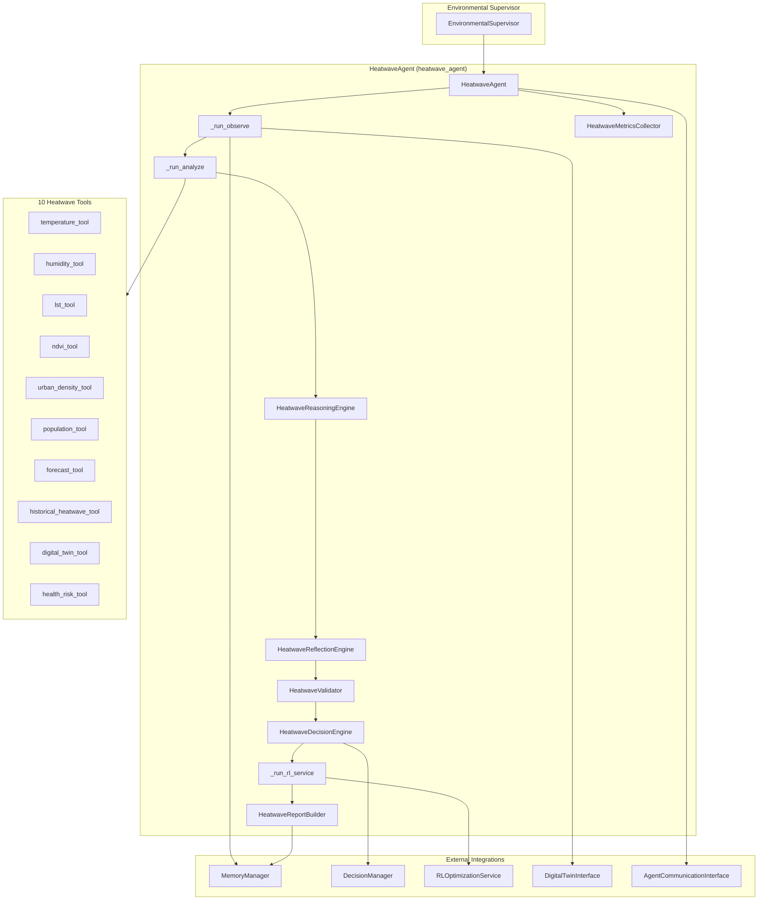
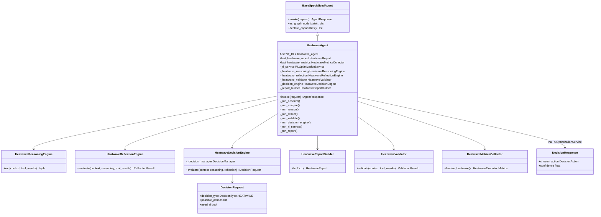
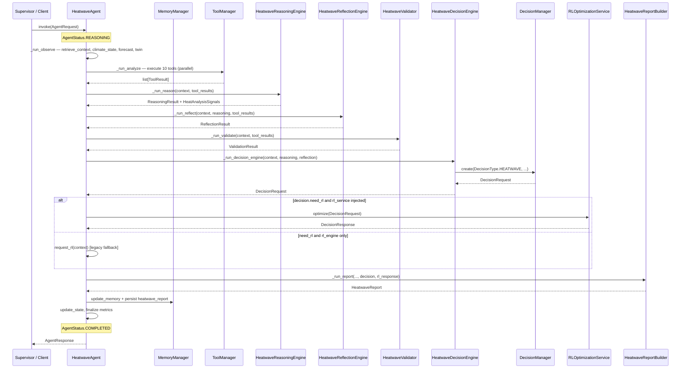
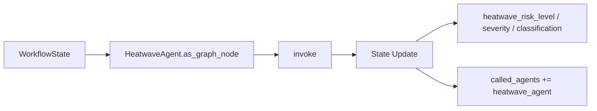
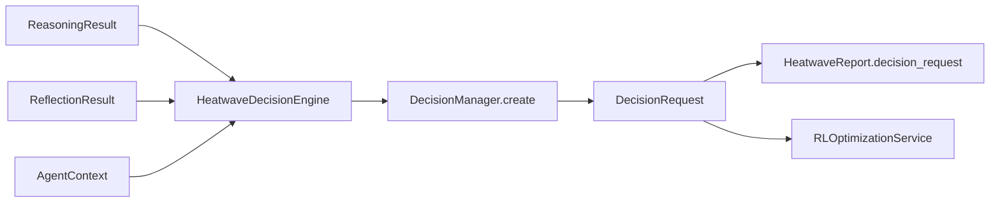
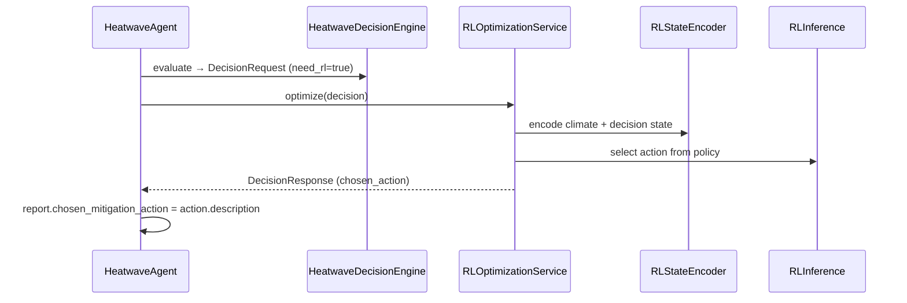
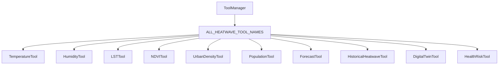
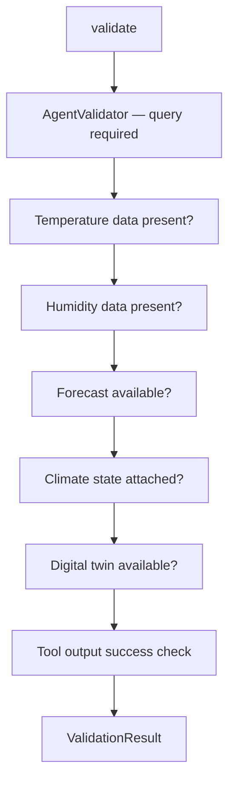
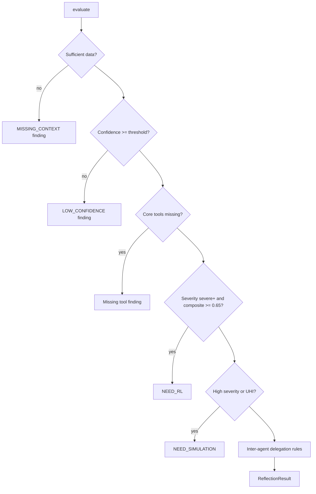

# Heatwave Agent

> **Component:** Heatwave Agent (Prompt 10)  
> **Status:** ✅ Complete  
> **Version:** 0.2.0  
> **Last Updated:** 2026-07-07  
> **Agent ID:** `heatwave_agent`  
> **Source:** `backend/agents/specialized/heatwave/`

---

## Purpose

The **Heatwave Agent** (`HeatwaveAgent`) is a production-grade autonomous climate agent that detects, analyzes, and reports on heatwave events, urban heat island (UHI) effects, human thermal vulnerability, and critical infrastructure heat risk. It is the first specialized agent in Hyperion to adopt the **unified Decision Framework** end-to-end — producing `backend.decision.DecisionRequest` objects and consuming `DecisionResponse` objects from `RLOptimizationService.optimize()` directly.

The agent serves the **Environmental Supervisor** domain alongside flood and air-quality agents, responding to queries about extreme heat, thermal stress, wet-bulb danger, compound heat–AQI events, and urban cooling mitigation.

---

## Responsibilities

| Responsibility | Owner Module |
|----------------|--------------|
| Heatwave detection and severity classification | `heatwave_reasoning.py`, `heatwave_models.py` |
| Urban heat island and LST analysis | `heatwave_tools.py` (`lst_tool`, `urban_density_tool`, `ndvi_tool`) |
| Heat index, wet-bulb, and humidity stress | `heatwave_tools.py` (`humidity_tool`, `health_risk_tool`) |
| Population and infrastructure exposure | `heatwave_reasoning.py`, `heatwave_report.py` |
| Historical heatwave analog comparison | `heatwave_tools.py` (`historical_heatwave_tool`) |
| Unified decision request construction | `heatwave_decision_engine.py` |
| RL-optimized mitigation selection | `heatwave_agent.py` → `RLOptimizationService` |
| Professional heatwave report generation | `heatwave_report.py` |
| Input/output validation | `heatwave_validator.py` |
| Confidence-based reflection and delegation | `heatwave_reflection.py` |
| Invocation metrics and observability | `heatwave_metrics.py` |
| LangGraph workflow node exposure | `heatwave_agent.as_graph_node()` |

---

## Architecture



**Design distinction:** Unlike Flood and Water Resource agents (which use local decision schemas and `SpecializedRLEngineInterface.request_rl()`), HeatwaveAgent wires directly into the unified decision and RL service layers.

---

## Folder Structure

```
backend/agents/specialized/heatwave/
├── __init__.py                  # Public exports
├── heatwave_agent.py            # HeatwaveAgent — main orchestrator
├── heatwave_context.py          # HeatwaveInputs, signals, domain models
├── heatwave_decision_engine.py  # DecisionRequest builder via DecisionManager
├── heatwave_metrics.py          # HeatwaveMetricsCollector, HeatwaveExecutionMetrics
├── heatwave_models.py           # Enums, action types, agent IDs
├── heatwave_reasoning.py        # 11-stage thermal reasoning pipeline
├── heatwave_reflection.py       # Self-evaluation and inter-agent delegation
├── heatwave_report.py           # HeatwaveReport, HeatwaveReportBuilder
├── heatwave_tools.py            # 10 AbstractTool implementations
└── heatwave_validator.py        # Domain-specific validation rules

backend/tests/specialized/heatwave/
├── conftest.py                  # Fixtures, scenario builders, MockRLOptimizationService
├── test_heatwave_unit.py        # 13 unit tests
└── test_heatwave_integration.py # 12 integration tests
```

---

## Class Diagram



---

## Execution Flow

The HeatwaveAgent implements an internal LangGraph-style pipeline. The **RL Service step runs after Decision Framework evaluation and before Report generation** — a key difference from Flood/Water agents that defer RL to a legacy engine interface.



### Workflow Phases

| Phase | Method | Description |
|-------|--------|-------------|
| 1. Observe | `_run_observe` | Parse `HeatwaveInputs`, hydrate climate state, forecast, digital twin |
| 2. Analyze | `_run_analyze` | Execute all registered heatwave tools in parallel |
| 3. Reason | `_run_reason` | 11-stage thermal reasoning pipeline |
| 4. Reflect | `_run_reflect` | Confidence check, RL/simulation/delegation signals |
| 5. Validate | `_run_validate` | Temperature, humidity, forecast, climate state checks |
| 6. Decide | `_run_decision_engine` | Build unified `DecisionRequest` |
| 7. RL Optimize | `_run_rl_service` | Call `RLOptimizationService.optimize()` when `need_rl` |
| 8. Report | `_run_report` | Assemble `HeatwaveReport` with decision + RL artifacts |

---

## Public APIs

### `HeatwaveAgent`

| Method / Property | Description |
|-------------------|-------------|
| `create(memory, *, rl_service, rl_engine, ...)` | Async factory; calls `initialize()` |
| `invoke(request: AgentRequest)` | Full heatwave analysis pipeline |
| `declare_capabilities()` | Returns 10 `AgentCapability` entries |
| `as_graph_node(state: WorkflowState)` | LangGraph node; adds heatwave metadata to state |
| `required_inputs()` | Returns `["query"]` |
| `last_heatwave_report` | Most recent `HeatwaveReport` after invocation |
| `last_heatwave_metrics` | Most recent `HeatwaveMetricsCollector` |
| `AGENT_ID` / `agent_id` | Constant `"heatwave_agent"` |

### Factory

```python
agent = await HeatwaveAgent.create(
    memory_manager,
    rl_service=rl_optimization_service,  # preferred RL path
    agent_communication=comm_interface,
    digital_twin=twin_interface,
)
response = await agent.invoke(request)
```

### Response Metadata

`AgentResponse.metadata` includes:

| Key | Type | Description |
|-----|------|-------------|
| `heatwave_report_id` | `str` | UUID of generated report |
| `risk_level` | `str` | `HeatRiskLevel` value |
| `severity` | `str` | `HeatwaveSeverity` value |
| `classification` | `str` | `HeatwaveClassification` value |
| `confidence` | `float` | Overall confidence 0–1 |
| `heat_index_c` | `float` | Computed heat index |
| `wet_bulb_c` | `float` | Wet-bulb temperature |
| `uhi_score` | `float` | Urban heat island score |
| `probability` | `dict` | `HeatProbabilityEstimate` |
| `population_at_risk` | `list[dict]` | Per-district exposure |
| `recommendations` | `list[str]` | Mitigation recommendations |
| `need_rl` | `bool` | Whether RL was requested |
| `need_simulation` | `bool` | Whether simulation recommended |
| `decision_request` | `dict` | Serialized `DecisionRequest` |
| `rl_response` | `dict \| null` | Serialized `DecisionResponse` |
| `metrics` | `dict` | `HeatwaveExecutionMetrics` |

### Domain Exports (`heatwave/__init__.py`)

Key public types: `HeatwaveAgent`, `HeatwaveReport`, `HeatwaveInputs`, `HeatwaveSeverity`, `HeatRiskLevel`, `HeatwaveClassification`, `HeatActionType`, `HEATWAVE_AGENT_ID`.

---

## Private Methods

| Method | Purpose |
|--------|---------|
| `_run_observe` | Build `AgentContext`, parse `HeatwaveInputs`, retrieve memory/climate/forecast/twin |
| `_run_analyze` | Build tool specs from `ALL_HEATWAVE_TOOL_NAMES`, execute in parallel |
| `_run_reason` | Delegate to `HeatwaveReasoningEngine.run()` |
| `_run_reflect` | Delegate to `HeatwaveReflectionEngine.evaluate()` |
| `_run_validate` | Delegate to `HeatwaveValidator.validate()` |
| `_run_decision_engine` | Delegate to `HeatwaveDecisionEngine.evaluate()` |
| `_run_rl_service` | Call `self._rl_service.optimize(decision)` when `need_rl`; swallow `RLOptimizationError` |
| `_run_report` | Delegate to `HeatwaveReportBuilder.build()` |
| `_build_tool_specs` | Create `ToolCallSpec` for each registered heatwave tool |
| `_on_select_tools` | Hook override; returns same specs as `_build_tool_specs` |
| `_persist_heatwave_report` | Store report JSON in `MemoryDomain.WORKING` |
| `_to_agent_report` | Convert `HeatwaveReport` → framework `AgentReport` |
| `_heatwave_report_to_response` | Convert report + metrics → `AgentResponse` |
| `_hydrate_digital_twin` | Inherited; loads twin state when interface available |

---

## LangGraph Integration

`HeatwaveAgent.as_graph_node()` extends the base implementation:

1. Calls `super().as_graph_node(state)` to run `invoke()` and merge standard workflow updates.
2. Enriches `update["metadata"]` with heatwave-specific fields when `last_heatwave_report` is set:

| Metadata Key | Source |
|--------------|--------|
| `heatwave_risk_level` | `report.risk_level.value` |
| `heatwave_severity` | `report.severity.value` |
| `heatwave_classification` | `report.classification.value` |

The node is registerable under `EnvironmentalSupervisor` and composable into climate supervisor graphs without modifying upstream graph topology.



---

## Memory Integration

| Operation | Domain | Key Pattern | Content |
|-----------|--------|-------------|---------|
| Context retrieval | WORKING, SESSION, VECTOR | session-scoped | Prior conversation and analyses |
| Climate state | via `retrieve_climate_state` | — | `ClimateState` measurements |
| Report persistence | WORKING | `heatwave_report:{request_id}` | Full `HeatwaveReport.model_dump()` |
| Memory references | — | — | Stored in `report.references` |

Memory writes are tracked via `HeatwaveMetricsCollector.record_memory_write()`. All access flows through injected `MemoryManager` — no direct Redis/Qdrant access in the agent layer.

---

## Decision Framework Integration

HeatwaveAgent is the **reference implementation** for unified decision integration among specialized agents.



### DecisionRequest Construction

| Field | Source |
|-------|--------|
| `decision_type` | `DecisionType.HEATWAVE` |
| `agent_id` | `"heatwave_agent"` |
| `objectives` | Minimize mortality, protect vulnerable, reduce thermal stress, cost/infra |
| `possible_actions` | Mapped from `HeatActionType` catalog (8 action types) |
| `constraints` | Budget, time, population, safety — severity-scaled |
| `risk` | `RiskAssessment` from composite score and severity |
| `priority` | CRITICAL (extreme) → LOW (none) |
| `need_rl` | Reflection flag OR severe/extreme + composite ≥ 0.65 |
| `need_simulation` | From reflection (high severity or UHI) |
| `need_other_agents` | urban_planning, water_resource, air_quality, disaster, flood |
| `need_human` | Extreme severity or dangerous heat index |
| `context` | `DecisionContext` with scenario, climate state, forecast reference |

### HeatActionType Catalog

| Action | Description | Typical Trigger |
|--------|-------------|-----------------|
| `PUBLIC_ALERTS` | Issue public heat health alerts | Moderate+ severity |
| `COOLING_CENTERS` | Open public cooling centers | Moderate+ severity |
| `WATER_DISTRIBUTION` | Drinking water to vulnerable areas | Moderate+ severity |
| `WORK_HOUR_MODIFICATION` | Modify outdoor work hours | High+ severity |
| `SCHOOL_CLOSURE` | Close schools during peak heat | High+ severity |
| `URBAN_COOLING` | Deploy urban cooling infrastructure | UHI detected |
| `TREE_PLANTATION` | Accelerate tree plantation | **Only when `low_vegetation` signal is true** |
| `EMERGENCY_RESPONSE` | Activate emergency heat protocol | Severe/extreme severity |

---

## RL Integration

HeatwaveAgent uses **`RLOptimizationService.optimize()` directly** — not the legacy `SpecializedRLEngineInterface`.



### RL Invocation Logic (`_run_rl_service`)

```python
if not decision.need_rl or not self._rl_service:
    return None
try:
    return await self._rl_service.optimize(decision)
except RLOptimizationError:
    return None  # non-blocking; report still generated
```

### Legacy Fallback

If `decision.need_rl` is true but only `rl_engine` (not `rl_service`) is injected, the agent calls `request_rl(context)` after the RL service step — preserving backward compatibility with `SpecializedRLEngineInterface`.

### Known RL Test Limitation

Integration tests use `MockRLOptimizationService` instead of the real `RLOptimizationService` because `rl_state_encoder.py` references `ClimateVariable.RIVER_DISCHARGE`, which is **not defined** in `backend.utils.enums.ClimateVariable`. Instantiating the real service triggers an `AttributeError` during state encoding. This enum gap must be resolved before end-to-end RL tests can run against the production service.

---

## Knowledge Graph Integration

HeatwaveAgent does not directly query `backend.knowledge_graph.GraphEngine`. Graph context is available indirectly via:

- `MemoryManager.search_graph()` during base-class context retrieval
- `context.memory.references` propagated into `HeatwaveReport.references`

Future wiring may add explicit CKG queries for infrastructure entities (hospitals, power grid nodes) during `_run_observe`.

---

## Explainability Integration

| Artifact | XAI Consumption |
|----------|-----------------|
| `ReasoningResult.steps` | Step-by-step thermal analysis trace |
| `reasoning.trace` on report | Human-readable reasoning chain in `HeatwaveReport` |
| `decision_request.rationale` | Decision justification strings |
| `rl_response` + `chosen_mitigation_action` | RL action explanation via `ExplanationEngine.explain_decision()` |
| `HeatAnalysisSignals` | Structured signal metadata for evidence linking |
| `AgentResponse.metadata` | Flattened explainability fields for API consumers |

Heatwave reports include both pre-RL (`decision_request`) and post-RL (`rl_response`) payloads — enabling contrastive explanations of why a specific mitigation action was selected.

---

## Tool Architecture

HeatwaveAgent registers **10 tools** via `create_heatwave_tools()`. All tools extend `AbstractTool` with `get_input_schema()`, `validate_input()`, and `_execute()`.



### Tool Reference

| Tool Name | Class | Category | Primary Outputs |
|-----------|-------|----------|-----------------|
| `temperature_tool` | `TemperatureTool` | ANALYSIS | `elevated_temperature`, `rising_trend`, `temperature_score` |
| `humidity_tool` | `HumidityTool` | ANALYSIS | `heat_index_c`, `wet_bulb_c`, `high_humidity_stress`, `dangerous_heat` |
| `lst_tool` | `LSTTool` | GEOSPATIAL | `urban_heat_island`, `uhi_intensity_c`, `uhi_score` |
| `ndvi_tool` | `NDVITool` | GEOSPATIAL | `ndvi`, `low_vegetation`, `cooling_potential`, `tree_plantation_recommended` |
| `urban_density_tool` | `UrbanDensityTool` | GEOSPATIAL | `high_urban_exposure`, `urban_score`, impervious fraction |
| `population_tool` | `PopulationTool` | ANALYSIS | `total_population`, `vulnerable_population`, `high_exposure` |
| `forecast_tool` | `ForecastTool` | FORECAST | `worsening_trend`, `forecast_score` |
| `historical_heatwave_tool` | `HistoricalHeatwaveTool` | RETRIEVAL | `historical_analog`, `max_historical_peak_c`, events |
| `digital_twin_tool` | `DigitalTwinTool` | SIMULATION | `heat_layers`, twin LST, active scenario |
| `health_risk_tool` | `HealthRiskTool` | ANALYSIS | `health_risk_level`, `compound_aqi_heat_risk`, `vulnerability_score` |

### Tool Execution Policy

- All available tools run on every invocation (`parallel=True`).
- Tool parameters are merged from `context.request.context` plus `digital_twin_state`.
- Inputs parsed through `HeatwaveInputs.from_request_context()`.

### Bug Fixes (Tool Layer)

| Bug | Fix |
|-----|-----|
| **`low_vegetation or True`** | `NDVITool` now correctly sets `low_vegetation = ndvi < 0.25` (previously an `or True` expression made the flag always true, causing spurious `TREE_PLANTATION` actions) |
| **Missing `get_input_schema()`** | All 10 tools now implement `get_input_schema()` returning JSON Schema objects |
| **`heatwave_tools.py` corruption** | File was restored with complete tool class definitions and `create_heatwave_tools()` factory |

---

## Validation Pipeline

`HeatwaveValidator` extends the framework validator with heatwave-specific rules:



| Check | Field | Strict Severity | Default Severity |
|-------|-------|-----------------|------------------|
| Temperature required | `temperature` | 0.9 | 0.65 |
| Humidity required | `humidity` | 0.85 | 0.55 |
| Forecast consistency | `forecast` | 0.7 | 0.4 |
| Climate state | `climate_state` | 0.75 | 0.45 |
| Digital twin | `digital_twin` | 0.6 | 0.35 |
| Failed tools | per tool | — | 0.65 |

When `validation.valid` is false, report confidence is capped at `0.5`.

---

## Reflection Pipeline

`HeatwaveReflectionEngine` evaluates analysis completeness and sets delegation flags:



### Inter-Agent Delegation Matrix

| Condition | Suggested Agent |
|-----------|-----------------|
| UHI or urban_density > 0.6 | `urban_planning_agent` |
| High/severe/extreme severity | `water_resource_agent` |
| Compound AQI risk | `air_quality_agent` |
| Severe/extreme severity | `disaster_response_agent` |
| Monsoon query + severe heat | `flood_agent` |

### RL Recommendation Criteria

Reflection sets `needs_rl = true` when:

- Severity is `SEVERE` or `EXTREME`, **and**
- `composite_score >= 0.65`

Decision engine applies the same rule independently, OR-ing with `reflection.needs_rl`.

---

## Metrics

`HeatwaveMetricsCollector` extends `AgentMetricsCollector` with heatwave-specific dimensions.

### HeatwaveExecutionMetrics

| Metric | Description |
|--------|-------------|
| `reasoning_time_ms` | Total reasoning pipeline duration |
| `tool_usage_count` | Number of tools executed |
| `tools_used` | Deduplicated list of tool names |
| `memory_reads` / `memory_writes` | Memory operation counts |
| `confidence` | Final report confidence |
| `heatwave_severity` | `HeatwaveSeverity` enum |
| `heat_risk_level` | `HeatRiskLevel` enum |
| `decision_requests` | Count of decision framework calls (always ≥ 1) |
| `rl_calls` | Count of successful RL service invocations |
| `total_duration_ms` | End-to-end invocation time |

Accessible via `agent.last_heatwave_metrics.finalize_heatwave()` after invocation.

---

## Logging

Logger namespace: `backend.agents.specialized.heatwave.heatwave_agent`

| Event | Level | Key Fields |
|-------|-------|------------|
| `heatwave_observe_complete` | INFO | `region_id` |
| `heatwave_decision_evaluated` | DEBUG | `decision_id`, `need_rl`, `action_count` |
| `heatwave_rl_optimization_failed` | WARNING | `decision_id`, `error` |
| `heatwave_agent_failed` | ERROR | `request_id`, `error` |

Reasoning steps are appended to `AgentContext` via `context.add_reasoning()` and reflection notes via `context.add_reflection()`.

---

## Error Handling

| Exception | When Raised | Behavior |
|-----------|-------------|----------|
| `AgentInvocationError` | Any unhandled pipeline exception | Status → `FAILED`, metrics finalized, error logged |
| `RLOptimizationError` | RL service failure | Logged as warning; report generated without `rl_response` |
| `ToolValidationError` | Invalid tool input (temperature/humidity missing) | Tool returns `success=False`; validator records issue |

The agent does **not** fail the entire invocation when RL optimization fails — mitigation falls back to decision-engine ranked actions.

---

## Configuration

| Parameter | Default | Description |
|-----------|---------|-------------|
| `confidence_threshold` | `0.45` | Reflection low-confidence gate |
| `HEATWAVE_AGENT_ID` | `"heatwave_agent"` | Canonical agent identifier |
| Tool execution mode | `PARALLEL` | All tools run concurrently |
| `requires_climate_state` | `True` (metadata flag) | Set during observe phase |

### Request Context Keys

| Key | Type | Description |
|-----|------|-------------|
| `region_id` | `str` | Geographic region identifier |
| `air_temp_c` / `temperature_c` | `float` | Current air temperature |
| `humidity_pct` | `float` | Relative humidity 0–100 |
| `lst_c` | `float` | Land surface temperature |
| `ndvi` | `float` | Normalized difference vegetation index |
| `urban_density` | `float` | Urban density 0–1 |
| `population_density` | `float` | People per km² |
| `forecast_max_24h_c` | `float` | 24-hour max forecast |
| `forecast_max_72h_c` | `float` | 72-hour max forecast |
| `aqi` | `float` | Air quality index (compound events) |
| `historical_heatwaves` | `list[dict]` | Prior heatwave events |
| `digital_twin_state` | `dict` | Twin thermal layers |
| `districts` | `list[str]` | Affected administrative districts |

---

## Performance

| Phase | Typical Duration (unit tests) |
|-------|-------------------------------|
| Tool execution (10 parallel) | 5–20 ms |
| Reasoning (11 steps) | 2–8 ms |
| Decision engine | 1–3 ms |
| Report build | 1–2 ms |
| RL service (mock) | < 1 ms |

Tool execution dominates wall-clock time. Parallel mode reduces latency versus sequential execution when tools perform independent computation.

---

## Scalability

- **Stateless invocations:** No instance state persists between requests except cached `last_*` properties for testing/debugging.
- **Horizontal scaling:** Multiple `HeatwaveAgent` instances can run behind `EnvironmentalSupervisor` with shared `MemoryManager`.
- **Tool isolation:** Each tool is independently testable and replaceable without pipeline changes.
- **Async throughout:** All I/O-bound operations use `async/await`.

---

## Security

- No direct external API calls in the heatwave agent layer.
- Tool inputs validated via Pydantic models (`HeatwaveInputs`) and JSON Schema (`get_input_schema()`).
- Inter-agent calls require explicit `AgentCommunicationInterface` injection.
- Decision constraints enforce budget caps and safety risk ceilings.
- Digital twin access mediated through `DigitalTwinInterface` — no raw file/network access.

---

## Known Limitations

| Limitation | Impact | Mitigation Path |
|------------|--------|-----------------|
| `ClimateVariable.RIVER_DISCHARGE` missing from enum | Real `RLOptimizationService` cannot run in tests | Add enum value; update `rl_state_encoder` |
| All 10 tools run every invocation | No dynamic tool selection by query | Implement capability-driven tool filtering |
| Population estimates are heuristic | `density × 10 × districts` approximation | Integrate census API |
| Wet-bulb uses Stull approximation | Not WMO-certified | Swap for psychrometric library |
| No rate limiting on inter-agent calls | Potential cascade under load | Add circuit breaker (framework roadmap) |
| CKG not directly wired | Infrastructure risk uses static list | Future graph query integration |

---

## Future Improvements

- Add `RIVER_DISCHARGE` (and other missing variables) to `ClimateVariable` enum for production RL tests.
- Implement query-aware tool selection to skip irrelevant tools on mild scenarios.
- Wire `GraphEngine` for hospital/power-grid entity resolution in infrastructure risk.
- Add LLM-augmented narrative generation for executive summaries.
- Integrate live NWP forecast APIs into `forecast_tool`.
- Auto-invoke `ExplanationEngine.explain_decision()` post-report.
- Support multi-region batch analysis in a single invocation.

---

## Testing Summary

| Test File | Count | Scope |
|-----------|-------|-------|
| `backend/tests/specialized/heatwave/test_heatwave_unit.py` | **13** | Tools, inputs, reasoning, validator, decision engine |
| `backend/tests/specialized/heatwave/test_heatwave_integration.py` | **12** | Full agent invoke, RL mock, supervisor, LangGraph node |
| **Total** | **25** | All passing (v0.2.0) |

### Unit Tests (`test_heatwave_unit.py`)

| Test | Validates |
|------|-----------|
| `test_temperature_tool_elevated` | Delhi scenario elevated temperature and score |
| `test_humidity_tool_heat_index` | Heat index > 40°C, wet bulb computation |
| `test_lst_tool_uhi` | Ahmedabad UHI detection |
| `test_ndvi_tool_low_vegetation` | `low_vegetation=True` when ndvi=0.12 |
| `test_urban_density_tool` | High urban exposure flag |
| `test_population_tool_exposure` | Population and high_exposure |
| `test_historical_heatwave_analog` | Historical analog matching |
| `test_heatwave_inputs_from_context` | Context parsing into `HeatwaveInputs` |
| `test_heatwave_reasoning_pipeline` | ≥ 10 reasoning steps, composite score |
| `test_compound_aqi_reasoning` | Compound AQI risk signal |
| `test_heatwave_validator` | Validator returns `ValidationResult` |
| `test_decision_engine_unified_request` | `DecisionType.HEATWAVE`, unified schema |
| `test_tree_plantation_only_when_low_vegetation` | No tree_plantation when ndvi=0.65 |

### Integration Tests (`test_heatwave_integration.py`)

| Test | Validates |
|------|-----------|
| `test_heatwave_agent_initialize` | 10 capabilities, core tools registered |
| `test_heatwave_agent_invoke_delhi_extreme` | End-to-end Delhi extreme heatwave |
| `test_heatwave_agent_ahmedabad_uhi` | UHI analysis, decision request attached |
| `test_heatwave_agent_compound_aqi` | Compound heat–AQI classification |
| `test_heatwave_agent_metrics` | Tool count, memory writes, decision requests |
| `test_heatwave_agent_decision_request` | Unified `DecisionRequest` in report |
| `test_heatwave_agent_rl_integration` | Mock RL service, chosen mitigation action |
| `test_heatwave_agent_mild_scenario` | Low-risk thermal monitoring |
| `test_heatwave_agent_as_graph_node` | LangGraph metadata enrichment |
| `test_heatwave_agent_health` | Health check passes |
| `test_environmental_supervisor_with_heatwave_agent` | Supervisor registration and routing |
| `test_heatwave_report_structure` | Complete report field population |

### Test Fixtures (`conftest.py`)

| Fixture / Builder | Purpose |
|-------------------|---------|
| `build_delhi_heatwave_context()` | Delhi 2024 extreme heat (46°C, low NDVI) |
| `build_ahmedabad_uhi_context()` | Ahmedabad UHI scenario |
| `build_compound_heat_aqi_context()` | Heat + AQI 380 compound event |
| `build_mild_heat_context()` | Low-risk monitoring baseline |
| `build_climate_state()` | `ClimateState` with temperature/humidity |
| `MockHeatwaveComm` | Inter-agent communication stub |
| `MockRLOptimizationService` | RL stub returning `DecisionResponse` |
| `heatwave_agent` | Agent without RL service |
| `heatwave_agent_with_rl` | Agent with mock RL service |

### Reasoning Severity Thresholds

| Composite Score | Severity |
|-----------------|----------|
| ≥ 0.85 or dangerous heat index | `EXTREME` |
| ≥ 0.70 or heat index ≥ 45°C | `SEVERE` |
| ≥ 0.55 or heat index ≥ 41°C | `HIGH` |
| ≥ 0.35 | `MODERATE` |
| ≥ 0.15 | `LOW` |
| < 0.15 | `NONE` |

Composite formula: `temperature×0.30 + heat_index×0.30 + uhi×0.20 + vulnerability×0.20`

---

## Related Documents

- [Specialized Agent Framework](./specialized_framework.md)
- [Flood Agent](./flood_agent.md)
- [Water Resource Agent](./water_resource_agent.md)
- [Agent → Decision → RL Flow](../diagrams/agent_decision_rl_flow.md)
- [RL Optimization Service](../rl/README.md)
- [Environmental Supervisor](../domain/domain_supervisors.md)
- [Decision Framework](../decision/decision_framework.md)
