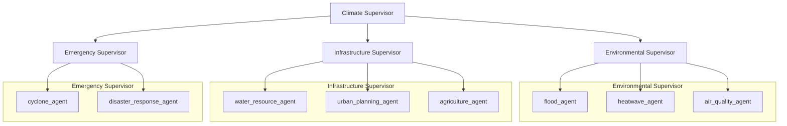
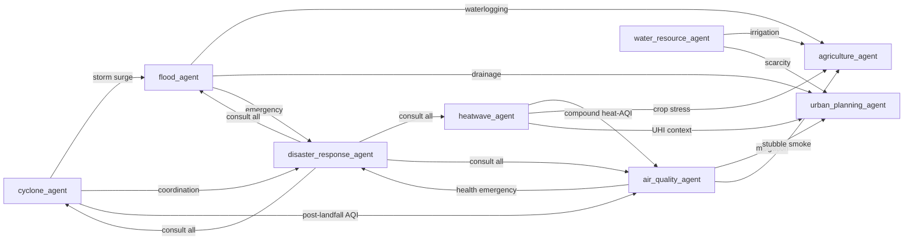

# Specialized Agents Overview

> **Document Status:** Active  
> **Version:** 0.3.0  
> **Last Updated:** 2026-07-09  
> **Maintainer:** Nexora Engineering

---

## Purpose

This document provides a unified view of all eight Hyperion specialized agents, their supervisor hierarchy, integration patterns, and operational status after Prompts 5–17.

---

## Supervisor Hierarchy

---

## Agent Registry

### Environmental Domain

#### Flood Agent (`flood_agent`)

| Field | Value |
|-------|-------|
| **Purpose** | Fluvial and pluvial flood detection, risk assessment, and mitigation |
| **Responsibilities** | River discharge, rainfall, terrain, population exposure, evacuation planning |
| **Inputs** | Climate state, forecast, digital twin, peer outputs |
| **Outputs** | `FloodReport`, `DecisionRequest` (local schema) |
| **Decision Type** | `DecisionType.FLOOD` |
| **RL Usage** | `SpecializedRLEngineInterface` (legacy path) |
| **CKG Usage** | Limited |
| **XAI Usage** | Report-level reasoning trace |
| **Peer Agents** | Water, Agriculture, Air Quality (suggested) |
| **Status** | ✅ Complete — 23 tests |

#### Heatwave Agent (`heatwave_agent`)

| Field | Value |
|-------|-------|
| **Purpose** | Heatwave detection, UHI analysis, thermal vulnerability |
| **Responsibilities** | Temperature, humidity, LST, wet-bulb, population health risk |
| **Inputs** | Climate state, forecast, digital twin, population density |
| **Outputs** | `HeatwaveReport`, unified `DecisionRequest` |
| **Decision Type** | `DecisionType.HEATWAVE` |
| **RL Usage** | `RLOptimizationService.optimize()` |
| **CKG Usage** | Observe-phase queries |
| **XAI Usage** | `ExplanationEngine` full pipeline |
| **Peer Agents** | Air Quality, Flood |
| **Status** | ✅ Complete — 25 tests |

#### Air Quality Agent (`air_quality_agent`)

| Field | Value |
|-------|-------|
| **Purpose** | Atmospheric pollution, health risk, smoke/dust transport |
| **Responsibilities** | AQI, PM2.5/PM10, gas analysis, mitigation advisories |
| **Inputs** | Pollutants, meteorology, satellite aerosol, emission inventory, population |
| **Outputs** | `AirQualityReport`, `DecisionRequest` |
| **Decision Type** | `DecisionType.AQI` |
| **RL Usage** | `RLOptimizationService` for mitigation optimization |
| **CKG Usage** | Emission sources, historical pollution, compound hazards |
| **XAI Usage** | Full pipeline with counterfactuals |
| **Peer Agents** | Heatwave, Urban Planning, Disaster, Agriculture, Cyclone |
| **Status** | ✅ Complete — 17 tests |

### Infrastructure Domain

#### Water Resource Agent (`water_resource_agent`)

| Field | Value |
|-------|-------|
| **Purpose** | Reservoir, drought, and water allocation analysis |
| **Responsibilities** | Groundwater, reservoir levels, irrigation demand, allocation |
| **Inputs** | Climate state, forecast, reservoir data, agriculture demand |
| **Outputs** | `WaterResourceReport`, local `DecisionRequest` |
| **Decision Type** | `DecisionType.WATER` |
| **RL Usage** | `SpecializedRLEngineInterface` (legacy path) |
| **CKG Usage** | Limited |
| **XAI Usage** | Report-level |
| **Peer Agents** | Flood, Agriculture |
| **Status** | ✅ Complete — 24 tests |

#### Urban Planning Agent (`urban_planning_agent`)

| Field | Value |
|-------|-------|
| **Purpose** | Long-term urban climate adaptation and resilience planning |
| **Responsibilities** | UHI, green cover, drainage, stormwater, investment prioritization |
| **Inputs** | Land use, building density, NDVI, drainage capacity, peer hazard outputs |
| **Outputs** | `UrbanPlanningReport`, `DecisionRequest` |
| **Decision Type** | `DecisionType.URBAN` |
| **RL Usage** | Portfolio budget optimization via RL |
| **CKG Usage** | Infrastructure and population nodes |
| **XAI Usage** | Full pipeline |
| **Peer Agents** | Heatwave, Flood, Water, Air Quality, Agriculture |
| **Status** | ✅ Complete — 16 tests |

#### Agriculture Agent (`agriculture_agent`)

| Field | Value |
|-------|-------|
| **Purpose** | Precision agriculture and climate-informed crop advisory |
| **Responsibilities** | Crop health, irrigation, yield risk, phenology, government advisories |
| **Inputs** | NDVI/EVI, soil moisture, crop calendar, peer hazard outputs |
| **Outputs** | `AgricultureReport`, `DecisionRequest`, RAG documents |
| **Decision Type** | `DecisionType.AGRICULTURE` |
| **RL Usage** | Irrigation and scheduling optimization |
| **CKG Usage** | Crop/water dependencies, regional suitability |
| **XAI Usage** | Full pipeline with agronomic justification |
| **RAG** | Provider-agnostic `AgricultureRagService` |
| **Peer Agents** | Water, Heatwave, Flood, Urban Planning |
| **Status** | ✅ Complete — 17 tests |

### Emergency Domain

#### Cyclone Agent (`cyclone_agent`)

| Field | Value |
|-------|-------|
| **Purpose** | Tropical cyclone monitoring, track forecasting, landfall assessment |
| **Responsibilities** | SST, pressure, wind, storm surge, INSAT imagery, evacuation |
| **Inputs** | Ocean/atmosphere state, forecast, population, infrastructure |
| **Outputs** | `CycloneReport`, `DecisionRequest` |
| **Decision Type** | `DecisionType.CYCLONE` |
| **RL Usage** | Evacuation timing optimization |
| **CKG Usage** | Historical cyclone analogs, affected infrastructure |
| **XAI Usage** | Full pipeline |
| **Peer Agents** | Flood, Disaster Response, Air Quality |
| **Status** | ✅ Complete — 24 tests |

#### Disaster Response Agent (`disaster_response_agent`)

| Field | Value |
|-------|-------|
| **Purpose** | Multi-hazard emergency coordination and resource allocation |
| **Responsibilities** | Shelter, hospital, relief inventory, critical infrastructure, communication |
| **Inputs** | Active hazards, peer agent outputs, population, infrastructure status |
| **Outputs** | `DisasterResponseReport`, `DecisionRequest` |
| **Decision Type** | `DecisionType.DISASTER` |
| **RL Usage** | Resource allocation optimization |
| **CKG Usage** | Compound hazard chains, infrastructure dependencies |
| **XAI Usage** | Full pipeline |
| **Peer Agents** | Flood, Cyclone, Heatwave, Air Quality (live consultation) |
| **Status** | ✅ Complete — 16 tests |

---

## Shared Integration Patterns

All Prompt 13–17 agents share:

| Integration | Pattern |
|-------------|---------|
| Base class | `BaseSpecializedAgent` |
| Decision | Unified `backend.decision.DecisionRequest` via domain `*DecisionEngine` |
| RL | `RLOptimizationService.optimize()` with `MockRLOptimizationService` in tests |
| XAI | `ExplanationEngine.explain(ExplanationInput)` when engine injected |
| CKG | `GraphEngine` queries in `_run_observe()` → `ckg_insights` in context |
| Memory | `MemoryManager.store()` for domain reports in working memory |
| Peers | `AgentCommunicationInterface.call_agent()` only |
| LangGraph | `as_graph_node()` exposes agent as workflow node |
| Tools | Two-batch parallel execution when tool count > 10 |

---

## Inter-Agent Interaction Map

---

## Test Matrix

| Agent | Unit | Integration | Total |
|-------|------|-------------|-------|
| Framework | 10 | — | 10 |
| Flood | 11 | 12 | 23 |
| Water | 12 | 12 | 24 |
| Heatwave | 13 | 12 | 25 |
| Cyclone | 12 | 12 | 24 |
| Disaster Response | 7 | 9 | 16 |
| Urban Planning | 7 | 9 | 16 |
| Agriculture | 8 | 9 | 17 |
| Air Quality | 8 | 9 | 17 |
| **Agent subtotal** | | | **172** |
| Decision + RL + XAI + CKG + Foundation | | | **224** |
| **Grand total** | | | **396** |

---

## Documentation Index

| Agent | Component Doc | Development Log |
|-------|--------------|-----------------|
| Cyclone | [cyclone_agent.md](./cyclone_agent.md) | [012](../development_logs/012_cyclone_agent.md) |
| Disaster Response | [disaster_response_agent.md](./disaster_response_agent.md) | [013](../development_logs/013_disaster_response_agent.md) |
| Urban Planning | [urban_planning_agent.md](./urban_planning_agent.md) | [014](../development_logs/014_urban_planning_agent.md) |
| Agriculture | [agriculture_agent.md](./agriculture_agent.md) | [015](../development_logs/015_agriculture_agent.md) |
| Air Quality | [air_quality_agent.md](./air_quality_agent.md) | [016](../development_logs/016_air_quality_agent.md) |
