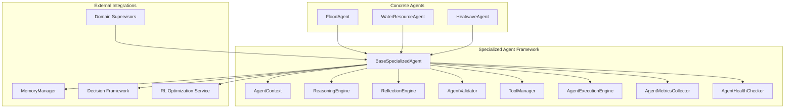
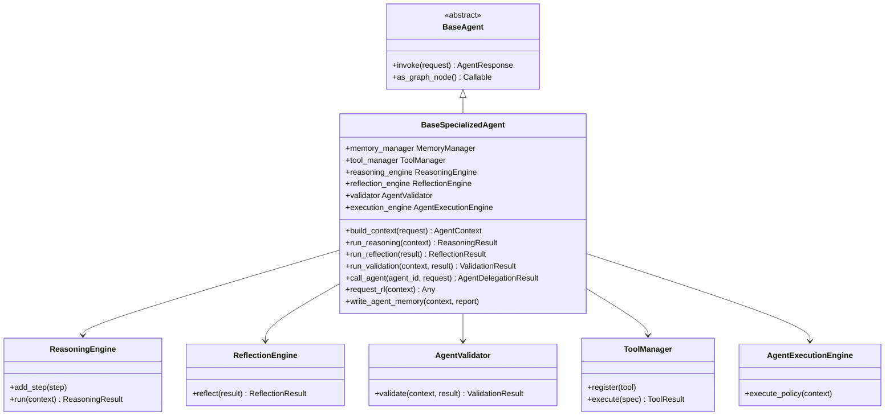
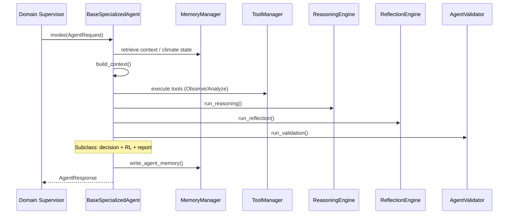
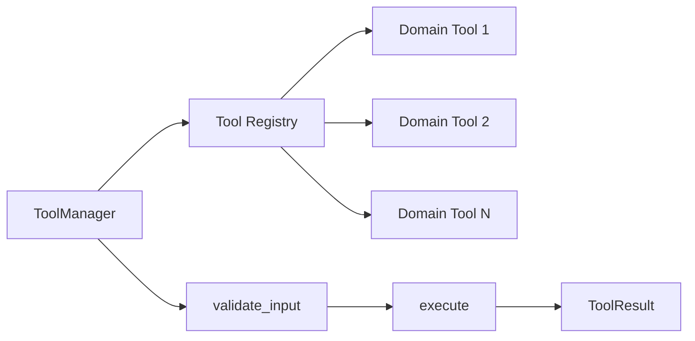

# Specialized Agent Framework

> **Component:** Specialized Agent Framework (Prompt 5)  
> **Status:** ✅ Complete  
> **Version:** 0.2.0  
> **Last Updated:** 2026-07-07  
> **Source:** `backend/agents/specialized/`

---

## Purpose

The Specialized Agent Framework provides the canonical enterprise base class, shared pipelines, and cross-cutting infrastructure that all domain-specific climate agents (flood, water resource, heatwave, and future agents) inherit. It standardizes the Observe → Analyze → Reason → Reflect → Validate → Decide → Report lifecycle, inter-agent communication, tool orchestration, memory access, RL delegation, and LangGraph node exposure.

---

## Responsibilities

| Responsibility | Owner Module |
|----------------|--------------|
| Agent lifecycle and `invoke()` pipeline | `base_specialized_agent.py` |
| Capability registration and discovery | `agent_capabilities.py` |
| Structured context assembly | `agent_context.py` |
| Multi-phase reasoning orchestration | `agent_reasoning.py` |
| Confidence-based reflection | `agent_reflection.py` |
| Schema and business-rule validation | `agent_validator.py` |
| Tool registration and execution | `agent_tools.py` |
| Inter-agent delegation and RL requests | `agent_execution.py` |
| Health checks and readiness | `agent_health.py` |
| Latency and throughput metrics | `agent_metrics.py` |
| Specialized agent registry | `agent_registry.py` |

---

## Architecture



---

## Folder Structure

```
backend/agents/specialized/
├── __init__.py
├── base_specialized_agent.py    # BaseSpecializedAgent ABC
├── agent_capabilities.py        # AgentCapability, CapabilityRegistry
├── agent_context.py             # AgentContext, AgentReport, delegation types
├── agent_reasoning.py           # ReasoningEngine, ReasoningStep, ReasoningResult
├── agent_reflection.py          # ReflectionEngine, ReflectionResult
├── agent_validator.py           # AgentValidator, ValidationResult
├── agent_tools.py               # ToolManager, ToolCallSpec, ToolExecutionMode
├── agent_execution.py           # AgentExecutionEngine, communication/RL interfaces
├── agent_health.py              # AgentHealthChecker, AgentHealthReport
├── agent_metrics.py             # AgentMetricsCollector
├── agent_registry.py            # SpecializedAgentRegistry
├── flood/                       # Flood agent implementation
├── water_resource/              # Water resource agent implementation
└── heatwave/                    # Heatwave agent implementation
```

---

## Class Diagram



---

## Execution Flow



---

## Public APIs

### `BaseSpecializedAgent`

| Method | Description |
|--------|-------------|
| `build_context(request)` | Assembles `AgentContext` from request, memory, and climate state |
| `run_reasoning(context)` | Executes multi-phase reasoning pipeline |
| `run_reflection(result)` | Reflects on reasoning confidence and gaps |
| `run_validation(context, result)` | Validates reasoning output against schemas |
| `execute_tools(specs, mode)` | Runs registered tools via `ToolManager` |
| `call_agent(agent_id, request)` | Delegates to another specialized agent |
| `call_other_agents(requests)` | Parallel multi-agent delegation |
| `request_rl(context)` | Requests RL policy via `SpecializedRLEngineInterface` |
| `write_agent_memory(context, report)` | Persists agent output to memory domains |
| `get_health_report()` | Returns `AgentHealthReport` |
| `as_graph_node()` | LangGraph-compatible partial state updater |
| `get_capabilities()` | Lists registered `AgentCapability` entries |

### `SpecializedAgentRegistry`

| Method | Description |
|--------|-------------|
| `register(agent)` | Register a specialized agent instance |
| `get(agent_id)` | Retrieve agent by ID |
| `list_agents()` | List all registered agents |
| `health_check_all()` | Aggregate health across agents |

---

## Private Methods

| Method | Purpose |
|--------|---------|
| `_on_initialize()` | Subclass hook for tool/capability setup |
| `_retrieve_memory_context()` | Fetches hybrid memory for context assembly |
| `_persist_workflow_state()` | Writes workflow metadata after invocation |
| `_collect_metrics()` | Finalizes `AgentMetricsCollector` |
| `_framework_log(phase, message)` | Structured phase logging |

Subclasses implement `_run_domain_pipeline()` (or equivalent) for hazard-specific logic.

---

## LangGraph Integration

- `BaseSpecializedAgent.as_graph_node()` returns an async callable compatible with LangGraph `StateGraph` nodes.
- Node function accepts `WorkflowState`, extracts `AgentRequest` from state metadata, calls `invoke()`, and merges `AgentResponse` into state.
- Domain supervisors can embed specialized agents as subgraph nodes without modifying the climate supervisor graph.

---

## Memory Integration

| Memory Domain | Usage |
|---------------|-------|
| `WORKING` | Ephemeral context during invocation |
| `SESSION` | Session-scoped agent outputs |
| `VECTOR` | Semantic retrieval of prior analyses |
| `GRAPH` | Entity/relationship context (via `NetworkXKnowledgeGraph`) |
| `DIGITAL_TWIN` | Scenario checkpoints when `DigitalTwinInterface` injected |

All access flows through `MemoryManager` — never direct backend access.

---

## Decision Framework Integration

- Framework agents produce domain-specific decision payloads.
- Flood and Water agents use **local** decision schemas in their context modules, converted at decision-engine boundaries.
- Heatwave agent uses the **unified** `backend.decision.DecisionRequest` / `DecisionResponse`.
- `DecisionManager.evaluate()` can be called from agent decision engines for constraint validation and ranking.

---

## RL Integration

| Interface | Usage |
|-----------|-------|
| `SpecializedRLEngineInterface` | Legacy per-agent RL via `request_rl()` — used by Flood and Water |
| `RLOptimizationService.optimize()` | Unified service — used by Heatwave agent directly |

Both paths accept standardized decision payloads at the service boundary.

---

## Knowledge Graph Integration

- Agents read graph context via `MemoryManager.search_graph()` and hybrid retrieval.
- The standalone `backend/knowledge_graph/GraphEngine` (Climate Knowledge Graph) is a separate, richer graph layer for cross-domain reasoning — integration is optional per agent via future wiring.

---

## Explainability Integration

- Agents produce `ReasoningStep` traces consumed by `ExplanationEngine.explain_pipeline()`.
- `AgentReport` metadata includes confidence, evidence references, and action rationale for XAI ingestion.
- Heatwave reports include structured decision and RL metadata for `explain_decision()`.

---

## Tool Architecture



- All tools extend `AbstractTool` with `get_input_schema()`, `validate_input()`, `execute()`.
- `ToolCallSpec` defines tool name, inputs, timeout, and execution mode (`SEQUENTIAL`, `PARALLEL`, `BEST_EFFORT`).
- `ToolManager` handles registration, deduplication, and error aggregation.

---

## Validation Pipeline

1. **Input validation** — `AgentValidator` checks context completeness and schema conformance.
2. **Tool output validation** — Each `ToolResult.success` flag checked before reasoning.
3. **Reasoning validation** — Minimum confidence threshold enforced.
4. **Reflection gate** — Low-confidence results trigger additional reflection cycles (configurable).
5. **Domain validator** — Subclass validators (e.g., `FloodValidator`) apply hazard-specific rules.

---

## Reflection Pipeline

1. `ReflectionEngine.reflect()` receives `ReasoningResult`.
2. Computes confidence score from step weights and evidence coverage.
3. Identifies knowledge gaps and recommends additional tool calls.
4. Returns `ReflectionResult` with `should_retry`, `adjusted_confidence`, and `gaps`.
5. Agent may re-run tools if `should_retry` is true (policy-dependent).

---

## Metrics

`AgentMetricsCollector` tracks:

| Metric | Unit |
|--------|------|
| `total_duration_ms` | milliseconds |
| `context_build_ms` | milliseconds |
| `reasoning_ms` | milliseconds |
| `reflection_ms` | milliseconds |
| `validation_ms` | milliseconds |
| `tool_execution_ms` | milliseconds |
| `tool_call_count` | count |
| `memory_read_count` | count |
| `memory_write_count` | count |

Accessible via `agent.last_metrics` after invocation.

---

## Logging

- Logger namespace: `specialized.{agent_id}`
- Phase markers: `CONTEXT`, `REASONING`, `REFLECTION`, `VALIDATION`, `TOOLS`, `DECISION`, `RL`, `REPORT`
- Structured fields: `request_id`, `workflow_id`, `phase`, `duration_ms`, `confidence`

---

## Error Handling

| Exception | When Raised |
|-----------|-------------|
| `AgentInvocationError` | Pipeline failure, unrecoverable validation error |
| `ToolExecutionError` | Tool failure in strict mode |
| `MemoryAccessError` | MemoryManager operation failure |

Agents catch recoverable errors, populate `AgentResponse.status = FAILED`, and include error details in metadata.

---

## Configuration

| Parameter | Default | Description |
|-----------|---------|-------------|
| `confidence_threshold` | 0.4 | Minimum reflection confidence |
| `execution_policy` | sequential | Tool execution topology |
| `VECTOR_SEARCH_TOP_K` | from constants | Memory retrieval depth |

---

## Performance

- Typical framework overhead (excluding domain tools): 15–50 ms in unit tests.
- Tool execution dominates latency for agents with 5–10 tools.
- Parallel tool mode reduces wall-clock time when tools are I/O bound.

---

## Scalability

- Agents are stateless between invocations; horizontal scaling via multiple worker processes.
- `SpecializedAgentRegistry` supports lazy registration and health-based routing.
- Memory access is async throughout — no blocking I/O in the hot path.

---

## Security

- No direct external API calls in framework layer.
- Tool inputs validated against Pydantic schemas before execution.
- Agent-to-agent calls require explicit `AgentCommunicationInterface` — no implicit global registry access in production.

---

## Known Limitations

- No built-in rate limiting on inter-agent calls.
- `SpecializedRLEngineInterface` and `RLOptimizationService` coexist — migration to unified service incomplete for Flood/Water.
- LangGraph subgraph composition with domain supervisors not yet integration-tested end-to-end.

---

## Future Improvements

- Migrate Flood and Water agents to unified `DecisionRequest` / `RLOptimizationService`.
- Add LLM-augmented reasoning phase behind feature flag.
- Standardize CKG queries in `build_context()`.
- Auto-wire `ExplanationEngine` post-report.
- Circuit breaker for inter-agent delegation.

---

## Testing Summary

| Test File | Tests | Coverage |
|-----------|-------|----------|
| `tests/specialized/test_specialized_framework.py` | 10 | Base class, context, tools, metrics, health |
| **Subtotal (framework only)** | **10** | — |
| Flood agent tests | 23 | See [flood_agent.md](./flood_agent.md) |
| Water agent tests | 24 | See [water_resource_agent.md](./water_resource_agent.md) |
| Heatwave agent tests | 25 | See [heatwave_agent.md](./heatwave_agent.md) |

**Framework + all specialized agent tests:** 81 passing (as of v0.2.0).

---

## Related Documents

- [Flood Agent](./flood_agent.md)
- [Water Resource Agent](./water_resource_agent.md)
- [Heatwave Agent](./heatwave_agent.md)
- [Decision Framework](../decision/decision_framework.md)
- [ADR-006](../decisions/ADR-006_specialized_agent_framework.md)
- [Development Log 004](../development_logs/004_specialized_framework.md)
- [Specialized Agent Architecture](../diagrams/specialized_agent_architecture.md)
