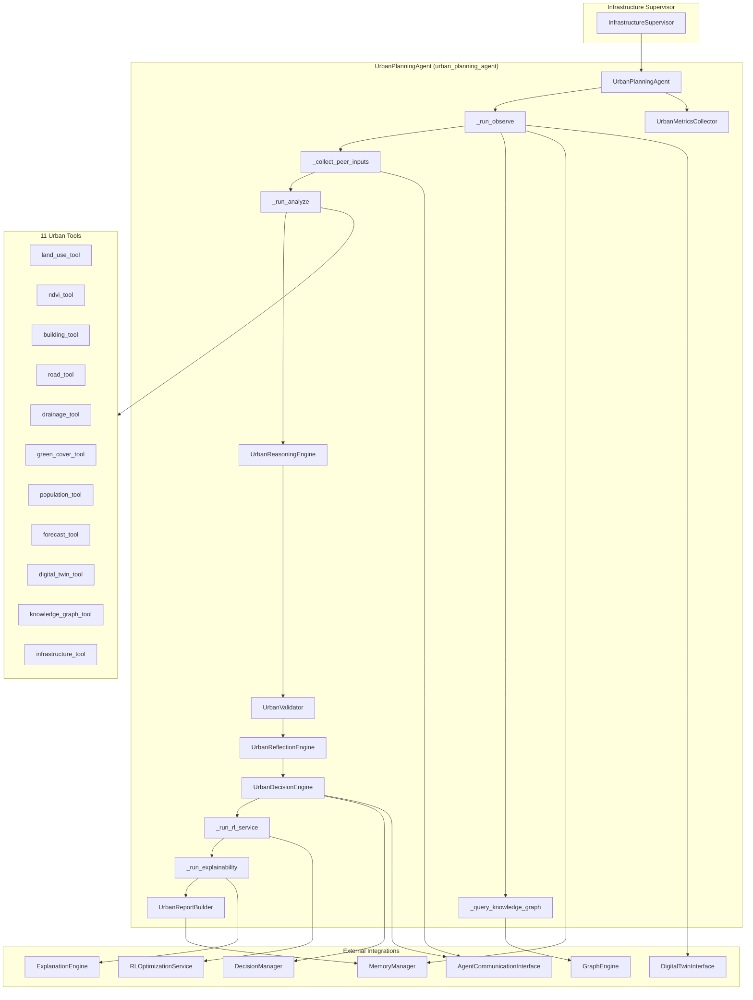
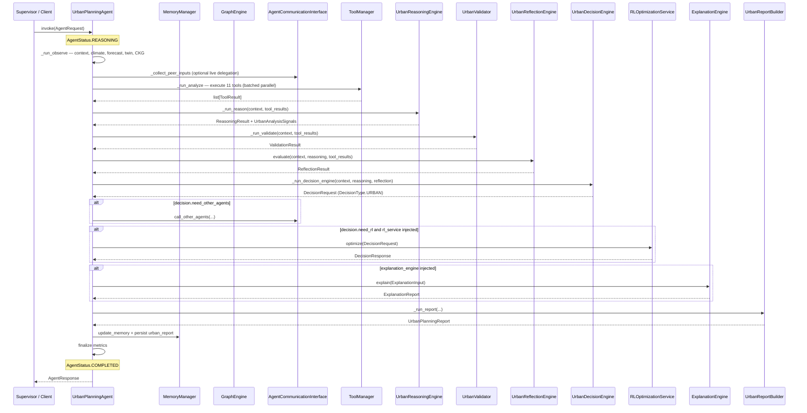
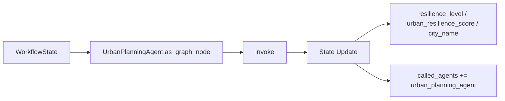
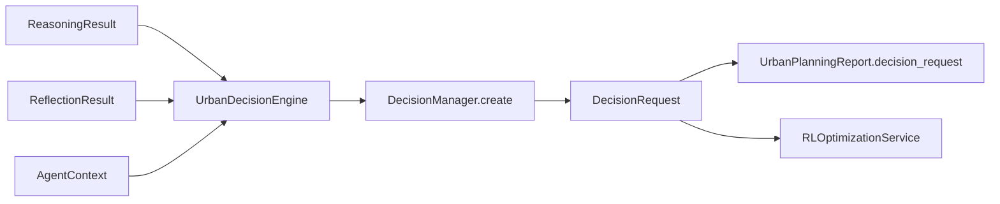
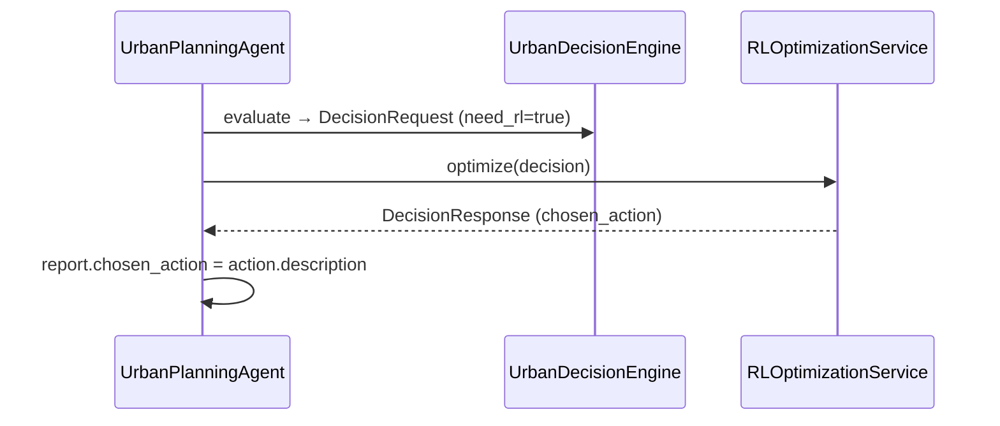
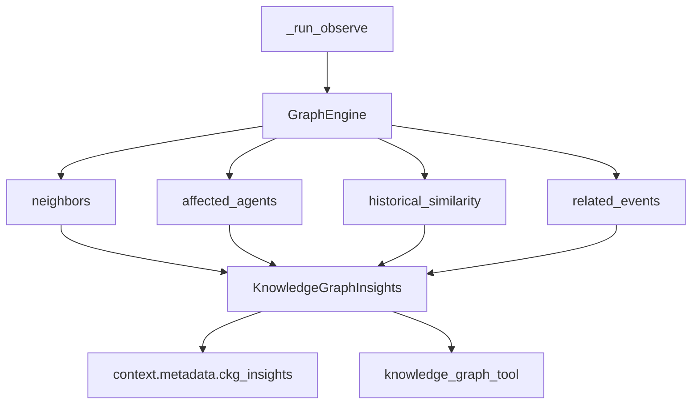
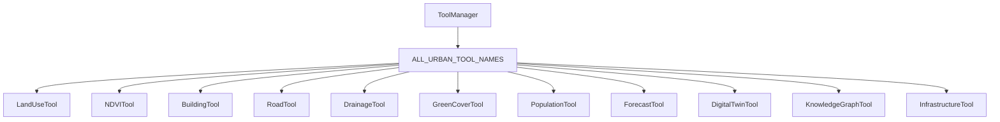
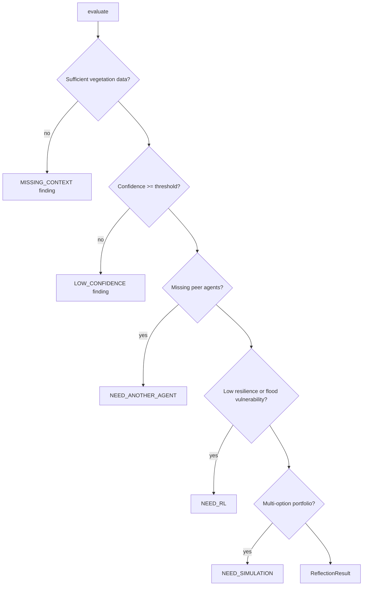
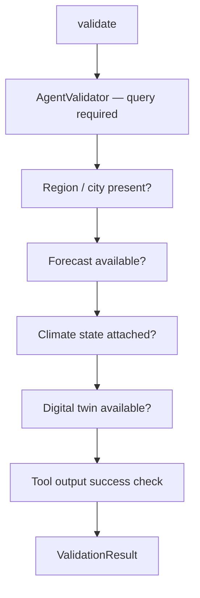

# Urban Planning Agent

> **Component:** Urban Planning Agent (Prompt 15)  
> **Status:** ✅ Complete  
> **Version:** 0.3.0  
> **Last Updated:** 2026-07-09  
> **Agent ID:** `urban_planning_agent`  
> **Source:** `backend/agents/specialized/urban_planning/`

---

## Purpose

The **Urban Planning Agent** (`UrbanPlanningAgent`) is a production-grade autonomous climate agent that evaluates long-term urban climate adaptation, resilience planning, and mitigation strategy portfolios for Indian cities. It is registered under the **Infrastructure Supervisor** domain and adopts the unified **Decision Framework** end-to-end — producing `backend.decision.DecisionRequest` objects with `DecisionType.URBAN` and consuming `DecisionResponse` objects from `RLOptimizationService.optimize()` directly.

The agent serves planners, municipal authorities, and infrastructure operators responding to urban heat island (UHI) effects, stormwater and drainage deficits, green-cover gaps, impervious-surface expansion, and compound hazard exposure. It is designed as core intelligence for Hyperion's future What-If Scenario Simulator, combining geospatial analysis, peer-agent hazard context, Climate Knowledge Graph (CKG) queries, RL-optimized adaptation portfolios, and full-pipeline explainability.

---

## Responsibilities

| Responsibility | Owner Module |
|----------------|--------------|
| Long-term climate adaptation and resilience scoring | `urban_reasoning.py`, `urban_models.py` |
| Urban heat island and building heat exposure | `urban_tools.py` (`building_tool`, `ndvi_tool`) |
| Green cover, canopy gap, and urban forest planning | `urban_tools.py` (`green_cover_tool`, `ndvi_tool`) |
| Drainage capacity and stormwater management | `urban_tools.py` (`drainage_tool`, `road_tool`) |
| Land-use composition and rezoning opportunities | `urban_tools.py` (`land_use_tool`) |
| Critical infrastructure climate exposure | `urban_tools.py` (`infrastructure_tool`) |
| Climate Knowledge Graph urban entity resolution | `urban_planning_agent.py` → `GraphEngine` |
| Peer-agent hazard context (flood, heat, water) | `urban_planning_agent.py` → `AgentCommunicationInterface` |
| Unified decision request construction | `urban_reasoning.py` (`UrbanDecisionEngine`) |
| RL-optimized mitigation portfolio selection | `urban_planning_agent.py` → `RLOptimizationService` |
| Full-pipeline explainability | `urban_planning_agent.py` → `ExplanationEngine` |
| Professional urban planning report generation | `urban_report.py` |
| Input/output validation | `urban_validator.py` |
| Confidence-based reflection and delegation | `urban_reflection.py` |
| Invocation metrics and observability | `urban_metrics.py` |
| LangGraph workflow node exposure | `urban_planning_agent.as_graph_node()` |

---

## Architecture



**Design distinction:** UrbanPlanningAgent wires directly into the unified decision and RL service layers (like HeatwaveAgent), with explicit CKG integration during observe and optional `ExplanationEngine` post-decision. Reflection runs after validation and before the decision engine.

---

## Folder Structure

```
backend/agents/specialized/urban_planning/
├── __init__.py                  # Public exports
├── urban_planning_agent.py      # UrbanPlanningAgent — main orchestrator
├── urban_context.py             # UrbanInputs, CKG insights, peer models
├── urban_metrics.py             # UrbanMetricsCollector, UrbanExecutionMetrics
├── urban_models.py              # Enums, action types, agent IDs
├── urban_reasoning.py           # 11-stage urban reasoning + UrbanDecisionEngine
├── urban_reflection.py          # Self-evaluation and inter-agent delegation
├── urban_report.py              # UrbanPlanningReport, UrbanReportBuilder
├── urban_tools.py               # 11 AbstractTool implementations
└── urban_validator.py           # Domain-specific validation rules

backend/tests/specialized/urban_planning/
├── conftest.py                  # Fixtures, scenario builders, MockRLOptimizationService
├── test_urban_unit.py           # 7 unit tests
└── test_urban_integration.py    # 9 integration tests
```

---

## Workflow

The UrbanPlanningAgent implements an internal LangGraph-style pipeline aligned with the canonical Hyperion specialized-agent pattern:

**Observe → Analyze → Reason → Validate → Decision → RL → XAI → Report**

Reflection and peer-agent consultation are integrated as sub-phases within this flow.



### Workflow Phases

| Phase | Method | Description |
|-------|--------|-------------|
| 1. Observe | `_run_observe` | Parse `UrbanInputs`, hydrate climate state, forecast, digital twin, CKG insights |
| 2. Peer Consult | `_collect_peer_inputs` | Merge pre-supplied or live-delegated peer agent outputs |
| 3. Analyze | `_run_analyze` | Execute all 11 urban tools in two parallel batches (10 + 1) |
| 4. Reason | `_run_reason` | 11-stage urban adaptation reasoning pipeline |
| 5. Validate | `_run_validate` | Region, forecast, climate state, twin, tool output checks |
| 6. Reflect | `_urban_reflection.evaluate` | Confidence check, RL/simulation/delegation signals |
| 7. Decide | `_run_decision_engine` | Build unified `DecisionRequest` via `UrbanDecisionEngine` |
| 8. RL Optimize | `_run_rl_service` | Call `RLOptimizationService.optimize()` when `need_rl` |
| 9. Explain | `_run_explainability` | Full-pipeline explanation via `ExplanationEngine` |
| 10. Report | `_run_report` | Assemble `UrbanPlanningReport` with decision + RL + XAI artifacts |

---

## Execution Pipeline

```mermaid
flowchart LR
    REQ[AgentRequest] --> OBS[Observe + CKG]
    OBS --> PEER[Peer Inputs]
    PEER --> TOOLS[11 Tools Parallel]
    TOOLS --> REASON[11-Stage Reasoning]
    REASON --> VALID[Validator]
    VALID --> REFLECT[Reflection]
    REFLECT --> DECIDE[DecisionType.URBAN]
    DECIDE --> RL[RL Service]
    RL --> XAI[Explainability]
    XAI --> REPORT[UrbanPlanningReport]
    REPORT --> RESP[AgentResponse]
```



**Batch tool execution:** Tools are split at index 10 — first batch runs in parallel, second batch (remaining tools) runs in parallel. This prevents resource contention while maintaining high throughput.

**Resilience scoring:** Composite resilience score from reasoning signals drives `UrbanResilienceLevel` classification and RL recommendation thresholds.

---

## LangGraph Integration

`UrbanPlanningAgent.as_graph_node()` extends the base implementation:

1. Calls `super().as_graph_node(state)` to run `invoke()` and merge standard workflow updates.
2. Enriches `update["metadata"]` with urban-specific fields when `last_urban_report` is set:

| Metadata Key | Source |
|--------------|--------|
| `resilience_level` | `report.resilience_level.value` |
| `urban_resilience_score` | `report.urban_resilience_score` |
| `city_name` | `report.metadata.city_name` |

The node is registerable under `InfrastructureSupervisor` and composable into infrastructure supervisor graphs without modifying upstream graph topology.



---

## Decision Framework Integration

UrbanPlanningAgent uses the unified decision schema via `UrbanDecisionEngine` embedded in `urban_reasoning.py`.



### DecisionRequest Construction

| Field | Source |
|-------|--------|
| `decision_type` | `DecisionType.URBAN` |
| `agent_id` | `"urban_planning_agent"` |
| `objectives` | Maximize resilience, reduce UHI/flood exposure, optimize green infrastructure ROI |
| `possible_actions` | Mapped from `UrbanActionType` catalog (9 action types) |
| `constraints` | Budget (`adaptation_budget_crores`), planning horizon, safety |
| `risk` | `RiskAssessment` from composite resilience score |
| `priority` | CRITICAL (resilience < 0.35) → LOW (resilience ≥ 0.75) |
| `need_rl` | Reflection flag OR low resilience + multi-option portfolio |
| `need_simulation` | From reflection (digital twin scenario recommended) |
| `need_other_agents` | heatwave, flood, water_resource, air_quality, agriculture |
| `need_human` | Critical resilience level or high infrastructure exposure |
| `context` | `DecisionContext` with city, scenario, peer outputs, CKG references |

### UrbanActionType Catalog

| Action | Description | Typical Trigger |
|--------|-------------|-----------------|
| `PLANT_TREES` | Expand urban tree canopy along heat corridors | Low NDVI / UHI |
| `GREEN_ROOFS` | Install green roofs on public/commercial buildings | High building density |
| `COOL_ROOFS` | Deploy cool-roof coatings on high-exposure buildings | `cool_roof_candidate` signal |
| `RAIN_GARDENS` | Construct rain gardens in flood-prone micro-catchments | Drainage deficit |
| `PERMEABLE_PAVEMENT` | Replace impervious surfaces with permeable pavement | High impervious road % |
| `STORMWATER_UPGRADES` | Upgrade stormwater detention and conveyance | `stormwater_upgrade_required` |
| `URBAN_FOREST_EXPANSION` | Expand urban forest blocks and green belts | Green cover gap ≥ 8% |
| `BUILDING_RETROFITS` | Retrofit buildings for thermal/flood resilience | High heat exposure |
| `LAND_USE_CHANGES` | Rezone for climate-resilient land use | High climate exposure score |

---

## RL Integration

UrbanPlanningAgent uses **`RLOptimizationService.optimize()` directly**.



### RL Invocation Logic (`_run_rl_service`)

```python
if not decision.need_rl or not self._rl_service:
    return None
try:
    return await self._rl_service.optimize(decision)
except RLOptimizationError:
    return None  # non-blocking; report still generated
```

### RL Recommendation Criteria

Reflection sets `needs_rl = true` when:

- `resilience_score < 0.55`, **or**
- ≥ 3 mitigation options in reasoning metadata, **or**
- Flood vulnerability signal is true

---

## Explainability Integration

When `ExplanationEngine` is injected, `_run_explainability()` builds a full-pipeline `ExplanationInput`:

| Artifact | XAI Consumption |
|----------|-----------------|
| `ReasoningResult.steps` | Step-by-step urban adaptation trace |
| `reasoning.trace` on report | Human-readable reasoning chain |
| `decision_request.rationale` | Decision justification strings |
| `rl_response` + `chosen_action` | RL action contrastive explanation |
| `UrbanAnalysisSignals` | Structured signal metadata for evidence linking |
| `ReflectionResult` + `ValidationResult` | Confidence and data-quality context |
| `AgentResponse.metadata.explainability_summary` | Executive XAI summary for API consumers |

Reports include both pre-RL (`decision_request`) and post-RL (`rl_response`) payloads plus optional `explainability_report` — enabling contrastive explanations of why a specific adaptation action was selected.

---

## Climate Knowledge Graph Integration

UrbanPlanningAgent queries `GraphEngine` directly during `_run_observe` via `_query_knowledge_graph()`:



| Query | Purpose | Output Field |
|-------|---------|--------------|
| `neighbors(entity_id)` | Infrastructure and population nodes | `infrastructure_nodes`, `population_nodes` |
| `affected_agents(entity_id)` | Cross-domain agent dependencies | `urban_dependencies` |
| `historical_similarity(entity_id)` | Prior mitigation project analogs | `historical_mitigation_projects` |
| `related_events(entity_id)` | Historical climate events | `historical_mitigation_projects` |

CKG insights are propagated into tool parameters via `ckg_insights` and surfaced by `knowledge_graph_tool`. Query count is tracked via `UrbanMetricsCollector.record_ckg_query()`.

When `graph_engine` is not injected, an empty `KnowledgeGraphInsights` is returned — the pipeline continues without CKG enrichment.

---

## Memory Integration

| Operation | Domain | Key Pattern | Content |
|-----------|--------|-------------|---------|
| Context retrieval | WORKING, SESSION, VECTOR | session-scoped | Prior conversation and analyses |
| Climate state | via `retrieve_climate_state` | — | `ClimateState` measurements |
| Report persistence | WORKING | `urban_report:{request_id}` | Full `UrbanPlanningReport.model_dump()` |
| Memory references | — | — | Stored in `report.references` |

Memory writes are tracked via `UrbanMetricsCollector.record_memory_write()`. All access flows through injected `MemoryManager` — no direct Redis/Qdrant access in the agent layer.

---

## Inter-Agent Communication

UrbanPlanningAgent supports bidirectional inter-agent communication via injected `AgentCommunicationInterface`.

### Peer Agent Map

| Agent ID | Domain | Typical Consultation Trigger |
|----------|--------|------------------------------|
| `heatwave_agent` | heatwave | UHI, elevated LST, thermal stress |
| `flood_agent` | flood | Drainage deficit, flood-prone zones |
| `water_resource_agent` | water_stress | Seasonal water supply constraints |
| `air_quality_agent` | air_quality | Compound urban pollution exposure |
| `agriculture_agent` | agriculture | Peri-urban agricultural interface |

### Consultation Modes

1. **Pre-supplied:** `peer_agent_outputs` in request context (test scenarios, supervisor orchestration).
2. **Live delegation:** `consult_agents` list triggers `call_other_agents()` during observe.
3. **Decision-driven:** `decision.need_other_agents` triggers post-decision delegation.

Peer outputs are normalized to `PeerAgentOutput` and fed into reasoning for compound hazard assessment.

---

## Tool Architecture

UrbanPlanningAgent registers **11 tools** via `create_urban_tools()`. All tools extend `AbstractTool` with `get_input_schema()`, `validate_input()`, and `_execute()`.



### Tool Reference

| Tool Name | Class | Category | Primary Outputs |
|-----------|-------|----------|-----------------|
| `land_use_tool` | `LandUseTool` | GEOSPATIAL | `climate_exposure_score`, `rezoning_opportunity`, land-use fractions |
| `ndvi_tool` | `NDVITool` | GEOSPATIAL | `ndvi`, `low_vegetation`, `cooling_potential_score`, `tree_planting_priority` |
| `building_tool` | `BuildingTool` | ANALYSIS | `heat_exposure_score`, `cool_roof_candidate`, `green_roof_candidate` |
| `road_tool` | `RoadTool` | ANALYSIS | `climate_risk_score`, `permeable_pavement_opportunity` |
| `drainage_tool` | `DrainageTool` | ANALYSIS | `capacity_score`, `drainage_deficit`, `stormwater_upgrade_required` |
| `green_cover_tool` | `GreenCoverTool` | GEOSPATIAL | `canopy_gap_pct`, `urban_forest_opportunity`, `cooling_potential_score` |
| `population_tool` | `PopulationTool` | ANALYSIS | `estimated_population`, `vulnerable_population`, `high_density_exposure` |
| `forecast_tool` | `ForecastTool` | FORECAST | `warming_trend_c_per_decade`, `escalating_heat_risk`, `escalating_flood_risk` |
| `digital_twin_tool` | `DigitalTwinTool` | SIMULATION | `urban_layers`, `scenario_ready` |
| `knowledge_graph_tool` | `KnowledgeGraphTool` | ANALYSIS | CKG infrastructure nodes, historical mitigation projects |
| `infrastructure_tool` | `InfrastructureTool` | ANALYSIS | `exposure_score`, `protection_required`, critical asset list |

### Tool Execution Policy

- All available tools run on every invocation (batched parallel: 10 + 1).
- Tool parameters merged from `context.request.context` plus `digital_twin_state` and `ckg_insights`.
- Inputs parsed through `UrbanInputs.from_request_context()`.

---

## Reflection Process

`UrbanReflectionEngine` evaluates analysis completeness and sets delegation flags:



### Inter-Agent Delegation Matrix

| Condition | Suggested Agent |
|-----------|-----------------|
| UHI or low green cover | `heatwave_agent` |
| Drainage deficit / flood-prone zones | `flood_agent` |
| Water stress signals from peers | `water_resource_agent` |
| Industrial/commercial land use dominance | `air_quality_agent` |
| Peri-urban agricultural interface | `agriculture_agent` |

---

## Validation Pipeline

`UrbanValidator` extends the framework validator with urban-specific rules:



| Check | Field | Strict Severity | Default Severity |
|-------|-------|-----------------|------------------|
| Region identifier | `region_id` / `city_name` | 0.85 | 0.55 |
| Forecast consistency | `forecast` | 0.7 | 0.4 |
| Climate state | `climate_state` | 0.75 | 0.45 |
| Digital twin | `digital_twin` | 0.6 | 0.35 |
| Failed tools | per tool | — | 0.65 |

When `validation.valid` is false, report confidence is capped at `0.5`.

---

## Metrics

`UrbanMetricsCollector` extends `AgentMetricsCollector` with urban-planning-specific dimensions.

### UrbanExecutionMetrics

| Metric | Description |
|--------|-------------|
| `reasoning_time_ms` | Total reasoning pipeline duration |
| `tool_usage_count` | Number of tools executed |
| `tools_used` | Deduplicated list of tool names |
| `memory_reads` / `memory_writes` | Memory operation counts |
| `confidence` | Final report confidence |
| `resilience_score` | Composite urban resilience score 0–1 |
| `resilience_level` | `UrbanResilienceLevel` enum |
| `peer_agents_consulted` | Count of peer agents with outputs |
| `decision_requests` | Count of decision framework calls (always ≥ 1) |
| `rl_calls` | Count of successful RL service invocations |
| `knowledge_graph_queries` | CKG query count during observe |
| `explainability_calls` | XAI engine invocations |
| `total_duration_ms` | End-to-end invocation time |

Accessible via `agent.last_urban_metrics.finalize_urban()` after invocation.

---

## Public APIs

### `UrbanPlanningAgent`

| Method / Property | Description |
|-------------------|-------------|
| `create(memory, *, rl_service, explanation_engine, graph_engine, ...)` | Async factory; calls `initialize()` |
| `invoke(request: AgentRequest)` | Full urban planning analysis pipeline |
| `declare_capabilities()` | Returns 12 `AgentCapability` entries |
| `as_graph_node(state: WorkflowState)` | LangGraph node; adds urban metadata to state |
| `required_inputs()` | Returns `["query"]` |
| `last_urban_report` | Most recent `UrbanPlanningReport` after invocation |
| `last_urban_metrics` | Most recent `UrbanMetricsCollector` |
| `AGENT_ID` / `agent_id` | Constant `"urban_planning_agent"` |

### Factory

```python
agent = await UrbanPlanningAgent.create(
    memory_manager,
    rl_service=rl_optimization_service,
    explanation_engine=explanation_engine,
    graph_engine=graph_engine,
    agent_communication=comm_interface,
    digital_twin=twin_interface,
)
response = await agent.invoke(request)
```

### Response Metadata

`AgentResponse.metadata` includes:

| Key | Type | Description |
|-----|------|-------------|
| `urban_report_id` | `str` | UUID of generated report |
| `resilience_level` | `str` | `UrbanResilienceLevel` value |
| `urban_resilience_score` | `float` | Composite resilience 0–1 |
| `confidence` | `float` | Overall confidence 0–1 |
| `recommendations` | `list[str]` | Adaptation recommendations |
| `evidence` | `list[dict]` | Supporting evidence artifacts |
| `need_rl` | `bool` | Whether RL was requested |
| `chosen_action` | `str \| null` | RL-selected mitigation action |
| `decision_request` | `dict` | Serialized `DecisionRequest` |
| `rl_response` | `dict \| null` | Serialized `DecisionResponse` |
| `explainability_summary` | `str \| null` | XAI executive summary |
| `metrics` | `dict` | `UrbanExecutionMetrics` |

### Domain Exports (`urban_planning/__init__.py`)

Key public types: `UrbanPlanningAgent`, `UrbanPlanningReport`, `UrbanInputs`, `UrbanResilienceLevel`, `UrbanActionType`, `URBAN_PLANNING_AGENT_ID`.

---

## Private Methods

| Method | Purpose |
|--------|---------|
| `_run_observe` | Build `AgentContext`, parse `UrbanInputs`, retrieve memory/climate/forecast/twin/CKG |
| `_collect_peer_inputs` | Merge pre-supplied or live-delegated peer agent outputs |
| `_query_knowledge_graph` | Execute CKG queries; populate `KnowledgeGraphInsights` |
| `_run_analyze` | Build tool specs from `ALL_URBAN_TOOL_NAMES`, execute in batched parallel |
| `_run_reason` | Delegate to `UrbanReasoningEngine.run()` |
| `_run_validate` | Delegate to `UrbanValidator.validate()` |
| `_run_decision_engine` | Delegate to `UrbanDecisionEngine.evaluate()` |
| `_run_rl_service` | Call `self._rl_service.optimize(decision)` when `need_rl` |
| `_run_explainability` | Call `ExplanationEngine.explain()` with full pipeline input |
| `_run_report` | Delegate to `UrbanReportBuilder.build()` |
| `_build_tool_specs` | Create `ToolCallSpec` for each registered urban tool |
| `_on_select_tools` | Hook override; returns same specs as `_build_tool_specs` |
| `_peer_from_delegation` | Normalize delegation response → `PeerAgentOutput` |
| `_persist_urban_report` | Store report JSON in `MemoryDomain.WORKING` |
| `_to_agent_report` | Convert `UrbanPlanningReport` → framework `AgentReport` |
| `_urban_report_to_response` | Convert report + metrics → `AgentResponse` |
| `_hydrate_digital_twin` | Inherited; loads twin state when interface available |

---

## Configuration

| Parameter | Default | Description |
|-----------|---------|-------------|
| `confidence_threshold` | `0.45` | Reflection low-confidence gate |
| `URBAN_PLANNING_AGENT_ID` | `"urban_planning_agent"` | Canonical agent identifier |
| Tool execution mode | `PARALLEL` (batched) | Two batches of 10 + 1 |
| `requires_climate_state` | `True` (metadata flag) | Set during observe phase |
| `planning_horizon_years` | `10` | Long-term adaptation horizon |
| `adaptation_budget_crores` | scenario-dependent | Budget constraint for decision engine |

### Request Context Keys

| Key | Type | Description |
|-----|------|-------------|
| `region_id` | `str` | Geographic region identifier |
| `city_name` | `str` | City name for reporting |
| `ndvi` | `float` | Normalized difference vegetation index |
| `green_cover_pct` | `float` | Urban green cover percentage |
| `building_density` | `float` | Building density 0–1 |
| `impervious_surface_pct` | `float` | Impervious surface fraction |
| `lst_c` | `float` | Land surface temperature |
| `uhi_intensity_c` | `float` | Urban heat island intensity |
| `population_density` | `float` | People per km² |
| `land_use` | `dict` | Land-use composition profile |
| `drainage` | `dict` | Drainage capacity profile |
| `planning_horizon_years` | `int` | Adaptation planning horizon |
| `adaptation_budget_crores` | `float` | Available adaptation budget |
| `peer_agent_outputs` | `dict` | Pre-supplied peer agent assessments |
| `consult_agents` | `list[str]` | Agent IDs for live delegation |
| `digital_twin_state` | `dict` | Twin urban planning layers |
| `districts` | `list[str]` | Affected administrative districts |

### Test Scenarios

| Scenario Builder | Description |
|------------------|-------------|
| `build_chennai_flooding_context()` | High impervious surface, drainage deficit |
| `build_delhi_uhi_context()` | Extreme UHI, low vegetation |
| `build_bengaluru_green_cover_context()` | Moderate vegetation with expansion opportunity |
| `build_hyderabad_drainage_context()` | Stormwater capacity deficit |

---

## Error Handling

| Exception | When Raised | Behavior |
|-----------|-------------|----------|
| `AgentInvocationError` | Any unhandled pipeline exception | Status → `FAILED`, metrics finalized, error logged |
| `RLOptimizationError` | RL service failure | Logged as warning; report generated without `rl_response` |
| `ToolValidationError` | Invalid tool input | Tool returns `success=False`; validator records issue |

CKG query failures are non-blocking — each query is wrapped in try/except with debug logging. The agent does **not** fail the entire invocation when RL optimization or CKG queries fail.

---

## Logging

Logger namespace: `backend.agents.specialized.urban_planning.urban_planning_agent`

| Event | Level | Key Fields |
|-------|-------|------------|
| `urban_observe_complete` | INFO | `region_id`, `city` |
| `urban_rl_optimization_failed` | WARNING | `decision_id`, `error` |
| `urban_planning_agent_failed` | ERROR | `request_id`, `error` |
| `ckg_*_skipped` | DEBUG | `error` (per CKG query) |

Reasoning steps are appended to `AgentContext` via `context.add_reasoning()` and reflection notes via `context.add_reflection()`.

---

## Performance Considerations

| Phase | Typical Duration (unit tests) |
|-------|-------------------------------|
| Tool execution (11 batched parallel) | 5–25 ms |
| CKG queries (4 parallel-safe) | 2–10 ms |
| Reasoning (11 steps) | 3–10 ms |
| Decision engine | 1–3 ms |
| Report build | 1–2 ms |
| RL service (mock) | < 1 ms |
| Explainability (when injected) | 5–15 ms |

Tool execution dominates wall-clock time. Batched parallel mode reduces latency versus sequential execution when tools perform independent computation.

---

## Scalability

- **Stateless invocations:** No instance state persists between requests except cached `last_*` properties for testing/debugging.
- **Horizontal scaling:** Multiple `UrbanPlanningAgent` instances can run behind `InfrastructureSupervisor` with shared `MemoryManager`.
- **Tool isolation:** Each tool is independently testable and replaceable without pipeline changes.
- **Async throughout:** All I/O-bound operations use `async/await`.
- **CKG graceful degradation:** Missing `GraphEngine` injection skips CKG without pipeline failure.

---

## Security

- No direct external API calls in the urban planning agent layer.
- Tool inputs validated via Pydantic models (`UrbanInputs`) and JSON Schema (`get_input_schema()`).
- Inter-agent calls require explicit `AgentCommunicationInterface` injection.
- Decision constraints enforce budget caps and safety risk ceilings.
- Digital twin and CKG access mediated through injected interfaces — no raw file/network access.
- Peer agent outputs sanitized through `PeerAgentOutput` schema validation.

---

## Testing Summary

| Test File | Count | Scope |
|-----------|-------|-------|
| `backend/tests/specialized/urban_planning/test_urban_unit.py` | **7** | Tools, inputs, reasoning, decision engine |
| `backend/tests/specialized/urban_planning/test_urban_integration.py` | **9** | Full agent invoke, RL mock, CKG, XAI, supervisor, LangGraph node |
| **Total** | **16** | All passing (v0.3.0) |

### Unit Tests (`test_urban_unit.py`)

| Test | Validates |
|------|-----------|
| `test_urban_tools_registered` | All 11 tools registered |
| `test_drainage_tool_chennai` | Chennai drainage deficit detection |
| `test_building_tool_delhi_uhi` | Delhi UHI heat exposure and cool-roof candidate |
| `test_urban_inputs_from_context` | Context parsing into `UrbanInputs` |
| `test_urban_reasoning_chennai_flood` | ≥ 10 reasoning steps, resilience score |
| `test_urban_decision_engine_delhi` | `DecisionType.URBAN`, unified schema |
| `test_green_cover_tool` | Canopy gap and urban forest opportunity |

### Integration Tests (`test_urban_integration.py`)

| Test | Validates |
|------|-----------|
| `test_urban_agent_chennai_flooding` | End-to-end Chennai flooding adaptation |
| `test_urban_agent_delhi_uhi` | Delhi UHI analysis, stormwater recommendations |
| `test_urban_agent_bengaluru_green_cover` | Green cover expansion planning |
| `test_urban_agent_hyderabad_drainage` | Hyderabad drainage upgrade portfolio |
| `test_urban_agent_with_rl_xai_ckg` | Mock RL, ExplanationEngine, GraphEngine |
| `test_urban_agent_live_peer_consultation` | Live peer agent delegation |
| `test_urban_as_graph_node` | LangGraph metadata enrichment |
| `test_urban_infrastructure_supervisor_slot` | InfrastructureSupervisor registration |
| `test_urban_report_sections` | Complete report field population |

### Test Fixtures (`conftest.py`)

| Fixture / Builder | Purpose |
|-------------------|---------|
| `build_chennai_flooding_context()` | Chennai urban flooding (78% impervious, drainage 0.28) |
| `build_delhi_uhi_context()` | Delhi UHI (46°C LST, 8% green cover) |
| `build_bengaluru_green_cover_context()` | Bengaluru green cover expansion (22% → 33% target) |
| `build_hyderabad_drainage_context()` | Hyderabad stormwater deficit |
| `build_consult_agents_context()` | Live peer consultation (Pune) |
| `MockUrbanComm` | Inter-agent communication stub |
| `MockRLOptimizationService` | RL stub returning `DecisionResponse` |
| `urban_agent` | Agent without RL/XAI/CKG |
| `urban_agent_full` | Agent with mock RL, XAI, and CKG |

---

## Known Limitations

| Limitation | Impact | Mitigation Path |
|------------|--------|-----------------|
| All 11 tools run every invocation | No dynamic tool selection by query | Implement capability-driven tool filtering |
| Population estimates are heuristic | `density × 25 × districts` approximation | Integrate census API |
| CKG queries use default entity fallback | May miss city-specific entities | Require explicit `region_id` entity mapping |
| Real `RLOptimizationService` enum gaps | Production RL tests use mock service | Resolve `ClimateVariable` enum gaps in RL encoder |
| Long-term forecasts are synthetic | `warming_trend_c_per_decade` from context defaults | Integrate CMIP6/downscaled projections |
| No rate limiting on inter-agent calls | Potential cascade under load | Add circuit breaker (framework roadmap) |

---

## Future Improvements

- Implement query-aware tool selection to skip irrelevant tools on mild scenarios.
- Wire live municipal GIS APIs for land-use and drainage data.
- Add LLM-augmented narrative generation for executive summaries and stakeholder briefs.
- Integrate Hyperion What-If Scenario Simulator for counterfactual adaptation modeling.
- Support multi-city batch analysis in a single invocation.
- Auto-invoke peer agents proactively when reflection detects missing hazard context.
- Expand CKG entity resolution with ward-level granularity.

---

## Related Documents

- [Specialized Agent Framework](./specialized_framework.md)
- [Heatwave Agent](./heatwave_agent.md)
- [Agriculture Agent](./agriculture_agent.md)
- [Air Quality Agent](./air_quality_agent.md)
- [Agent → Decision → RL Flow](../diagrams/agent_decision_rl_flow.md)
- [RL Optimization Service](../rl/README.md)
- [Infrastructure Supervisor](../domain/domain_supervisors.md)
- [Decision Framework](../decision/decision_framework.md)
