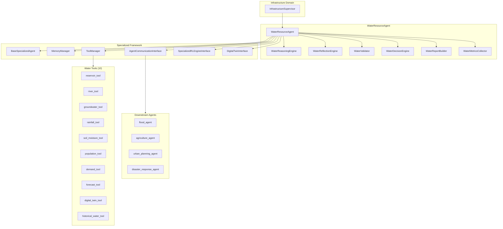
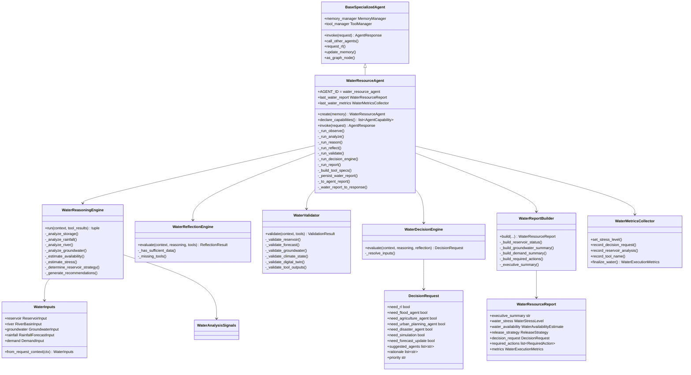
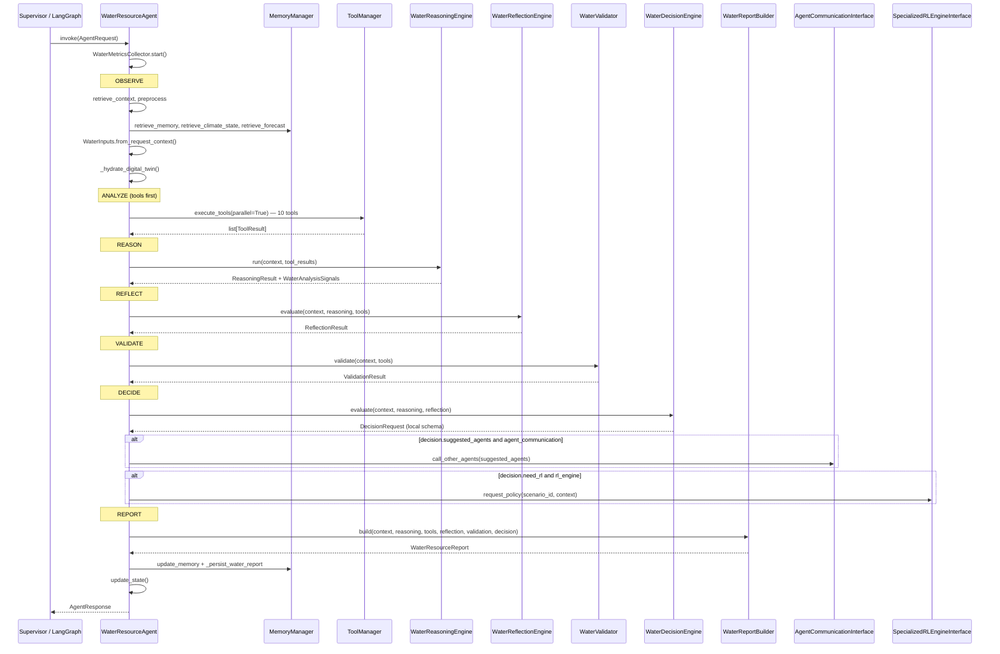
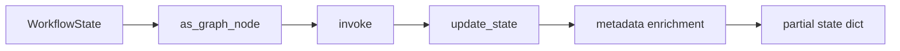
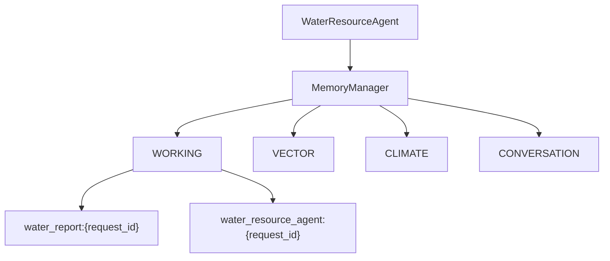
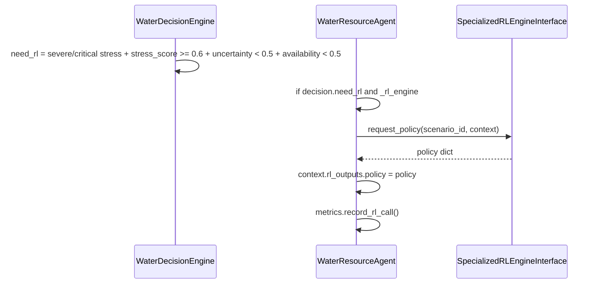
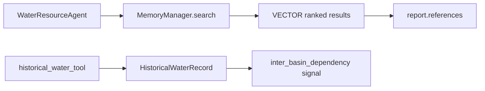
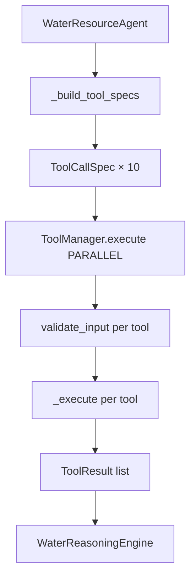
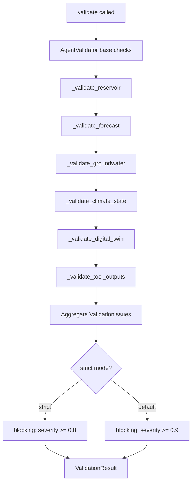
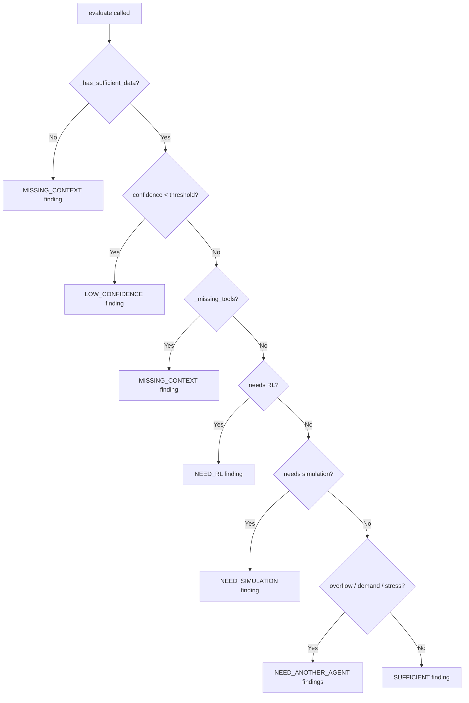

# Water Resource Agent

> **Component:** Infrastructure Domain — Water Resource Management  
> **Status:** ✅ Complete  
> **Version:** 0.2.0  
> **Last Updated:** 2026-07-07  
> **Agent ID:** `water_resource_agent`  
> **Source:** `backend/agents/specialized/water_resource/`  
> **Tests:** `backend/tests/specialized/water_resource/`

---

## Purpose

The Water Resource Agent is a production-grade specialized climate agent for India's reservoir operations, drought assessment, basin hydrology, and multi-sector water allocation. It extends `BaseSpecializedAgent` and serves as the central coordination point between Flood, Agriculture, Urban Planning, and Disaster Response agents within the Infrastructure domain.

The agent ingests hydrological inputs (reservoir levels, river discharge, groundwater, rainfall forecasts, sector demand), executes a domain-specific reasoning pipeline, and produces a structured `WaterResourceReport` with executive summary, stress classification, release strategy, recommendations, and downstream delegation flags.

Unlike the Heatwave agent, the Water Resource Agent uses a **local decision schema** (`water_context.DecisionRequest`) rather than the unified `backend.decision.DecisionRequest`. This local schema carries reciprocal `need_*_agent` boolean flags and a `suggested_agents` list that are kept in sync — a prior bug where flags and agent IDs could diverge was fixed in `WaterDecisionEngine.evaluate()`.

---

## Responsibilities

| Responsibility | Owner Module | Description |
|----------------|--------------|-------------|
| Invocation orchestration | `water_resource_agent.py` | Custom Observe → Analyze → Reason → Reflect → Validate → Decide → Report pipeline |
| Capability declaration | `water_resource_agent.py` | 11 registered capabilities for reservoir, basin, demand, and forecast analysis |
| Input parsing | `water_context.py` | `WaterInputs.from_request_context()` normalizes request context into typed models |
| Hydrological reasoning | `water_reasoning.py` | 11-stage pipeline computing stress, availability, and release strategy |
| Self-evaluation | `water_reflection.py` | Confidence gating, missing-data detection, delegation signals |
| Input/output validation | `water_validator.py` | Reservoir, forecast, groundwater, climate state, and digital twin checks |
| Downstream routing | `water_decision_engine.py` | Rule-based decision layer for RL, simulation, forecast, and inter-agent needs |
| Report assembly | `water_report.py` | `WaterResourceReport` with executive summary, required actions, and metrics |
| Tool execution | `water_tools.py` | 10 domain tools for reservoir, river, groundwater, demand, and twin data |
| Metrics collection | `water_metrics.py` | `WaterMetricsCollector` with stress level and reservoir analysis dimensions |
| Domain enumerations | `water_models.py` | `WaterStressLevel`, `ReleaseStrategy`, `WaterAvailabilityBand`, agent ID constants |

---

## Architecture



### Design Notes

| Decision | Rationale |
|----------|-----------|
| Tools before reasoning | Hydrological signals must be materialized before the 11-stage reasoning pipeline can score storage, rainfall, and demand |
| Local `DecisionRequest` | Faster iteration for water-specific flags (`need_flood_agent`, `need_forecast_update`); migration to unified schema planned |
| Parallel tool execution | All registered water tools run concurrently via `execute_tools(..., parallel=True)` |
| Override `invoke()` | Base class default orders reasoning before tools; water domain requires the inverse |
| `confidence_threshold=0.45` | Default reflection gate tuned for hydrological data sparsity |

---

## Folder Structure

```
backend/agents/specialized/water_resource/
├── __init__.py                  # Package exports
├── water_resource_agent.py      # WaterResourceAgent — main entry point
├── water_models.py              # Enumerations and agent ID constants
├── water_context.py             # Domain models, WaterInputs, local DecisionRequest
├── water_tools.py               # 10 AbstractTool implementations + factory
├── water_reasoning.py           # WaterReasoningEngine — 11-stage pipeline
├── water_reflection.py          # WaterReflectionEngine — self-evaluation
├── water_validator.py           # WaterValidator — domain validation rules
├── water_decision_engine.py     # WaterDecisionEngine — routing decisions
├── water_report.py              # WaterReportBuilder, WaterResourceReport
└── water_metrics.py             # WaterMetricsCollector, WaterExecutionMetrics

backend/tests/specialized/water_resource/
├── conftest.py                  # Fixtures: Krishna basin scenarios, MockWaterComm
├── test_water_unit.py           # 13 unit tests (tools, reasoning, validator, decision)
└── test_water_integration.py    # 11 integration tests (agent, supervisor, LangGraph)
```

---

## Class Diagram



---

## Execution Flow

### High-Level Pipeline



### Reasoning Sub-Pipeline (11 Stages)


Each stage produces a `ReasoningStep` appended to `ReasoningResult.steps`. Intermediate signals accumulate in `WaterAnalysisSignals` and are serialized into `reasoning.metadata["water_signals"]`.

---

## Public APIs

### `WaterResourceAgent`

| Method / Property | Signature | Description |
|-------------------|-----------|-------------|
| `AGENT_ID` | `str` | Class constant: `"water_resource_agent"` |
| `__init__` | `(memory, *, rl_engine, agent_communication, digital_twin, confidence_threshold=0.45)` | Constructs agent with 10 tools and domain engines |
| `create` | `async (memory, *, rl_engine, agent_communication, digital_twin) → WaterResourceAgent` | Factory: construct + `initialize()` |
| `declare_capabilities` | `async () → list[AgentCapability]` | Returns 11 water management capabilities |
| `invoke` | `async (request: AgentRequest) → AgentResponse` | Full water resource workflow (overrides base) |
| `required_inputs` | `async () → list[str]` | Returns `["query"]` |
| `as_graph_node` | `async (state: WorkflowState) → dict[str, Any]` | LangGraph node with water stress metadata |
| `last_water_report` | `property → WaterResourceReport \| None` | Most recent domain report |
| `last_water_metrics` | `property → WaterMetricsCollector \| None` | Most recent metrics collector |

### Inherited from `BaseSpecializedAgent`

| Method | Description |
|--------|-------------|
| `initialize()` | Registers capabilities, sets `_initialized` |
| `health()` / `health_check()` | Returns `AgentHealthReport`; checks tool and capability counts |
| `memory_manager` | `MemoryManager` instance |
| `tool_manager` | `ToolManager` with 10 registered water tools |
| `capability_registry` | `CapabilityRegistry` with 11 capabilities |
| `call_other_agents(context, agent_ids, request)` | Delegates via `AgentCommunicationInterface` |
| `request_rl(context)` | Requests RL policy via `SpecializedRLEngineInterface` |
| `update_memory(context, report)` | Persists `AgentReport` to WORKING and CONVERSATION domains |
| `update_state(context, report)` | Produces `WorkflowState` partial update |

### `WaterReasoningEngine`

| Method | Signature | Description |
|--------|-----------|-------------|
| `run` | `async (context, tool_results) → (ReasoningResult, WaterAnalysisSignals)` | Executes full 11-stage reasoning pipeline |

### `WaterDecisionEngine`

| Method | Signature | Description |
|--------|-----------|-------------|
| `evaluate` | `async (context, reasoning, reflection) → DecisionRequest` | Produces local decision with reciprocal agent flags |

### `WaterValidator`

| Method | Signature | Description |
|--------|-----------|-------------|
| `validate` | `async (context, tool_results, *, strict=False) → ValidationResult` | Domain + base validation |

### `WaterReflectionEngine`

| Method | Signature | Description |
|--------|-----------|-------------|
| `evaluate` | `async (context, reasoning, tool_results) → ReflectionResult` | Self-evaluation with delegation signals |

### `WaterReportBuilder`

| Method | Signature | Description |
|--------|-----------|-------------|
| `build` | `(context, reasoning, tools, reflection, validation, decision) → WaterResourceReport` | Assembles final report |

### `create_water_tools()`

| Returns | Description |
|---------|-------------|
| `list[AbstractTool]` | Factory returning all 10 water resource tools |

### Package Exports (`__init__.py`)

`WaterResourceAgent`, `WATER_RESOURCE_AGENT_ID`, `WaterInputs`, `DecisionRequest`, `WaterResourceReport`, `WaterStressLevel`, `ReleaseStrategy`, `WaterAvailabilityBand`, `ReservoirStatus`, `GroundwaterTrend`, and all engine/builder classes.

---

## Private Methods

### `WaterResourceAgent`

| Method | Purpose |
|--------|---------|
| `_run_observe(request)` | Builds `AgentContext`, parses `WaterInputs`, hydrates climate/forecast/twin |
| `_run_analyze(context, metrics)` | Executes all tools in parallel, records tool metrics |
| `_run_reason(context, tool_results, metrics)` | Delegates to `WaterReasoningEngine.run()` |
| `_run_reflect(context, reasoning, tool_results)` | Delegates to `WaterReflectionEngine.evaluate()` |
| `_run_validate(context, tool_results)` | Delegates to `WaterValidator.validate()` |
| `_run_decision_engine(context, reasoning, reflection)` | Delegates to `WaterDecisionEngine.evaluate()` |
| `_run_report(context, reasoning, tools, reflection, validation, decision)` | Delegates to `WaterReportBuilder.build()` |
| `_build_tool_specs(context)` | Creates `ToolCallSpec` for every registered water tool |
| `_on_select_tools(context, reasoning)` | Hook override; delegates to `_build_tool_specs()` |
| `_persist_water_report(context, report)` | Stores report to `MemoryDomain.WORKING` at key `water_report:{request_id}` |
| `_to_agent_report(water_report)` | Converts `WaterResourceReport` → `AgentReport` for framework memory |
| `_water_report_to_response(report, metrics, memory_refs)` | Converts report → `AgentResponse` with water metadata |

### `WaterReasoningEngine` (selected)

| Method | Purpose |
|--------|---------|
| `_resolve_inputs(context)` | Retrieves `WaterInputs` from context metadata |
| `_index_tool_outputs(results)` | Maps successful tool outputs by tool name |
| `_analyze_storage/river/groundwater/...` | Per-stage signal computation |
| `_estimate_availability(outputs, signals)` | Computes `WaterAvailabilityEstimate` with band classification |
| `_estimate_stress(signals, availability)` | Maps composite score → `WaterStressLevel` |
| `_determine_reservoir_strategy(outputs, signals)` | Selects `ReleaseStrategy` |
| `_generate_recommendations(signals, stress, strategy, availability)` | Produces actionable recommendation list |

### `WaterDecisionEngine`

| Method | Purpose |
|--------|---------|
| `_resolve_inputs(context)` | Retrieves `WaterInputs` from context metadata |

### `WaterReflectionEngine`

| Method | Purpose |
|--------|---------|
| `_has_sufficient_data(inputs, tool_results)` | Requires ≥4 successful tools + reservoir data |
| `_missing_tools(tool_results)` | Checks for `reservoir_tool`, `rainfall_tool`, `demand_tool` |

### `WaterValidator`

| Method | Purpose |
|--------|---------|
| `_validate_reservoir/forecast/groundwater/climate_state/digital_twin` | Per-domain prerequisite checks |
| `_validate_tool_outputs(tool_results)` | Flags failed tool executions |

---

## LangGraph Integration

`WaterResourceAgent.as_graph_node()` extends the base implementation:

1. Extracts query from `WorkflowState.conversation`, `messages`, or `metadata.query`.
2. Constructs `AgentRequest` with climate state and workflow context.
3. Calls overridden `invoke()` (full water pipeline).
4. Merges `update_state()` output into partial state update.
5. Appends assistant turn to conversation if present.
6. Enriches `metadata` with `water_stress`, `availability_band`, and `release_strategy` from `_last_water_report`.



**State keys written:**

| Key | Value |
|-----|-------|
| `called_agents` | `[water_resource_agent]` |
| `agent_status` | `COMPLETED` |
| `tool_outputs` | Tool output dict from report |
| `memory_references` | Memory keys from invocation |
| `metadata.water_stress` | e.g. `moderate`, `severe` |
| `metadata.availability_band` | e.g. `adequate`, `deficit` |
| `metadata.release_strategy` | e.g. `hold`, `emergency_spill` |
| `conversation` | Updated with assistant turn |
| `rl_outputs` | RL policy if `request_rl()` was called |

---

## Memory Integration

| Phase | Domain | Key Pattern | Content |
|-------|--------|-------------|---------|
| Observe — retrieve | WORKING | `{agent_id}:latest` | Prior agent report |
| Observe — search | VECTOR | semantic query | Ranked prior analyses |
| Observe — climate | CLIMATE | `current_state` | `ClimateState` if not on request |
| Observe — forecast | VECTOR | `document_type=forecast_summary` | Forecast payloads |
| Persist — report | WORKING | `water_report:{request_id}` | Full `WaterResourceReport.model_dump()` |
| Persist — framework | WORKING | `{agent_id}:{request_id}` | `AgentReport` via `update_memory()` |
| Persist — conversation | CONVERSATION | `turn:{request_id}` | Executive summary text |

Memory access flows exclusively through `MemoryManager` — no direct backend access. The agent records `memory_reads` and `memory_writes` via `WaterMetricsCollector` / `AgentMetricsCollector`.



---

## Decision Framework Integration

The Water Resource Agent uses a **local** `DecisionRequest` schema defined in `water_context.py`, distinct from the unified `backend.decision.DecisionRequest` consumed by the RL service and Heatwave agent.

### Local Decision Schema

| Field | Type | Description |
|-------|------|-------------|
| `request_id` | `str` | UUID for this decision |
| `need_rl` | `bool` | Complex multi-basin allocation warrants RL |
| `need_flood_agent` | `bool` | Reservoir overflow risk |
| `need_agriculture_agent` | `bool` | High agricultural water demand |
| `need_urban_planning_agent` | `bool` | High urban water demand |
| `need_disaster_agent` | `bool` | Severe/critical water stress |
| `need_simulation` | `bool` | Basin-scale water simulation needed |
| `need_forecast_update` | `bool` | Updated rainfall forecast required |
| `suggested_agents` | `list[str]` | Deduplicated agent IDs for delegation |
| `rationale` | `list[str]` | Human-readable decision rationale |
| `priority` | `str` | `normal`, `high`, or `critical` |
| `metadata` | `dict` | Stress score, availability score |

### Reciprocal Decision Flags (Bug Fix)

A prior bug allowed `need_*_agent` boolean flags to be set without the corresponding agent appearing in `suggested_agents` (or vice versa). `WaterDecisionEngine.evaluate()` now maintains **reciprocal consistency**:

- When `need_flood_agent=True`, `flood_agent` is appended to `suggested_agents`.
- When `need_agriculture_agent=True`, `agriculture_agent` is appended.
- When `need_urban_planning_agent=True`, `urban_planning_agent` is appended.
- When `need_disaster_agent=True`, `disaster_response_agent` is appended.
- `suggested_agents` is deduplicated via `list(dict.fromkeys(suggested))`.

### Decision Rules

| Condition | Flag Set | Agent Suggested |
|-----------|----------|-----------------|
| `overflow_risk` or `level_pct >= 95` | `need_flood_agent` | `flood_agent` |
| `agricultural_demand_high` or `crop_area_ha > 1000` | `need_agriculture_agent` | `agriculture_agent` |
| `urban_demand_high` or `population > 1M` | `need_urban_planning_agent` | `urban_planning_agent` |
| Stress `SEVERE` or `CRITICAL` | `need_disaster_agent` | `disaster_response_agent` |
| Stress `SEVERE/CRITICAL` + `stress_score >= 0.6` + low uncertainty + low availability | `need_rl` | — |
| High/severe stress, dependent basins, or overflow | `need_simulation` | — |
| No forecast or rainfall deficit or `stress_score >= 0.4` | `need_forecast_update` | — |

### Future Migration Path

Local `DecisionRequest` will be converted to `backend.decision.DecisionRequest` at the report boundary (similar to Heatwave agent), enabling direct consumption by `DecisionManager`, `RLOptimizationService`, and XAI `ExplanationEngine.explain_decision()`.

---

## RL Integration

The Water Resource Agent integrates with reinforcement learning via `SpecializedRLEngineInterface` (not the unified `RLOptimizationService`).



### RL Trigger Conditions

| Signal | Threshold |
|--------|-----------|
| Water stress | `SEVERE` or `CRITICAL` |
| Stress score | `>= 0.6` |
| Uncertainty | `< 0.5` |
| Availability score | `< 0.5` |

### `SpecializedRLEngineInterface` Contract

```python
async def request_policy(scenario_id: str, *, context: dict | None) -> dict
async def evaluate_action(action: dict, *, state: dict | None) -> dict
```

Context payload includes `query`, `agent_id`, and serialized `climate_state`.

### Required Actions

When `need_rl=True`, `WaterReportBuilder` adds a `RequiredAction`:

> "Request RL policy for optimal reservoir release scheduling" (priority: `high`, category: `rl`)

---

## Knowledge Graph Integration

Current integration is **indirect** via `MemoryManager`:

| Path | Usage |
|------|-------|
| `MemoryManager.search()` | Semantic retrieval of prior water analyses (VECTOR domain) |
| `context.memory.references` | Propagated to `WaterResourceReport.references` |
| `historical_water_tool` | Compares current conditions against `HistoricalWaterRecord` entries |
| `dependent_basins` | Inter-basin dependency flag in `WaterAnalysisSignals` |

The standalone `backend/knowledge_graph/GraphEngine` (Climate Knowledge Graph) is not yet wired into the water agent's `build_context()` phase. Future integration will query basin-reservoir-aquifer entity relationships for inter-basin transfer planning.



---

## Explainability Integration

The Water Resource Agent produces rich artifacts consumable by the XAI subsystem (`backend/xai/`):

| Artifact | XAI Consumer | Usage |
|----------|--------------|-------|
| `ReasoningResult.steps` | `ExplanationEngine.explain_pipeline()` | 11-stage hydrological reasoning trace |
| `ReasoningStep.metadata["stage"]` | Evidence engine | Stage-level evidence attribution |
| `WaterAnalysisSignals` | Confidence engine | Signal coverage for uncertainty quantification |
| `WaterResourceReport.recommendations` | Explanation report | Actionable output for stakeholders |
| `decision_request.rationale` | `EvidenceEngine._collect_decision_rationale()` | Decision justification (local schema) |
| `AgentResponse.metadata` | `ExplanationReport` | Stress, availability, supply/demand, confidence |
| `tool_outputs` | Evidence engine | Tool-level provenance |

### Reasoning Trace Format

Each step is recorded as `"[{phase}] {content}"` in `context.reasoning_trace` and `WaterResourceReport.reasoning`.

### Gap

Local `DecisionRequest` is not yet compatible with `ExplanationEngine.explain_decision()` which expects unified `backend.decision.DecisionRequest`. Migration to unified schema will close this gap.

---

## Tool Architecture

### Tool Registry

| Tool Name | Class | Category | Required Inputs | Key Outputs |
|-----------|-------|----------|-----------------|-------------|
| `reservoir_tool` | `ReservoirTool` | ANALYSIS | `reservoir_level_pct` or `live_storage_mcm` | `level_pct`, `status`, `overflow_risk`, `recommended_release`, `storage_score` |
| `river_tool` | `RiverTool` | ANALYSIS | — (defaults applied) | `river_healthy`, `overflow`, `river_score`, `flow_balance_m3s` |
| `groundwater_tool` | `GroundwaterTool` | ANALYSIS | `groundwater_depth_m` or `groundwater_level_m` | `declining`, `critical`, `groundwater_score`, `sustainable` |
| `rainfall_tool` | `RainfallTool` | FORECAST | — | `rainfall_deficit`, `rainfall_score`, `monsoon_normal_pct` |
| `soil_moisture_tool` | `SoilMoistureTool` | ANALYSIS | — | `irrigation_needed`, `deficit_index`, `soil_moisture_score` |
| `population_tool` | `PopulationTool` | ANALYSIS | — | `population`, `estimated_urban_demand_m3d` |
| `demand_tool` | `DemandTool` | ANALYSIS | — | `total_demand_m3d`, `urban/agricultural_demand_high`, `demand_score` |
| `forecast_tool` | `ForecastTool` | FORECAST | — | `forecast_available`, `forecast_score`, `improving_trend` |
| `digital_twin_tool` | `DigitalTwinTool` | SIMULATION | `twin_id` (optional) | `water_layers`, `reservoir_level_pct`, `active_scenario` |
| `historical_water_tool` | `HistoricalWaterTool` | RETRIEVAL | — | `drought_analog`, `historical_analog`, `records` |

### Tool Execution Model



- All tools share request context via `ToolCallSpec.parameters` (includes `digital_twin_state`).
- `ReservoirTool` and `GroundwaterTool` raise `ToolValidationError` on missing required inputs.
- Tools derive region from `WaterInputs.region_id` via `_extract_inputs()`.

### Tool Selection Strategy

`WaterResourceAgent` executes **all** registered water tools on every invocation (no selective filtering). This ensures complete signal coverage for the reasoning pipeline at the cost of always running 10 tools.

---

## Validation Pipeline



### Validation Rules

| Check | Category | Severity (default / strict) | Blocking? |
|-------|----------|----------------------------|-----------|
| Missing `query` | REQUIRED_INPUTS | base validator | Yes |
| No reservoir data | REQUIRED_INPUTS | 0.65 / 0.9 | Strict only |
| No rainfall forecast | FORECAST_CONSISTENCY | 0.4 / 0.7 | No |
| No groundwater data | REQUIRED_INPUTS | 0.45 / 0.75 | No |
| No climate state | CLIMATE_CONSISTENCY | 0.45 / 0.75 | No |
| No digital twin | REQUIRED_INPUTS | 0.35 / 0.6 | No |
| Failed tool execution | TOOL_OUTPUTS | 0.65 | No |

Validation issues are appended to `context.validation_errors`. Invalid validation caps report confidence at `0.5` in `WaterReportBuilder.build()`.

---

## Reflection Pipeline



### Reflection Signals

| Signal | Trigger | Suggested Agent |
|--------|---------|-----------------|
| `MISSING_CONTEXT` | <4 successful tools or no reservoir data | — |
| `LOW_CONFIDENCE` | `overall_confidence < confidence_threshold` (0.45) | — |
| `NEED_RL` | Severe/critical stress + composite score ≥ 0.5 + uncertainty < 0.5 | — |
| `NEED_SIMULATION` | Overflow risk, high+ stress, or dependent basins | — |
| `NEED_ANOTHER_AGENT` | Overflow → flood; agri demand → agriculture; urban → urban planning; severe stress → disaster | Respective agent ID |
| `SUFFICIENT` | No issues found | — |

`ReflectionResult.should_retry_reasoning` is `True` when `LOW_CONFIDENCE` finding exists. The water agent does not currently re-run reasoning on retry (no retry loop in `invoke()`).

---

## Metrics

### `WaterExecutionMetrics`

| Field | Type | Description |
|-------|------|-------------|
| `agent_id` | `str` | `water_resource_agent` |
| `request_id` | `str` | Request scope |
| `reasoning_time_ms` | `float` | Sum of reasoning step durations |
| `tool_usage_count` | `int` | Number of tools executed |
| `memory_reads` | `int` | Memory retrieve/search operations |
| `memory_writes` | `int` | Report + framework persistence writes |
| `confidence` | `float` | Final report confidence |
| `water_stress_level` | `WaterStressLevel` | Classified stress from reasoning |
| `reservoir_analyses` | `int` | Count of successful `reservoir_tool` runs |
| `decision_requests` | `int` | Decision engine invocations (always 1) |
| `tools_used` | `list[str]` | Deduplicated successful tool names |
| `total_duration_ms` | `float` | Wall-clock invocation time |

Accessible via:
- `water_agent.last_water_metrics.finalize_water()`
- `response.metadata["metrics"]`

---

## Logging

| Logger | Namespace |
|--------|-----------|
| Module logger | `backend.agents.specialized.water_resource.*` |
| Framework logger | `specialized.water_resource_agent` (inherited) |

### Structured Log Events

| Event | Level | Fields |
|-------|-------|--------|
| `water_observe_complete` | INFO | `region_id`, `basin_id` |
| `water_agent_failed` | ERROR | `request_id`, `error` |
| `water_reasoning_completed` | DEBUG | `agent_id`, `stress_score`, `availability_score` |
| `water_decision_evaluated` | DEBUG | `agent_id`, `suggested_agents`, `need_rl`, `need_simulation` |
| `water_validation_completed` | DEBUG | `agent_id`, `valid`, `issues` |
| `water_reflection_completed` | DEBUG | `agent_id`, `needs_rl`, `suggested_agents` |
| `water_report_generated` | INFO | `agent_id`, `stress_level`, `availability_band` |

---

## Error Handling

| Exception | When Raised | Recovery |
|-----------|-------------|----------|
| `AgentInvocationError` | Any unhandled exception in `invoke()` | Status → `FAILED`; metrics finalized; error logged |
| `ToolValidationError` | Missing required inputs for `reservoir_tool` / `groundwater_tool` | Tool returns `success=False`; flagged in validation |
| `AgentInitializationError` | `invoke()` before `initialize()` (auto-initializes) | Transparent retry via `if not self._initialized` guard |

Error response includes:
```python
AgentInvocationError(
    "Water resource agent failed: {exc}",
    details={"agent_id": "water_resource_agent", "request_id": "..."},
)
```

Failed tool results are non-blocking by default (severity 0.65 validation issue) unless strict validation is enabled via `context.metadata["strict_validation"]`.

---

## Configuration

| Parameter | Default | Location | Description |
|-----------|---------|----------|-------------|
| `confidence_threshold` | `0.45` | `WaterResourceAgent.__init__` | Reflection confidence gate |
| `WATER_RESOURCE_AGENT_ID` | `"water_resource_agent"` | `water_models.py` | Canonical agent identifier |
| `ALL_WATER_TOOL_NAMES` | 10 tool names | `water_tools.py` | Tools executed per invocation |
| `VECTOR_SEARCH_TOP_K` | from `utils/constants.py` | Base class memory search | Semantic retrieval depth |
| `dead_storage_pct` | `10.0` | `ReservoirInput` default | Dead storage assumption |
| Per-capita demand | `135.0` LPCD | `PopulationTool`, `DemandTool` | Urban demand estimation |
| Irrigation efficiency default | `0.45` | `DemandTool` | Crop area → demand conversion |

### Request Context Flags

| Flag | Effect |
|------|--------|
| `forecast_available` | Skips forecast validation warning |
| `reservoir_available` | Marks reservoir data present |
| `groundwater_available` | Marks groundwater data present |
| `digital_twin_available` | Marks twin data present |
| `twin_id` | Triggers `DigitalTwinInterface.get_state()` if injected |
| `strict_validation` | Enables strict validation severity thresholds |

---

## Performance

| Phase | Typical Contribution | Notes |
|-------|---------------------|-------|
| Observe (memory + climate) | 5–15 ms | In-memory backend in tests |
| Tool execution (parallel) | 10–30 ms | 10 tools, CPU-bound calculations |
| Reasoning pipeline | 1–5 ms | Pure Python signal computation |
| Reflection + validation | 1–3 ms | Rule evaluation |
| Decision engine | <1 ms | Rule-based, no I/O |
| Report generation | 1–2 ms | Pydantic model assembly |
| Memory persistence | 2–5 ms | Two WORKING writes |

**Observed in tests:** `tool_usage_count >= 5`, `total_duration_ms` typically under 100 ms with in-memory backends.

### Optimization Opportunities

- Selective tool execution based on query-matched capabilities (currently runs all 10).
- Cache `WaterInputs.from_request_context()` across phases (currently re-resolved).
- Skip digital twin tool when `digital_twin_available=False`.

---

## Scalability

| Aspect | Behavior |
|--------|----------|
| Agent state | Stateless between invocations; safe for horizontal scaling |
| Tool parallelism | `ToolExecutionMode.PARALLEL` reduces wall-clock for I/O-bound production tools |
| Memory | Async `MemoryManager` throughout; no blocking I/O in hot path |
| Delegation | Sequential per-agent calls in `call_other_agents()`; parallelization possible |
| Domain supervisor | `InfrastructureSupervisor` routes water management tasks to `water_resource_agent` |
| Registry | Registerable via `InfrastructureSupervisor.register_agent()` |

---

## Security

| Control | Implementation |
|---------|----------------|
| Input validation | Pydantic models with field constraints (`ge`, `le`) on all domain inputs |
| Tool validation | `AbstractTool.validate_input()` before execution; `ToolValidationError` on schema violations |
| No direct I/O | Tools perform deterministic calculations; no filesystem or network access |
| Agent delegation | Requires explicit `AgentCommunicationInterface` injection — no global agent registry access |
| Memory isolation | Session-scoped keys (`session_id`) prevent cross-session data leakage |
| Error sanitization | Exception details in `AgentInvocationError.details` limited to `agent_id` and `request_id` |

---

## Known Limitations

| Limitation | Impact |
|------------|--------|
| Local `DecisionRequest` schema | Not directly consumable by unified `DecisionManager` or `RLOptimizationService` |
| All-tools-every-invocation | Runs 10 tools even when query needs subset; increases latency |
| No reasoning retry loop | `should_retry_reasoning` from reflection is not acted upon |
| Rule-based decision engine | No ML/RL in decision layer itself; RL only triggered as downstream request |
| Simplified supply model | `supply_m3d = live_storage/30 + discharge*86400*0.1` is approximate |
| No LLM reasoning | All reasoning is deterministic rule/score based |
| Digital twin optional | Validation warns but does not block when twin unavailable |
| Agriculture/Urban agents | Delegation targets are registered but agents may not exist yet |
| CKG not wired | Knowledge graph entity relationships not queried during context build |
| XAI decision explain | Local decision schema incompatible with `explain_decision()` |

---

## Future Improvements

| Improvement | Priority | Description |
|-------------|----------|-------------|
| Unified `DecisionRequest` migration | High | Convert local schema → `backend.decision.DecisionRequest` at report boundary |
| `RLOptimizationService` adoption | High | Replace `SpecializedRLEngineInterface` with unified RL service |
| Selective tool execution | Medium | Match tools to capabilities/query keywords instead of running all 10 |
| Reasoning retry loop | Medium | Re-run tools/reasoning when `should_retry_reasoning=True` |
| CKG integration | Medium | Query basin-reservoir-aquifer graph in `_run_observe()` |
| LLM-augmented recommendations | Low | Feature-flagged natural language recommendation enhancement |
| Multi-reservoir support | Low | Extend `ReservoirStatusReport` to handle multiple dams per basin |
| Real-time telemetry adapters | Low | Replace deterministic tool calculations with live sensor feeds |
| Auto-wire `ExplanationEngine` | Low | Post-report explainability pipeline invocation |
| Inter-basin transfer optimization | Low | RL policy for linked basin allocation |

---

## Testing Summary

| Test File | Tests | Scope |
|-----------|-------|-------|
| `test_water_unit.py` | **13** | Individual tools, `WaterInputs`, reasoning pipeline, validator, decision engine, validation errors |
| `test_water_integration.py` | **11** | Full agent invoke, metrics, overflow/drought scenarios, delegation, LangGraph node, health, Infrastructure supervisor, report structure |
| **Total** | **24** | All passing |

### Unit Test Coverage

| Test | Component |
|------|-----------|
| `test_reservoir_tool_normal` | `ReservoirTool` — normal storage |
| `test_reservoir_tool_overflow` | `ReservoirTool` — overflow risk at 97% |
| `test_river_tool_healthy` | `RiverTool` — healthy flow |
| `test_groundwater_tool_declining` | `GroundwaterTool` — critical decline |
| `test_rainfall_tool_deficit` | `RainfallTool` — monsoon deficit |
| `test_demand_tool_sectors` | `DemandTool` — urban + agricultural demand |
| `test_soil_moisture_irrigation_needed` | `SoilMoistureTool` — drought irrigation flag |
| `test_water_inputs_from_context` | `WaterInputs.from_request_context()` |
| `test_water_reasoning_pipeline` | `WaterReasoningEngine.run()` — 9+ steps |
| `test_water_validator` | `WaterValidator.validate()` |
| `test_decision_engine_overflow` | `WaterDecisionEngine` — flood agent routing |
| `test_reservoir_tool_validation_error` | `ReservoirTool` — missing inputs |
| `test_groundwater_tool_validation_error` | `GroundwaterTool` — missing inputs |

### Integration Test Coverage

| Test | Scenario |
|------|----------|
| `test_water_agent_initialize` | 11 capabilities, tool registration |
| `test_water_agent_invoke_normal` | Krishna basin normal assessment |
| `test_water_agent_metrics` | Tool count, memory writes, reservoir analyses |
| `test_water_agent_overflow_scenario` | 97% reservoir, flood agent + simulation flags |
| `test_water_agent_drought_scenario` | 18% reservoir, severe stress, agriculture agent |
| `test_water_agent_decision_request` | High urban + agricultural demand routing |
| `test_water_agent_delegation` | Overflow delegation via `MockWaterComm` |
| `test_water_agent_as_graph_node` | LangGraph state update with water metadata |
| `test_water_agent_health` | Health check passes |
| `test_infrastructure_supervisor_with_water_agent` | Domain supervisor registration + invoke |
| `test_water_report_structure` | Full report field validation |

### Test Fixtures (`conftest.py`)

| Fixture / Builder | Description |
|-------------------|-------------|
| `build_water_context()` | Realistic Krishna basin / Nagarjuna Sagar scenario |
| `build_overflow_context()` | 97% reservoir, spillway active, river overflow |
| `build_drought_context()` | 18% reservoir, critical groundwater decline |
| `build_climate_state()` | Precipitation + soil moisture measurements |
| `MockWaterComm` | `AgentCommunicationInterface` stub |
| `water_agent` | Pre-initialized `WaterResourceAgent` with in-memory memory |
| `memory_manager` | `MemoryManager.create_in_memory()` |

### Run Tests

```bash
python -m pytest backend/tests/specialized/water_resource/ -v
```

---

## Domain Enumerations

### `WaterStressLevel`

| Value | Stress Score Range |
|-------|-------------------|
| `none` | < 0.15 |
| `low` | 0.15 – 0.35 |
| `moderate` | 0.35 – 0.50 |
| `high` | 0.50 – 0.65 |
| `severe` | 0.65 – 0.80 |
| `critical` | >= 0.80 |

### `WaterAvailabilityBand`

| Value | Availability Score |
|-------|-------------------|
| `abundant` | >= 0.75 |
| `adequate` | >= 0.55 |
| `marginal` | >= 0.40 |
| `deficit` | >= 0.25 |
| `severe_deficit` | < 0.25 |

### `ReleaseStrategy`

`hold`, `gradual_release`, `controlled_release`, `emergency_spill`, `conservation`, `supplemental_release`

### Inter-Agent Constants

| Constant | Value |
|----------|-------|
| `AGENT_FLOOD` | `flood_agent` |
| `AGENT_AGRICULTURE` | `agriculture_agent` |
| `AGENT_URBAN_PLANNING` | `urban_planning_agent` |
| `AGENT_DISASTER` | `disaster_response_agent` |
| `WATER_RESOURCE_AGENT_ID` | `water_resource_agent` |

---

## Capabilities Registry

| Capability ID | Category | Required Tools |
|---------------|----------|----------------|
| `reservoir_monitoring` | MONITORING | `reservoir_tool` |
| `reservoir_overflow` | ANALYSIS | `reservoir_tool`, `river_tool` |
| `reservoir_release_planning` | PLANNING | `reservoir_tool`, `forecast_tool` |
| `river_basin_analysis` | ANALYSIS | `river_tool` |
| `groundwater_assessment` | ANALYSIS | `groundwater_tool` |
| `water_availability_forecast` | FORECAST | `rainfall_tool`, `forecast_tool`, `reservoir_tool` |
| `water_stress_detection` | MONITORING | `demand_tool`, `reservoir_tool` |
| `water_demand_estimation` | ANALYSIS | `demand_tool`, `population_tool` |
| `urban_water_supply` | ANALYSIS | `population_tool`, `demand_tool` |
| `agricultural_water_demand` | ANALYSIS | `demand_tool`, `soil_moisture_tool` |
| `inter_basin_dependency` | ANALYSIS | `river_tool`, `historical_water_tool` |

---

## Related Documents

- [Agent Foundation Layer](./foundation.md)
- [Specialized Agent Framework](./specialized_framework.md)
- [Decision Framework](../decision/decision_framework.md)
- [Infrastructure Supervisor](../architecture/domain_supervisors.md)
- [State Management](../architecture/state_management.md)
- [RL Service](../rl/README.md)
