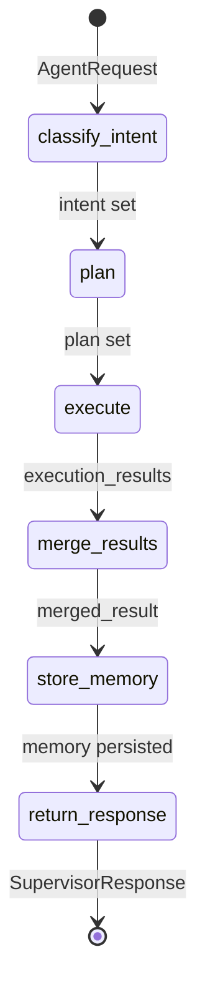

# State Management Architecture

> **Status:** Active  
> **Version:** 0.1.0  
> **Last Updated:** 2026-07-07

---

## Purpose

Hyperion uses three complementary state models to track workflow execution, climate domain data, and conversational context. All state types are designed for LangGraph compatibility.

---

## State Types

### WorkflowState

**Location:** `backend/agents/state/workflow_state.py`

LangGraph-compatible `TypedDict` representing the full execution state of a supervisor workflow.

| Field | Type | Purpose |
|-------|------|---------|
| `request_id` | `str` | Unique request identifier |
| `session_id` | `str` | User session scope |
| `messages` | `Annotated[list, add_messages]` | LangChain message history |
| `query` | `str` | Original user query |
| `intent` | `str` | Classified intent |
| `plan` | `dict` | Serialized execution plan |
| `execution_results` | `Annotated[list, append_lists]` | Per-supervisor results |
| `merged_result` | `dict` | Aggregated supervisor output |
| `metadata` | `Annotated[dict, merge_dicts]` | Extensible metadata bag |
| `status` | `str` | Workflow status |
| `error` | `str \| None` | Error message if failed |

**Factory:** `create_initial_workflow_state(request_id, session_id, query)`

**Reducers:**
- `add_messages` — Appends LangChain messages without overwriting
- `merge_dicts` — Deep-merges metadata dictionaries
- `append_lists` — Appends to result lists

---

### ClimateState

**Location:** `backend/agents/state/climate_state.py`

Pydantic model for structured climate domain data attached to digital twin scenarios.

| Field | Type | Purpose |
|-------|------|---------|
| `twin_id` | `str` | Digital twin identifier |
| `scenario_id` | `str` | Active scenario |
| `variables` | `dict[str, float]` | Climate variable values |
| `layers` | `dict[str, Any]` | Geospatial/data layers |
| `metadata` | `dict[str, Any]` | Scenario metadata |
| `timestamp` | `datetime` | State capture time |

---

### ConversationState

**Location:** `backend/agents/state/conversation_state.py`

Pydantic model tracking multi-turn conversation context.

| Field | Type | Purpose |
|-------|------|---------|
| `session_id` | `str` | Session identifier |
| `turns` | `list[ConversationTurn]` | Ordered conversation turns |
| `active_agent` | `str \| None` | Currently active agent |
| `reasoning_refs` | `list[str]` | Reasoning trace references |
| `simulation_refs` | `list[str]` | Simulation result references |

**ConversationTurn fields:** `role`, `content`, `agent_id`, `timestamp`, `metadata`

---

## State Flow Through LangGraph

Each graph node returns a **partial state update** (`dict[str, Any]`) that LangGraph merges using the defined reducers.

---

## State Persistence

| State Type | Persisted To | When |
|------------|-------------|------|
| Workflow metadata | Redis (`MemoryDomain.WORKFLOW`) | After `store_memory` node |
| Conversation turns | ConversationMemory | After each agent response |
| Climate state | DigitalTwinMemoryStore | On twin checkpoint |
| Session preferences | SessionMemory | On session update |

---

## Domain State Extensions

Domain supervisors extend `WorkflowState.metadata` with:

| Key | Type | Purpose |
|-----|------|---------|
| `active_domain` | `str` | Currently executing domain |
| `completed_agents` | `list[str]` | Successfully invoked agents |
| `failed_agents` | `list[str]` | Failed agent invocations |
| `domain_results` | `dict` | Per-domain merged results |

---

## Error Handling

- Failed graph nodes set `state["error"]` and `state["status"] = "failed"`
- `FailureHandler` captures exceptions and records them in `WorkflowState.metadata`
- Partial state is preserved on failure for debugging and retry

---

## Testing

| Test File | Tests | Coverage |
|-----------|-------|----------|
| `backend/tests/test_state.py` | 4 | WorkflowState creation, ClimateState, ConversationState, TypedDict validation |

---

## Known Limitations

- No LangGraph checkpoint persistence configured (in-memory only)
- ClimateState not yet wired to PostGIS
- ConversationState has no token-budget truncation
- WorkflowState `plan` field is untyped `dict` (should be `ExecutionPlan` serialization)

---

## Future Extensions

- LangGraph `SqliteSaver` or Redis checkpoint store for workflow replay
- Typed plan serialization in WorkflowState
- Conversation token budget management
- ClimateState versioning via DigitalTwinMemoryStore
