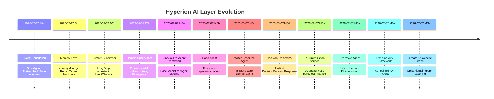
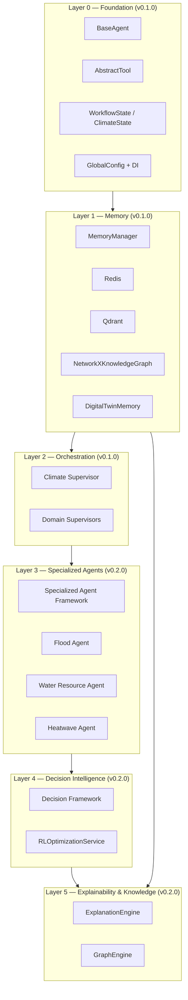
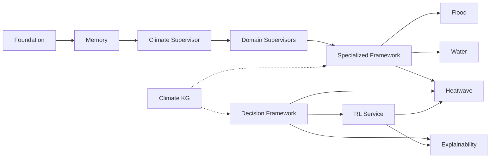
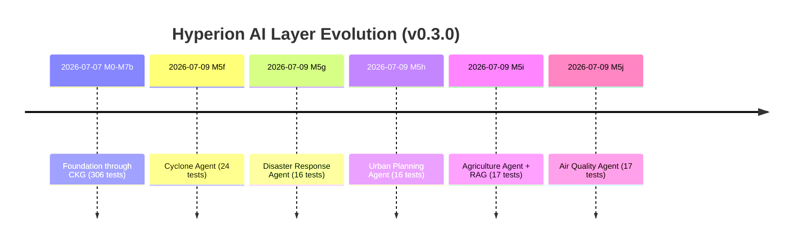
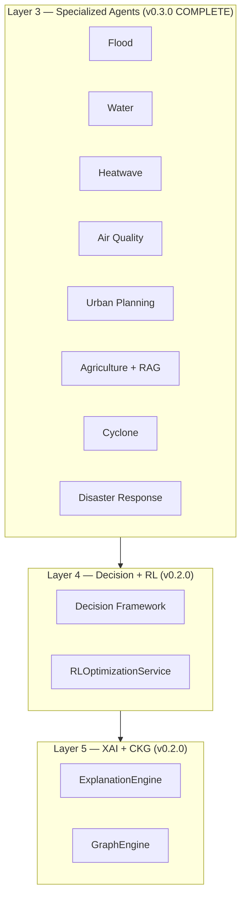
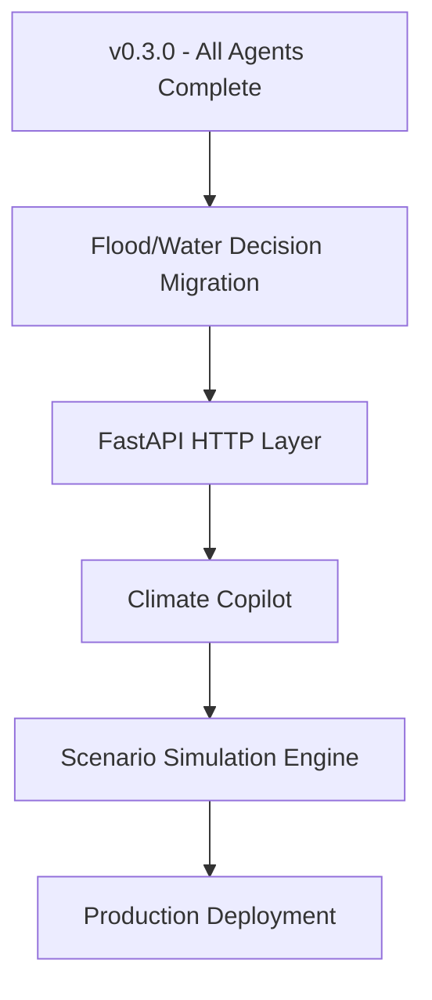
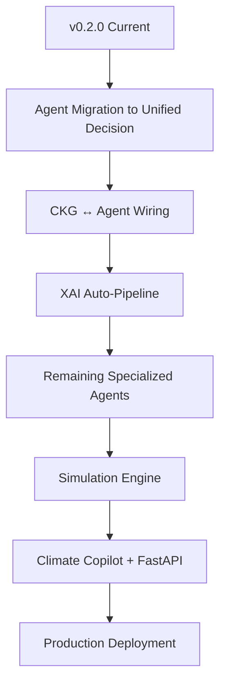

# System Evolution

> **Document Status:** Active  
> **Version:** 0.3.0  
> **Last Updated:** 2026-07-09  
> **Maintainer:** Nexora Engineering

---

## Purpose

This document traces the evolutionary path of the Hyperion Climate Twin AI layer from initial foundation through the Climate Knowledge Graph, showing how each milestone built on prior capabilities without breaking existing contracts.

---

## Evolution Timeline



---

## Layered Architecture Evolution



---

## Capability Stack

```
Foundation
    ↓
Memory Layer
    ↓
Climate Supervisor
    ↓
Domain Supervisors
    ↓
Specialized Agent Framework
    ↓
Flood Agent
    ↓
Water Resource Agent
    ↓
Decision Framework
    ↓
RL Optimization
    ↓
Heatwave Agent
    ↓
Explainability Framework
    ↓
Climate Knowledge Graph
```

---

## Dependency Graph



---

## Version Milestones

| Version | Milestone | Tests | Key Deliverable |
|---------|-----------|-------|-----------------|
| 0.1.0 | M0–M4 | 124 | Foundation, memory, supervisors, docs |
| 0.2.0 | M5–M7 (partial) | 306 | Specialized agents, decision, RL, XAI, CKG |
| 0.3.0 | M5 (complete) | 396 | All 8 specialized agents |

---

## Version 0.3.0 Evolution (2026-07-09)

### Capability Stack (updated)

```
Foundation
    ↓
Memory Layer
    ↓
Climate Supervisor
    ↓
Domain Supervisors
    ↓
Specialized Agent Framework
    ↓
Flood Agent → Water Resource Agent → Heatwave Agent
    ↓
Decision Framework → RL Optimization → Explainability → Climate Knowledge Graph
    ↓
Cyclone Agent
    ↓
Disaster Response Agent
    ↓
Urban Planning Agent
    ↓
Agriculture Agent (+ RAG)
    ↓
Air Quality Agent
```

### Evolution Timeline (v0.3.0 additions)



### Layered Architecture (v0.3.0)



### What Changed Between v0.2.0 and v0.3.0

| Area | v0.2.0 | v0.3.0 |
|------|--------|--------|
| Specialized agents | 3 of 8 | **8 of 8 (complete)** |
| Agriculture RAG | None | Provider-agnostic `AgricultureRagService` |
| Urban planning | Not started | Scenario intelligence for future simulation |
| Disaster coordination | Not started | Meta-agent with live hazard consultation |
| CKG agent wiring | Partial (heatwave only) | All 5 new agents query CKG in observe |
| XAI auto-pipeline | Heatwave only | All Prompt 13–17 agents |
| Test count | 306 | **396** |

### Future Evolution (updated)




| Area | v0.1.0 | v0.2.0 |
|------|--------|--------|
| Specialized agents | Empty placeholder | Framework + 3 agents |
| Decision layer | None | Unified `backend/decision/` |
| RL | Interface only | Full `RLOptimizationService` |
| Explainability | None | `ExplanationEngine` |
| Knowledge graph | Memory-layer NetworkX only | Standalone `GraphEngine` CKG |
| Test count | 124 | 306 |

---

## Future Evolution (Planned)



---

## Related Documents

- [README](../README.md)
- [Progress Tracker](../engineering/progress_tracker.md)
- [Technical Debt](../engineering/technical_debt.md)
- [CHANGELOG](../../CHANGELOG.md)
- [Development Logs](../development_logs/)
