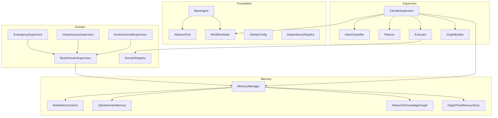

# System Architecture Overview

> **Status:** Active  
> **Version:** 0.1.0  
> **Last Updated:** 2026-07-07

---

## Purpose

This document describes the high-level architecture of the Hyperion Climate Twin AI layer as implemented in version 0.1.0. It provides the structural context for all component-level documentation.

---

## Architectural Layers

| Layer | Responsibility | Location |
|-------|---------------|----------|
| **Presentation** (future) | HTTP API, WebSocket, Copilot UI | `backend/api/` (not yet created) |
| **Orchestration** | Intent classification, planning, routing, execution | `backend/agents/supervisor/` |
| **Domain** | Hazard-domain agent coordination | `backend/agents/domain/` |
| **Specialized** (future) | Single-hazard intelligence agents | `backend/agents/specialized/` |
| **Memory** | Unified persistence and retrieval | `backend/agents/memory/` |
| **Foundation** | Base classes, state, schemas, config | `backend/agents/base/`, `state/`, `config/` |

---

## Design Principles

1. **Hierarchical supervision** — Three-tier agent hierarchy (Climate → Domain → Specialized)
2. **Memory facade** — All persistence through `MemoryManager`; no direct backend access
3. **LangGraph orchestration** — Workflow state flows through compiled `StateGraph`
4. **Interface-first extensibility** — RL, Digital Twin, and agent handlers defined as protocols
5. **Testability** — In-memory mocks for Redis, Qdrant, and NetworkX
6. **Additive development** — New layers added without modifying existing layers

---

## Component Interaction Model

```
User Request (AgentRequest)
        │
        ▼
ClimateSupervisor.process_request()
        │
        ├── IntentClassifier → IntentClassification
        ├── Planner → ExecutionPlan
        ├── WorkflowRouter → domain supervisor selection
        ├── Executor / ParallelExecutor → domain invocation
        ├── merge_results() → MergedSupervisorResult
        ├── store_memory() → MemoryManager
        └── return_response() → SupervisorResponse
                │
                ▼
        DomainSupervisor.invoke()  [per selected domain]
                │
                ├── select_agents() → DomainSelectionResult
                ├── DomainExecutor → specialized agent invocation
                ├── merge_results() → DomainMergedResult
                └── update_memory() → MemoryManager
```

---

## Technology Stack

| Component | Technology | Version Constraint |
|-----------|-----------|-------------------|
| Language | Python | ≥ 3.12 |
| Orchestration | LangGraph | ≥ 0.2 |
| LLM Framework | LangChain Core | ≥ 0.3 |
| Validation | Pydantic v2 | ≥ 2.0 |
| Configuration | pydantic-settings | ≥ 2.0 |
| Session Memory | Redis | ≥ 5.0 |
| Vector Memory | Qdrant Client | ≥ 1.7 |
| Knowledge Graph | NetworkX | ≥ 3.0 |
| Logging | structlog | ≥ 24.0 |
| Testing | pytest + pytest-asyncio | — |

---

## Dependency Graph (Module Level)



---

## Security Boundaries

| Boundary | Enforcement |
|----------|-------------|
| Memory isolation | `MemoryDomain` enum routes to correct backend |
| Agent registration | Duplicate registration raises `DependencyRegistrationError` |
| Tool invocation limit | `MAX_TOOL_CALLS_PER_INVOCATION` constant |
| Session scoping | Redis keys prefixed with session ID |

---

## Scalability Considerations

| Component | Current | Production Path |
|-----------|---------|-----------------|
| Redis | In-memory mock | Redis Cluster |
| Qdrant | In-memory mock | Qdrant Cloud / self-hosted cluster |
| NetworkX | In-process | PostGIS migration (ADR pending) |
| LangGraph | Single process | Horizontal scaling via stateless API + external checkpoint store |

---

## Related Documents

- [State Management](./state_management.md)
- [Configuration](./configuration.md)
- [Climate Supervisor](../supervisor/climate_supervisor.md)
- [Shared Memory](../memory/shared_memory.md)
- [Domain Supervisors](../domain/domain_supervisors.md)
- [ADR Index](../decisions/)
