# Decision Framework

> **Component:** Unified Decision Framework (Prompt 6)  
> **Status:** ✅ Complete  
> **Version:** 1.0.0  
> **Last Updated:** 2026-07-07  
> **Source:** `backend/decision/`

---

## Purpose

The Decision Framework is Hyperion's **agent-agnostic contract layer** for climate action selection. It defines unified `DecisionRequest` and `DecisionResponse` schemas that every specialized agent (flood, water resource, heatwave, and future domains) can produce and that downstream systems — RL optimization, orchestration, persistence, and explainability — can consume without depending on agent-specific report types.

The framework solves three enterprise problems:

1. **Schema fragmentation** — Flood and water agents historically used local `DecisionRequest` models in their context modules; heatwave and RL now share a single canonical schema in `backend/decision/`.
2. **RL payload standardization** — `DecisionRequest.to_rl_payload()` strips agent identity and orchestration metadata so the RL engine receives identical feature keys regardless of originating agent.
3. **Cross-agent orchestration** — `DecisionManager` provides validation, serialization, merging, comparison, priority queuing, and response lifecycle management for multi-agent climate workflows.

---

## Responsibilities

| Responsibility | Owner Module |
|----------------|--------------|
| Unified request/response schemas | `decision_request.py`, `decision_response.py` |
| Domain types (decision type, risk, objectives, status) | `decision_types.py` |
| Candidate action modeling and ranking | `decision_actions.py` |
| Operational constraint definitions | `decision_constraints.py` |
| Scenario and climate context assembly | `decision_context.py` |
| Priority resolution and comparison | `decision_priority.py` |
| Request/response validation | `decision_validator.py` |
| JSON, Pydantic, and database serialization | `decision_serializer.py` |
| Central lifecycle API (create, merge, compare, queue) | `decision_manager.py` |
| Public package exports | `__init__.py` |

---

## Architecture

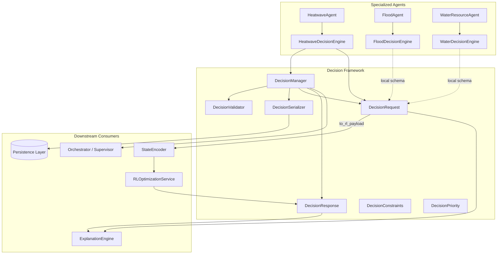

**Design principles:**

- **Agent-agnostic core** — `backend/decision/` has zero imports from `flood/`, `water_resource/`, or `heatwave/`.
- **Pydantic v2 models** — All schemas are strongly typed with field validators and JSON serialization via `model_dump(mode="json")`.
- **Validation at boundaries** — Requests are validated on `create()`, `queue()`, and before RL handoff; responses are validated against their originating request.
- **Separation of concerns** — Rule-based agent decision engines determine *what* to decide; `DecisionManager` manages *how* decisions are stored, ordered, and serialized; RL determines *which action* to take.

---

## Folder Structure

```
backend/decision/
├── __init__.py                 # Public exports (__all__)
├── decision_actions.py         # DecisionAction, ActionRanking, RejectedAction
├── decision_constraints.py     # Budget, Time, Water, Safety, ... DecisionConstraints
├── decision_context.py         # DecisionContext, ScenarioContext, SimulationReference
├── decision_manager.py         # DecisionManager, DecisionComparison, _QueuedDecision
├── decision_priority.py        # DecisionPriority, PriorityContext, compare/escalate helpers
├── decision_request.py         # DecisionRequest (+ to_rl_payload)
├── decision_response.py        # DecisionResponse
├── decision_serializer.py      # DecisionSerializer, SerializationFormat
├── decision_types.py           # DecisionType, RiskLevel, Objective, RiskAssessment, DecisionStatus
└── decision_validator.py       # DecisionValidator, ValidationResult, ValidationIssue

backend/tests/decision/
├── conftest.py                 # Fixtures: sample_action, flood_request, water_request, ...
├── test_decision_unit.py       # 15 unit tests (models, priority, validator)
├── test_decision_integration.py # 17 integration tests (DecisionManager)
└── test_decision_serializer.py # 6 serializer tests
```

---

## Class Diagram

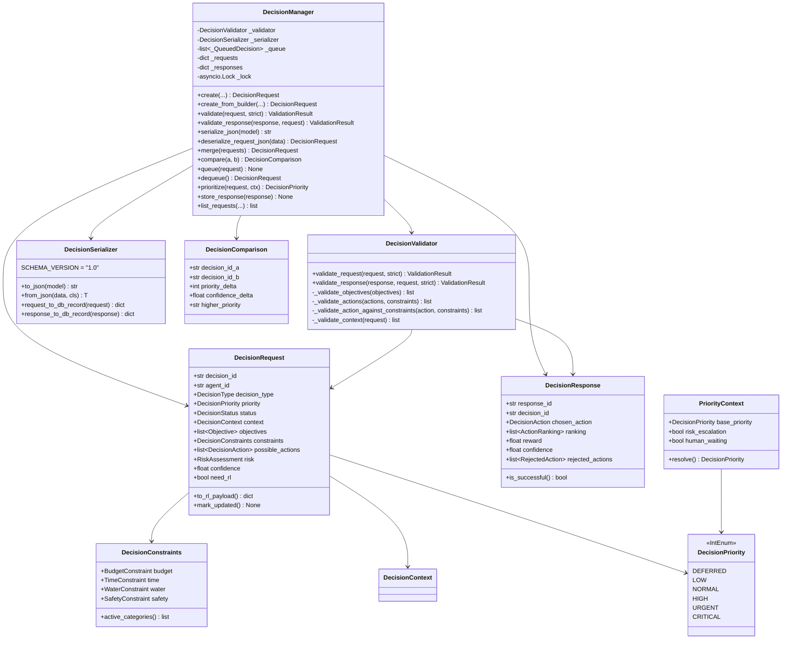

---

## Execution Flow

### End-to-End: Agent → Decision → RL → Response

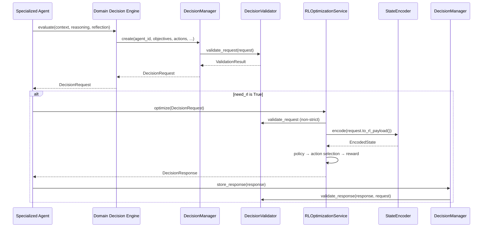

### DecisionManager Queue Lifecycle

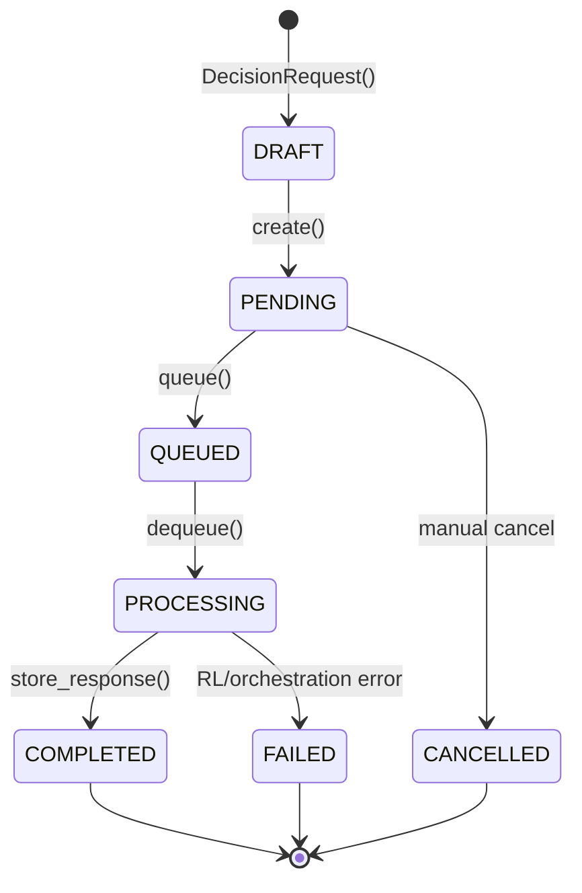

### Merge Flow (Multi-Agent Orchestration)

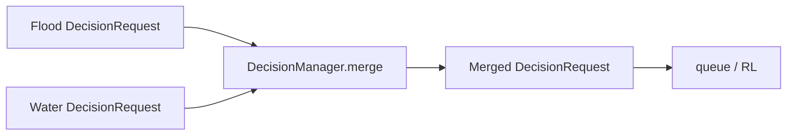

Merge semantics:

- **Priority** — Maximum across source requests (`compare_priority`).
- **Risk** — Maximum level and score across sources.
- **Confidence** — Arithmetic mean across sources.
- **Flags** — OR across `need_simulation`, `need_human`, `need_rl`.
- **Objectives/actions** — Deduplicated by `objective_id` / `action_id`.
- **Metadata** — `merged_from` lists source `decision_id` values.

---

## Public APIs

### `DecisionManager` — Central API

The `DecisionManager` is the primary entry point for decision lifecycle management. Its core operations align with orchestration needs: **evaluate** (via validation + creation), **compare**, **queue**, and **prioritize**.

| Method | Async | Description |
|--------|-------|-------------|
| `create(...)` | No | Build and optionally validate a `DecisionRequest`; register in `_requests` |
| `create_from_builder(...)` | No | Convenience builder for agents (string objectives, tuple actions, label priority) |
| `validate(request, strict=False)` | No | Run `DecisionValidator.validate_request`; raises `DecisionValidationError` if `strict=True` and invalid |
| `validate_response(response, request, strict=False)` | No | Validate response against originating request |
| `serialize_json(model)` | No | JSON wire format via `DecisionSerializer` |
| `deserialize_request_json(data)` | No | Parse JSON → `DecisionRequest` |
| `deserialize_response_json(data)` | No | Parse JSON → `DecisionResponse` |
| `to_db_record(model)` | No | Flatten request or response for persistence |
| `from_db_record(record)` | No | Reconstruct request or response from DB record |
| `merge(requests, agent_id, decision_type)` | No | Combine multiple requests into one unified request |
| `compare(a, b)` | No | Return `DecisionComparison` with priority/confidence/risk deltas |
| `queue(request)` | **Yes** | Validate and push onto priority heap; set status `QUEUED` |
| `dequeue()` | **Yes** | Pop highest-priority request; set status `PROCESSING` |
| `queue_size()` | **Yes** | Return current queue depth |
| `clear_queue()` | **Yes** | Drain queue; return count cleared |
| `prioritize(request, priority_context)` | No | Resolve effective priority via `PriorityContext.resolve()` |
| `store_response(response)` | No | Persist response; sync request status from response |
| `get_request(decision_id)` | No | Lookup registered request |
| `get_response(response_id)` | No | Lookup stored response |
| `list_requests(decision_type, status)` | No | Filter and sort by priority, then confidence |

**Queue ordering:** `(-int(priority), -confidence, decision_id)` — higher priority first, then higher confidence, then lexicographic `decision_id` tie-break.

### `DecisionRequest`

| Field / Method | Type | Description |
|----------------|------|-------------|
| `decision_id` | `str` | UUID, auto-generated |
| `agent_id` | `str` | Originating agent (required, non-empty) |
| `decision_type` | `DecisionType` | Domain classification (`flood`, `water`, `heatwave`, …) |
| `priority` | `DecisionPriority` | Scheduling urgency (0–5) |
| `status` | `DecisionStatus` | Lifecycle state |
| `context` | `DecisionContext` | Scenario, climate state, forecast/simulation refs |
| `objectives` | `list[Objective]` | Weighted RL optimization objectives |
| `constraints` | `DecisionConstraints` | Budget, safety, water, population, … |
| `possible_actions` | `list[DecisionAction]` | Candidate actions for selection |
| `risk` | `RiskAssessment` | Structured risk profile |
| `confidence` | `float` | Agent confidence in request quality (0.0–1.0) |
| `expected_reward` | `float \| None` | Optional pre-computed reward estimate |
| `need_simulation` | `bool` | Requires simulation before action |
| `need_other_agents` | `list[str]` | Cross-agent coordination targets |
| `need_human` | `bool` | Human-in-the-loop review required |
| `need_rl` | `bool` | Delegate action selection to RL |
| `rationale` | `list[str]` | Human-readable decision reasoning |
| `metadata` | `dict` | Agent-specific extension bag |
| `to_rl_payload()` | method | Agent-stripped JSON-serializable dict for RL |
| `mark_updated()` | method | Refresh `updated_at` timestamp |

### `DecisionResponse`

| Field / Method | Type | Description |
|----------------|------|-------------|
| `response_id` | `str` | UUID, auto-generated |
| `decision_id` | `str` | Links to originating request |
| `status` | `DecisionStatus` | Typically `COMPLETED` or `FAILED` |
| `chosen_action` | `DecisionAction \| None` | Selected action |
| `ranking` | `list[ActionRanking]` | Ordered alternatives with scores |
| `reward` | `float \| None` | Estimated reward of chosen action |
| `confidence` | `float` | RL/heuristic confidence (0.0–1.0) |
| `reason` | `str` | Selection explanation |
| `rejected_actions` | `list[RejectedAction]` | Actions filtered out with reasons |
| `engine_id` | `str` | Producer identifier (default `rl_engine`) |
| `processing_time_ms` | `float` | End-to-end processing latency |
| `is_successful()` | method | `True` if `COMPLETED` and `chosen_action` present |

### `DecisionValidator`

| Method | Description |
|--------|-------------|
| `validate_request(request, strict=False)` | Full request validation pipeline |
| `validate_response(response, request, strict=False)` | Response consistency and constraint checks |

### `DecisionSerializer`

| Method | Description |
|--------|-------------|
| `to_json(model)` / `from_json(data, cls)` | Wire-format serialization |
| `to_dict(model)` / `from_dict(data, cls)` | In-process dict round-trip |
| `to_pydantic(model)` | Clean Pydantic re-instantiation |
| `request_to_db_record(request)` | Flat DB record with `payload_json` blob |
| `request_from_db_record(record)` | Reconstruct from flat or payload record |
| `response_to_db_record(response)` | Flat DB record for responses |
| `response_from_db_record(record)` | Reconstruct response |

### Priority Utilities

| Function / Class | Description |
|----------------|-------------|
| `compare_priority(a, b)` | Returns positive if `a` > `b` |
| `escalate_priority(current, steps=1)` | Bump priority, capped at `CRITICAL` |
| `priority_from_label(label)` | Map string label → `DecisionPriority` |
| `PriorityContext.resolve()` | Apply risk/human escalation rules |

### Package Exports (`backend.decision`)

All public types are re-exported from `backend/decision/__init__.py` — import from the package root in application code.

---

## Private Methods

### `DecisionManager`

| Symbol | Purpose |
|--------|---------|
| `_QueuedDecision` | Internal heap entry with `sort_key` and `request`; `order=True` for `heapq` |
| `_validator` | Injected or default `DecisionValidator` |
| `_serializer` | Injected or default `DecisionSerializer` |
| `_queue` | Priority heap of `_QueuedDecision` |
| `_requests` | In-memory registry of all created/queued requests |
| `_responses` | In-memory registry of stored responses |
| `_lock` | `asyncio.Lock` for thread-safe queue operations |

### `DecisionValidator`

| Method | Purpose |
|--------|---------|
| `_validate_objectives` | Non-empty warning, duplicate ID check, positive total weight |
| `_validate_actions` | Minimum action count, duplicate IDs, per-action constraint checks |
| `_validate_action_against_constraints` | Budget, safety, population, no-go region enforcement |
| `_validate_constraints` | Structural constraint validity (time, water) |
| `_validate_confidence` | Range [0.0, 1.0] |
| `_validate_risk` | Risk level/score consistency, population exposure alignment |
| `_validate_context` | Simulation ref when `need_simulation`; actions when `need_rl` |
| `_validate_flags` | Informational consistency (e.g., high confidence + `need_human`) |

### `DecisionSerializer`

| Method | Purpose |
|--------|---------|
| `_json_default` | Custom JSON encoder for `datetime` and `Enum` |

### `DecisionRequest.to_rl_payload()` — Stripped Fields

The following fields are **removed** before RL consumption:

- `agent_id`
- `metadata`
- `rationale`
- `created_at`
- `updated_at`
- `status`

All other fields (including `decision_type`, `objectives`, `constraints`, `possible_actions`, `risk`, `context`) are preserved for uniform RL feature encoding.

---

## LangGraph Integration

The Decision Framework does not define LangGraph nodes directly. Integration occurs at the **specialized agent** layer:

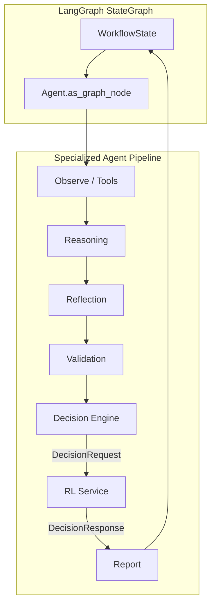

- `HeatwaveAgent.as_graph_node()` exposes the full pipeline including unified `DecisionRequest` production.
- `ClimateSupervisor` LangGraph workflow can route to specialized agent nodes; decision artifacts are stored in agent report metadata and optionally persisted via `DecisionManager.to_db_record()`.
- Decision queue operations (`queue` / `dequeue`) are intended for **async orchestrator** nodes that batch or prioritize cross-agent decisions — not yet wired into the climate supervisor graph by default.

---

## Memory Integration

| Integration Point | Mechanism |
|-------------------|-----------|
| `DecisionContext.climate_state` | Embeds full `ClimateState` from agent memory retrieval |
| `DecisionContext.from_climate_state()` | Factory building context from memory-backed climate state |
| `DecisionContext.forecast_reference` | Links to `ForecastReference` in climate state |
| `DecisionContext.simulation_reference` | Links to active simulation artifacts |
| `RLOptimizationService._retrieve_memory_context()` | RL service queries `MemoryManager` before encoding state |
| `StateEncoder.encode(memory_context=...)` | Optional memory features injected into RL observation |
| DB persistence | `DecisionSerializer.request_to_db_record()` stores `climate_state_json` and `payload_json` |

Decision requests do **not** write to memory directly — agents call `write_agent_memory()` after report generation, optionally including serialized decision/response IDs in report metadata.

---

## Decision Framework Integration

### Agent Adoption Status

| Agent | Decision Engine | Schema | Uses `DecisionManager` |
|-------|-----------------|--------|------------------------|
| **Heatwave** | `HeatwaveDecisionEngine` | Unified `backend.decision.DecisionRequest` | ✅ Yes |
| **Flood** | `FloodDecisionEngine` | Local `flood_context.DecisionRequest` | ❌ (migration pending) |
| **Water** | `WaterDecisionEngine` | Local `water_context.DecisionRequest` | ❌ (migration pending) |

### Migration Roadmap

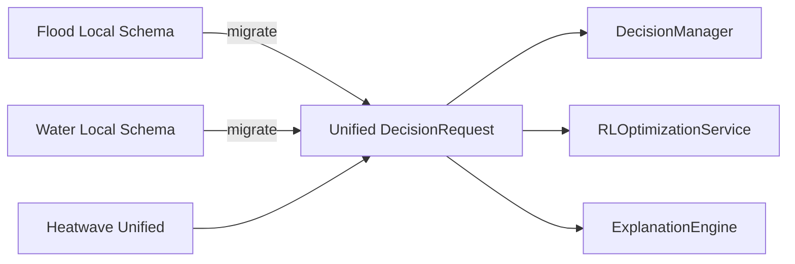

Local schemas capture agent-specific flags (`need_flood_agent`, `suggested_agents`, etc.). The unified schema expresses cross-agent needs via `need_other_agents: list[str]` and `metadata`.

### Orchestrator Integration

- `DecisionManager.merge()` combines multi-agent requests for joint RL optimization.
- `DecisionManager.compare()` supports supervisor-level triage when multiple agents raise concurrent decisions.
- `DecisionManager.list_requests()` enables dashboard and audit views filtered by `DecisionType` and `DecisionStatus`.

---

## RL Integration

RL payload standardization is the **primary integration point** between the Decision Framework and `backend/rl/`.

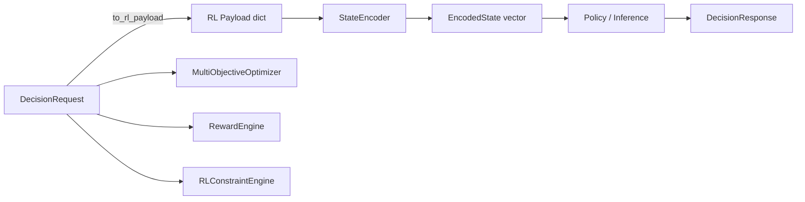

### Contract

| Layer | Input | Output |
|-------|-------|--------|
| `RLOptimizationService.optimize()` | `DecisionRequest` | `DecisionResponse` |
| `RLOptimizationService.rank_actions()` | `DecisionRequest` | `list[ActionRanking]` |
| `RLOptimizationService.evaluate()` | `DecisionRequest`, `action_id` | `MultiObjectiveResult` |
| `RLInference.optimize()` | `DecisionRequest`, `memory_context` | `DecisionResponse` |
| `StateEncoder.encode()` | `DecisionRequest` | `EncodedState` |
| `MultiObjectiveOptimizer` | `DecisionRequest`, `DecisionAction` | Pareto scores per objective |
| `RewardEngine` | `DecisionRequest`, `DecisionAction` | `RewardBreakdown` |
| `RLConstraintEngine.filter_feasible()` | `DecisionRequest` | Feasible actions + validation results |

### Key Guarantee

Test `test_uniform_schema_across_agents` verifies that flood and water agent requests produce **identical RL payload key sets** when built via `create_from_builder()`, and that `agent_id` is never present in the payload.

### RL Pipeline (from `RLOptimizationService` docstring)

```
DecisionRequest → State Encoder → Observation Space → Policy →
Action Selection → Reward Estimation → Constraint Validation →
DecisionResponse
```

---

## Knowledge Graph Integration

The Decision Framework has **no direct dependency** on `backend/knowledge_graph/`. Integration is indirect:

| Path | Description |
|------|-------------|
| Memory graph domain | Agents retrieve entity context via `MemoryManager.search_graph()` before building `DecisionContext` |
| `DecisionContext.metadata` | Agents may attach graph entity IDs for downstream traceability |
| `need_other_agents` | Cross-agent edges in orchestration mirror graph relationships |
| Future wiring | `GraphReasoningEngine` may enrich `RiskAssessment.factors` from CKG traversals |

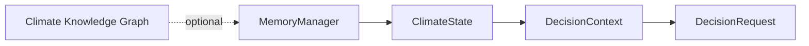

---

## Explainability Integration

`ExplanationInput` in `backend/xai/explanation_report.py` accepts unified decision artifacts:

| Field | Type | Role |
|-------|------|------|
| `decision_request` | `DecisionRequest \| None` | Full request for evidence and constraint explanation |
| `decision_response` | `DecisionResponse \| None` | Chosen action, ranking, rejections for counterfactuals |

`ExplanationEngine` sub-engines consume decision data:

| Engine | Decision Data Used |
|--------|-------------------|
| `AlternativeActionsEngine` | `possible_actions`, `ranking`, `rejected_actions` |
| `ConfidenceEngine` | Request `confidence`, response `confidence` |
| `CounterfactualEngine` | Non-chosen actions and constraint violations |
| `EvidenceEngine` | `rationale`, `risk.factors`, context references |
| `UncertaintyEngine` | Risk scores, confidence gaps |

Heatwave reports include `decision_request` and optional RL response for `explain_decision()` post-hoc analysis.

---

## Tool Architecture

The Decision Framework does not register or execute tools. Tool integration is **upstream** in the agent pipeline:

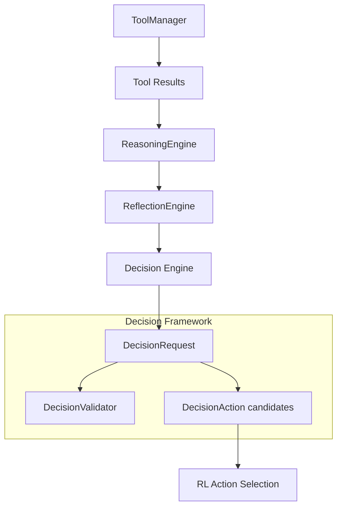

- Tool outputs inform reasoning signals that decision engines translate into `objectives`, `possible_actions`, and `rationale`.
- `DecisionAction.metadata` can carry tool-derived provenance (e.g., hydrology tool ID, measurement timestamp).
- `RejectedAction.constraint_violated` aligns with validator codes (`budget_exceeded`, `safety_violation`, `no_go_region`).

---

## Validation Pipeline

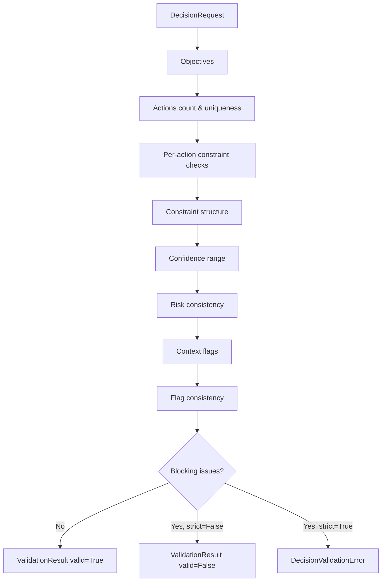

### Validation Severity Levels

| Severity | Effect |
|----------|--------|
| `INFO` | Informational only; does not block |
| `WARNING` | Recorded; does not block validation |
| `ERROR` | Blocks `valid=True` |
| `CRITICAL` | Blocks `valid=True` (e.g., `id_mismatch`, `no_go_region`) |

### Validation Codes Reference

| Code | Severity | Trigger |
|------|----------|---------|
| `empty_objectives` | WARNING | No objectives defined |
| `duplicate_objectives` | ERROR | Duplicate `objective_id` |
| `invalid_objective_weights` | ERROR | Total weight ≤ 0 |
| `insufficient_actions` | ERROR | Fewer than 1 possible action |
| `duplicate_actions` | ERROR | Duplicate `action_id` |
| `budget_exceeded` | ERROR | Action cost > `max_cost` |
| `safety_violation` | ERROR | Action risk > `max_risk_score` |
| `population_exceeded` | ERROR | Affected population > limit |
| `no_go_region` | CRITICAL | Action affects forbidden region |
| `invalid_time_constraint` | ERROR | `max_hours` ≤ 0 |
| `invalid_water_constraint` | ERROR | Inconsistent water config |
| `invalid_confidence` | ERROR | Confidence outside [0, 1] |
| `risk_inconsistency` | WARNING | CRITICAL level with score < 0.7 |
| `population_mismatch` | WARNING | Risk population < max action exposure |
| `missing_simulation_ref` | WARNING | `need_simulation` without reference |
| `rl_without_actions` | ERROR | `need_rl` with empty actions |
| `human_review_info` | INFO | High confidence + `need_human` |
| `id_mismatch` | CRITICAL | Response `decision_id` ≠ request |
| `missing_chosen_action` | ERROR | COMPLETED without chosen action |
| `unknown_action` | WARNING | Chosen action not in request |
| `invalid_rank` | ERROR | Ranking rank < 1 |

### Response Validation

Response validation runs after RL or heuristic selection:

1. `decision_id` match (CRITICAL)
2. `chosen_action` required when status is `COMPLETED`
3. Chosen action membership in `possible_actions` (WARNING if unknown)
4. Chosen action re-validated against request constraints
5. Ranking rank values ≥ 1

---

## Reflection Pipeline

The Decision Framework does not implement reflection. Reflection is an **agent-layer prerequisite** that feeds decision engines:

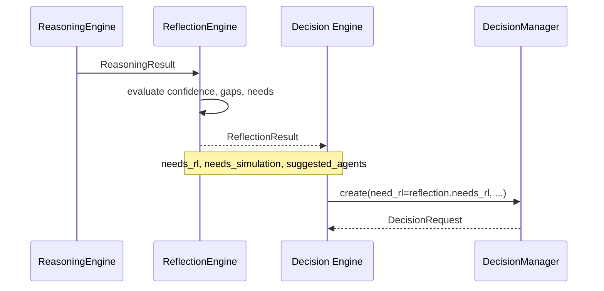

| Reflection Signal | Decision Field |
|-------------------|----------------|
| `needs_rl` | `need_rl` |
| `needs_simulation` | `need_simulation` |
| `suggested_agents` | `need_other_agents` |
| Low confidence | May set `need_human=True` (agent-specific) |

Heatwave reflection explicitly recommends RL for severe heatwaves; flood/water engines compute `need_rl` from severity and uncertainty thresholds independently.

---

## Metrics

The Decision Framework itself does not ship a metrics collector. Observability is provided through:

| Source | Metrics |
|--------|---------|
| Structured logging (`get_logger`) | `decision_created`, `decisions_merged`, `decision_queued` |
| `DecisionResponse.processing_time_ms` | End-to-end RL processing latency |
| `RLOptimizationService.last_metrics` | `RLExecutionMetrics` (state dimension, algorithm, reward) |
| Agent metrics collectors | `record_rl_call()` in heatwave pipeline |

Recommended future metrics (not yet implemented):

- `decision_validation_failures_total` by code
- `decision_queue_depth` gauge
- `decision_merge_count` histogram
- `decision_priority_distribution` by `DecisionType`

---

## Logging

All logging uses `backend.config.logger.get_logger` with structured key-value fields:

| Event | Level | Fields |
|-------|-------|--------|
| `decision_created` | DEBUG | `decision_id`, `agent_id`, `decision_type` |
| `decisions_merged` | INFO | `merged_id`, `source_count` |
| `decision_queued` | DEBUG | `decision_id` |

Downstream RL logging (`rl_request_validation_issues`, `rl_optimize_failed`) references `decision_id` for correlation.

---

## Error Handling

| Exception | Module | When Raised |
|-----------|--------|-------------|
| `DecisionValidationError` | `decision_validator.py` | Strict validation failure (`strict=True`) |
| `SchemaValidationError` | `decision_serializer.py` | Invalid JSON or Pydantic validation on deserialize |
| `ValueError` | `decision_manager.py` | `merge([])` with empty list |
| `RLOptimizationError` | `rl_service.py` | RL pipeline failure (wraps underlying exception) |

### Error Handling Patterns

- **Non-strict validation** — `create(validate=True, strict=False)` records issues but still persists the request; used when agents want warnings without blocking.
- **Queue gate** — `queue()` always validates strictly (raises on invalid) before enqueue.
- **RL graceful degradation** — Heatwave agent catches `RLOptimizationError`, logs warning, returns `None` RL response; report still generated with rule-based actions.
- **Serializer resilience** — `request_from_db_record()` supports both `payload_json` blob and flat column reconstruction.

---

## Configuration

The Decision Framework is **zero-config** by default. Customization is via constructor injection:

```python
from backend.decision import DecisionManager, DecisionValidator, DecisionSerializer

manager = DecisionManager(
    validator=DecisionValidator(),
    serializer=DecisionSerializer(),
)
```

| Constant | Location | Value |
|----------|----------|-------|
| `DecisionValidator.MIN_ACTIONS` | `decision_validator.py` | `1` |
| `DecisionSerializer.SCHEMA_VERSION` | `decision_serializer.py` | `"1.0"` |
| `DecisionSerializer.DB_REQUEST_TABLE` | `decision_serializer.py` | `"decision_requests"` |
| `DecisionSerializer.DB_RESPONSE_TABLE` | `decision_serializer.py` | `"decision_responses"` |
| `SafetyConstraint.max_risk_score` default | `decision_constraints.py` | `0.85` |
| Default `confidence` on create | `decision_manager.py` | `0.5` |

`DecisionConstraints` auto-injects a default `SafetyConstraint` when none is provided (`ensure_safety_default` model validator).

---

## Performance

| Operation | Complexity | Notes |
|-----------|------------|-------|
| `create()` | O(A + O) | A = actions, O = objectives; validation dominates |
| `merge(n requests)` | O(n × (A + O)) | Deduplication via hash sets |
| `compare()` | O(1) | Field comparisons only |
| `queue()` | O(log Q) | `heapq.heappush` |
| `dequeue()` | O(log Q) | `heapq.heappop` |
| `serialize_json()` | O(payload size) | Full model dump |
| `to_rl_payload()` | O(payload size) | Dict copy with key removal |

In-memory `_requests` and `_responses` dictionaries provide O(1) lookup. Production deployments should back these with persistent storage via `to_db_record()` / `from_db_record()`.

---

## Scalability

| Concern | Current State | Scale Path |
|---------|---------------|------------|
| Queue storage | In-process `heapq` | Redis sorted set or dedicated queue service |
| Request registry | In-process `dict` | Database-backed repository |
| Merge | Single-process | Distributed reduce with idempotent `decision_id` |
| Serialization | Synchronous JSON | Async batch writer for audit trail |
| Validation | CPU-bound Pydantic | Cache validation results by content hash |

`asyncio.Lock` on queue operations allows safe concurrent `queue`/`dequeue` within a single event loop. Multi-process deployments require external queue coordination.

---

## Security

| Concern | Mitigation |
|---------|------------|
| Agent impersonation | `agent_id` retained in request but stripped from RL payload; audit logs include both |
| Constraint bypass | Validator enforces budget, safety, population, no-go regions before queue and RL |
| Injection via metadata | Pydantic typed fields; `metadata` is opaque dict — consumers must sanitize on display |
| Deserialization attacks | `SchemaValidationError` on malformed JSON; `model_validate` strict typing |
| Human safety | `no_go_region` violations are CRITICAL severity; `need_human` flag for escalation |
| Data minimization for RL | `to_rl_payload()` strips `rationale`, `metadata`, timestamps |

---

## Known Limitations

1. **Schema bifurcation** — Flood and water agents still use local `DecisionRequest` models; only heatwave is fully unified.
2. **No `evaluate()` on DecisionManager** — Evaluation is split across `DecisionValidator`, domain decision engines, and `RLOptimizationService.evaluate()` for action scoring.
3. **In-memory only** — `DecisionManager` registries and queue are not durable across process restarts.
4. **No distributed locking** — Queue lock is `asyncio.Lock`, not cross-process.
5. **Default safety constraint** — Auto-injected `SafetyConstraint()` may surprise agents that intended no safety limits.
6. **Merge uses first request's constraints** — Merged request inherits `constraints` from `requests[0]` only.
7. **No built-in metrics** — Framework relies on logging and downstream RL metrics.
8. **Knowledge graph** — No first-class entity references in `DecisionRequest`; only via `context.metadata`.
9. **Climate supervisor** — Decision queue not yet integrated into LangGraph supervisor workflow.

---

## Future Improvements

| Priority | Improvement |
|----------|-------------|
| P0 | Migrate flood and water decision engines to unified `DecisionRequest` |
| P0 | Add `DecisionRepository` with database-backed persistence |
| P1 | Wire `DecisionManager.queue()` into climate supervisor orchestration |
| P1 | Add `DecisionMetricsCollector` with Prometheus export |
| P1 | Graph-enriched `RiskAssessment` via CKG entity traversal |
| P2 | Versioned schema migration (`SCHEMA_VERSION` > 1.0) |
| P2 | `DecisionManager.evaluate()` facade unifying validate + prioritize + optional RL handoff |
| P2 | Constraint templates per `DecisionType` (flood-specific water constraints) |
| P3 | Decision replay from audit store for XAI and RL training |
| P3 | Webhook/notification on CRITICAL validation failures |

---

## Testing Summary

**Total: 38 tests** — `backend/tests/decision/`

| Suite | File | Count | Coverage Focus |
|-------|------|-------|----------------|
| Unit | `test_decision_unit.py` | **15** | Types, priority, actions, RL payload, validator rules |
| Integration | `test_decision_integration.py` | **17** | DecisionManager lifecycle, queue, merge, compare, cross-agent schema |
| Serializer | `test_decision_serializer.py` | **6** | JSON, Pydantic, DB round-trip, RL payload serializability |

### Unit Tests (15)

| Test | Validates |
|------|-----------|
| `test_decision_type_values` | 9 `DecisionType` enum values |
| `test_priority_ordering` | `compare_priority`, `escalate_priority` |
| `test_priority_from_label` | Label parsing with fallback |
| `test_decision_action_net_value` | `benefit - cost` heuristic |
| `test_decision_request_rl_payload_strips_agent` | RL payload key exclusion |
| `test_decision_request_agent_id_required` | Empty `agent_id` rejected |
| `test_constraints_active_categories` | `active_categories()` |
| `test_risk_assessment_exceeds` | Ordinal risk comparison |
| `test_validator_valid_request` | Happy path |
| `test_validator_rejects_no_actions` | `insufficient_actions` |
| `test_validator_budget_violation` | `budget_exceeded` |
| `test_validator_safety_violation` | `safety_violation` |
| `test_validator_strict_raises` | `DecisionValidationError` |
| `test_validator_duplicate_objectives` | `duplicate_objectives` |
| `test_validator_no_go_region` | CRITICAL `no_go_region` |

### Integration Tests (17)

| Test | Validates |
|------|-----------|
| `test_manager_create` | Create and registry lookup |
| `test_manager_create_from_builder` | Builder convenience API |
| `test_manager_queue_and_dequeue` | Priority ordering (flood > water > low) |
| `test_manager_compare` | `DecisionComparison` deltas |
| `test_manager_merge` | Multi-agent merge semantics |
| `test_manager_merge_empty_raises` | Empty merge guard |
| `test_manager_prioritize` | `PriorityContext` escalation |
| `test_manager_serialize_round_trip` | JSON via manager |
| `test_manager_db_record_round_trip` | DB record via manager |
| `test_manager_store_response` | Response storage + status sync |
| `test_manager_validate_response` | Response validation |
| `test_manager_validate_response_id_mismatch` | CRITICAL id mismatch |
| `test_manager_list_requests` | Filter by `DecisionType` |
| `test_uniform_schema_across_agents` | **RL payload standardization** |
| `test_context_from_climate_state` | `DecisionContext.from_climate_state()` |
| `test_manager_create_strict_validation` | Strict create failure |
| `test_clear_queue` | Queue drain |

### Serializer Tests (6)

| Test | Validates |
|------|-----------|
| `test_json_round_trip` | JSON serialize/deserialize |
| `test_pydantic_round_trip` | `to_pydantic()` equality |
| `test_request_db_record_round_trip` | Request DB persistence |
| `test_response_db_record_round_trip` | Response DB persistence |
| `test_invalid_json_raises` | `SchemaValidationError` |
| `test_rl_payload_json_serializable` | RL payload JSON safety |

### Running Tests

```bash
python -m pytest backend/tests/decision/ -v
```

### Related Test Suites

| Suite | Relevance |
|-------|-----------|
| `backend/tests/rl/` | RL service consumes `DecisionRequest` |
| `backend/tests/xai/` | `ExplanationInput` with decision artifacts |
| `backend/tests/specialized/heatwave/` | Unified decision engine integration |

---

## Related Documents

- [Specialized Agent Framework](../agents/specialized_framework.md)
- [Agent → Decision → RL Flow](../diagrams/agent_decision_rl_flow.md)
- [RL Engine](../rl/README.md)
- [Climate Supervisor](../supervisor/climate_supervisor.md)
- [ADR-002: Hierarchical Supervisors](../decisions/ADR-002_hierarchical_supervisors.md)
