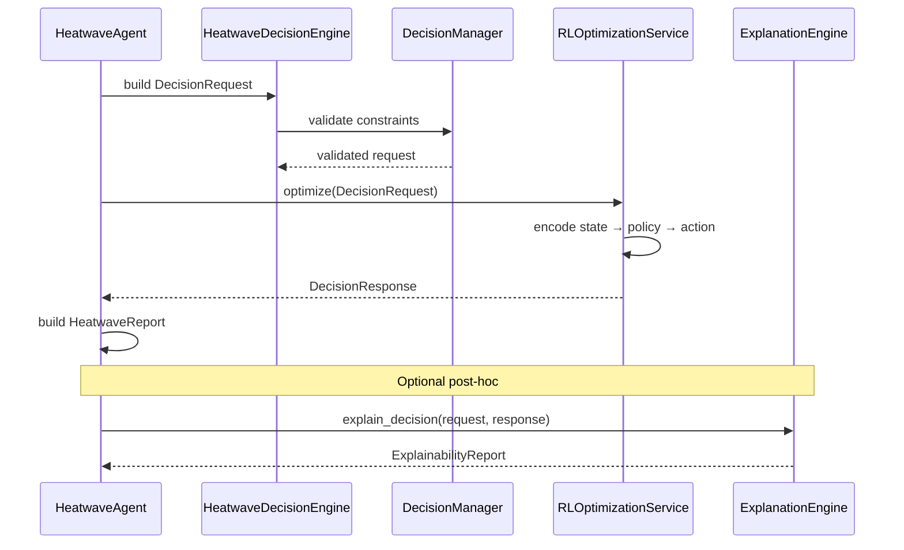
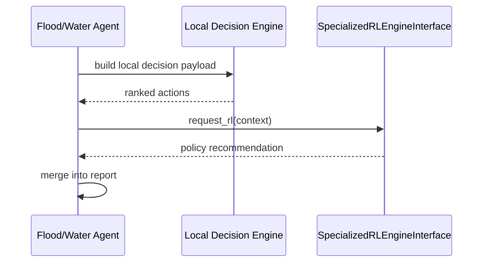
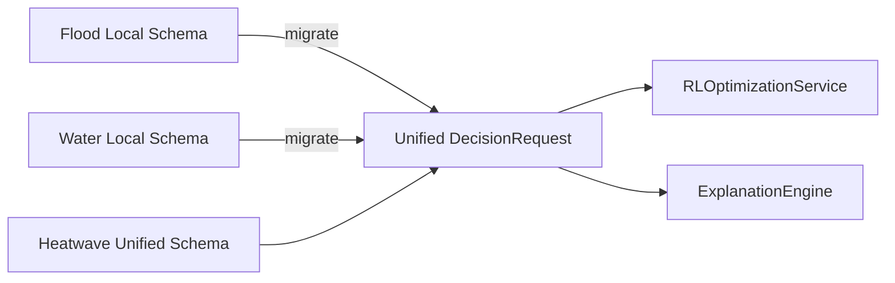

# Agent → Decision → RL Flow

> **Version:** 0.2.0  
> **Last Updated:** 2026-07-07

---

## Unified Pipeline (Heatwave Agent)

---

## Legacy Pipeline (Flood / Water Agents)

---

## Decision Payload Standardization Roadmap

