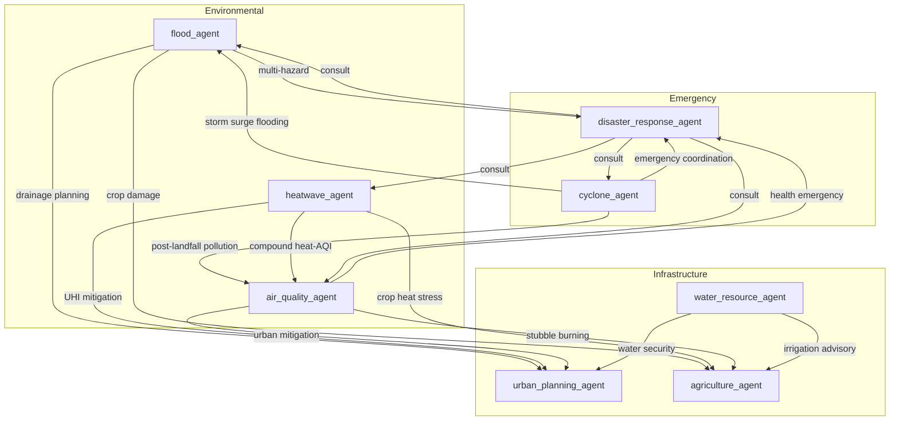

# Agent Interaction Map

> **Version:** 0.3.0 | **Last Updated:** 2026-07-09

## Communication Contract

All inter-agent calls use `AgentCommunicationInterface.call_agent()` with normalized `PeerAgentOutput` payloads. No direct module imports between agent packages.
