# Decision Framework

> **Version:** 0.2.0  
> **Last Updated:** 2026-07-07  
> **Source:** `backend/decision/`

---

## Architecture Overview

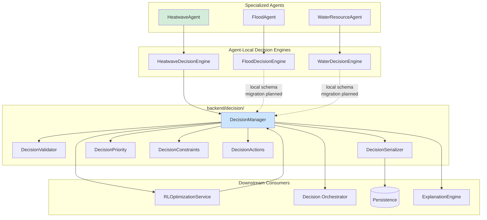

---

## DecisionRequest Schema

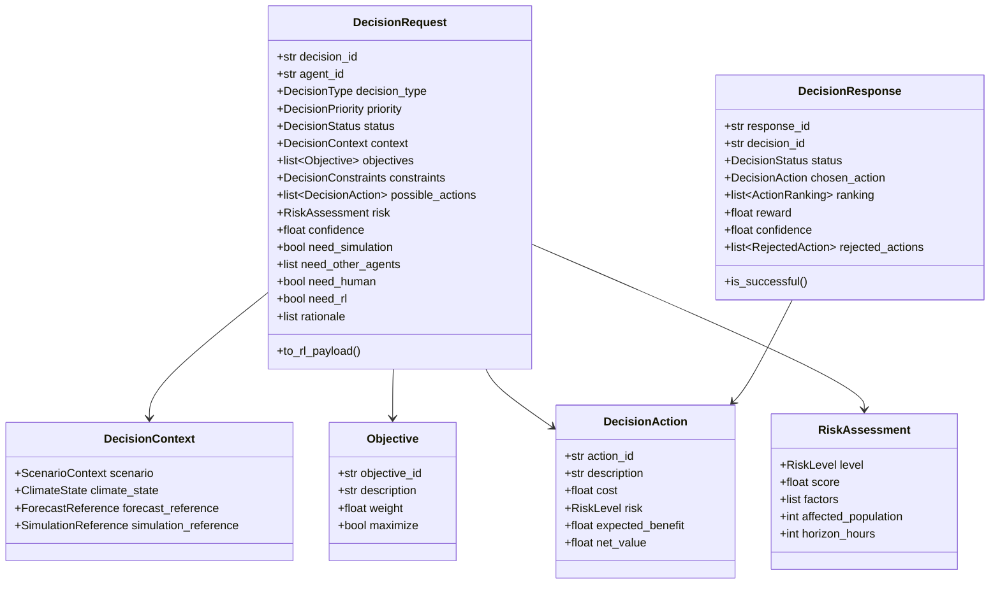

---

## DecisionManager Lifecycle

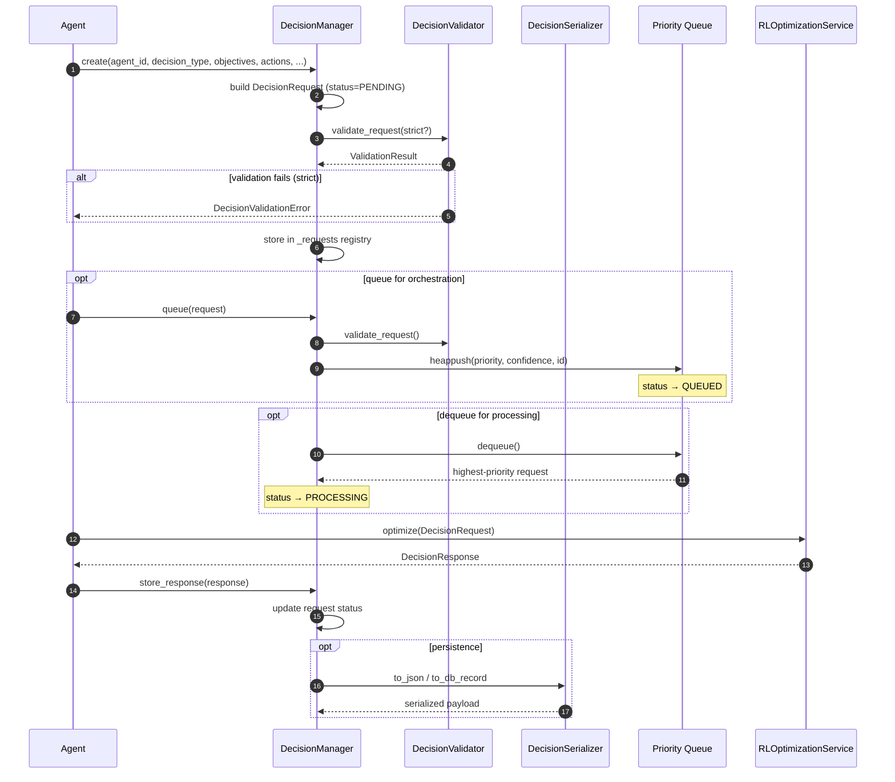

---

## Validation Pipeline

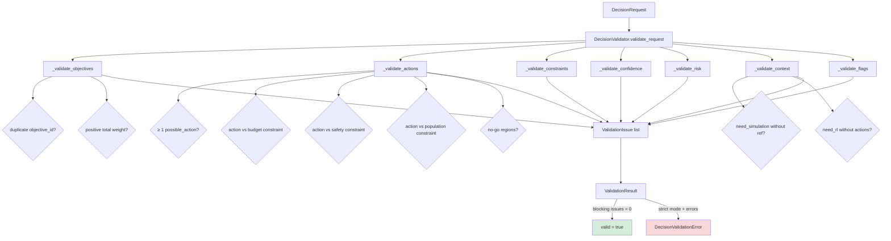

---

## Priority Queue & Scheduling

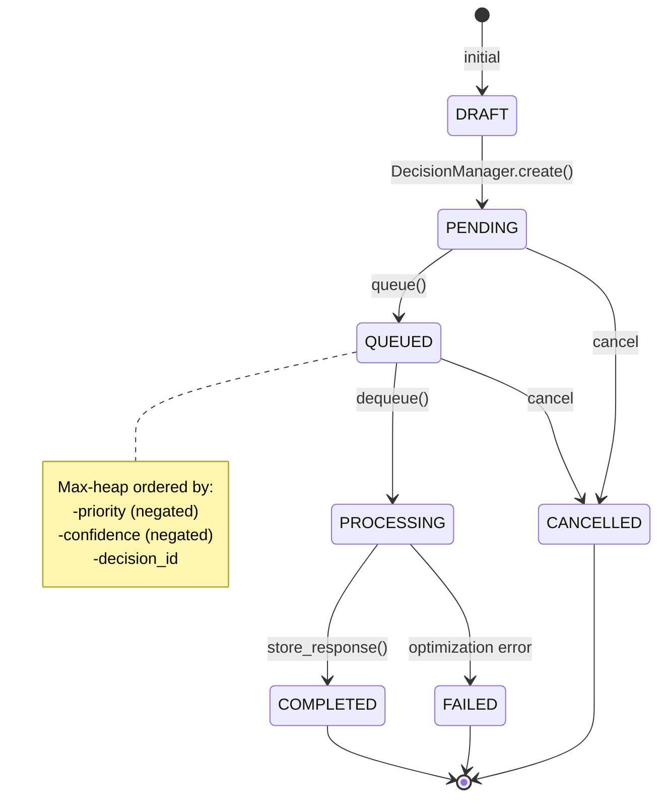

---

## Priority Resolution

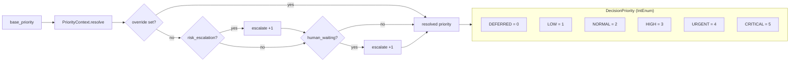

---

## Merge Multiple Agent Decisions

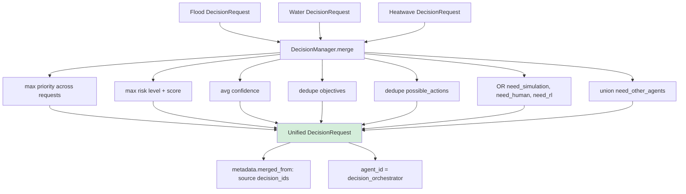

---

## Compare Two Decisions

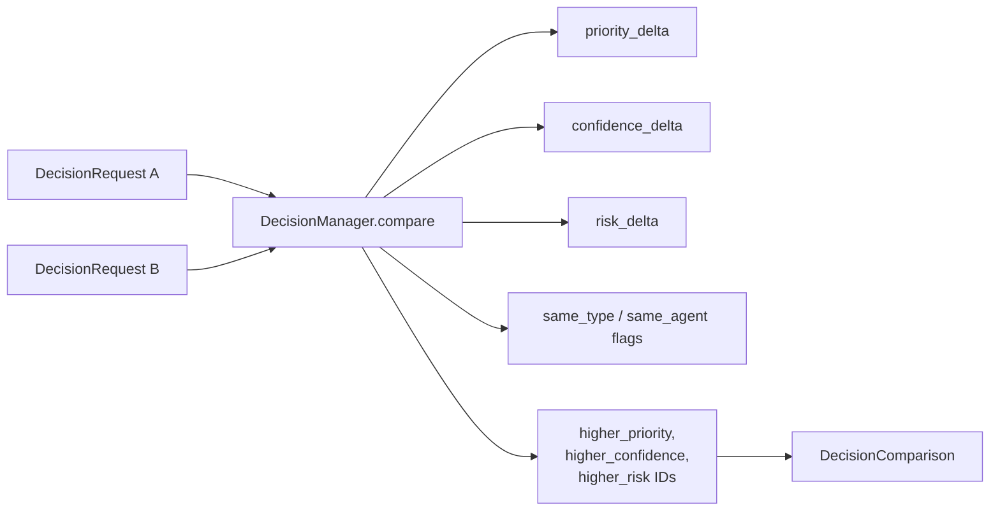

---

## Decision Types

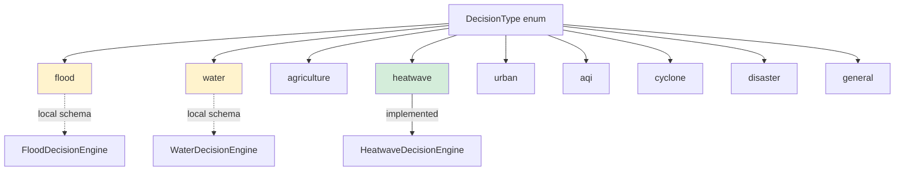

---

## RL Payload Flow

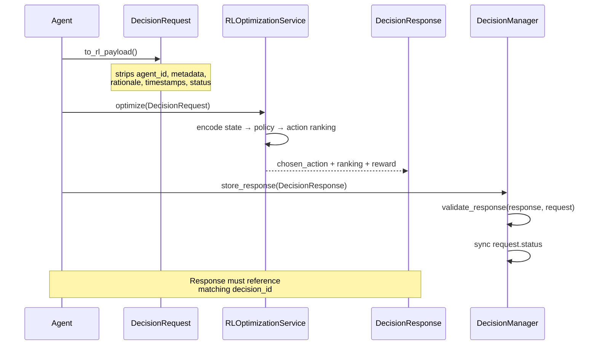

---

## Constraint Categories

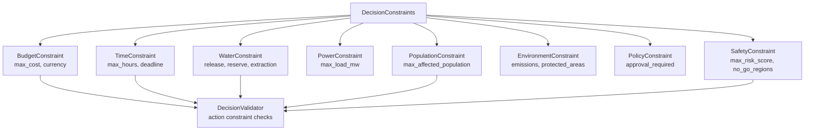
