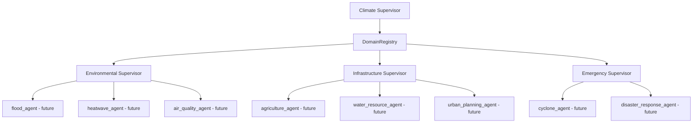
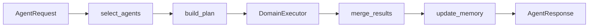
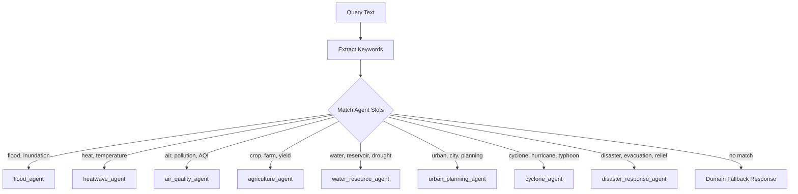
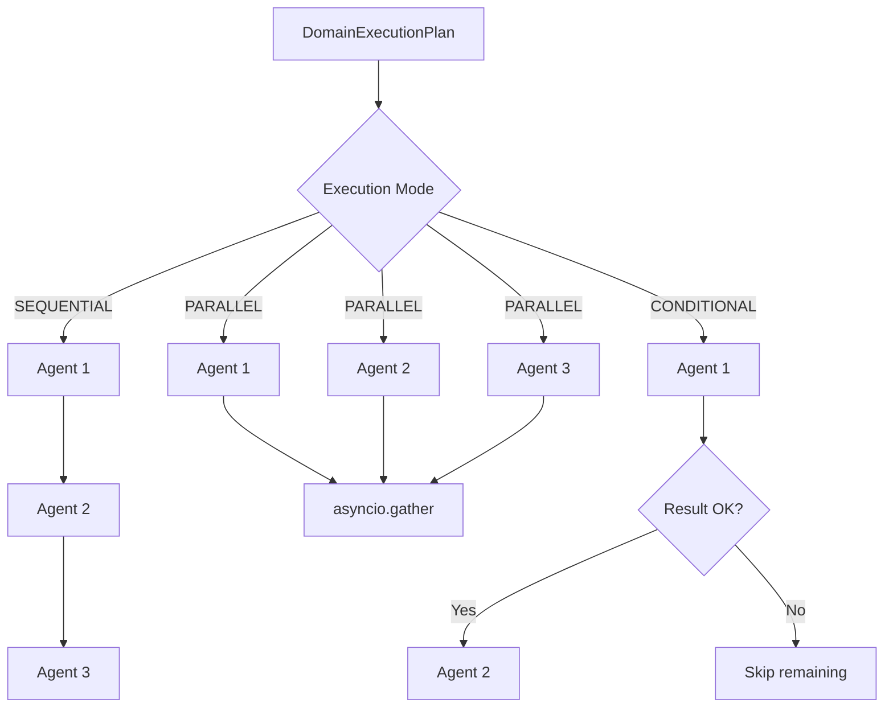
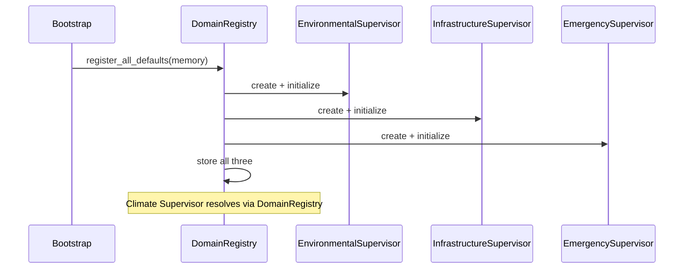
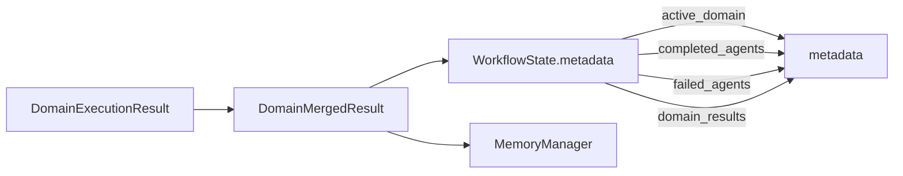

# Domain Flow

> **Last Updated:** 2026-07-07

---

## Domain Hierarchy

---

## Domain Invocation Pipeline

---

## Agent Selection (Keyword Matching)

---

## DomainExecutor Modes

---

## Domain Registry

---

## State Updates

---

## Related Documents

- [Domain Supervisors](../domain/domain_supervisors.md)
- [ADR-005](../decisions/ADR-005_domain_supervisors.md)
- [Supervisor Flow](./supervisor_flow.md)
