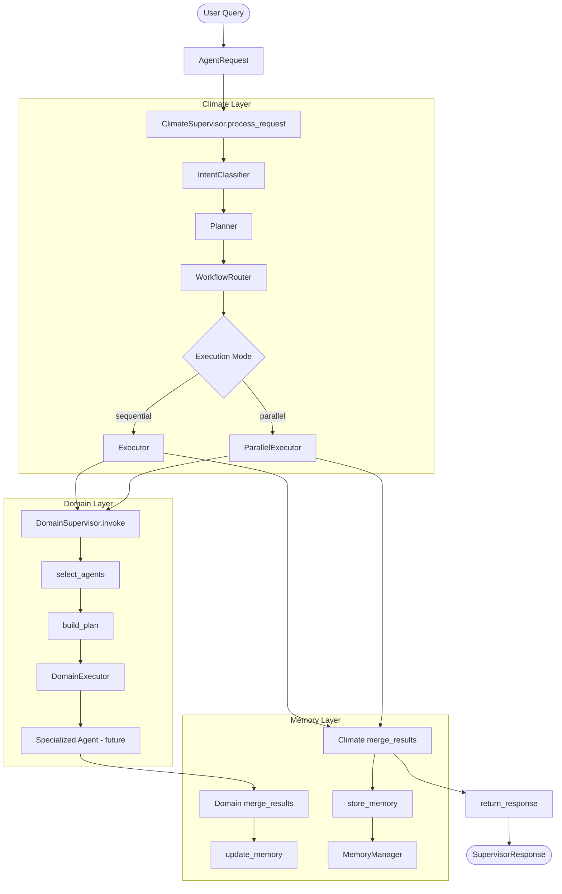
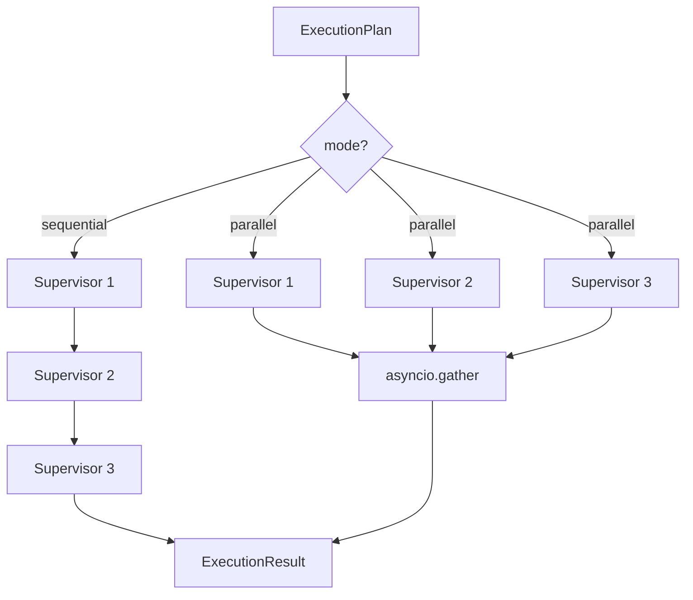
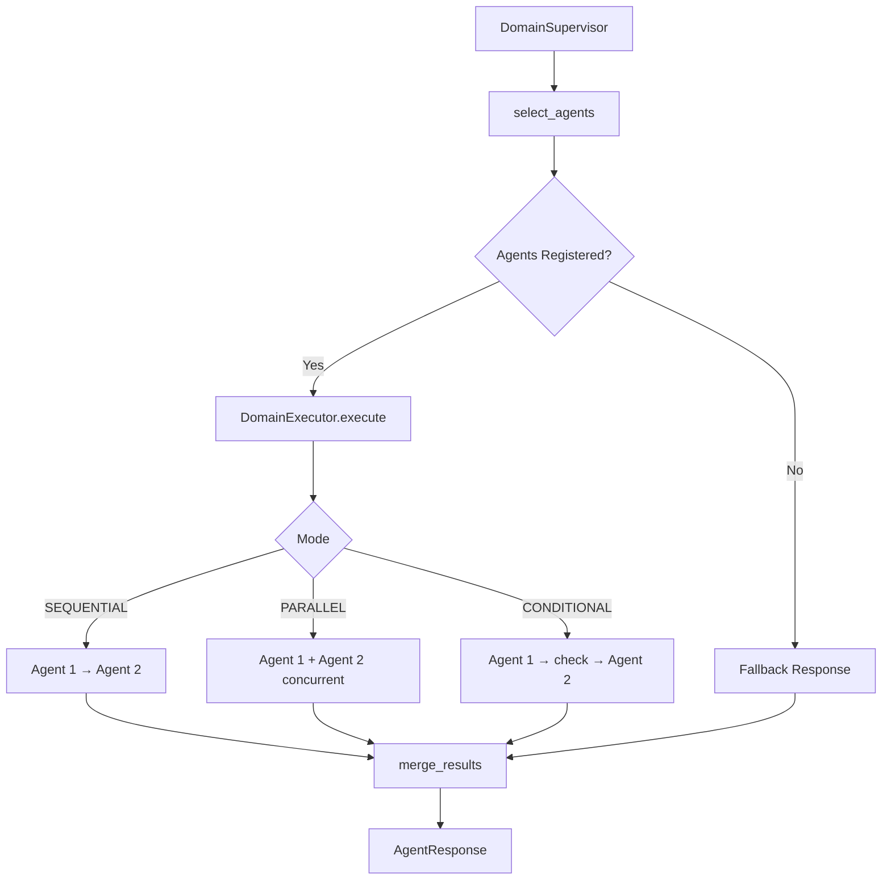
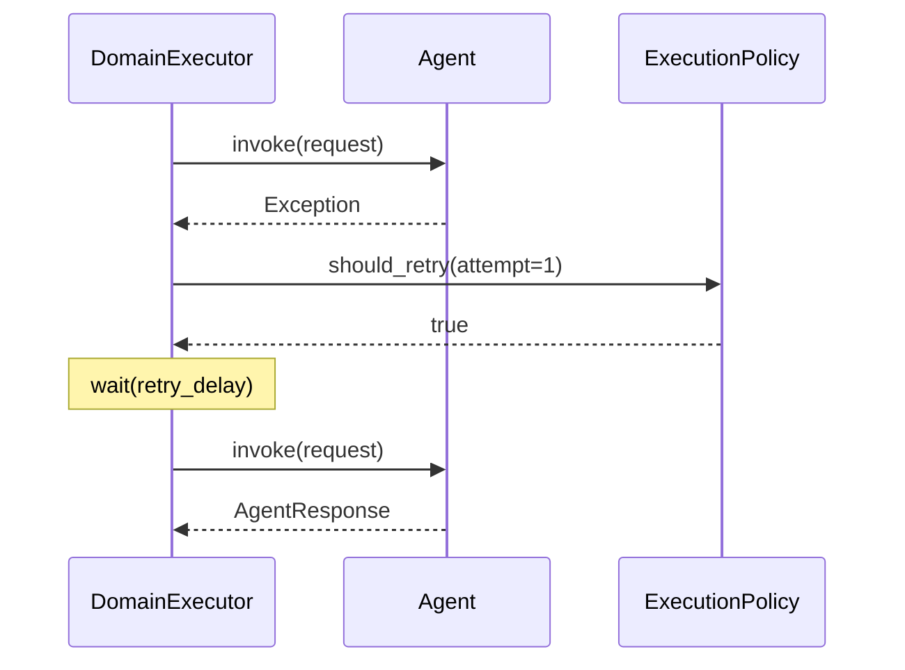
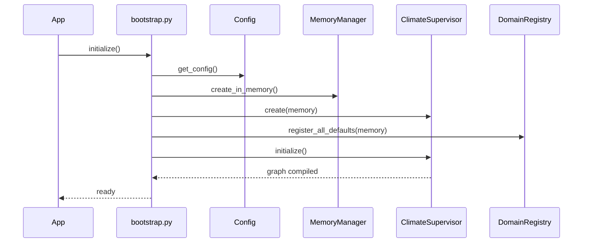

# Execution Flow

> **Last Updated:** 2026-07-07

---

## Full System Execution Flow

---

## Parallel vs. Sequential Execution

---

## Domain-Level Execution

---

## Retry Execution

---

## Bootstrap Execution Sequence

---

## Related Documents

- [Supervisor Flow](./supervisor_flow.md)
- [Domain Flow](./domain_flow.md)
- [Request Flow](./request_flow.md)
