# Explainability Pipeline

> **Version:** 1.0.0  
> **Last Updated:** 2026-07-07  
> **Source:** `backend/xai/`

---

## Overview

The Explainability Pipeline transforms agent pipeline artifacts into a standardized `ExplainabilityReport`. Six sub-engines run under `ExplanationEngine` orchestration, producing executive summary, reasoning trace, evidence, confidence, uncertainty, alternatives, and counterfactuals.

---

## High-Level Pipeline

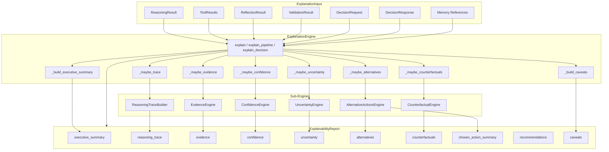

---

## Entry Points

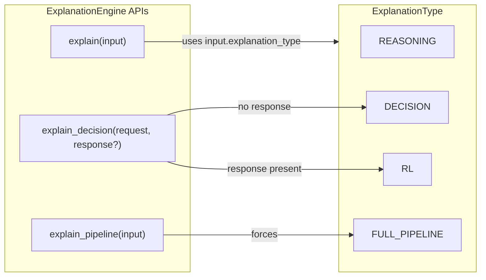

| API | Sets Type | Typical Caller |
|-----|-----------|----------------|
| `explain()` | From `ExplanationInput.explanation_type` | Custom scope control |
| `explain_pipeline()` | `FULL_PIPELINE` | Agent post-invoke |
| `explain_decision()` | `RL` or `DECISION` | Decision/RL post-hoc |

---

## Sub-Engine Data Flow

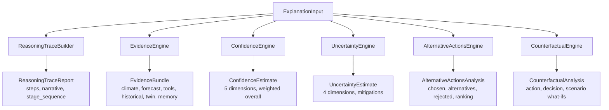

---

## Reasoning Trace Pipeline

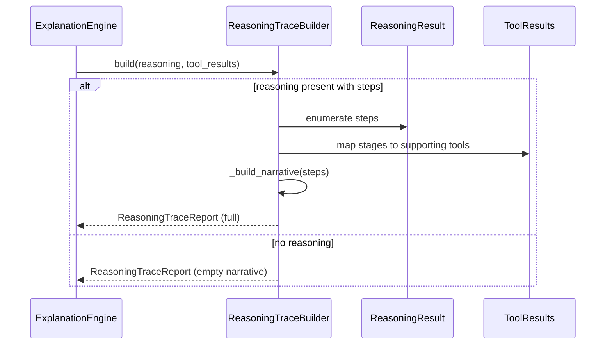

---

## Evidence Collection Pipeline

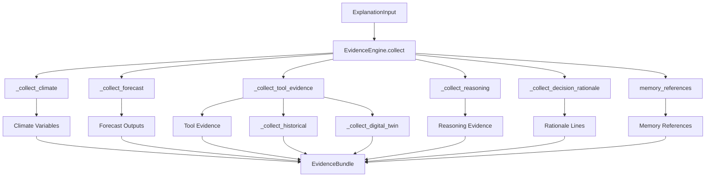

---

## Confidence & Uncertainty Pipeline

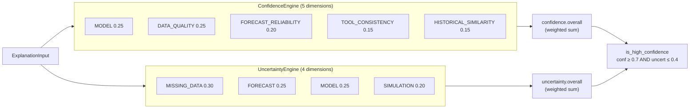

---

## Alternatives & Counterfactuals Pipeline

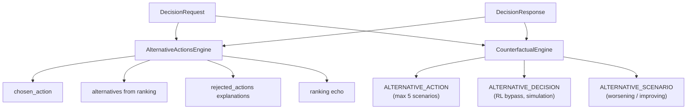

---

## Report Assembly

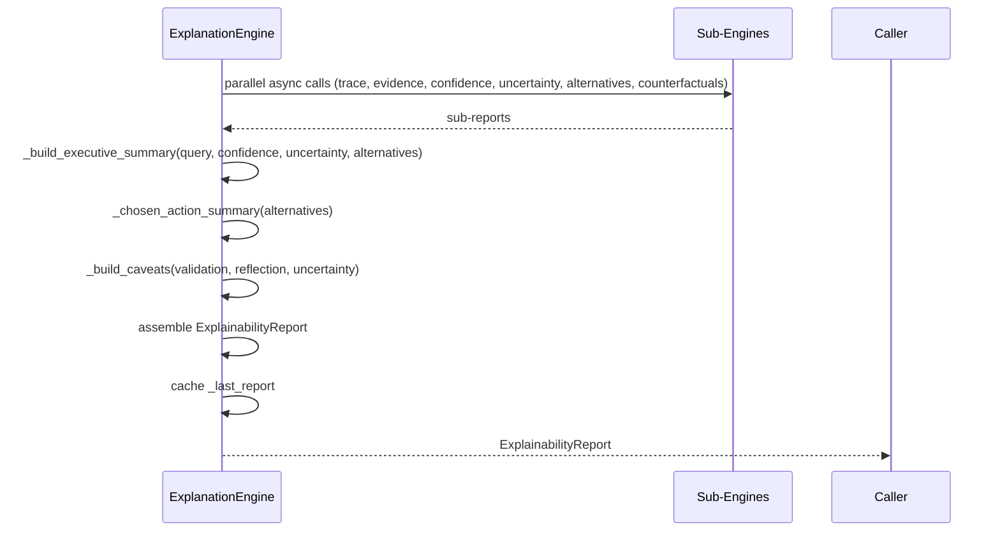

---

## Agent Integration Flow

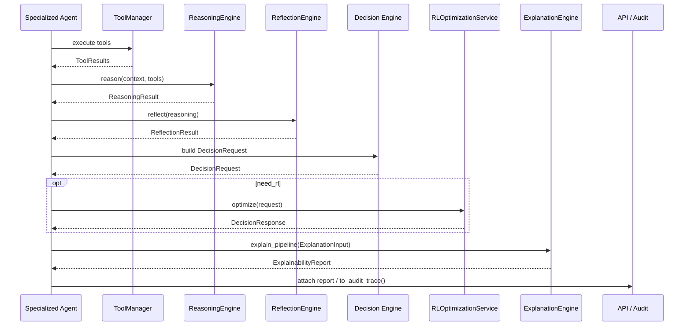

---

## ExplanationType Scope

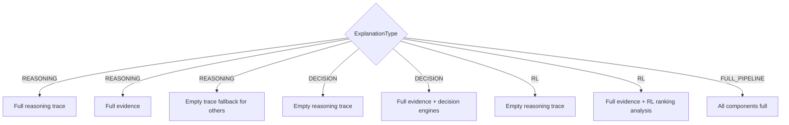

---

## Audit Trace Export

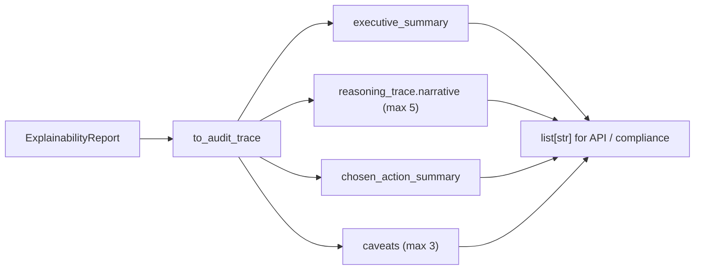

---

## Test Coverage Map

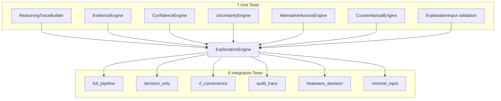
