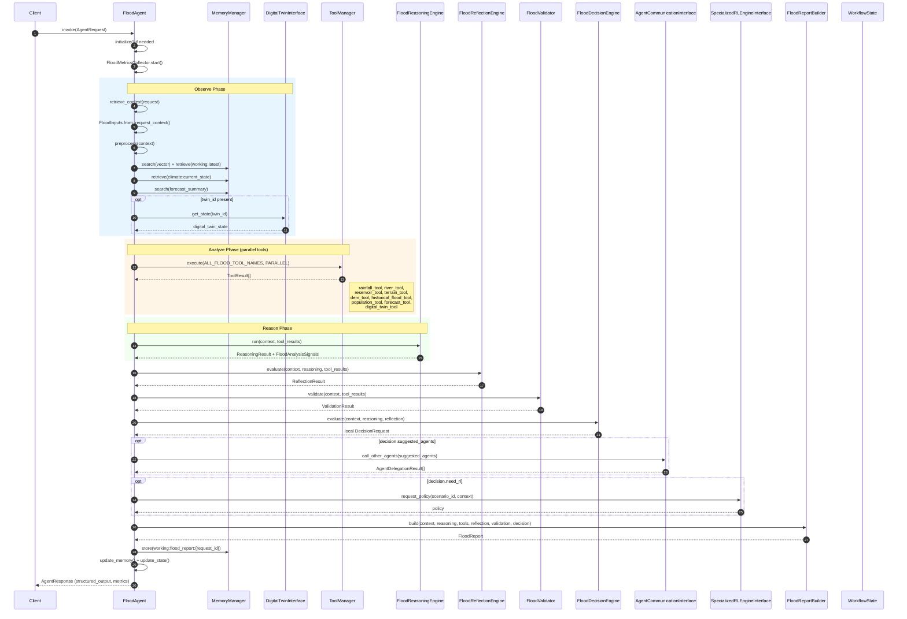
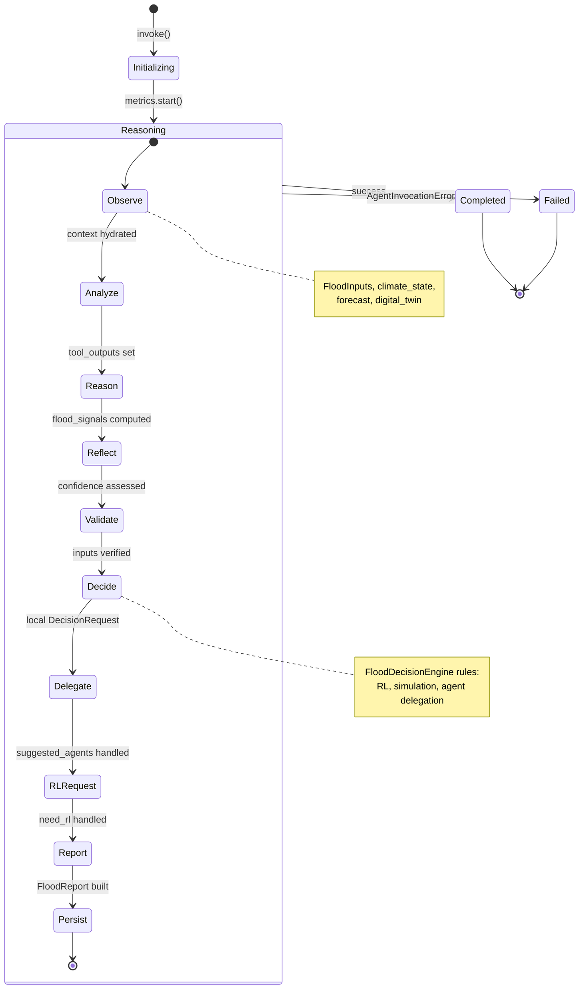
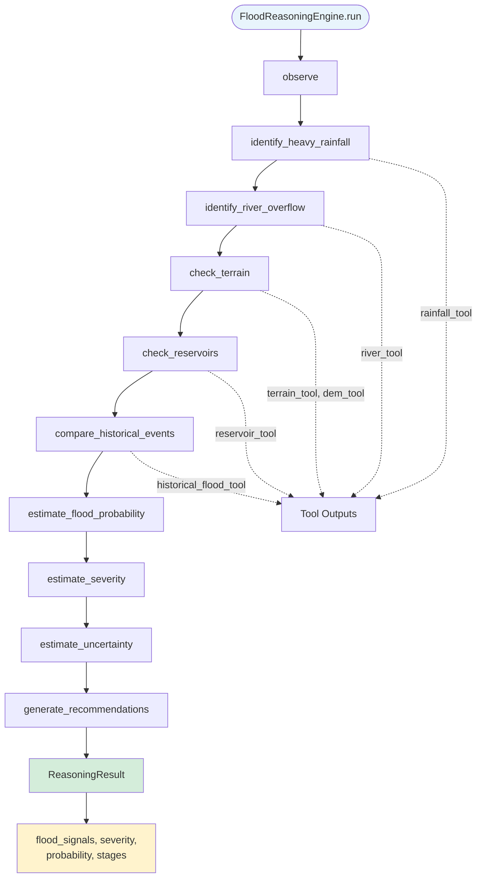
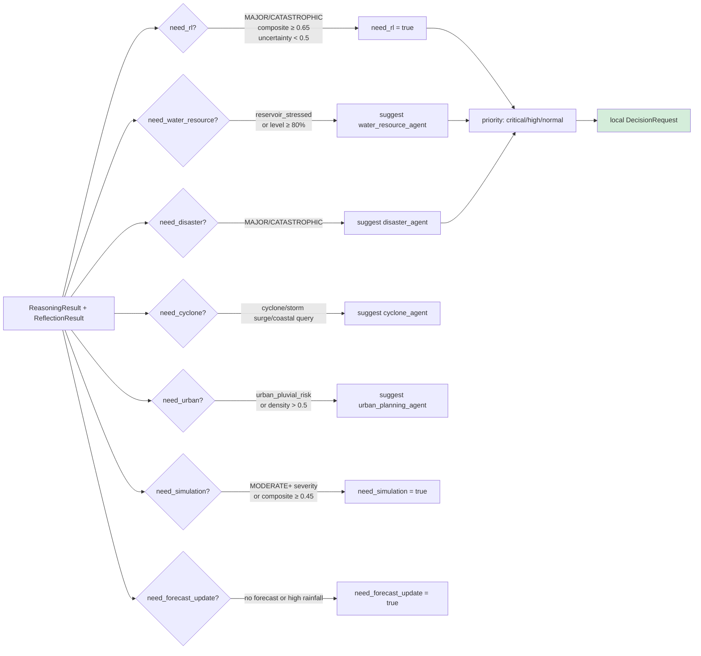
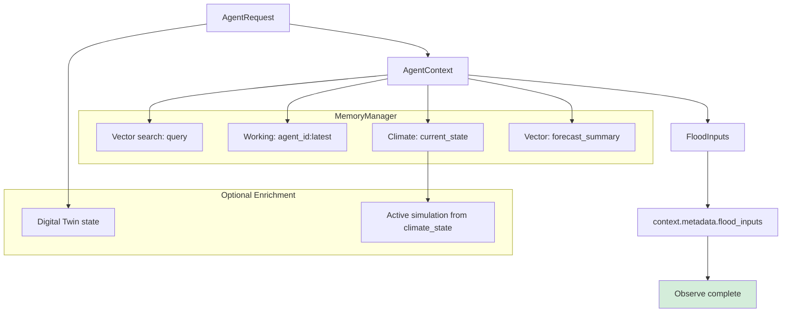
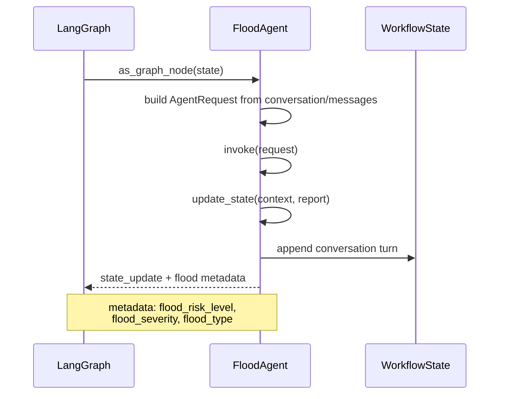

# Flood Agent Workflow

> **Version:** 0.2.0  
> **Last Updated:** 2026-07-07  
> **Source:** `backend/agents/specialized/flood/`

---

## End-to-End Invocation Sequence

---

## Workflow State Machine

---

## Reasoning Pipeline

---

## Flood Decision Engine Rules

---

## Context & Memory Hydration (Observe)

---

## LangGraph Node Integration

