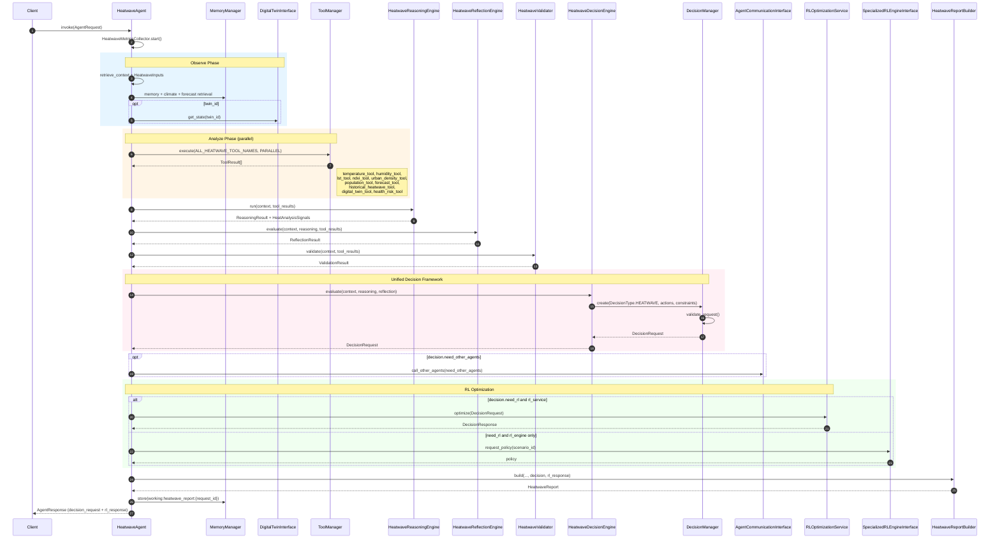
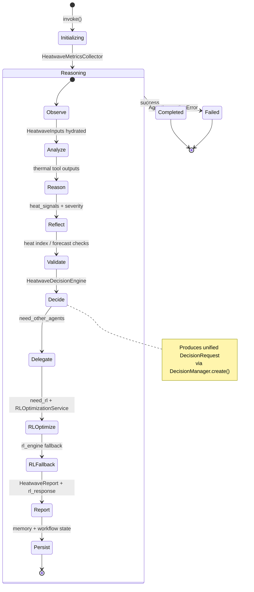
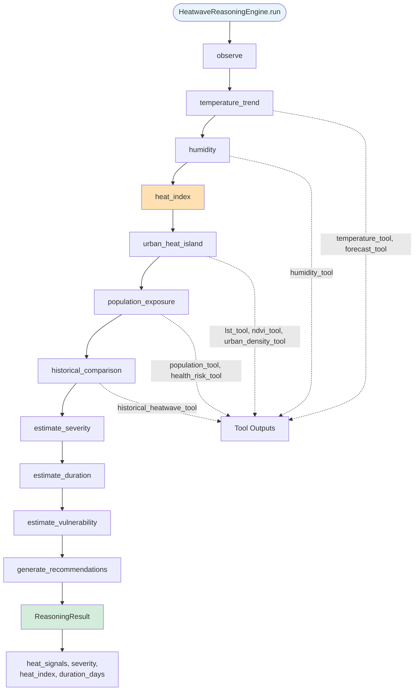
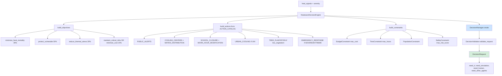
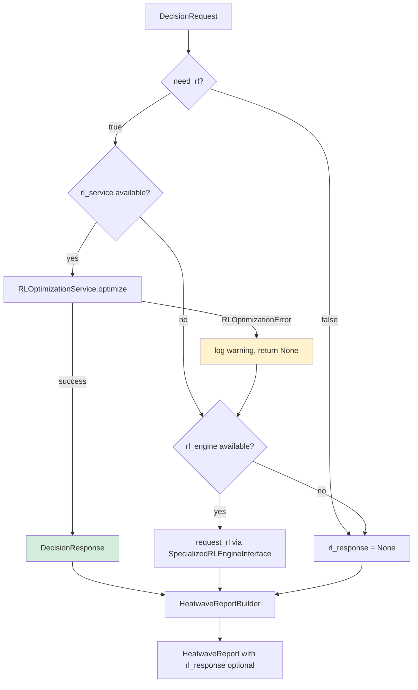
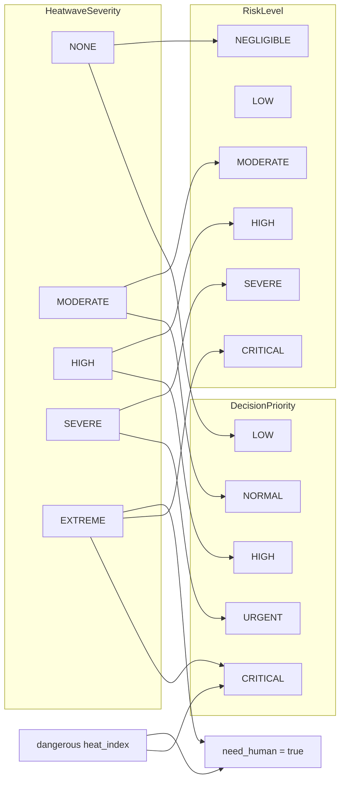
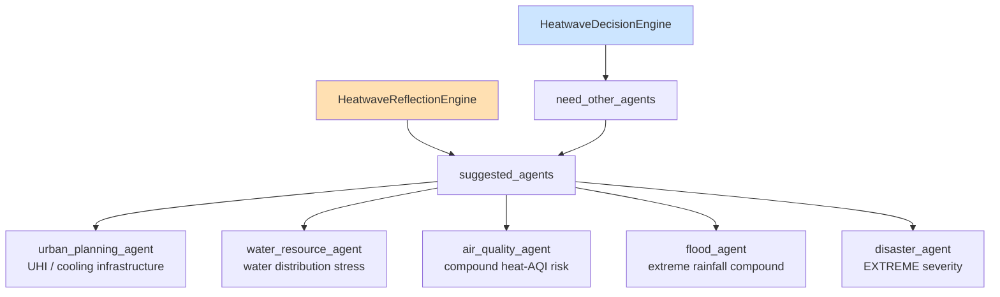

# Heatwave Agent Workflow

> **Version:** 0.2.0  
> **Last Updated:** 2026-07-07  
> **Source:** `backend/agents/specialized/heatwave/`

---

## End-to-End Invocation Sequence

---

## Workflow State Machine

---

## Reasoning Pipeline

---

## Unified Decision Request Construction

---

## RL Optimization Branch

---

## Severity → Priority & Risk Mapping

---

## Suggested Agent Delegation

