# Climate Knowledge Graph — Reasoning Flow

> **Diagram:** CKG query and reasoning pipelines  
> **Component:** `backend.knowledge_graph`  
> **Last Updated:** 2026-07-07

---

## Overview

This document visualizes how `GraphEngine` routes requests through `GraphQueryEngine` and `GraphReasoningEngine`, and how the India seed graph (`ClimateGraphBuilder.build_india_climate_graph()`) connects climate events to infrastructure, agents, and historical analogs.

**Distinction:** `GraphEngine` (`backend/knowledge_graph/`) is separate from `NetworkXKnowledgeGraph` (`backend/agents/memory/knowledge_graph.py`).

---

## System Architecture

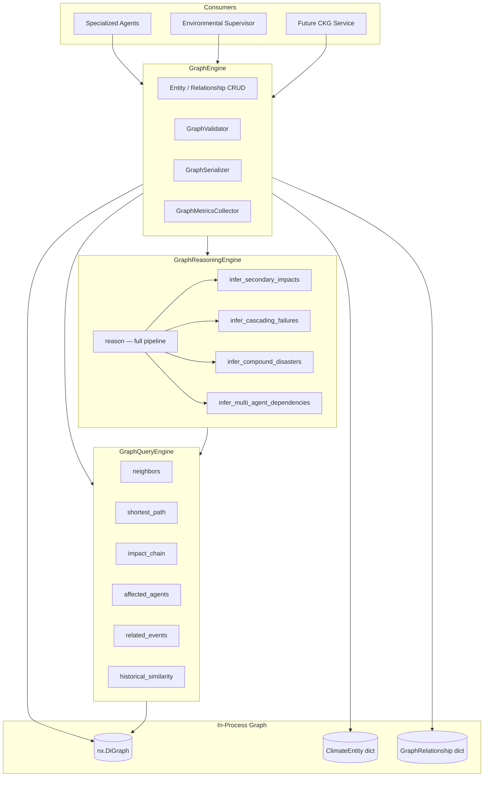

---

## Query API Flow

Six core query APIs exposed via `engine.query`:

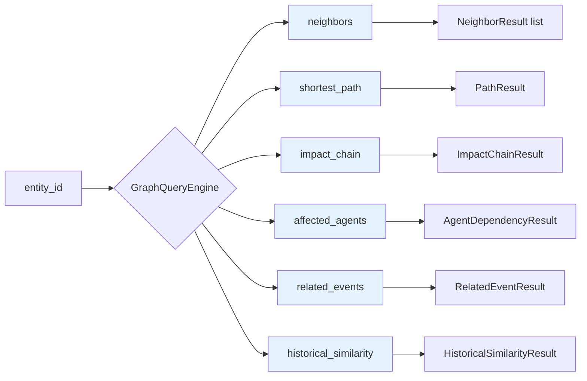

### `impact_chain` BFS Traversal

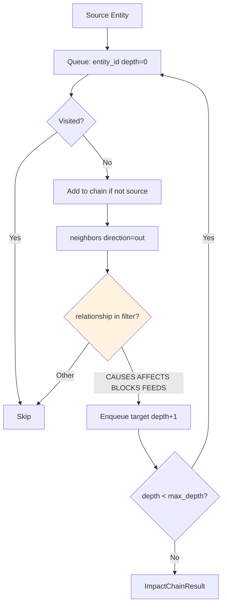

Default relationship filter: `IMPACT_RELATIONSHIPS` = `{CAUSES, AFFECTS, BLOCKS, FEEDS}`.

---

## Full Reasoning Pipeline

`GraphReasoningEngine.reason(entity_id)` orchestrates four inference stages:

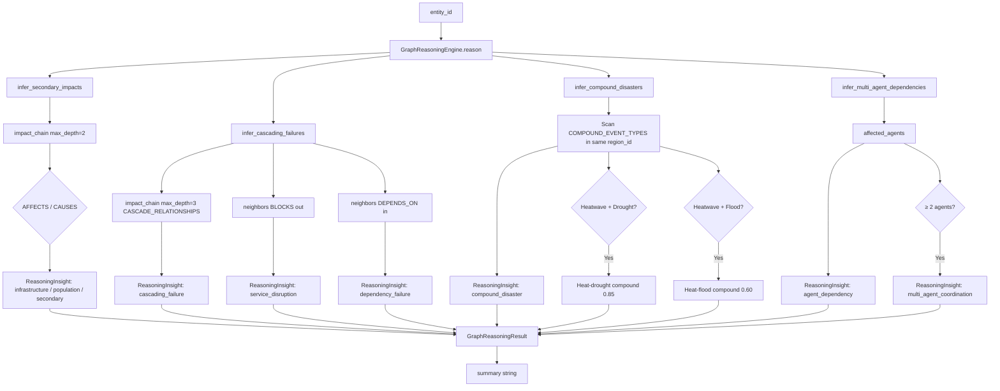

---

## Reasoning Sequence Diagram

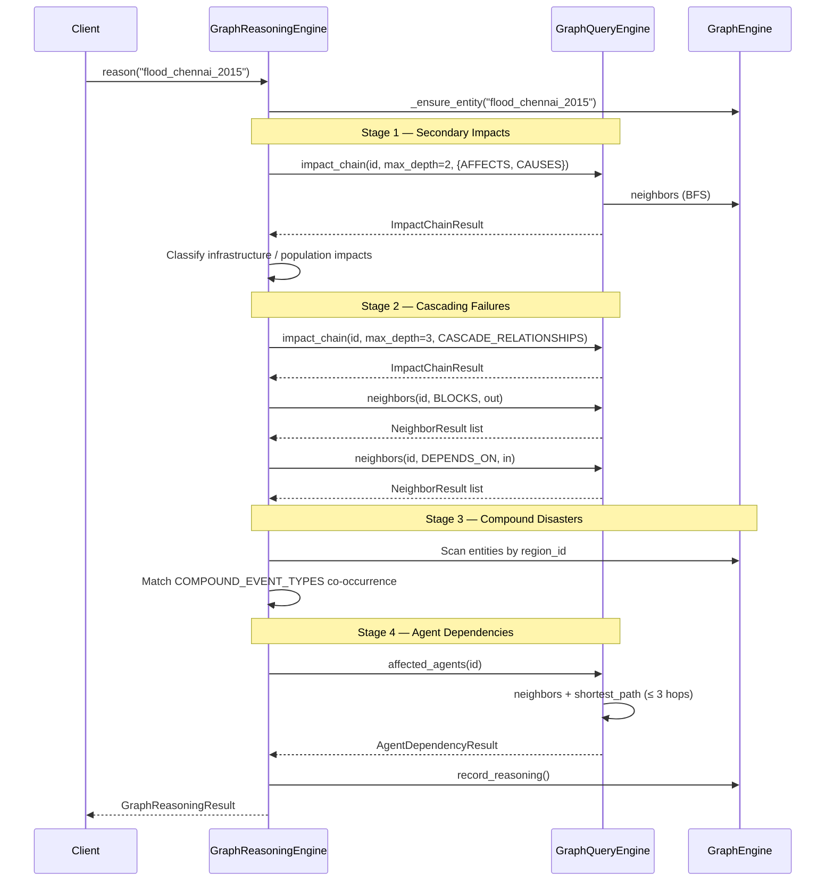

---

## `affected_agents` Resolution

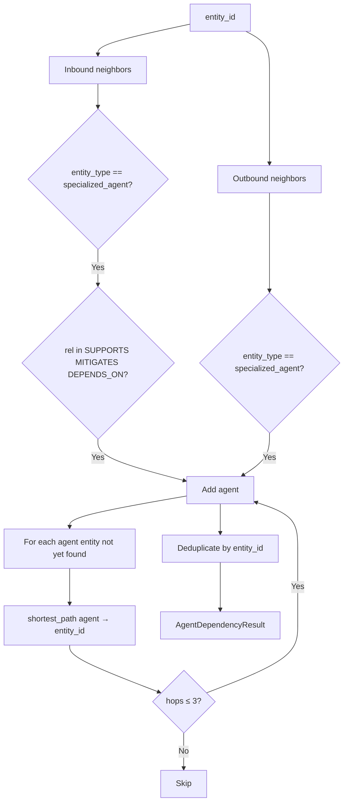

---

## `related_events` and `historical_similarity`

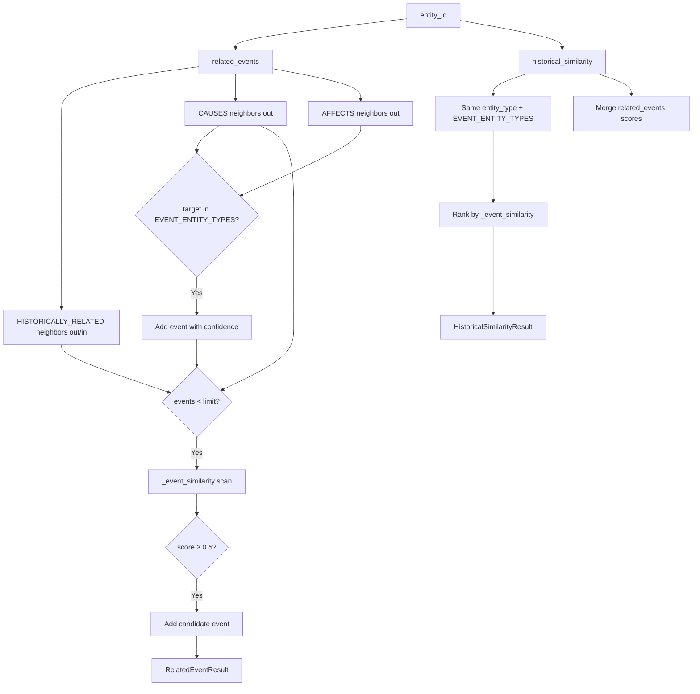

### Event Similarity Scoring

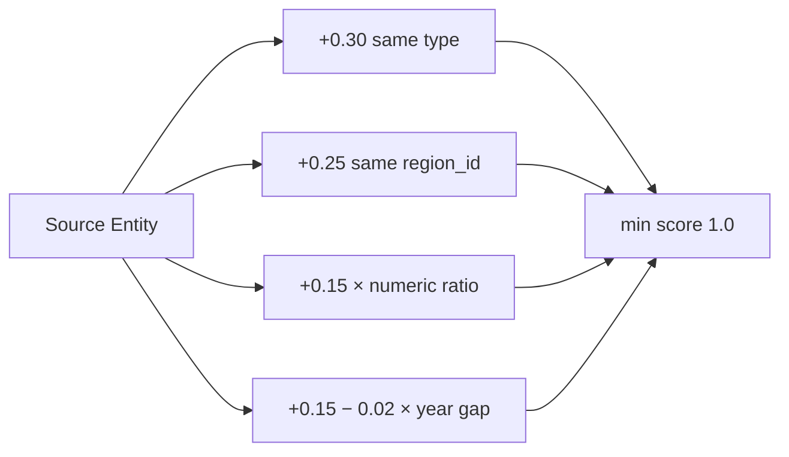

**Note:** `RAINFALL` is not in `EVENT_ENTITY_TYPES`. Rainfall entities resolve related events via `CAUSES` edges to `FLOOD` nodes and the similarity fallback loop.

---

## India Seed Graph — Example Paths

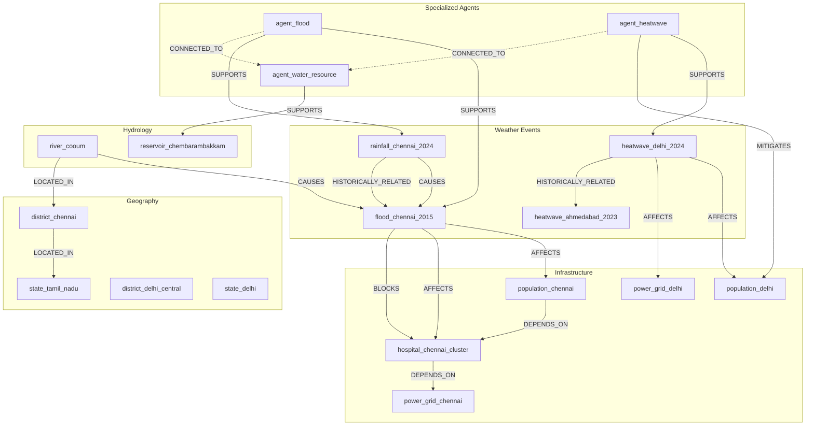

---

## GraphEngine vs NetworkXKnowledgeGraph

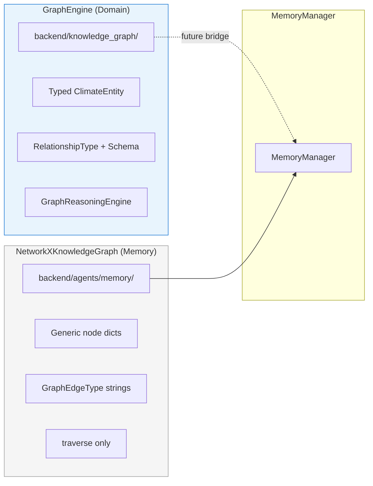

---

## Validation Gate on Mutations

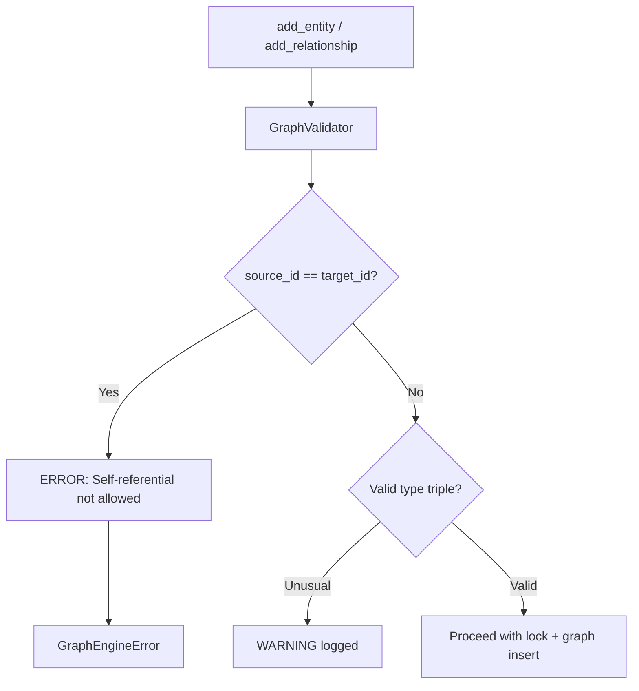

---

## Related Documents

- [Climate Knowledge Graph Documentation](../knowledge_graph/climate_knowledge_graph.md)
- [Memory Architecture](./memory_architecture.md)
- [Agent → Decision → RL Flow](./agent_decision_rl_flow.md)
