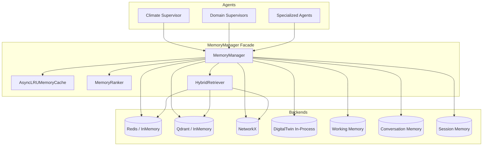
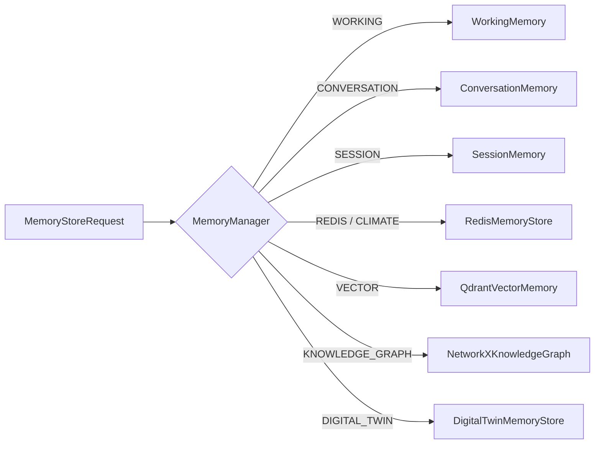
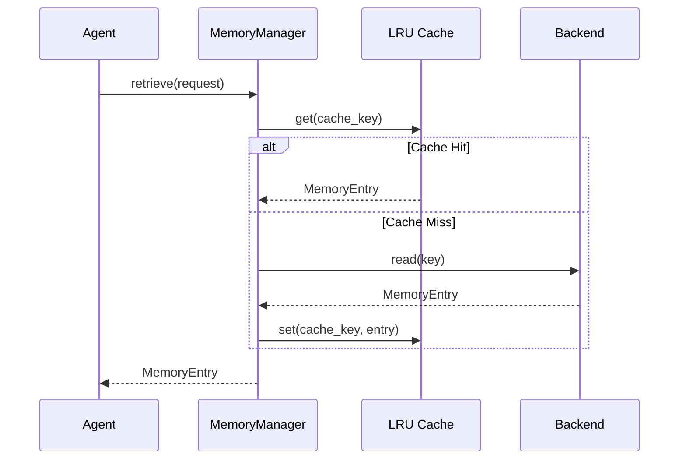
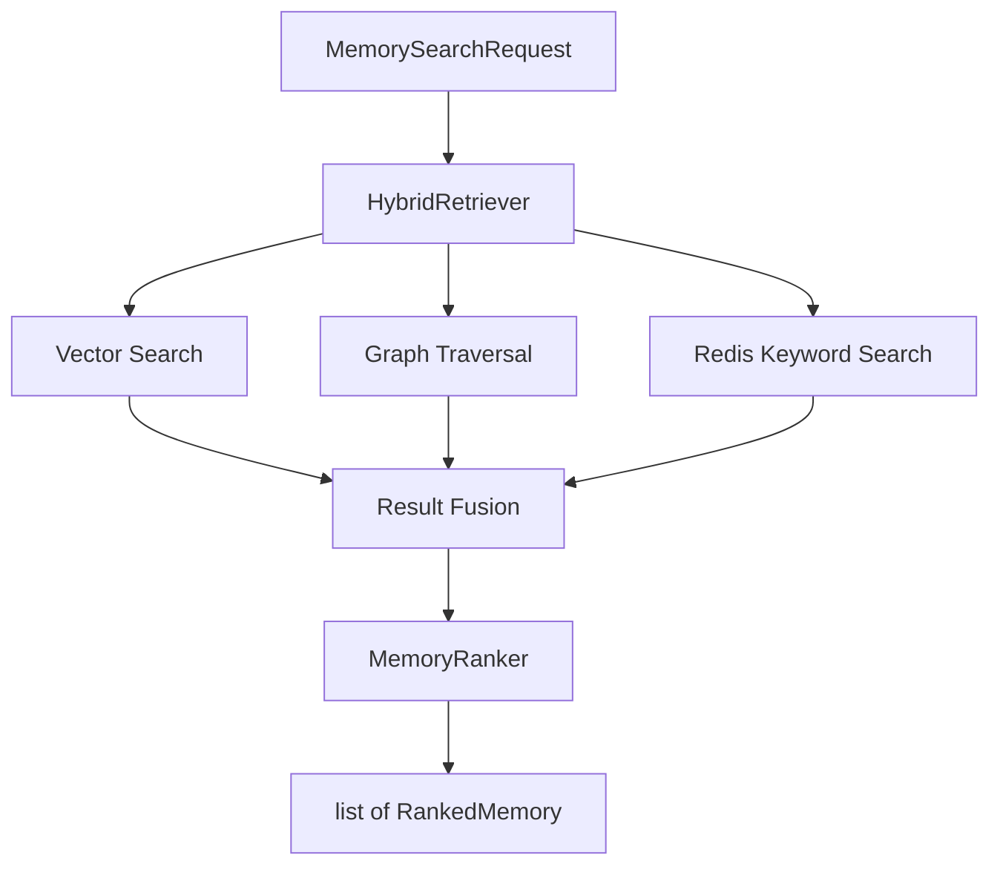
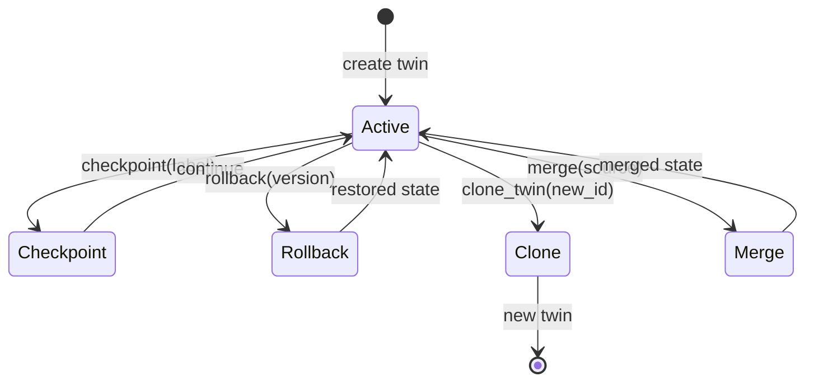

# Memory Architecture

> **Last Updated:** 2026-07-07

---

## Overview

The Hyperion memory system uses a facade pattern where all agents interact exclusively through `MemoryManager`, which routes operations to domain-specific backends.

---

## Component Diagram

---

## Memory Domain Routing

---

## Read Path with Cache

---

## Search / Hybrid Retrieval

---

## Digital Twin Versioning

---

## Key Design Constraints

| Constraint | Enforcement |
|------------|-------------|
| No direct backend access | Coding standard + ADR-003 |
| Session scoping | Redis key prefix with session_id |
| Cache invalidation | On write, update, delete, TTL change |
| Collection isolation | Qdrant collections per document type |

---

## Related Documents

- [Shared Memory Component Doc](../memory/shared_memory.md)
- [ADR-003](../decisions/ADR-003_memory_manager_abstraction.md)
- [ADR-004](../decisions/ADR-004_redis_plus_qdrant.md)
