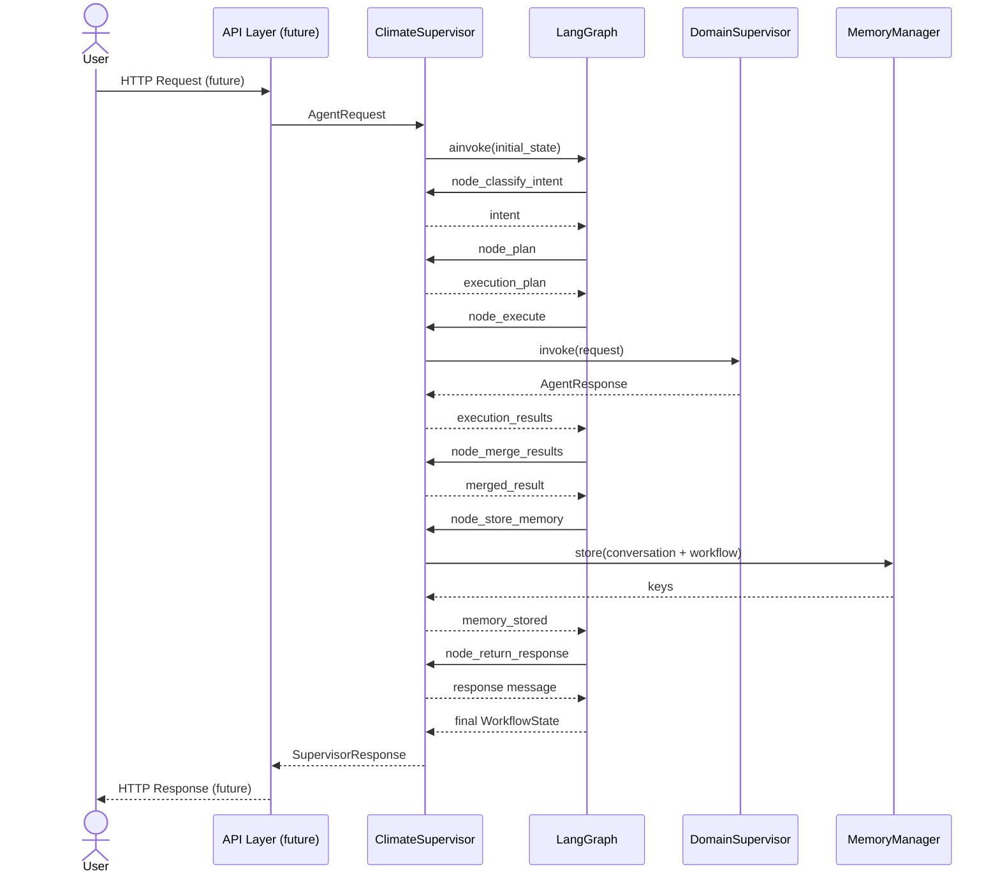

# Request Flow

> **Last Updated:** 2026-07-07

---

## End-to-End Request Flow

---

## Request Object Transformation

---

## AgentRequest Schema

| Field | Type | Required | Description |
|-------|------|----------|-------------|
| `query` | `str` | Yes | User query text |
| `session_id` | `str` | Yes | Session identifier |
| `request_id` | `str` | No (auto-generated) | Unique request ID |
| `context` | `dict` | No | Additional context |
| `metadata` | `dict` | No | Extensible metadata |

---

## SupervisorResponse Schema

| Field | Type | Description |
|-------|------|-------------|
| `request_id` | `str` | Request identifier |
| `content` | `str` | Response text |
| `intent` | `str` | Classified intent |
| `supervisors_invoked` | `list[str]` | Domain supervisors called |
| `metadata` | `dict` | Execution metadata |
| `status` | `str` | Final status |

---

## Current vs. Future Entry Points

| Entry Point | Status | Description |
|-------------|--------|-------------|
| `ClimateSupervisor.process_request()` | ✅ Implemented | Direct Python API |
| FastAPI HTTP endpoint | ⬜ Not started | REST API wrapper |
| Climate Copilot | ⬜ Not started | Conversational UI |
| WebSocket streaming | ⬜ Not started | Real-time response streaming |

---

## Related Documents

- [Supervisor Flow](./supervisor_flow.md)
- [Climate Supervisor](../supervisor/climate_supervisor.md)
- [Execution Flow](./execution_flow.md)
