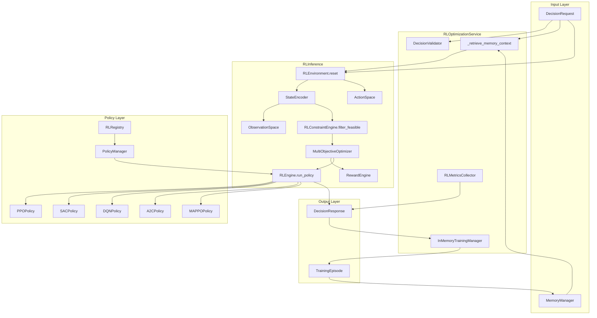
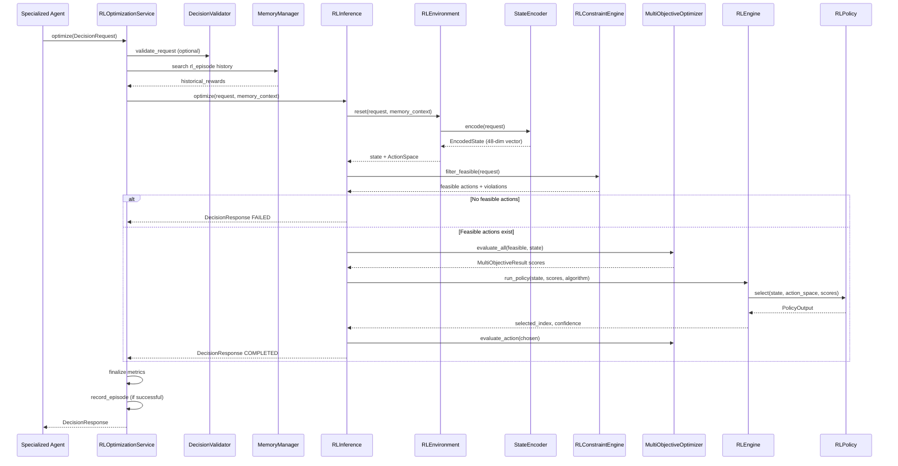
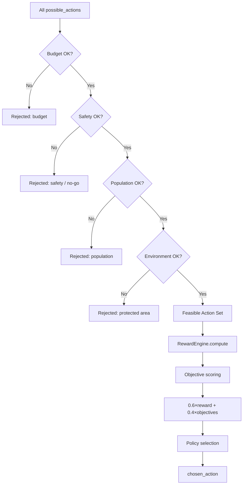
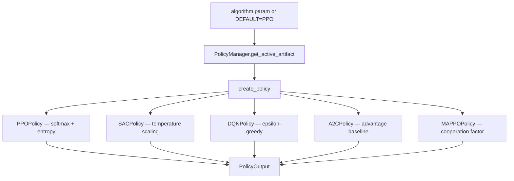
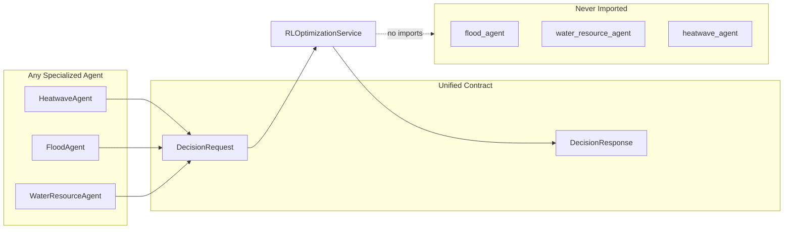

# RL Optimization Flow

> **Version:** 0.2.0  
> **Last Updated:** 2026-07-07  
> **Source:** `backend/rl/`

---

## End-to-End Optimization Pipeline

---

## Sequence: optimize(DecisionRequest)

---

## State Encoding Detail

```mermaid
flowchart LR
    DR[DecisionRequest] -->|to_rl_payload| P[Stripped Payload]
    P --> SE[StateEncoder]

    subgraph Features["Encoded Features → 48-dim Vector"]
        DT[decision_type one-hot ×9]
        PR[priority scalar]
        CF[confidence scalar]
        RS[risk_score scalar]
        RL[risk_level one-hot ×6]
        OW[objective_weights ×8]
        CB[constraint_budget]
        CS[constraint_safety]
        CV[climate_variables ×12]
        FP[forecast_present]
        SP[simulation_present]
        AC[action_count]
        NF[need_flags ×4]
        HR[historical_reward]
    end

    SE --> Features
    Features --> ES[EncodedState]
```

---

## Constraint & Reward Gates

---

## Policy Algorithm Selection

---

## Agent-Agnostic Contract

---

## Related Documents

- [RL Optimization Service](../rl/rl_optimization_service.md)
- [Decision Framework](../decision/decision_framework.md)
- [Agent → Decision → RL Flow](./agent_decision_rl_flow.md)
