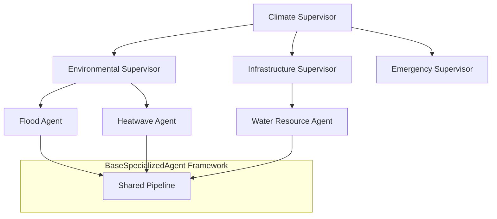
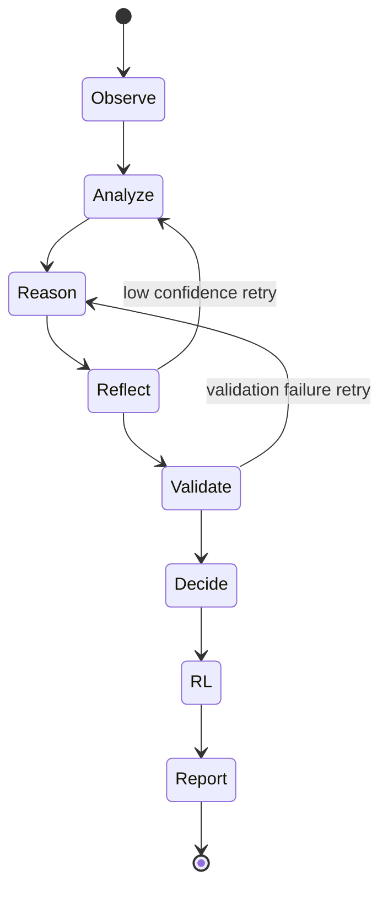
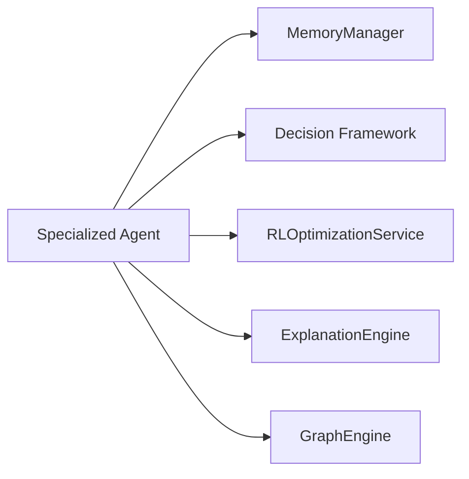
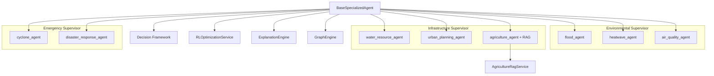

# Specialized Agent Architecture Diagram

> **Version:** 0.2.0  
> **Last Updated:** 2026-07-07

---

## Hierarchical Placement

---

## Internal Pipeline

---

## Cross-Cutting Services

---

## Version 0.3.0 Update — All 8 Agents Complete (2026-07-09)

**Test count:** 172 specialized agent tests (396 total suite).

See [Specialized Agents Overview](../agents/specialized_agents_overview.md) for per-agent details.
