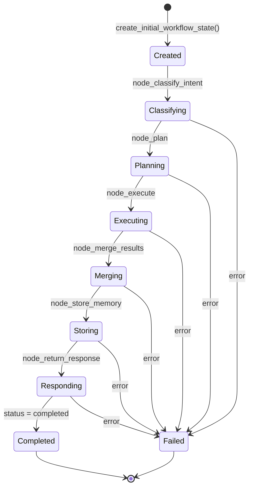
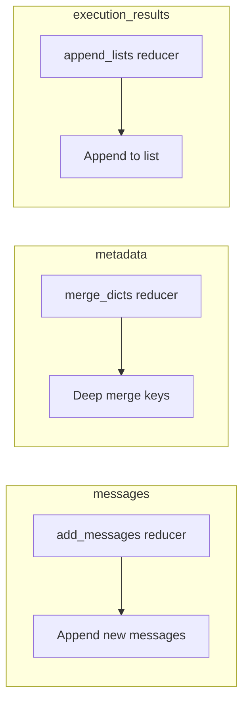
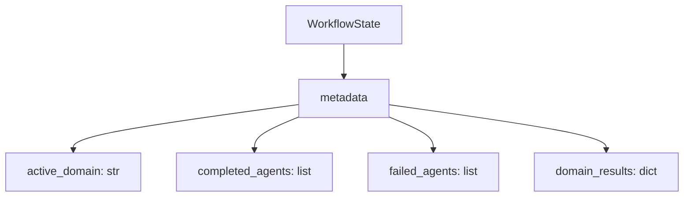
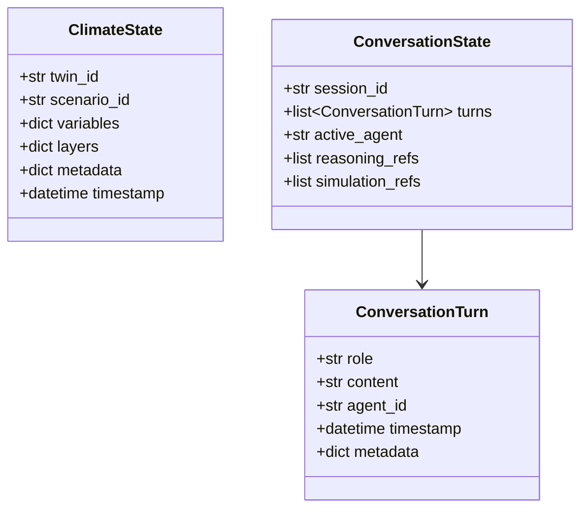

# State Flow

> **Last Updated:** 2026-07-07

---

## WorkflowState Lifecycle



---

## State Field Evolution

```mermaid
flowchart TD
    subgraph Initial
        I1[request_id]
        I2[session_id]
        I3[query]
        I4[messages: empty]
        I5[status: pending]
    end

    subgraph After classify_intent
        A1[intent]
        A2[metadata.intent_classification]
    end

    subgraph After plan
        B1[plan]
        B2[metadata.execution_plan]
    end

    subgraph After execute
        C1[execution_results]
        C2[metadata.supervisor_results]
    end

    subgraph After merge
        D1[merged_result]
    end

    subgraph After store_memory
        E1[metadata.memory_stored = true]
    end

    subgraph After return_response
        F1[status = completed]
        F2[messages: response added]
    end

    Initial --> After classify_intent
    After classify_intent --> After plan
    After plan --> After execute
    After execute --> After merge
    After merge --> After store_memory
    After store_memory --> After return_response
```

---

## LangGraph Reducers



---

## Domain State Extensions



---

## ClimateState and ConversationState



---

## Related Documents

- [State Management](../architecture/state_management.md)
- [Supervisor Flow](./supervisor_flow.md)
