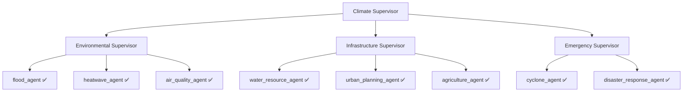
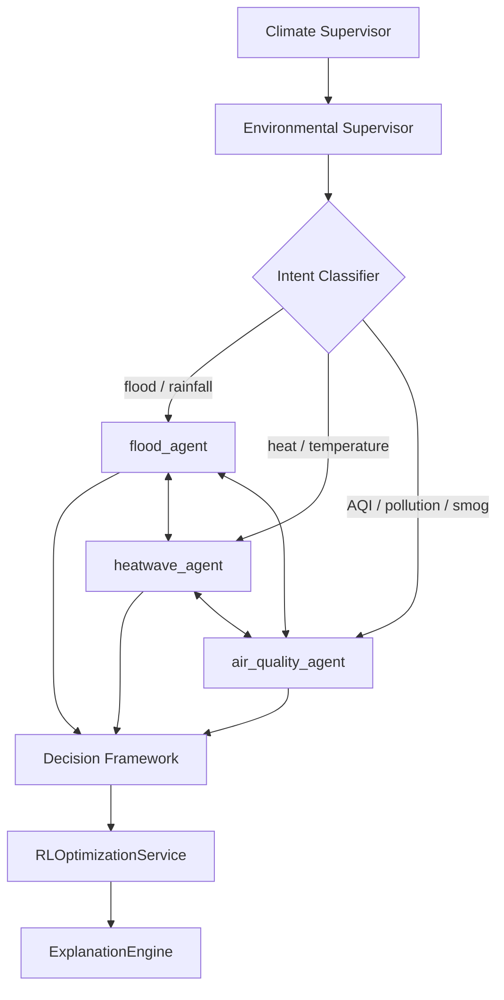
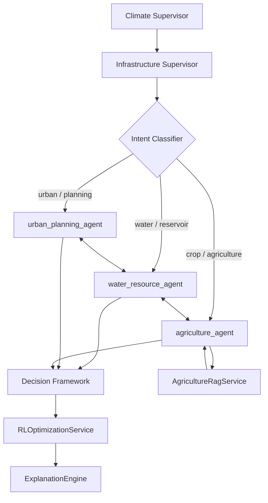
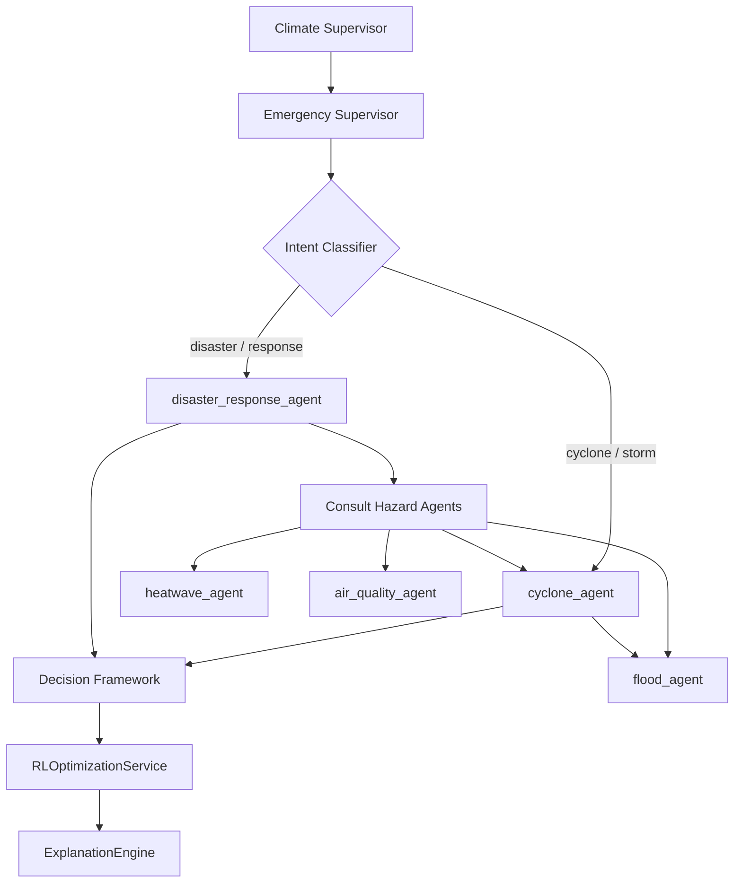

# Supervisor Agent Hierarchy

> **Version:** 0.3.0 | **Last Updated:** 2026-07-09

## Supervisor Responsibilities

| Supervisor | Agent Slots | Task Keywords |
|------------|-------------|---------------|
| Environmental | flood, heatwave, air_quality | flood, heat, pollution, AQI, environment |
| Infrastructure | water, urban, agriculture | water, urban, agriculture, planning, crop |
| Emergency | cyclone, disaster | cyclone, disaster, emergency, evacuation |

---

## Environmental Supervisor Workflow

| Agent | Primary Inputs | Primary Outputs | Peer Agents |
|-------|----------------|-----------------|-------------|
| `flood_agent` | Rainfall, river discharge, soil moisture | Flood risk, evacuation zones | heatwave, air_quality |
| `heatwave_agent` | Temperature, humidity, UHI | Heat stress, cooling advisories | flood, air_quality |
| `air_quality_agent` | PM2.5, gases, wind, emissions | AQI category, health risk | heatwave, urban_planning, agriculture |

---

## Infrastructure Supervisor Workflow

| Agent | Primary Inputs | Primary Outputs | Peer Agents |
|-------|----------------|-----------------|-------------|
| `water_resource_agent` | Reservoir levels, demand, rainfall | Allocation, release schedules | agriculture, flood |
| `urban_planning_agent` | Land use, UHI, flood zones | Adaptation scenarios, zoning | flood, heatwave, water |
| `agriculture_agent` | Soil moisture, crop stage, weather | Irrigation, harvest advisories | water, heatwave, flood |

---

## Emergency Supervisor Workflow

| Agent | Primary Inputs | Primary Outputs | Peer Agents |
|-------|----------------|-----------------|-------------|
| `cyclone_agent` | SST, wind, pressure, INSAT | Track, landfall, surge, evacuation | flood, disaster_response |
| `disaster_response_agent` | Multi-hazard signals, population | Coordinated response plan | all hazard agents |
