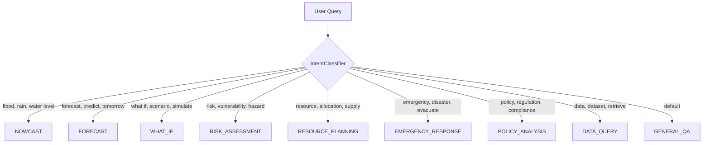
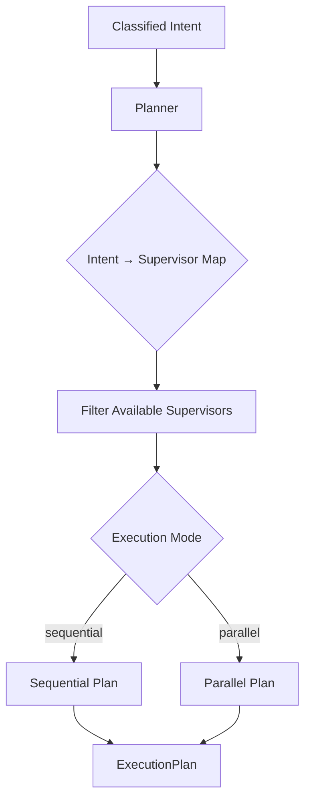
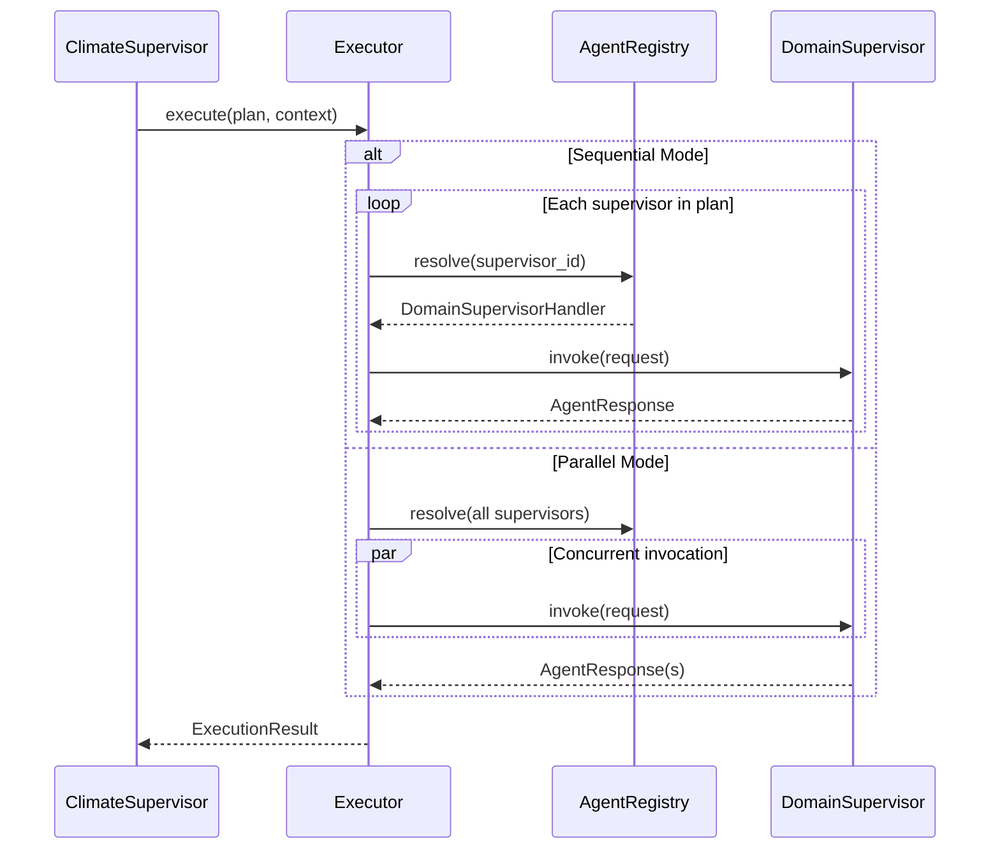
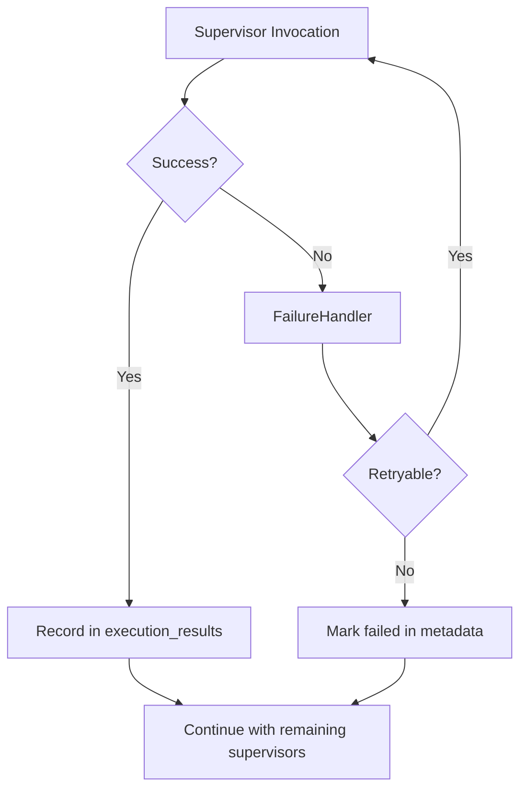

# Supervisor Flow

> **Last Updated:** 2026-07-07

---

## LangGraph Pipeline

---

## Node Responsibilities

| Node | Input State Fields | Output State Fields |
|------|-------------------|-------------------|
| `classify_intent` | `query` | `intent`, `metadata.intent_classification` |
| `plan` | `intent`, `query` | `plan`, `metadata.execution_plan` |
| `execute` | `plan` | `execution_results`, `metadata.supervisor_results` |
| `merge_results` | `execution_results` | `merged_result` |
| `store_memory` | `merged_result`, `messages` | `metadata.memory_stored` |
| `return_response` | `merged_result` | `status`, `messages` (response) |

---

## Intent Classification Flow

---

## Planning and Routing

---

## Execution Flow

---

## Failure Handling

---

## Related Documents

- [Climate Supervisor](../supervisor/climate_supervisor.md)
- [ADR-001](../decisions/ADR-001_langgraph_over_langchain.md)
- [Request Flow](./request_flow.md)
