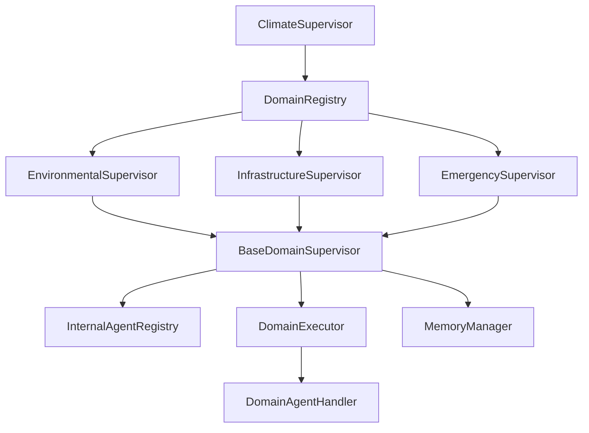

# Domain Supervisors

> **Component:** Domain Supervisors (Milestone 3)  
> **Status:** ✅ Complete  
> **Version:** 0.1.0  
> **Last Updated:** 2026-07-07  
> **Source:** `backend/agents/domain/`

---

## Purpose

Domain supervisors form the middle tier of the Hyperion agent hierarchy. They coordinate specialized agents within a hazard domain (environmental, infrastructure, emergency), selecting agents based on task keywords, building execution plans, orchestrating sequential/parallel/conditional execution, merging results, and updating memory.

---

## Architecture

```
BaseDomainSupervisor (ABC)
    ├── InternalAgentRegistry    → per-domain agent registry
    ├── DomainExecutor           → execution orchestration
    └── DomainExecutionPolicy    → retry/timeout policy

Concrete Implementations:
    ├── EnvironmentalSupervisor  → flood, heatwave, air_quality slots
    ├── InfrastructureSupervisor → agriculture, water, urban_planning slots
    └── EmergencySupervisor      → cyclone, disaster_response slots

DomainRegistry                 → global domain supervisor discovery
```

---

## Files Added

| File | Class(es) | Purpose |
|------|-----------|---------|
| `base_domain_supervisor.py` | `BaseDomainSupervisor`, `InternalAgentRegistry` | Abstract base + registry |
| `environmental_supervisor.py` | `EnvironmentalSupervisor` | Environmental domain |
| `infrastructure_supervisor.py` | `InfrastructureSupervisor` | Infrastructure domain |
| `emergency_supervisor.py` | `EmergencySupervisor` | Emergency domain |
| `domain_registry.py` | `DomainRegistry` | Global supervisor registry |
| `domain_context.py` | Domain types | Pydantic models for domain execution |
| `domain_execution.py` | `DomainExecutor`, `DomainAgentHandler` | Execution engine |

---

## Folder Structure

```
backend/agents/domain/
├── __init__.py
├── base_domain_supervisor.py
├── environmental_supervisor.py
├── infrastructure_supervisor.py
├── emergency_supervisor.py
├── domain_registry.py
├── domain_context.py
└── domain_execution.py

backend/tests/domain/
├── conftest.py
├── test_domain_supervisors.py
├── test_domain_registry.py
└── test_domain_execution.py
```

---

## Classes Created

### BaseDomainSupervisor

| Method | Description |
|--------|-------------|
| `initialize()` | Domain setup |
| `register_agent(handler, ...)` | Register specialized agent |
| `unregister_agent(agent_id)` | Remove agent |
| `select_agents(request)` | Keyword-based agent selection |
| `build_plan(selection, request)` | Execution plan from selection |
| `execute(plan, request)` | Run plan via DomainExecutor |
| `merge_results(result)` | Aggregate agent outputs |
| `update_memory(request, result)` | Persist domain results |
| `update_state(state, result)` | Update WorkflowState metadata |
| `invoke(request)` | Full domain pipeline |
| `as_graph_node(state)` | LangGraph node adapter |
| `health()` / `health_check()` | Health reporting |

### Domain Supervisors

| Supervisor | Domain ID | Agent Slots |
|------------|-----------|-------------|
| `EnvironmentalSupervisor` | `environmental` | `flood_agent`, `heatwave_agent`, `air_quality_agent` |
| `InfrastructureSupervisor` | `infrastructure` | `agriculture_agent`, `water_resource_agent`, `urban_planning_agent` |
| `EmergencySupervisor` | `emergency` | `cyclone_agent`, `disaster_response_agent` |

### DomainExecutor

| Mode | Description |
|------|-------------|
| `SEQUENTIAL` | Execute agents one after another |
| `PARALLEL` | Execute agents concurrently via `asyncio.gather` |
| `CONDITIONAL` | Execute based on prior step results |
| Retry support | Configurable via `DomainExecutionPolicy` |

### DomainRegistry

| Method | Description |
|--------|-------------|
| `register_supervisor(supervisor)` | Register domain supervisor |
| `register_all_defaults(memory)` | Register all three defaults |
| `resolve(supervisor_id)` | Resolve by ID |
| `resolve_by_domain(domain_type)` | Resolve by domain type |
| `unregister(supervisor_id)` | Remove supervisor |
| `health()` | Health check all |

---

## Domain Types

| DomainType | Supervisor | Tasks |
|------------|-----------|-------|
| `ENVIRONMENTAL` | EnvironmentalSupervisor | flood, heatwave, air_quality, forecast, nowcast |
| `INFRASTRUCTURE` | InfrastructureSupervisor | agriculture, water, urban_planning, resource |
| `EMERGENCY` | EmergencySupervisor | cyclone, disaster, evacuation, alert |

---

## Interfaces

| Interface | Location | Implementors |
|-----------|----------|-------------|
| `DomainAgentHandler` | `domain_execution.py` | Future specialized agents |
| `DomainSupervisorHandler` | `execution_context.py` | All domain supervisors |

### DomainAgentHandler Protocol

```python
@property
def agent_id(self) -> str: ...
async def invoke(self, request: AgentRequest) -> AgentResponse: ...
async def health_check(self) -> bool: ...
```

---

## Design Decisions

| Decision | Rationale | ADR |
|----------|-----------|-----|
| Middle tier between climate and specialized | Domain isolation and specialization | ADR-005 |
| InternalAgentRegistry per domain | No global agent coupling | ADR-005 |
| Keyword-based agent selection | Deterministic, testable without LLM | — |
| Pre-declared agent slots | Documents future agent contracts | — |
| DomainExecutor with retry | Resilience for agent failures | — |

---

## Dependency Graph



---

## Execution Flow

```
invoke(AgentRequest)
  ├── select_agents(request) → DomainSelectionResult
  ├── build_plan(selection) → DomainExecutionPlan
  ├── execute(plan) → DomainExecutionResult
  │     └── DomainExecutor (sequential/parallel/conditional)
  ├── merge_results(result) → DomainMergedResult
  ├── update_memory(request, result)
  └── return AgentResponse
```

---

## Data Flow

```
AgentRequest
    → DomainSelectionResult (selected agent IDs)
    → DomainExecutionPlan (steps, mode, policy)
    → DomainExecutionResult (per-agent results)
    → DomainMergedResult (aggregated content)
    → MemoryStoreRequest (domain results)
    → AgentResponse
```

---

## Interaction with Other Modules

| Module | Interaction |
|--------|------------|
| ClimateSupervisor | Invokes domain supervisors via AgentRegistry |
| MemoryManager | `update_memory()` stores domain execution results |
| WorkflowState | `update_state()` writes domain metadata |
| AgentRequest/Response | Input/output contracts |
| Specialized Agents (future) | Register via `register_agent()` |

---

## Public APIs

| API | Signature |
|-----|-----------|
| `BaseDomainSupervisor.invoke` | `async (request) → AgentResponse` |
| `BaseDomainSupervisor.register_agent` | `async (handler, ...) → None` |
| `BaseDomainSupervisor.as_graph_node` | `async (state) → dict` |
| `DomainRegistry.register_all_defaults` | `async (memory) → DomainRegistry` |
| `DomainRegistry.resolve` | `async (id) → BaseDomainSupervisor` |
| `DomainExecutor.execute` | `async (plan, handlers) → DomainExecutionResult` |

---

## Private APIs

| API | Owner |
|-----|-------|
| `_on_initialize()` | BaseDomainSupervisor subclasses |
| `_fallback_for(agent_id)` | BaseDomainSupervisor |
| `_match_agents_by_keywords()` | BaseDomainSupervisor |

---

## Configuration

No domain-specific configuration yet. Execution policy defaults:

| Policy | Default |
|--------|---------|
| Max retries | 2 |
| Retry delay | 0.1s |
| Execution mode | From plan |

---

## Error Handling

| Error | Behavior |
|-------|----------|
| Unregistered agent | `DependencyNotFoundError` on resolve |
| Duplicate registration | `DependencyRegistrationError` |
| Agent invocation failure | Retry per policy, then mark failed |
| No agents selected | Fallback response with domain context |

---

## Logging

- Agent selection logged at DEBUG with matched keywords
- Execution steps logged at INFO
- Failures logged at ERROR with agent_id context

---

## Metrics

`DomainExecutionMetrics` tracked per invocation:

| Field | Description |
|-------|-------------|
| `total_agents` | Agents in plan |
| `successful_agents` | Completed successfully |
| `failed_agents` | Failed after retries |
| `execution_time_ms` | Total execution time |
| `mode` | Execution mode used |

---

## Performance Considerations

- Parallel mode uses `asyncio.gather` for concurrent agent invocation
- Keyword matching is O(n) over registered agents — negligible at current scale
- Memory writes are async but sequential after execution

---

## Scalability Considerations

- InternalAgentRegistry is in-memory per domain supervisor instance
- Future: distributed agent discovery via service mesh
- Domain supervisors can be deployed as separate processes

---

## Security Considerations

- Agent registration requires explicit `register_agent()` call
- No arbitrary code execution in keyword matching
- Domain results sanitized before memory storage

---

## Future Extensions

- LLM-based agent selection replacing keyword matching
- Domain-specific prompt templates
- Cross-domain agent collaboration within a single request
- Agent capability negotiation protocol

---

## Known Limitations

- **No specialized agents implemented** — agent slots are metadata only
- Keyword-based selection may miss nuanced queries
- No timeout enforcement on agent invocation
- Domain supervisors not auto-registered in ClimateSupervisor by default
- `as_graph_node()` not yet composed into climate supervisor graph

---

## Test Coverage

| Test File | Tests | Status |
|-----------|-------|--------|
| `test_domain_supervisors.py` | 9 | ✅ |
| `test_domain_registry.py` | 6 | ✅ |
| `test_domain_execution.py` | 3 | ✅ |

**Total domain tests:** 18

---

## Related Documents

- [Development Log 003](../development_logs/003_domain_supervisors.md)
- [ADR-002](../decisions/ADR-002_hierarchical_supervisors.md)
- [ADR-005](../decisions/ADR-005_domain_supervisors.md)
- [Domain Flow Diagram](../diagrams/domain_flow.md)
