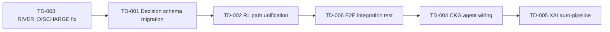

# Technical Debt Register

> **Last Updated:** 2026-07-07  
> **Version:** 0.2.0  
> **Maintainer:** Nexora Engineering

---

## Purpose

This register tracks known limitations, deferred refactoring, performance bottlenecks, and research topics identified during Prompts 5–12 implementation. Items are prioritized by impact on production readiness and hackathon demonstration quality.

---

## Summary Dashboard

| Category | Open Items | High Priority | Medium | Low |
|----------|-----------|---------------|--------|-----|
| Schema Migration | 2 | 2 | 0 | 0 |
| RL Engine | 3 | 1 | 2 | 0 |
| Integration Gaps | 4 | 2 | 2 | 0 |
| Testing | 3 | 1 | 2 | 0 |
| Performance | 2 | 0 | 1 | 1 |
| Documentation | 1 | 0 | 1 | 0 |
| **Total** | **15** | **6** | **8** | **1** |

---

## Current Limitations

### TD-001: Dual Decision Schema (Flood / Water)

| Field | Value |
|-------|-------|
| **Priority** | High |
| **Component** | Flood Agent, Water Resource Agent |
| **Status** | Open |

Flood and Water agents use **local** `DecisionRequest` schemas in their context modules. Heatwave uses the unified `backend.decision.DecisionRequest`. This prevents direct `RLOptimizationService` integration for Flood/Water without adapter layers.

**Resolution path:** Migrate `FloodDecisionEngine` and `WaterDecisionEngine` to emit unified schemas. Estimated effort: 2–3 days.

---

### TD-002: Dual RL Integration Paths

| Field | Value |
|-------|-------|
| **Priority** | High |
| **Component** | Specialized Agent Framework |
| **Status** | Open |

`SpecializedRLEngineInterface.request_rl()` (Flood/Water) and `RLOptimizationService.optimize()` (Heatwave) coexist. Increases maintenance burden and test surface.

**Resolution path:** Deprecate `SpecializedRLEngineInterface` after Flood/Water migration. Estimated effort: 1 day after TD-001.

---

### TD-003: ClimateVariable.RIVER_DISCHARGE Enum Gap

| Field | Value |
|-------|-------|
| **Priority** | High |
| **Component** | `rl_state_encoder.py` |
| **Status** | Open |

`RLStateEncoder` references `ClimateVariable.RIVER_DISCHARGE` which does not exist in the `ClimateVariable` enum. Causes `RLOptimizationError` when `climate_state` is attached to `DecisionRequest`. Heatwave integration tests use `MockRLOptimizationService` as workaround.

**Resolution path:** Add `RIVER_DISCHARGE` to enum or remove reference from encoder. Estimated effort: 2 hours.

---

### TD-004: CKG Not Wired to Agents

| Field | Value |
|-------|-------|
| **Priority** | Medium |
| **Component** | Climate Knowledge Graph, Specialized Agents |
| **Status** | Open |

`GraphEngine` operates independently. Agents use `MemoryManager` NetworkX graph, not the richer CKG with reasoning APIs (`impact_chain`, `compound_disasters`).

**Resolution path:** Inject `GraphEngine` into `build_context()` via DI. Estimated effort: 3–5 days.

---

### TD-005: XAI Not Auto-Invoked

| Field | Value |
|-------|-------|
| **Priority** | Medium |
| **Component** | ExplanationEngine, Specialized Agents |
| **Status** | Open |

`ExplanationEngine` is implemented but not called automatically in agent pipelines. Manual invocation required.

**Resolution path:** Add optional `explain=True` flag to agent report phase. Estimated effort: 1–2 days.

---

### TD-006: No End-to-End Climate → Agent Integration Test

| Field | Value |
|-------|-------|
| **Priority** | High |
| **Component** | Climate Supervisor, Domain Supervisors, Specialized Agents |
| **Status** | Open |

Full path from `ClimateSupervisor.process_request()` through domain supervisor to specialized agent is not integration-tested.

**Resolution path:** Create `test_climate_to_flood_e2e.py`. Estimated effort: 1 day.

---

### TD-007: In-Memory RL Only

| Field | Value |
|-------|-------|
| **Priority** | Medium |
| **Component** | RL Optimization Service |
| **Status** | Open |

`PolicyManager` and `InMemoryTrainingManager` use deterministic/heuristic policies. No Stable Baselines3 or trained model artifacts.

**Resolution path:** Integrate SB3 after simulation engine. Estimated effort: 1–2 weeks.

---

### TD-008: Rule-Based Domain Task Routing

| Field | Value |
|-------|-------|
| **Priority** | Low |
| **Component** | Domain Supervisors |
| **Status** | Open (pre-existing) |

Keyword-based agent selection may misroute ambiguous queries.

**Resolution path:** LLM-based classifier behind feature flag. Estimated effort: 3–5 days.

---

## Known Issues

| ID | Issue | Workaround |
|----|-------|------------|
| KI-001 | RL fails with attached climate_state | Mock RL in tests; omit climate_state in production calls until TD-003 fixed |
| KI-002 | Flood/Water cannot use unified RL service | Use `request_rl()` interface |
| KI-003 | CKG seed graph is India-specific only | Extend `ClimateGraphBuilder` for other regions |

---

## Future Refactoring

| Item | Description | Trigger |
|------|-------------|---------|
| RF-001 | Consolidate decision schemas | Before Copilot MVP |
| RF-002 | Extract shared decision-engine base class | When 4+ agents exist |
| RF-003 | Unify memory NetworkX and CKG | Before graph reasoning in agents |
| RF-004 | LangGraph meta-graph with domain subgraphs | Before production deployment |

---

## Performance Bottlenecks

| Bottleneck | Impact | Mitigation |
|------------|--------|------------|
| Sequential tool execution default | High latency with 10 tools | Enable `PARALLEL` mode for independent tools |
| Full graph validation on every `add_entity` | O(n) on large graphs | Batch validation mode for bulk imports |
| Synchronous constraint validation in RL | Blocks optimize() | Already async; profile under load |

---

## Scalability Improvements

| Improvement | Benefit |
|-------------|---------|
| Agent worker pool | Horizontal scaling of specialized agents |
| CKG read replicas | Query throughput for reasoning APIs |
| Redis cluster for memory | Session/working memory at scale |
| Policy artifact store (S3) | RL model versioning |

---

## Future Research Topics

| Topic | Relevance |
|-------|-----------|
| Multi-agent RL for coordinated disaster response | Emergency domain |
| Graph neural networks on CKG | Improved impact chain prediction |
| Conformal prediction for uncertainty | XAI confidence calibration |
| LLM-grounded tool selection | Replace keyword routing |
| Federated climate model integration | Prithvi WxC, regional models |

---

## Debt Paydown Priority

---

## Related Documents

- [Progress Tracker](./progress_tracker.md)
- [Debugging History](../testing/debugging_history.md)
- [System Evolution](../architecture/system_evolution.md)
- [CHANGELOG](../../CHANGELOG.md)

---

## Version 0.3.0 Technical Debt Update (2026-07-09)

> **Supplemental section.** All v0.2.0 items above are preserved.

### Resolved in v0.3.0

| Item | Resolution |
|------|------------|
| TD-004 (CKG not wired) | Partially resolved — all Prompt 13–17 agents query CKG in observe phase |
| TD-005 (XAI auto-pipeline) | Partially resolved — XAI on Cyclone, Disaster, Urban, Agriculture, Air Quality |
| Remaining 5 specialized agents | Resolved — all 8 agent slots implemented |

### New Debt Items (v0.3.0)

| ID | Item | Priority | Status |
|----|------|----------|--------|
| TD-016 | Scenario Simulation Engine pending | High | Open |
| TD-017 | Climate Copilot pending | High | Open |
| TD-018 | FastAPI endpoints not implemented | High | Open |
| TD-019 | CesiumJS digital twin integration | Medium | Open |
| TD-020 | Agriculture RAG external provider | Medium | Open |
| TD-021 | Model/inference optimization (SB3) | Low | Open |
| TD-022 | Deployment pipeline | Medium | Open |

See [Backend Architecture Status](../architecture/backend_architecture_status.md) for integration readiness.
