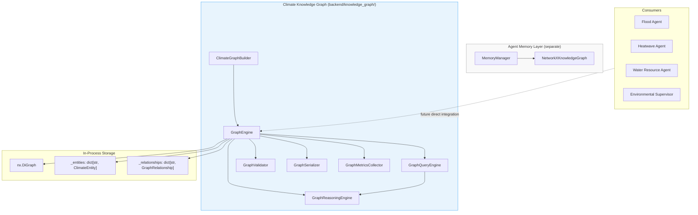
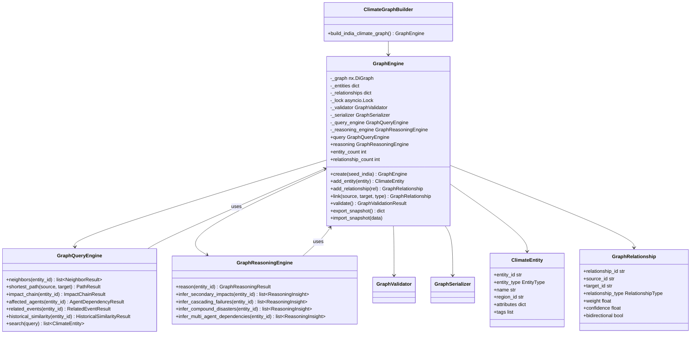
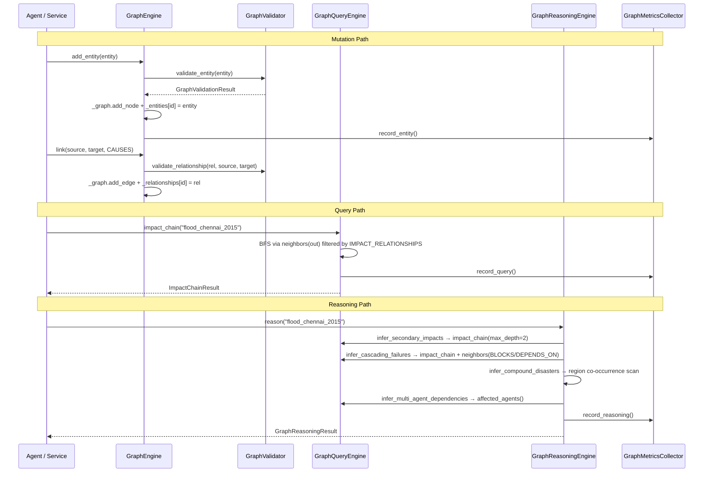
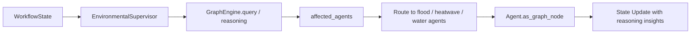
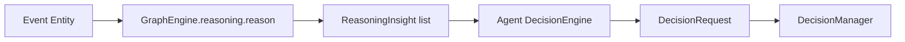
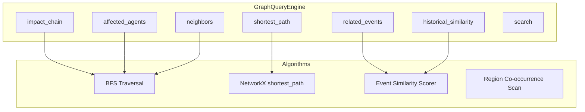
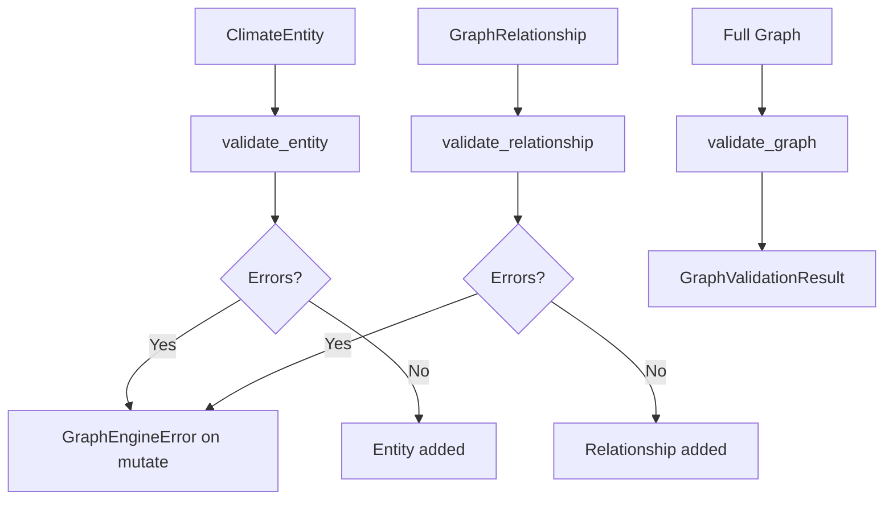
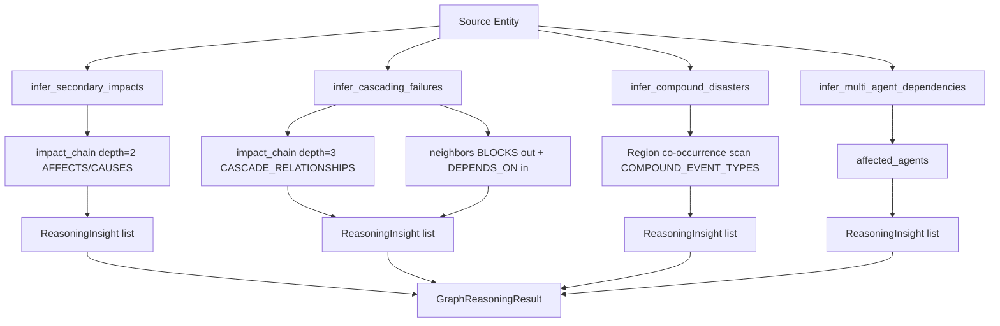

# Climate Knowledge Graph (CKG)

> **Component:** Climate Knowledge Graph (Prompt 11)  
> **Status:** ✅ Complete  
> **Version:** 1.0.0  
> **Last Updated:** 2026-07-07  
> **Package:** `backend.knowledge_graph`  
> **Schema Version:** `1.0`

---

## Purpose

The **Climate Knowledge Graph (CKG)** is Hyperion's enterprise-grade, domain-specific knowledge graph for modeling climate hazards, geographic entities, critical infrastructure, population exposure, specialized agents, forecasts, and digital twins. It is implemented by `GraphEngine` in `backend/knowledge_graph/` and is **architecturally separate** from the agent memory layer's `NetworkXKnowledgeGraph` in `backend/agents/memory/knowledge_graph.py`.

The CKG enables:

- **Structural reasoning** over typed entities and relationships (causality, dependency, geography, agent coordination)
- **Graph queries** — neighbors, shortest paths, impact chains, agent dependencies, related events, historical similarity
- **Inference** — secondary impacts, cascading failures, compound disasters, multi-agent coordination via `GraphReasoningEngine`
- **India domain seed data** via `ClimateGraphBuilder.build_india_climate_graph()`
- **Validation, serialization, and observability** for production graph lifecycle management

Specialized agents (Flood, Heatwave, Water Resource) are represented as `SpecializedAgentEntity` nodes and linked to events, infrastructure, and forecasts they support or mitigate.

---

## Responsibilities

| Responsibility | Owner Module |
|----------------|--------------|
| Entity type definitions and typed models | `entity_models.py` |
| Relationship types and query result models | `relationship_models.py` |
| Schema constraints and relationship triples | `graph_schema.py` |
| Core graph CRUD and lifecycle | `graph_engine.py` |
| Graph traversal and query APIs | `graph_query.py` |
| Impact inference and compound disaster detection | `graph_reasoning.py` |
| India climate domain seed graph | `graph_builder.py` |
| Entity/relationship/graph validation | `graph_validator.py` |
| Snapshot and node-link serialization | `graph_serializer.py` |
| Operation metrics and timing | `graph_metrics.py` |
| Public package exports | `__init__.py` |

---

## Architecture



**Design distinction:** `GraphEngine` is a standalone domain graph with Pydantic-typed entities, schema validation, reasoning, and rich query APIs. `NetworkXKnowledgeGraph` is a memory-backend adapter implementing `KnowledgeGraphMemory` for session/working memory graph storage inside `MemoryManager`. They share NetworkX and `KNOWLEDGE_GRAPH_MAX_DEPTH` but serve different layers and must not be conflated.

---

## Folder Structure

```
backend/knowledge_graph/
├── __init__.py              # Public API exports
├── entity_models.py         # EntityType enum, 22 typed entity models, create_entity()
├── relationship_models.py   # RelationshipType, GraphRelationship, query/reasoning result models
├── graph_schema.py          # ENTITY_RELATIONSHIP_CONSTRAINTS, impact/cascade sets
├── graph_engine.py          # GraphEngine — central orchestrator
├── graph_query.py           # GraphQueryEngine — 6 query APIs + search
├── graph_reasoning.py       # GraphReasoningEngine — 4 inference methods + reason()
├── graph_builder.py         # ClimateGraphBuilder — India seed data
├── graph_validator.py       # GraphValidator — entity/relationship/graph validation
├── graph_serializer.py      # GraphSerializer — snapshot and node-link I/O
└── graph_metrics.py         # GraphMetricsCollector, GraphExecutionMetrics

backend/tests/knowledge_graph/
├── conftest.py              # graph_engine, india_climate_graph fixtures
├── test_ckg_unit.py         # 7 unit tests
└── test_ckg_integration.py  # 17 integration tests
```

---

## Class Diagram



---

## Execution Flow

The CKG supports three primary execution paths: **mutation** (add/update entities and relationships), **query** (structural traversal), and **reasoning** (inference over query results).



### Workflow Phases

| Phase | Entry Point | Description |
|-------|-------------|-------------|
| 1. Bootstrap | `GraphEngine.create(seed_india=True)` | Instantiate engine; optionally seed India graph |
| 2. Seed | `ClimateGraphBuilder.build_india_climate_graph()` | Add 27+ entities, 50+ relationships across India domains |
| 3. Mutate | `add_entity`, `link`, `add_relationship` | Validated graph mutations with async lock |
| 4. Query | `engine.query.*` | Structural queries over typed relationships |
| 5. Reason | `engine.reasoning.*` | Inference pipelines producing `ReasoningInsight` objects |
| 6. Validate | `engine.validate()` | Full-graph consistency check |
| 7. Export | `export_snapshot()` / `export_node_link()` | Persist graph state |
| 8. Metrics | `finalize_metrics()` | Record operation timing and counts |

---

## Public APIs

### `GraphEngine`

| Method / Property | Description |
|-------------------|-------------|
| `create(*, seed_india=False)` | Async factory; optionally seeds India graph |
| `query` | `GraphQueryEngine` instance |
| `reasoning` | `GraphReasoningEngine` instance |
| `serializer` | `GraphSerializer` instance |
| `entity_count` / `relationship_count` | Graph size counters |
| `last_metrics` | Most recent `GraphExecutionMetrics` |
| `add_entity(entity, *, validate=True)` | Add validated entity node |
| `get_entity(entity_id)` | Retrieve entity by ID |
| `update_entity(entity)` | Update entity and graph node attributes |
| `remove_entity(entity_id)` | Remove entity and incident relationships |
| `list_entities(*, entity_type, region_id)` | Filtered entity listing |
| `add_relationship(relationship, *, validate=True)` | Add validated edge |
| `link(source_id, target_id, relationship_type, ...)` | Convenience relationship creator |
| `get_relationship(relationship_id)` | Retrieve relationship by ID |
| `list_relationships(*, relationship_type, source_id, target_id)` | Filtered relationship listing |
| `validate()` | Full graph validation |
| `export_snapshot()` | JSON-serializable entity/relationship snapshot |
| `import_snapshot(data)` | Replace graph from snapshot |
| `export_node_link()` | NetworkX node-link format with entity records |
| `start_metrics(operation)` | Begin metrics collection |
| `finalize_metrics()` | End metrics collection and return summary |

### Factory

```python
# Empty graph
engine = await GraphEngine.create()

# Pre-seeded India climate graph
engine = await GraphEngine.create(seed_india=True)

# Or explicit builder
engine = await GraphEngine.create()
await ClimateGraphBuilder(engine).build_india_climate_graph()
```

### `GraphQueryEngine` — Six Core Query APIs

| API | Signature | Returns | Description |
|-----|-----------|---------|-------------|
| `neighbors` | `(entity_id, *, relationship=None, direction="out")` | `list[NeighborResult]` | Adjacent entities filtered by relationship type and direction |
| `shortest_path` | `(source_id, target_id, *, relationship=None)` | `PathResult` | Shortest path via NetworkX; optional relationship subgraph |
| `impact_chain` | `(entity_id, *, max_depth=3, relationships=None)` | `ImpactChainResult` | BFS traversal along causal/impact edges |
| `affected_agents` | `(entity_id)` | `AgentDependencyResult` | Specialized agents connected within 3 hops |
| `related_events` | `(entity_id, *, limit=10)` | `RelatedEventResult` | Historically or causally related weather events |
| `historical_similarity` | `(entity_id, *, limit=5)` | `HistoricalSimilarityResult` | Same-type event similarity scoring |

Additional: `search(query, *, entity_type=None, limit=10)` — text search across names, descriptions, tags, and region IDs.

### `GraphReasoningEngine`

| API | Returns | Description |
|-----|---------|-------------|
| `reason(entity_id)` | `GraphReasoningResult` | Full reasoning pipeline (all four inference methods) |
| `infer_secondary_impacts(entity_id)` | `list[ReasoningInsight]` | 2-hop AFFECTS/CAUSES downstream impacts |
| `infer_cascading_failures(entity_id)` | `list[ReasoningInsight]` | Dependency/block cascade along infrastructure |
| `infer_compound_disasters(entity_id)` | `list[ReasoningInsight]` | Co-occurring hazard types in same region |
| `infer_multi_agent_dependencies(entity_id)` | `list[ReasoningInsight]` | Agent coordination requirements |

### Domain Exports (`knowledge_graph/__init__.py`)

22 entity model classes, 10 relationship/result types, `GraphEngine`, `ClimateGraphBuilder`, `create_entity`, `is_valid_relationship`, `ENTITY_RELATIONSHIP_CONSTRAINTS`.

---

## Private Methods

### `GraphEngine`

| Method | Purpose |
|--------|---------|
| `_ensure_entity(entity_id)` | Raise `GraphEngineError` if entity not found; used by query/reasoning engines |

### `GraphQueryEngine`

| Method | Purpose |
|--------|---------|
| `_relation_subgraph(relationship)` | Build NetworkX subgraph filtered to one relationship type |
| `_edge_relationship(edge_data)` | Reconstruct `GraphRelationship` from edge attributes or registry |
| `_event_similarity(source, candidate)` | Score historical event similarity (type, region, numeric attrs, year gap) |

### `ClimateGraphBuilder`

| Method | Purpose |
|--------|---------|
| `_link_many(links)` | Batch convenience wrapper over `engine.link()` |

### `GraphSerializer`

| Method | Purpose |
|--------|---------|
| `graph_from_node_link(data)` | Deserialize node-link format to graph + entity/relationship dicts |

---

## LangGraph Integration

The CKG does not expose a LangGraph node directly. Integration is **indirect** through specialized agents and supervisors:

1. **Agent graph nodes** (`FloodAgent.as_graph_node()`, etc.) can be extended to query `GraphEngine` for impact context before or after tool execution.
2. **Supervisor routing** can use `affected_agents()` to determine which specialized agents to invoke for a given event entity.
3. **Workflow state enrichment** — reasoning results (`GraphReasoningResult`) can be attached to `WorkflowState.metadata` for downstream decision and RL steps.



Recommended integration pattern:

```python
engine = await GraphEngine.create(seed_india=True)
agents = await engine.query.affected_agents("flood_chennai_2015")
reasoning = await engine.reasoning.reason("flood_chennai_2015")
# Attach to workflow state metadata for supervisor consumption
```

---

## Memory Integration

| Layer | Class | Location | Role |
|-------|-------|----------|------|
| **CKG (domain graph)** | `GraphEngine` | `backend/knowledge_graph/` | Typed climate domain model; query and reasoning |
| **Memory graph** | `NetworkXKnowledgeGraph` | `backend/agents/memory/knowledge_graph.py` | `KnowledgeGraphMemory` backend for `MemoryManager` |

### `NetworkXKnowledgeGraph` (Memory Layer)

| Feature | Memory Graph | CKG (`GraphEngine`) |
|---------|--------------|-------------------|
| Interface | `KnowledgeGraphMemory` (read/write/search) | Standalone async API |
| Node model | Generic dict attributes + `GraphNodeType` | Pydantic `ClimateEntity` subtypes |
| Edge model | `relation` string on edges | Typed `RelationshipType` + `GraphRelationship` |
| Validation | None | `GraphValidator` + schema constraints |
| Reasoning | `traverse()` only | `GraphReasoningEngine` (4 inference methods) |
| Query APIs | `neighbors`, `traverse`, `query` | 6 domain query APIs + similarity |
| Caching | `AsyncLRUMemoryCache` | None (in-process) |
| Pre-seed | `create_climate_graph()` (empty) | `build_india_climate_graph()` (27+ entities) |

`MemoryManager.search_graph()` and `HybridRetriever` use `NetworkXKnowledgeGraph` for session-scoped retrieval. The CKG is the **authoritative domain ontology**; the memory graph holds runtime/session context. Future work may bridge CKG snapshots into memory graph hydration.

---

## Decision Framework Integration

The CKG does not produce `DecisionRequest` objects directly. It **informs** decision-making by supplying structured context:

| CKG Output | Decision Use |
|------------|--------------|
| `ImpactChainResult` | Scope objectives and constraints to affected infrastructure/population |
| `AgentDependencyResult` | Set `need_other_agents` on `DecisionRequest` |
| `GraphReasoningResult.compound_disasters` | Elevate priority for compound hazard scenarios |
| `GraphReasoningResult.cascading_failures` | Add infrastructure protection constraints |
| `HistoricalSimilarityResult` | Calibrate risk scores from historical analogs |



Specialized agents can query the CKG during `_run_observe` or `_run_reason` to enrich `DecisionContext` with graph-derived impact chains and agent coordination requirements.

---

## RL Integration

The CKG does not invoke `RLOptimizationService` directly. Graph reasoning outputs can enrich RL observation encoding:

| Reasoning Category | RL Signal |
|--------------------|-----------|
| `cascading_failure` | Infrastructure failure risk dimension |
| `compound_disaster` | Multi-hazard state encoding |
| `agent_dependency` | Available action agents / coordination flags |
| `infrastructure_impact` | Constraint tightening for power/hospital nodes |

`ImpactChainResult.chain` entity types can be mapped to `RLStateEncoder` features when CKG integration is wired into the RL observation pipeline. This is a planned integration point — not yet connected in v1.0.0.

---

## Knowledge Graph Integration

This section documents how the CKG relates to other graph systems in Hyperion.

### `GraphEngine` vs `NetworkXKnowledgeGraph`

| Aspect | `GraphEngine` | `NetworkXKnowledgeGraph` |
|--------|---------------|----------------------------|
| Package | `backend.knowledge_graph` | `backend.agents.memory.knowledge_graph` |
| Purpose | Domain ontology and reasoning | Agent memory persistence |
| Entity types | 22 typed `ClimateEntity` subclasses | Generic nodes with `node_type` string |
| Relationships | 10 `RelationshipType` values with schema constraints | `GraphEdgeType` strings |
| Async | Full async API with lock | Async with LRU cache |
| Tests | 24 dedicated CKG tests | Covered by memory integration tests |

**Critical:** Importing `GraphEngine` from `backend.knowledge_graph` and `NetworkXKnowledgeGraph` from `backend.agents.memory.knowledge_graph` — never interchange them.

### India Seed Graph Entity Inventory

`ClimateGraphBuilder.build_india_climate_graph()` seeds:

| Category | Entities |
|----------|----------|
| States | Tamil Nadu, Delhi, Gujarat |
| Districts / Urban | Chennai, Central Delhi, Ahmedabad |
| Rivers | Cooum, Krishna |
| Reservoirs | Chembarambakkam, Nagarjuna Sagar |
| Infrastructure | Chennai Healthcare Cluster, Delhi/Chennai Power Grids |
| Population | Chennai Metropolitan, Delhi NCR |
| Agriculture | Tamil Nadu Delta Agriculture |
| Weather Events | Chennai Flood 2015, Delhi Heatwave 2024, Ahmedabad UHI 2023, Chennai Heavy Rainfall Dec 2024 |
| Forecast / Twin | IMD GFS Forecast, Chennai/Delhi Digital Twins |
| Agents | flood_agent, heatwave_agent, water_resource_agent |

Relationship categories: geographic (`LOCATED_IN`), hydrological (`FEEDS`), causal/impact (`CAUSES`, `AFFECTS`), dependency (`DEPENDS_ON`, `BLOCKS`), agent (`SUPPORTS`, `MITIGATES`, `CONNECTED_TO`), historical (`HISTORICALLY_RELATED`).

---

## Explainability Integration

`ReasoningInsight` objects provide structured explainability artifacts:

| Field | Purpose |
|-------|---------|
| `category` | Impact classification (e.g., `infrastructure_impact`, `compound_disaster`) |
| `title` | Human-readable insight headline |
| `description` | Narrative explanation |
| `confidence` | 0.0–1.0 confidence score |
| `affected_entity_ids` | Traceable entity references |
| `supporting_relationships` | Relationship IDs backing the inference |
| `metadata` | Additional context (hazard types, agent IDs, capabilities) |

`GraphReasoningResult.summary` aggregates counts for logging and UI display. Query results (`ImpactChainResult.summary`, `HistoricalSimilarityResult.rationale`) provide additional narrative context for explainability modules.

---

## Tool Architecture

The CKG exposes query and reasoning capabilities analogous to agent tools — callable async methods with typed inputs and outputs.

### Query API Architecture



### Relationship Type Semantics

| Type | Direction | Meaning |
|------|-----------|---------|
| `CAUSES` | source → target | Causal trigger (rainfall → flood) |
| `AFFECTS` | source → target | Direct impact on entity |
| `DEPENDS_ON` | source → target | Operational dependency |
| `LOCATED_IN` | source → target | Geographic containment |
| `FEEDS` | source → target | Resource/water flow |
| `BLOCKS` | source → target | Service disruption |
| `MITIGATES` | source → target | Risk reduction |
| `SUPPORTS` | source → target | Agent/system support |
| `CONNECTED_TO` | source → target | Network connectivity |
| `HISTORICALLY_RELATED` | source → target | Historical analog link |

### Event Similarity Scoring (`_event_similarity`)

| Factor | Weight | Condition |
|--------|--------|-----------|
| Same entity type | +0.30 | `source.entity_type == candidate.entity_type` |
| Same region | +0.25 | Matching `region_id` |
| Numeric attribute ratio | +0.15 × ratio | `peak_depth_m`, `peak_temp_c`, `amount_mm`, `affected_population`, `duration_days` |
| Year proximity | +0.15 − 0.02×gap | `attributes["year"]` on both entities |
| Cap | 1.0 | `min(score, 1.0)` |

---

## Validation Pipeline

Validation occurs at three levels: **entity**, **relationship**, and **full graph**.



### Entity Validation Rules

| Rule | Severity | Condition |
|------|----------|-----------|
| Non-empty name | ERROR | `name.strip()` must be non-empty |
| Latitude range | ERROR | −90.0 ≤ lat ≤ 90.0 |
| Agent ID present | WARNING | `SpecializedAgentEntity` missing `agent_id` |

### Relationship Validation Rules

| Rule | Severity | Condition |
|------|----------|-----------|
| Source exists | ERROR | Source entity must be in graph |
| Target exists | ERROR | Target entity must be in graph |
| **No self-reference** | ERROR | `source_id != target_id` |
| Schema triple | WARNING | Unusual source–relation–target type combination |
| Non-negative weight | ERROR | `weight >= 0` |

### Bug Fix: Self-Reference Validation

Prior to v1.0.0, self-referential relationships (`source_id == target_id`) were not rejected at validation time. `GraphValidator.validate_relationship()` now emits an ERROR-level issue for self-references, preventing invalid edges from entering the graph. Covered by `test_graph_validator_self_reference`.

---

## Reflection Pipeline

The CKG equivalent of agent reflection is the **Graph Reasoning Pipeline** — multi-stage inference that evaluates an entity's downstream consequences without external LLM calls.



### Reasoning Categories

| Category | Source Method | Trigger |
|----------|---------------|---------|
| `infrastructure_impact` | `infer_secondary_impacts` | Downstream entity is hospital/road/power_grid/reservoir |
| `population_impact` | `infer_secondary_impacts` | Downstream entity is population |
| `secondary_impact` | `infer_secondary_impacts` | Other downstream entities |
| `cascading_failure` | `infer_cascading_failures` | ≥ 2 infrastructure nodes in cascade chain |
| `service_disruption` | `infer_cascading_failures` | `BLOCKS` outbound neighbor |
| `dependency_failure` | `infer_cascading_failures` | Inbound `DEPENDS_ON` from infrastructure |
| `compound_disaster` | `infer_compound_disasters` | Multiple `COMPOUND_EVENT_TYPES` in same region |
| `agent_dependency` | `infer_multi_agent_dependencies` | Connected specialized agent |
| `multi_agent_coordination` | `infer_multi_agent_dependencies` | ≥ 2 agents connected |

### Compound Disaster Rules

When source is `HEATWAVE` and co-occurring events exist in the same region:

| Co-occurring Type | Insight Title | Confidence |
|-------------------|---------------|------------|
| `DROUGHT` | Heat-drought compound event | 0.85 |
| `FLOOD` | Heat-flood compound event | 0.60 |

---

## Metrics

`GraphMetricsCollector` tracks operation-level metrics via `GraphExecutionMetrics`:

| Field | Description |
|-------|-------------|
| `operation` | Operation name (e.g., `build_india_climate_graph`, `graph`) |
| `entity_count` | Entities added during operation |
| `relationship_count` | Relationships added during operation |
| `query_count` | Query API invocations |
| `reasoning_count` | Reasoning API invocations |
| `validation_count` | Validation invocations |
| `duration_ms` | Wall-clock duration |
| `entity_type_counts` | Per-`EntityType` breakdown |
| `relationship_type_counts` | Per-`RelationshipType` breakdown |

### Recording Hooks

| Event | Recorder | Trigger |
|-------|----------|---------|
| Entity added | `record_entity(entity_type)` | `add_entity()` |
| Relationship added | `record_relationship(relationship_type)` | `add_relationship()` |
| Query executed | `record_query()` | Any `GraphQueryEngine` method |
| Reasoning executed | `record_reasoning()` | `GraphReasoningEngine.reason()` |
| Validation executed | `record_validation()` | `GraphEngine.validate()` |

Access via `engine.last_metrics` after `finalize_metrics()`.

---

## Logging

Structured logging via `backend.config.logger.get_logger(__name__)`:

| Event Key | Level | Fields |
|-------------|-------|--------|
| `ckg_entity_added` | DEBUG | `entity_id`, `entity_type` |
| `ckg_relationship_added` | DEBUG | `relationship_id`, `relationship_type` |

Query and reasoning operations do not emit per-call logs in v1.0.0 — metrics are the primary observability path. Errors are raised as `GraphEngineError` or `GraphQueryError` with structured `details` dicts.

---

## Error Handling

| Exception | Base | Raised When |
|-----------|------|-------------|
| `GraphEngineError` | `HyperionError` | Entity/relationship validation failure; entity not found; missing source/target on add |
| `GraphQueryError` | `HyperionError` | No shortest path exists; node not found in path query |
| `SchemaValidationError` | `HyperionError` | Deserialization failure in `GraphSerializer` |

### Error Details

```python
# Validation failure
GraphEngineError("Entity validation failed", details={"issues": ["Entity name must not be empty"]})

# Path not found
GraphQueryError("No path from 'river_cooum' to 'state_gujarat'", details={"relationship": None})
```

All mutation methods use `asyncio.Lock` to prevent concurrent graph corruption. Query methods acquire the lock only for graph reads that require consistency (`shortest_path`, `neighbors`).

---

## Configuration

| Constant | Location | Default | Description |
|----------|----------|---------|-------------|
| `KNOWLEDGE_GRAPH_MAX_DEPTH` | `backend/utils/constants.py` | `3` | Default `max_depth` for `impact_chain` |
| `GraphSchemaVersion.V1` | `graph_schema.py` | `"1.0"` | Snapshot schema version |
| `GraphSerializer.SCHEMA_VERSION` | `graph_serializer.py` | `"1.0"` | Serialized artifact version |

### Entity Types (22)

`weather_event`, `flood`, `cyclone`, `heatwave`, `drought`, `rainfall`, `reservoir`, `river`, `district`, `state`, `population`, `hospital`, `road`, `power_grid`, `agriculture`, `forest`, `urban_area`, `policy`, `forecast`, `simulation`, `digital_twin`, `specialized_agent`

### Relationship Types (10)

`causes`, `affects`, `depends_on`, `located_in`, `feeds`, `blocks`, `mitigates`, `supports`, `connected_to`, `historically_related`

---

## Performance

| Operation | Complexity | Notes |
|-----------|------------|-------|
| `add_entity` | O(1) | Dict + node insert |
| `add_relationship` | O(1) | Dict + edge insert; bidirectional doubles edges |
| `neighbors` | O(degree) | Linear in node degree |
| `shortest_path` | O(V + E) | NetworkX BFS/Dijkstra on subgraph |
| `impact_chain` | O(V + E) | BFS bounded by `max_depth` |
| `affected_agents` | O(A × path) | A = agent count; shortest path per agent |
| `related_events` | O(V) | Linear scan for similarity fallback |
| `historical_similarity` | O(V) | Full entity scan for same-type candidates |
| `infer_compound_disasters` | O(V) | Region scan across all entities |
| `validate` | O(V + E) | Full graph validation |

India seed graph (~27 entities, ~50 relationships) validates in < 5 ms on typical hardware. In-process NetworkX avoids network latency.

---

## Scalability

| Dimension | Current (v1.0.0) | Path Forward |
|-----------|------------------|--------------|
| Storage | In-process `nx.DiGraph` | Neo4j / Neptune adapter |
| Concurrency | `asyncio.Lock` (single-writer) | Read-write lock or external store |
| Graph size | Designed for 10³–10⁵ entities | Partition by `region_id` |
| Persistence | Snapshot export/import | Incremental sync, event sourcing |
| Distribution | Single process | Graph service with gRPC API |

The schema-first design (`ENTITY_RELATIONSHIP_CONSTRAINTS`, typed models) supports migration to external graph databases without API changes at the query layer.

---

## Security

| Concern | Mitigation |
|---------|------------|
| Injection via entity names | Pydantic validation; no SQL |
| Graph corruption | Validation on mutate; async lock |
| Snapshot deserialization | `SchemaValidationError` on invalid data; schema version field |
| Data exposure | In-process only; no network surface in v1.0.0 |
| Self-referential edges | Rejected at validation (prevents traversal loops) |

No authentication layer — CKG is a library component. Access control is enforced at the API/service layer that wraps it.

---

## Known Limitations

| Limitation | Impact | Workaround |
|------------|--------|------------|
| In-process only | No cross-process sharing | Export/import snapshots |
| `RAINFALL` not in `EVENT_ENTITY_TYPES` | Rainfall entities excluded from event-type filters in `related_events` causal path | Causal neighbors (CAUSES → FLOOD) and similarity fallback still resolve related events |
| No incremental persistence | Full snapshot required | `export_snapshot()` / `import_snapshot()` |
| `affected_agents` O(A) path search | Slows with many agents | Limit agent entities or cache paths |
| No temporal validity enforcement | `valid_from`/`valid_to` on relationships unused in queries | Future: filter edges by time window |
| No LLM-based reasoning | Rule/traversal only | Combine with agent reasoning pipelines |
| Memory graph not auto-synced | CKG and `NetworkXKnowledgeGraph` are separate | Manual bridge or future hydration |
| Bidirectional relationships create duplicate edges | Two edges in NetworkX graph | Query engines handle both directions |

### Bug Fix: `related_events` Empty for RAINFALL

Prior to v1.0.0, `related_events("rainfall_chennai_2024")` could return empty results because:

1. `RAINFALL` was not included in `EVENT_ENTITY_TYPES`, excluding rainfall from similarity-based event matching in the fallback loop.
2. Self-referential edges (if present) could pollute neighbor results.

**Fix applied:** The causal neighbor path (`CAUSES`/`AFFECTS` outbound to `EVENT_ENTITY_TYPES` targets) correctly returns `flood_chennai_2015` for `rainfall_chennai_2024`. The similarity fallback loop now supplements results when fewer than `limit` events are found, scoring candidates in `EVENT_ENTITY_TYPES` by region and numeric attributes. Self-reference validation prevents invalid edges from entering the graph.

---

## Future Improvements

| Priority | Improvement |
|----------|-------------|
| High | Bridge `GraphEngine` into specialized agent `_run_observe` pipelines |
| High | External graph database adapter (Neo4j) |
| Medium | Add `RAINFALL` to `EVENT_ENTITY_TYPES` for symmetric event handling |
| Medium | Temporal relationship filtering (`valid_from`/`valid_to`) |
| Medium | CKG → `NetworkXKnowledgeGraph` hydration on `MemoryManager` init |
| Medium | GraphQL/gRPC service wrapper |
| Low | GNN-based link prediction for missing relationships |
| Low | Real-time ingestion from IMD/NDMA feeds |
| Low | Policy entity expansion with regulatory constraint edges |

---

## Testing Summary

| Test File | Count | Scope |
|-----------|-------|-------|
| `backend/tests/knowledge_graph/test_ckg_unit.py` | **7** | Entity factory, CRUD, schema, validation, serialization |
| `backend/tests/knowledge_graph/test_ckg_integration.py` | **17** | India seed, all query APIs, reasoning, export/import |
| **Total** | **24** | All passing (v1.0.0) |

### Unit Tests (`test_ckg_unit.py`)

| Test | Validates |
|------|-----------|
| `test_create_entity_factory` | `create_entity()` returns correct `EntityType` |
| `test_graph_add_entity_and_relationship` | Entity/relationship CRUD and counts |
| `test_schema_relationship_validation` | `is_valid_relationship()` triple checking |
| `test_graph_validator_entity` | Empty name rejected |
| `test_graph_validator_self_reference` | Self-referential relationship rejected |
| `test_graph_serializer_roundtrip` | Snapshot export/import preserves entities |
| `test_remove_entity` | Entity removal and lookup |

### Integration Tests (`test_ckg_integration.py`)

| Test | Validates |
|------|-----------|
| `test_india_graph_seed` | ≥ 20 entities, ≥ 30 relationships, valid graph |
| `test_neighbors` | Chennai → Tamil Nadu via `LOCATED_IN` |
| `test_shortest_path` | Cooum → Tamil Nadu via Chennai (≥ 2 hops) |
| `test_shortest_path_not_found` | `GraphQueryError` for unreachable path |
| `test_impact_chain` | Flood 2015 impact chain ≥ 2 entities |
| `test_affected_agents_flood` | `flood_agent` connected to Chennai flood |
| `test_affected_agents_heatwave` | `heatwave_agent` connected to Delhi heatwave |
| `test_related_events` | Chennai flood has ≥ 1 related event |
| `test_historical_similarity` | Delhi heatwave matches Ahmedabad UHI |
| `test_graph_reasoning_secondary_impacts` | ≥ 1 infrastructure/population impact |
| `test_graph_reasoning_cascading_failures` | Returns list of cascade insights |
| `test_graph_reasoning_compound_disasters` | Returns list for heatwave entity |
| `test_graph_reasoning_multi_agent` | Agent dependency insight present |
| `test_full_reasoning_pipeline` | Full `reason()` with summary and agents |
| `test_search_entities` | Text search finds Chennai district |
| `test_export_import_snapshot` | Round-trip preserves entity/relationship counts |
| `test_water_agent_reservoir_path` | `water_resource_agent` at Nagarjuna Sagar |

### Test Fixtures (`conftest.py`)

| Fixture | Purpose |
|---------|---------|
| `graph_engine` | Empty `GraphEngine` via `GraphEngine.create()` |
| `india_climate_graph` | Full India seed via `ClimateGraphBuilder.build_india_climate_graph()` |

### Running Tests

```bash
pytest backend/tests/knowledge_graph/ -v
```

---

## Related Documents

- [Knowledge Graph Reasoning Flow](../diagrams/knowledge_graph_reasoning_flow.md)
- [Memory Architecture](../diagrams/memory_architecture.md)
- [Heatwave Agent](../agents/heatwave_agent.md)
- [Flood Agent](../agents/flood_agent.md)
- [Water Resource Agent](../agents/water_resource_agent.md)
- [Agent → Decision → RL Flow](../diagrams/agent_decision_rl_flow.md)
- [Specialized Agent Framework](../agents/specialized_framework.md)
- [Environmental Supervisor](../domain/domain_supervisors.md)
