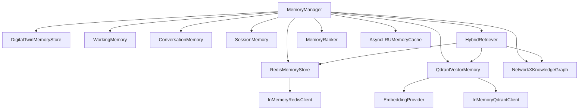

# Shared Memory Layer

> **Component:** Shared Memory (Milestone 1)  
> **Status:** ✅ Complete  
> **Version:** 0.1.0  
> **Last Updated:** 2026-07-07  
> **Source:** `backend/agents/memory/`

---

## Purpose

The shared memory layer provides a unified facade (`MemoryManager`) for all agent memory operations across Redis (session/workflow), Qdrant (semantic retrieval), NetworkX (knowledge graph), and in-process stores (digital twin, working, conversation, session). No agent or supervisor may access storage backends directly.

---

## Architecture

```
MemoryManager (facade)
    ├── RedisMemoryStore          → session, workflow, preferences
    ├── QdrantVectorMemory        → semantic/hybrid search
    ├── NetworkXKnowledgeGraph    → relational knowledge
    ├── DigitalTwinMemoryStore    → checkpoint/rollback/clone
    ├── WorkingMemory             → ephemeral agent-scoped data
    ├── ConversationMemory        → multi-turn history
    ├── SessionMemory             → user session state
    ├── HybridRetriever           → multi-backend fusion
    ├── MemoryRanker              → relevance scoring
    └── AsyncLRUMemoryCache       → hot-path read cache
```

---

## Files Added

| File | Class(es) | Purpose |
|------|-----------|---------|
| `memory_manager.py` | `MemoryManager` | Central facade |
| `redis_memory.py` | `RedisMemoryStore`, `InMemoryRedisClient` | KV session memory |
| `vector_memory.py` | `QdrantVectorMemory`, `InMemoryQdrantClient` | Vector search |
| `knowledge_graph.py` | `NetworkXKnowledgeGraph` | Graph operations |
| `digital_twin_memory.py` | `DigitalTwinMemoryStore` | Twin versioning |
| `working_memory.py` | `WorkingMemory` | Ephemeral agent memory |
| `conversation_memory.py` | `ConversationMemory` | Conversation history |
| `session_memory.py` | `SessionMemory` | Session preferences |
| `hybrid_retriever.py` | `HybridRetriever` | Multi-backend retrieval |
| `memory_ranker.py` | `MemoryRanker` | Relevance ranking |
| `memory_cache.py` | `AsyncLRUMemoryCache` | LRU cache |
| `embedding.py` | `EmbeddingProvider`, `DeterministicEmbeddingProvider` | Embedding generation |
| `serialization.py` | Utility functions | Pydantic/dict conversion |
| `memory_types.py` | Request/response types, `MemoryDomain` | Type definitions |
| `__init__.py` | Package exports | Public API surface |

---

## Folder Structure

```
backend/agents/memory/
├── __init__.py
├── interfaces.py          # ABCs (not modified in M1)
├── memory_manager.py
├── memory_types.py
├── redis_memory.py
├── vector_memory.py
├── knowledge_graph.py
├── digital_twin_memory.py
├── working_memory.py
├── conversation_memory.py
├── session_memory.py
├── hybrid_retriever.py
├── memory_ranker.py
├── memory_cache.py
├── embedding.py
└── serialization.py

backend/tests/memory/
├── conftest.py
├── test_memory_manager.py
├── test_redis_memory.py
├── test_vector_memory.py
├── test_knowledge_graph.py
├── test_digital_twin_memory.py
├── test_working_memory.py
├── test_conversation_session_memory.py
├── test_memory_ranker.py
└── test_memory_cache.py
```

---

## Classes Created

### MemoryManager

| Method | Description |
|--------|-------------|
| `create(config)` | Factory with production backends |
| `create_in_memory()` | Factory with in-memory mocks |
| `store(request)` | Route write to domain backend |
| `retrieve(request)` | Route read with cache |
| `update(request)` | Update existing entry |
| `delete(domain, key)` | Delete entry |
| `search(request)` | Ranked search across backends |
| `similar(query, ...)` | Vector similarity search |
| `checkpoint(twin_id)` | Digital twin snapshot |
| `rollback(twin_id, version)` | Restore twin version |
| `merge(twin_id, ...)` | Merge twin states |
| `summarize(session_id)` | Session memory summary |
| `hybrid_retrieve(request)` | Multi-backend fusion |
| `compare_states(...)` | Twin version comparison |
| `clone_twin(...)` | Clone twin to new ID |

### MemoryDomain Enum

| Value | Backend |
|-------|---------|
| `WORKING` | WorkingMemory |
| `CONVERSATION` | ConversationMemory |
| `SESSION` | SessionMemory |
| `REDIS` | RedisMemoryStore |
| `VECTOR` | QdrantVectorMemory |
| `KNOWLEDGE_GRAPH` | NetworkXKnowledgeGraph |
| `DIGITAL_TWIN` | DigitalTwinMemoryStore |
| `CLIMATE` | RedisMemoryStore (climate namespace) |

---

## Interfaces

Defined in `interfaces.py` (unchanged during M1):

- `AgentMemory` — Generic agent memory contract
- `RedisMemory` — Redis operations contract
- `VectorMemory` — Vector store contract
- `KnowledgeGraphMemory` — Graph operations contract
- `DigitalTwinMemory` — Twin versioning contract

---

## Design Decisions

| Decision | Rationale | ADR |
|----------|-----------|-----|
| Single MemoryManager facade | Prevents direct backend coupling | ADR-003 |
| Redis + Qdrant dual store | Optimal for KV + vector workloads | ADR-004 |
| In-memory mocks for testing | Fast, deterministic tests without infrastructure | — |
| Deterministic embedder for dev | Reproducible vector search in tests | — |
| LRU cache on reads | Reduce redundant backend calls | — |
| Multi-collection vector search | Documents may span collections | — |

---

## Dependency Graph



---

## Execution Flow

### Store Operation

```
store(MemoryStoreRequest)
  ├── validate domain
  ├── route to backend (redis/vector/graph/twin/working/conversation/session)
  ├── invalidate cache key
  └── return entry key
```

### Search Operation

```
search(MemorySearchRequest)
  ├── hybrid_retrieve() → raw results from multiple backends
  ├── MemoryRanker.rank() → scored results
  └── return list[RankedMemory]
```

---

## Data Flow

```
Agent/Supervisor
    → MemoryStoreRequest / MemoryRetrieveRequest / MemorySearchRequest
    → MemoryManager (domain routing)
    → Backend Store (Redis / Qdrant / NetworkX / In-process)
    → MemoryEntry / RankedMemory / HybridRetrievalResult
    → Caller
```

---

## Interaction with Other Modules

| Module | Interaction |
|--------|------------|
| ClimateSupervisor | `store_memory()` writes conversation + workflow state |
| BaseDomainSupervisor | `update_memory()` writes domain execution results |
| BaseAgent | `write_memory()` / `read_memory()` via AgentMemory backends |
| GlobalConfig | Redis/Qdrant connection parameters |
| WorkflowState | Serialized to Redis workflow domain |

---

## Public APIs

| API | Input | Output |
|-----|-------|--------|
| `MemoryManager.store` | `MemoryStoreRequest` | `str` (key) |
| `MemoryManager.retrieve` | `MemoryRetrieveRequest` | `MemoryEntry \| None` |
| `MemoryManager.search` | `MemorySearchRequest` | `list[RankedMemory]` |
| `MemoryManager.checkpoint` | `twin_id, label?` | `CheckpointRecord` |
| `MemoryManager.rollback` | `twin_id, version` | `MemoryEntry` |
| `MemoryManager.summarize` | `session_id` | `MemorySummary` |
| `MemoryManager.create_in_memory` | — | `MemoryManager` |

---

## Private APIs

| API | Owner |
|-----|-------|
| `_cache_key(domain, key, session_id)` | MemoryManager |
| Backend-specific internals | Each store class |

---

## Configuration

| Setting | Default | Effect |
|---------|---------|--------|
| `memory.cache_size` | 4096 | LRU cache max entries |
| `redis.url` | `redis://localhost:6379/0` | Production Redis |
| `qdrant.host` / `port` | `localhost:6333` | Production Qdrant |
| `embedding.provider` | `deterministic` | Embedding backend |

---

## Error Handling

| Exception | When |
|-----------|------|
| `MemoryNotFoundError` | Retrieve/delete on missing key |
| `MemoryWriteError` | Backend write failure |
| `MemoryDomainError` | Invalid domain routing |

---

## Logging

- All store/retrieve/search operations logged at DEBUG
- Cache hits/misses logged at DEBUG
- Errors logged at ERROR with domain and key context

---

## Metrics

Not yet exposed. Future: cache hit rate, search latency, store throughput per domain.

---

## Performance Considerations

- LRU cache reduces Redis reads for hot keys
- Vector search scans multiple collections (trade-off: completeness vs. latency)
- NetworkX graph is in-process (fast but not distributed)
- Deterministic embedder is O(n) token overlap — not suitable for production scale

---

## Scalability Considerations

| Backend | Current | Production |
|---------|---------|------------|
| Redis | In-memory mock | Redis Cluster with session sharding |
| Qdrant | In-memory mock | Qdrant cluster with collection per domain |
| NetworkX | In-process | PostGIS migration required |
| Digital Twin | In-process dict | Redis or PostGIS persistence |

---

## Security Considerations

- Session keys scoped by `session_id` prefix
- No encryption at rest in current implementation
- Metadata fields sanitized before vector payload storage

---

## Future Extensions

- PostGIS knowledge graph backend
- Redis pub/sub for real-time memory updates
- OpenAI embedding provider for production semantic search
- Memory access audit log
- TTL-based automatic conversation summarization

---

## Known Limitations

- NetworkX graph not persisted across process restarts
- Digital twin store is in-process only
- No distributed cache invalidation
- Deterministic embedder has low semantic fidelity
- No memory quota enforcement per session

---

## Test Coverage

| Test File | Tests | Status |
|-----------|-------|--------|
| `test_memory_manager.py` | 10 | ✅ |
| `test_redis_memory.py` | 8 | ✅ |
| `test_vector_memory.py` | 7 | ✅ |
| `test_knowledge_graph.py` | 9 | ✅ |
| `test_digital_twin_memory.py` | 8 | ✅ |
| `test_working_memory.py` | 6 | ✅ |
| `test_conversation_session_memory.py` | 7 | ✅ |
| `test_memory_ranker.py` | 4 | ✅ |
| `test_memory_cache.py` | 5 | ✅ |

**Total memory tests:** 64

---

## Related Documents

- [Development Log 001](../development_logs/001_shared_memory.md)
- [ADR-003](../decisions/ADR-003_memory_manager_abstraction.md)
- [ADR-004](../decisions/ADR-004_redis_plus_qdrant.md)
- [Memory Architecture Diagram](../diagrams/memory_architecture.md)
