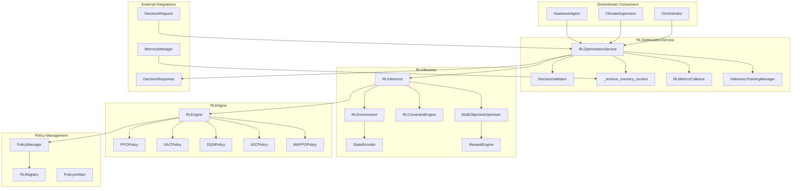
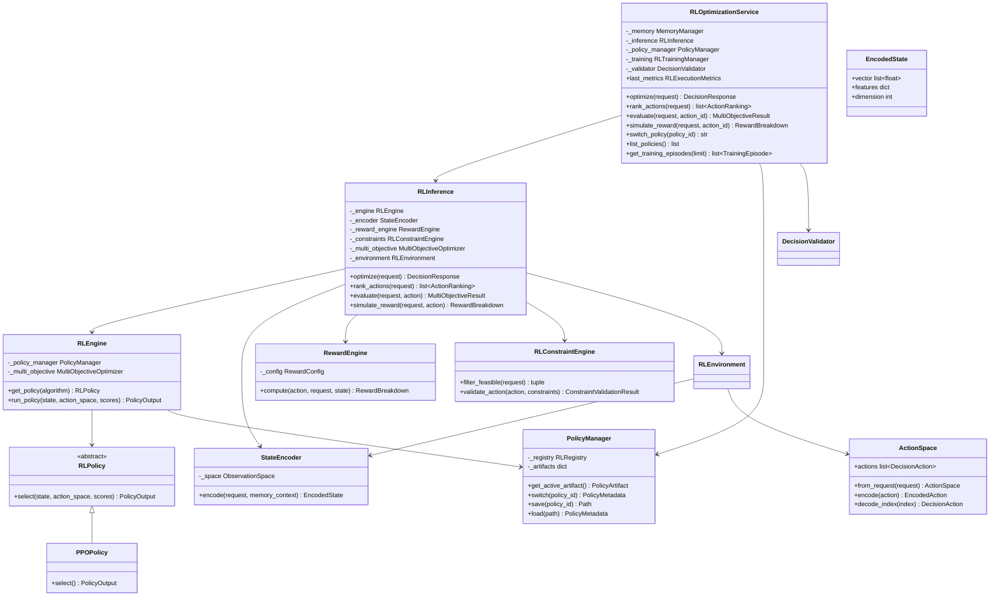
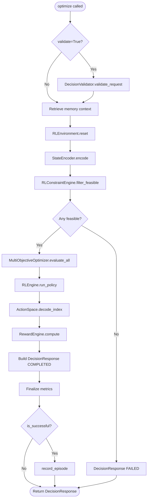
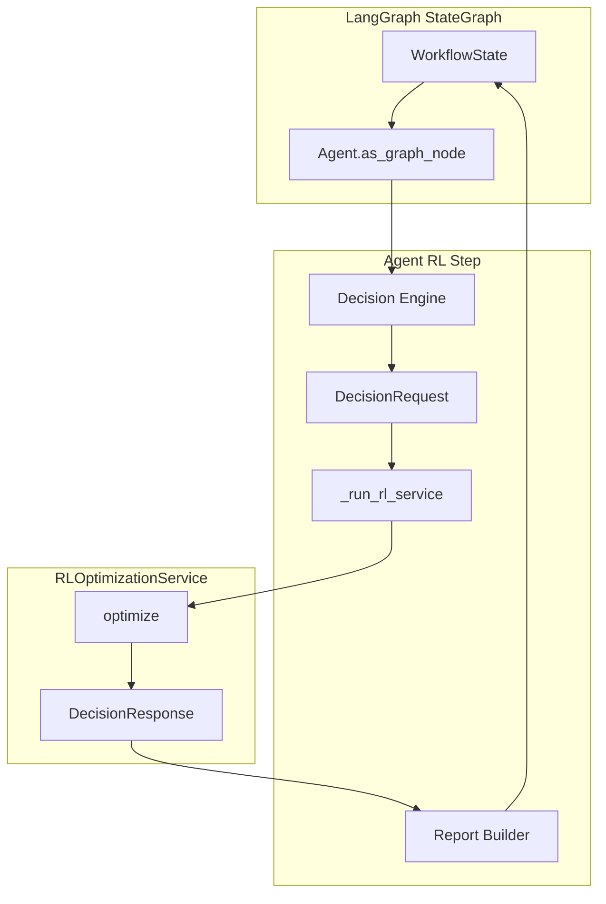
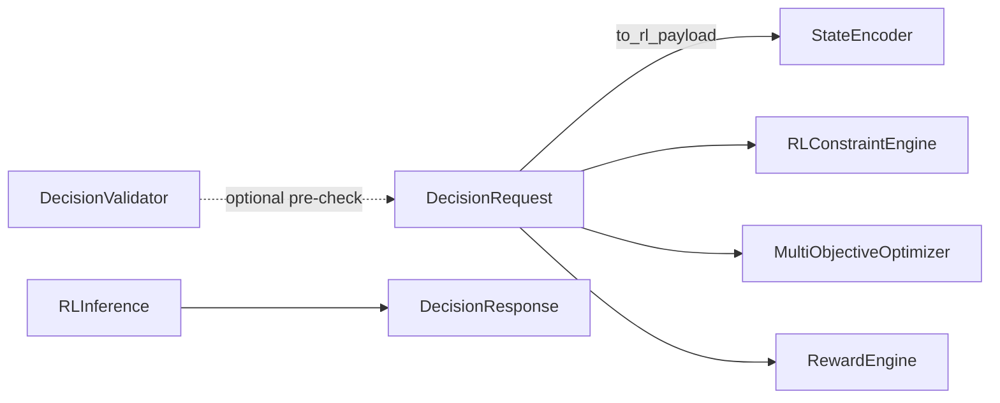
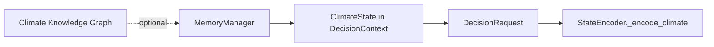
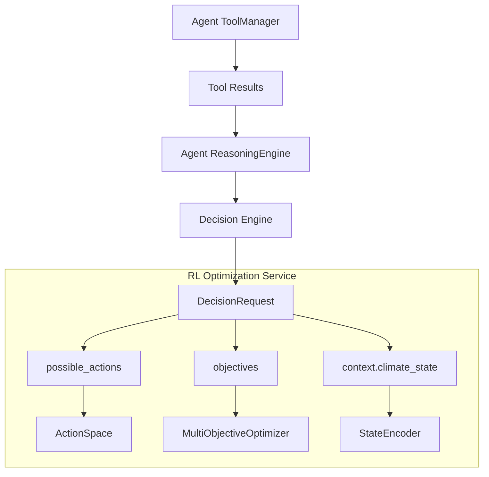
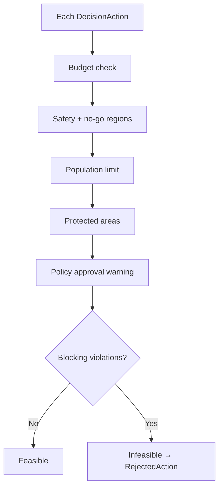
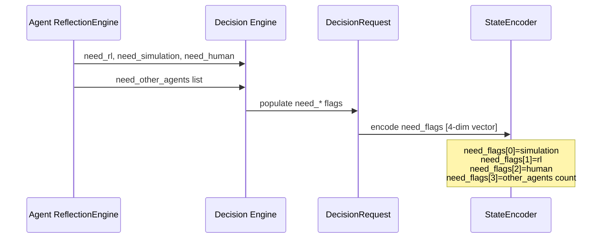

# RL Optimization Service

> **Component:** RL Optimization Service (Prompt 11)  
> **Status:** ✅ Complete  
> **Version:** 0.2.0  
> **Last Updated:** 2026-07-07  
> **Service ID:** `rl_optimization_service`  
> **Source:** `backend/rl/`

---

## Purpose

The **RL Optimization Service** (`RLOptimizationService`) is Hyperion's production-grade, **agent-agnostic** reinforcement learning layer for climate decision optimization. It accepts unified `DecisionRequest` objects from any specialized agent and returns `DecisionResponse` objects containing the optimal action, ranking, reward estimate, and constraint rejection details.

The service solves three enterprise problems:

1. **Agent decoupling** — RL logic lives entirely in `backend/rl/` and never imports flood, water, heatwave, or any specialized agent module. Agents depend on the service; the service does not depend on agents.
2. **Unified optimization contract** — A single `optimize(DecisionRequest) → DecisionResponse` API replaces legacy per-agent `SpecializedRLEngineInterface.request_rl()` patterns.
3. **Composable RL pipeline** — State encoding, observation space definition, policy selection, multi-objective scoring, reward estimation, and constraint validation are modular, testable, and swappable.

**Primary entry point:** `RLOptimizationService.optimize(DecisionRequest) → DecisionResponse`

---

## Responsibilities

| Responsibility | Owner Module |
|----------------|--------------|
| Public optimization API | `rl_service.py` |
| Inference orchestration | `rl_inference.py` |
| State encoding from decision requests | `rl_state_encoder.py` |
| Observation space specification | `rl_observation_space.py` |
| Action space mapping | `rl_action_space.py` |
| Policy algorithm implementations | `rl_engine.py` |
| Policy lifecycle (load, save, switch, version) | `rl_policy_manager.py` |
| Algorithm registry and metadata | `rl_registry.py` |
| Multi-component reward computation | `rl_reward_engine.py` |
| Multi-objective Pareto scoring | `rl_multi_objective.py` |
| Constraint validation for actions | `rl_constraints.py` |
| Single-step environment abstraction | `rl_environment.py` |
| Execution metrics collection | `rl_metrics.py` |
| Training episode recording (interface) | `rl_training_manager.py` |
| Public package exports | `__init__.py` |

---

## Architecture



**Design principle:** The service layer (`rl_service.py`) handles I/O, memory, metrics, and episode recording. The inference layer (`rl_inference.py`) orchestrates the optimization pipeline. The engine layer (`rl_engine.py`) performs policy selection only.

---

## Folder Structure

```
backend/rl/
├── __init__.py                  # Public exports (30+ symbols)
├── rl_service.py                # RLOptimizationService — primary API
├── rl_inference.py              # RLInference — optimize, rank, evaluate
├── rl_engine.py                 # RLEngine + 5 policy implementations
├── rl_state_encoder.py          # StateEncoder, EncodedState
├── rl_observation_space.py      # ObservationSpace, build_default_observation_space
├── rl_action_space.py           # ActionSpace, EncodedAction
├── rl_reward_engine.py          # RewardEngine, RewardBreakdown, RewardConfig
├── rl_multi_objective.py        # MultiObjectiveOptimizer, Pareto ranking
├── rl_constraints.py            # RLConstraintEngine, ConstraintValidationResult
├── rl_environment.py            # RLEnvironment — single-step episodes
├── rl_policy_manager.py         # PolicyManager — artifact lifecycle
├── rl_registry.py               # RLRegistry, RLAlgorithm, PolicyMetadata
├── rl_metrics.py                # RLMetricsCollector, RLExecutionMetrics
└── rl_training_manager.py       # RLTrainingManager, InMemoryTrainingManager

backend/tests/rl/
├── conftest.py                  # Fixtures: rl_service, policy_manager, requests
├── test_rl_unit.py              # 11 unit tests
└── test_rl_integration.py       # 15 integration tests
```

---

## Class Diagram



---

## Execution Flow

### Primary Pipeline

```
DecisionRequest
    → DecisionValidator.validate_request (optional)
    → MemoryManager.search (historical rewards)
    → RLEnvironment.reset
        → StateEncoder.encode → EncodedState (48-dim)
        → ActionSpace.from_request
    → RLConstraintEngine.filter_feasible
    → MultiObjectiveOptimizer.evaluate_all (feasible actions)
    → RLEngine.run_policy (algorithm-specific selection)
    → RewardEngine.compute (chosen action)
    → DecisionResponse (COMPLETED or FAILED)
    → RLMetricsCollector.finalize
    → InMemoryTrainingManager.record_episode (if successful)
```



See also: [RL Optimization Flow Diagram](../diagrams/rl_optimization_flow.md)

---

## Public APIs

### RLOptimizationService

| Method | Signature | Returns | Description |
|--------|-----------|---------|-------------|
| `create` | `classmethod async create(memory, algorithm=PPO)` | `RLOptimizationService` | Factory with optional memory |
| `optimize` | `async optimize(request, algorithm=None, validate=True)` | `DecisionResponse` | **Primary API** — select optimal action |
| `rank_actions` | `async rank_actions(request)` | `list[ActionRanking]` | Rank all feasible actions by score |
| `evaluate` | `async evaluate(request, action_id)` | `MultiObjectiveResult` | Evaluate single action |
| `simulate_reward` | `async simulate_reward(request, action_id)` | `RewardBreakdown` | Reward simulation without selection |
| `switch_policy` | `async switch_policy(policy_id)` | `str` | Activate a policy version |
| `list_policies` | `async list_policies()` | `list[dict]` | List registered policy metadata |
| `get_training_episodes` | `async get_training_episodes(limit=50)` | `list[TrainingEpisode]` | List recorded episodes |

### Properties

| Property | Type | Description |
|----------|------|-------------|
| `last_metrics` | `RLExecutionMetrics \| None` | Metrics from most recent `optimize()` call |
| `policy_manager` | `PolicyManager` | Direct access to policy lifecycle |
| `inference` | `RLInference` | Direct access to inference layer |

### RLInference

| Method | Description |
|--------|-------------|
| `optimize(request, memory_context, algorithm, metrics)` | Full pipeline → `DecisionResponse` |
| `rank_actions(request, memory_context)` | Pareto-ranked feasible actions |
| `evaluate(request, action, memory_context)` | Single-action multi-objective score |
| `simulate_reward(request, action, memory_context)` | Reward breakdown only |

### RLAlgorithm Enum

| Value | Policy Class | Selection Strategy |
|-------|--------------|-------------------|
| `ppo` (default) | `PPOPolicy` | Softmax over scores + entropy bonus |
| `sac` | `SACPolicy` | Temperature-scaled softmax |
| `dqn` | `DQNPolicy` | Epsilon-greedy Q-value selection |
| `a2c` | `A2CPolicy` | Advantage over value baseline |
| `mappo` | `MAPPOPolicy` | Cooperation factor for multi-agent pressure |

### Package Exports (`backend.rl`)

Key public symbols: `RLOptimizationService`, `RLOptimizationError`, `RLInference`, `RLEngine`, `StateEncoder`, `RewardEngine`, `RLConstraintEngine`, `PolicyManager`, `RLAlgorithm`, `ActionSpace`, `ObservationSpace`, `MultiObjectiveOptimizer`, `RewardBreakdown`, `TrainingEpisode`, `create_policy`, `build_default_observation_space`.

---

## Private Methods

### RLOptimizationService

| Method | Purpose |
|--------|---------|
| `_retrieve_memory_context(request)` | Query `MemoryManager` for historical RL episode rewards; returns `{"historical_rewards": [...]}` or `{}` |

### RLInference

| Method | Purpose |
|--------|---------|
| `_score_feasible(feasible, request, state)` | Run multi-objective evaluation on constraint-filtered actions |
| `_build_ranking(scores, policy_output)` | Construct `ActionRanking` list with policy probabilities |
| `_build_rejected(request, feasible, validation_results, scores)` | Build `RejectedAction` list for infeasible and lower-ranked actions |
| `_failed_response(request, reason, processing_time_ms)` | Return `DecisionResponse` with `FAILED` status |

### StateEncoder

| Method | Purpose |
|--------|---------|
| `_one_hot_decision_type(decision_type)` | 9-dim one-hot encoding |
| `_one_hot_risk(level)` | 6-dim one-hot encoding |
| `_encode_objectives(request)` | 8-dim weighted objective vector |
| `_encode_climate(request)` | 12-dim climate feature vector |
| `_normalize(value, variable)` | Per-variable scaling to [0, 1] |
| `_extract_historical_reward(memory_context)` | Mean of historical rewards |
| `_flatten(features)` | Concatenate feature dict → observation vector |

### PolicyManager

| Method | Purpose |
|--------|---------|
| `_initialize_defaults()` | Register default policies for all 5 algorithms |
| `_default_weights(algorithm)` | Algorithm-specific inference weights |

---

## LangGraph Integration

The RL Optimization Service does not define LangGraph nodes. Integration occurs at the **specialized agent** layer when agents call `optimize()` from their pipeline nodes:



- `HeatwaveAgent._run_rl_service()` calls `RLOptimizationService.optimize()` when `decision.need_rl` is true.
- RL failures are **non-blocking** — agents catch `RLOptimizationError` and continue report generation.
- `ClimateSupervisor.request_policy()` can delegate to an injected `RLEngineInterface`; production path uses `RLOptimizationService` via agent injection.

---

## Memory Integration

| Integration Point | Mechanism |
|-------------------|-----------|
| Constructor injection | `RLOptimizationService(memory=MemoryManager)` |
| `_retrieve_memory_context()` | Searches `MemoryDomain.WORKING` for `rl_episode` entries |
| `StateEncoder._extract_historical_reward()` | Injects mean historical reward into observation vector |
| `InMemoryTrainingManager.record_episode()` | Stores episode to `MemoryDomain.WORKING` with key `rl_episode:{episode_id}` |
| Episode metadata | `{"type": "rl_training_episode"}` for future training pipelines |

### Memory Search Query

```python
MemorySearchRequest(
    query=f"rl_episode decision {request.decision_type.value}",
    domains=[MemoryDomain.WORKING],
    limit=10,
)
```

Memory failures are non-fatal — `_retrieve_memory_context()` logs at debug level and returns an empty context.

---

## Decision Framework Integration

The RL service is a **downstream consumer** of the unified Decision Framework. It depends on `backend/decision/` but is never imported by it.



### Contract

| RL Layer | Decision Framework Type |
|----------|----------------------|
| Input | `DecisionRequest` |
| Output | `DecisionResponse` |
| Actions | `DecisionAction`, `ActionRanking`, `RejectedAction` |
| Constraints | `DecisionConstraints`, `ConstraintCategory` |
| Types | `DecisionType`, `RiskLevel`, `DecisionStatus`, `Objective` |
| Validation | `DecisionValidator` (request pre-check in service layer) |

### Agent Identity Stripping

`DecisionRequest.to_rl_payload()` removes `agent_id`, `metadata`, `rationale`, timestamps, and `status` before encoding. Test `test_state_encoder_strips_agent_identity` verifies `agent_id` is absent from the RL payload.

### Adoption by Agents

| Agent | Integration Path | Status |
|-------|------------------|--------|
| Heatwave | `HeatwaveAgent._run_rl_service()` → `optimize()` | ✅ Unified |
| Flood | Legacy `SpecializedRLEngineInterface` | ⬜ Migration pending |
| Water | Legacy `SpecializedRLEngineInterface` | ⬜ Migration pending |

---

## RL Integration

This section describes how the RL service integrates with **agent callers** and the broader RL subsystem.

### Agent-Agnostic Guarantee

```python
# backend/rl/ — NO imports from:
# backend.agents.specialized.flood
# backend.agents.specialized.water_resource
# backend.agents.specialized.heatwave
```

The service receives only `DecisionRequest` / `DecisionResponse` types. Agent identity is stripped at encoding time. Test `test_rl_service_agent_agnostic` verifies identical response schemas for flood and water requests and that `engine_id` contains no agent names.

### Caller Pattern (HeatwaveAgent)

```python
if not decision.need_rl or not self._rl_service:
    return None
try:
    return await self._rl_service.optimize(decision)
except RLOptimizationError:
    return None  # non-blocking
```

### Subsystem Components

| Component | Role in Pipeline |
|-----------|------------------|
| `StateEncoder` | `DecisionRequest` → `EncodedState` |
| `ObservationSpace` | Feature dimension specification (48-dim default) |
| `ActionSpace` | `DecisionAction` ↔ discrete index mapping |
| `RLEngine` | Policy instantiation and selection |
| `RewardEngine` | 8-component reward decomposition |
| `MultiObjectiveOptimizer` | 60/40 reward-objective blend + Pareto ranks |
| `RLConstraintEngine` | Pre-selection feasibility filtering |
| `PolicyManager` | Versioned policy artifacts |
| `InMemoryTrainingManager` | Episode recording for future training |

---

## Knowledge Graph Integration

The RL Optimization Service has **no direct dependency** on `backend/knowledge_graph/`. Integration is indirect:

| Path | Description |
|------|-------------|
| `DecisionContext.climate_state` | Graph-enriched climate data flows through `DecisionRequest` into `StateEncoder._encode_climate()` |
| `DecisionContext.metadata` | Agents may attach graph entity IDs; preserved in request but not directly queried by RL |
| `need_other_agents` | Encoded in `need_flags[3]` as multi-agent pressure signal for `MAPPOPolicy` |
| Future wiring | `GraphReasoningEngine` may enrich reward components via entity exposure scores |



---

## Explainability Integration

`DecisionResponse` artifacts produced by the RL service feed directly into `ExplanationEngine`:

| Response Field | XAI Usage |
|----------------|-----------|
| `chosen_action` | Primary decision explanation target |
| `ranking` | `AlternativeActionsEngine` — ranked alternatives with scores |
| `rejected_actions` | `CounterfactualEngine` — constraint-blocked actions |
| `reward` | Evidence for utility-based reasoning |
| `confidence` | `ConfidenceEngine` input |
| `metadata.policy_id` | Policy provenance in audit trail |
| `metadata.algorithm` | Algorithm identification for counterfactuals |
| `metadata.value_estimate` | Expected value for uncertainty analysis |

Post-hoc invocation pattern:

```python
report = await explanation_engine.explain_decision(
    decision_request=request,
    decision_response=rl_response,
)
```

The RL service does not call XAI directly — agents or orchestrators invoke explainability after optimization.

---

## Tool Architecture

The RL Optimization Service does not register or execute agent tools. Tool integration is **upstream** — agent tools produce signals that decision engines translate into `DecisionRequest` fields:



### Algorithm Architecture (Policy Layer)

| Policy | Key Hyperparameters | Selection Logic |
|--------|---------------------|-----------------|
| `PPOPolicy` | `temperature`, `entropy_coef` | Softmax(logits) with confidence-weighted entropy |
| `SACPolicy` | `temperature` (alpha) | Entropy-regularized softmax |
| `DQNPolicy` | `epsilon`, `exploration_bonus` | Epsilon-greedy over Q-values |
| `A2CPolicy` | `value_coef`, `value_baseline` | Softmax over advantages |
| `MAPPOPolicy` | `cooperation_factor` | Score adjustment by multi-agent pressure flag |

### Reward Component Architecture

| Component | Weight | Scoring Basis |
|-----------|--------|---------------|
| `FLOOD_REDUCTION` | 0.20 | Benefit × risk × flood keyword boost |
| `WATER_CONSERVATION` | 0.15 | Conservation keyword detection |
| `CROP_YIELD` | 0.10 | Agriculture keyword detection |
| `POPULATION_SAFETY` | 0.20 | Population exposure × risk reduction |
| `ECONOMIC_IMPACT` | 0.10 | Net value ratio |
| `INFRASTRUCTURE_PROTECTION` | 0.10 | Infrastructure keyword detection |
| `ENVIRONMENTAL_SUSTAINABILITY` | 0.10 | Reversibility bonus |
| `POLICY_COMPLIANCE` | 0.05 | Approval and safety compliance |

Penalties: `cost × cost_penalty_factor`, `risk × risk_penalty_factor`. Final reward normalized to [-1, 1].

---

## Validation Pipeline

The RL service applies **two validation layers**:

### Layer 1: Request Validation (Service)

`RLOptimizationService.optimize(validate=True)` calls `DecisionValidator.validate_request()` before inference. Validation issues are logged but do not block optimization unless strict mode is used at the decision manager level.

### Layer 2: Action Constraint Validation (Inference)



### Constraint Categories Checked

| Category | Field | Severity |
|----------|-------|----------|
| `BUDGET` | `action.cost > max_cost` | ERROR |
| `SAFETY` | `action.risk_score > max_risk_score` | ERROR |
| `SAFETY` | `affected_regions ∩ no_go_regions` | CRITICAL |
| `POPULATION` | `affected_population > max` | ERROR |
| `ENVIRONMENT` | `affected_regions ∩ protected_areas` | CRITICAL |
| `POLICY` | High-cost without approval | WARNING (non-blocking) |

### Infeasibility Handling

When zero actions pass constraint validation, `RLInference` returns:

```python
DecisionResponse(
    status=DecisionStatus.FAILED,
    reason="No feasible actions after constraint validation",
    confidence=0.0,
)
```

Test: `test_rl_service_constraint_failure`, `test_constraint_engine_budget_violation`.

---

## Reflection Pipeline

The RL Optimization Service does not implement agent reflection. Reflection is an **upstream agent prerequisite** that sets decision flags consumed by the encoder:



`MAPPOPolicy` reads `need_flags[3]` as multi-agent cooperation pressure, increasing scores for actions when multiple agents are involved.

---

## Metrics

### RLExecutionMetrics

| Field | Type | Description |
|-------|------|-------------|
| `decision_id` | `str` | Source decision identifier |
| `algorithm` | `str` | Algorithm used (e.g., `ppo`) |
| `policy_version` | `str` | Active policy version string |
| `inference_latency_ms` | `float` | Total optimize latency |
| `reward` | `float \| None` | Chosen action reward |
| `constraint_violations` | `int` | Total blocking violations across actions |
| `optimization_confidence` | `float` | Policy selection confidence [0, 1] |
| `actions_evaluated` | `int` | Total possible actions |
| `actions_feasible` | `int` | Actions passing constraints |
| `actions_rejected` | `int` | Actions filtered out |
| `memory_reads` | `int` | Memory search operations |
| `state_dimension` | `int` | Encoded observation dimension |
| `phase_timings` | `dict[str, float]` | Per-phase latency breakdown |

### Access Pattern

```python
response = await rl_service.optimize(request)
metrics = rl_service.last_metrics
# Also embedded in response.metadata["rl_metrics"]
```

### RLMetricsCollector Methods

| Method | Effect |
|--------|--------|
| `set_policy_version(version)` | Record active policy version |
| `record_violations(count)` | Accumulate constraint violations |
| `record_actions(evaluated, feasible, rejected)` | Action counts |
| `set_reward(reward)` | Chosen action reward |
| `set_confidence(confidence)` | Policy confidence |
| `set_state_dimension(dim)` | Observation vector size |
| `finalize()` | Compute latency, return `RLExecutionMetrics` |
| `track_phase(name)` | Async context manager for phase timing |

---

## Logging

Structured logging via `backend.config.logger.get_logger(__name__)`.

| Event | Level | Module | Trigger |
|-------|-------|--------|---------|
| `rl_request_validation_issues` | WARNING | `rl_service` | Request validation found issues |
| `rl_optimize_failed` | ERROR | `rl_service` | Unhandled exception in optimize |
| `rl_optimize_complete` | INFO | `rl_inference` | Successful optimization |
| `rl_memory_context_skipped` | DEBUG | `rl_service` | Memory search failed |
| `policy_switched` | INFO | `rl_policy_manager` | Active policy changed |
| `policy_saved` | INFO | `rl_policy_manager` | Artifact persisted to disk |
| `policy_loaded` | INFO | `rl_policy_manager` | Artifact loaded from disk |
| `rl_episode_recorded` | DEBUG | `rl_training_manager` | Training episode stored |
| `rl_training_scheduled` | INFO | `rl_training_manager` | Training job scheduled (deferred) |

---

## Error Handling

### Exception Hierarchy

| Exception | Module | When Raised |
|-----------|--------|-------------|
| `RLOptimizationError` | `rl_service.py` | Optimization failure, action not found |
| `RuntimeError` | `rl_inference.py` | Action space initialization failure |
| `RuntimeError` | `rl_environment.py` | Step/reset on uninitialized environment |
| `RuntimeError` | `rl_policy_manager.py` | No active policy configured |
| `KeyError` | `rl_policy_manager.py` | Policy artifact not found |
| `IndexError` | `rl_action_space.py` | Invalid action index |

### RLOptimizationError Details

```python
raise RLOptimizationError(
    f"RL optimization failed: {exc}",
    details={"decision_id": request.decision_id},
)
```

### Graceful Degradation

| Failure | Behavior |
|---------|----------|
| Memory search fails | Empty context; optimization continues |
| Request validation issues | Logged warning; optimization continues (unless strict) |
| No feasible actions | `DecisionResponse` with `FAILED` status (not exception) |
| Agent caller catches `RLOptimizationError` | Report generated without RL recommendation |

### Known Runtime Bug

`StateEncoder._encode_climate()` references `ClimateVariable.RIVER_DISCHARGE`, which is **not defined** in `backend.utils.enums.ClimateVariable`. When `request.context.climate_state` is attached with measurements, encoding raises `AttributeError`. See [Known Limitations](#known-limitations).

---

## Configuration

### Constructor Parameters

| Parameter | Type | Default | Description |
|-----------|------|---------|-------------|
| `memory` | `MemoryManager \| None` | `None` | Optional memory for context and episodes |
| `inference` | `RLInference \| None` | Auto-created | Custom inference layer |
| `policy_manager` | `PolicyManager \| None` | Auto-created | Custom policy manager |
| `training_manager` | `RLTrainingManager \| None` | `InMemoryTrainingManager` | Episode recorder |
| `algorithm` | `RLAlgorithm` | `RLAlgorithm.PPO` | Default algorithm |
| `record_episodes` | `bool` | `True` | Record successful episodes |

### RewardConfig

| Field | Default | Description |
|-------|---------|-------------|
| `weights` | 8-component defaults | Per-component reward weights |
| `cost_penalty_factor` | `0.01` | Cost penalty multiplier |
| `risk_penalty_factor` | `0.5` | Risk penalty multiplier |
| `normalize` | `True` | Clamp reward to [-1, 1] |

### Policy Storage

| Setting | Default | Description |
|---------|---------|-------------|
| `PolicyManager.storage_dir` | `.rl_policies/` | JSON artifact directory |
| Default policies | 5 (one per algorithm) | Auto-registered on init |
| Active policy | `default_ppo_v1` | `DEFAULT_ALGORITHM = PPO` |

### Observation Space

Built by `build_default_observation_space()` — **48 dimensions** total:

| Feature | Dimensions |
|---------|------------|
| `decision_type` | 9 |
| `priority` | 1 |
| `confidence` | 1 |
| `risk_score` | 1 |
| `risk_level` | 6 |
| `objective_weights` | 8 |
| `constraint_budget` | 1 |
| `constraint_safety` | 1 |
| `climate_variables` | 12 |
| `forecast_present` | 1 |
| `simulation_present` | 1 |
| `action_count` | 1 |
| `need_flags` | 4 |
| `historical_reward` | 1 |

---

## Performance

| Metric | Typical Value | Notes |
|--------|---------------|-------|
| `optimize()` latency | < 50 ms | Single request, 3–5 actions, in-memory |
| State encoding | < 5 ms | 48-dim vector construction |
| Constraint filtering | < 2 ms | Per-action linear scan |
| Policy selection | < 1 ms | Softmax over ≤ 20 actions |
| Memory search | Variable | Optional; skipped if no memory injected |

### Optimization Characteristics

- **Single-step episodes** — Each `DecisionRequest` is one environment step; no multi-step rollouts.
- **No GPU required** — Inference uses lightweight softmax/epsilon-greedy; no neural network forward passes in v0.2.0.
- **Synchronous scoring** — All feasible actions scored before policy selection (no early termination).

---

## Scalability

| Dimension | Current Design | Scale Path |
|-----------|----------------|------------|
| Concurrent requests | Stateless service instances | Horizontal pod scaling behind load balancer |
| Action count | Linear O(n) scoring | Batch scoring + approximate policies for n > 50 |
| Policy versions | In-memory registry | External object store (S3/Azure Blob) via `PolicyManager.save/load` |
| Training episodes | In-memory + optional memory store | Dedicated episode warehouse for offline training |
| Algorithm plugins | `POLICY_FACTORY` dict | Registry pattern with dynamic algorithm registration |

### Multi-Agent Scaling

`MAPPOPolicy` adjusts scores based on `need_other_agents` count, providing a cooperation signal for orchestrated multi-agent decisions without requiring agent-specific code paths.

---

## Security

| Concern | Mitigation |
|---------|------------|
| Agent identity leakage | `to_rl_payload()` strips `agent_id` before encoding |
| Constraint bypass | `RLConstraintEngine` validates every action pre-selection |
| Policy tampering | Artifacts stored as versioned JSON with metadata timestamps |
| Memory injection | Memory context is read-only; no arbitrary code execution |
| Error information disclosure | `RLOptimizationError.details` contains only `decision_id` |

The RL service does not perform authentication — caller authorization is enforced at the API gateway or agent orchestration layer.

---

## Known Limitations

| Limitation | Impact | Workaround |
|------------|--------|------------|
| **`ClimateVariable.RIVER_DISCHARGE` missing** | `AttributeError` when `climate_state` attached to request | Omit `climate_state` or add enum value |
| No real model training | `InMemoryTrainingManager` records episodes only | Schedule training jobs (interface only) |
| No neural network policies | Policies use heuristic softmax, not learned weights | Future Stable-Baselines3 integration |
| Time/water/power constraints stubbed | `_check_time`, `_check_water`, `_check_power` return empty | Implement when constraint schemas mature |
| Single-step environment | No sequential decision rollouts | Use simulation engine for multi-step |
| `docs/rl/README.md` outdated | README shows "Not Started" | Use this document as canonical reference |

### ClimateVariable Bug Detail

`backend/rl/rl_state_encoder.py` line 128 references:

```python
ClimateVariable.RIVER_DISCHARGE: 5,
```

But `backend/utils/enums.py` defines only:

```python
TEMPERATURE, PRECIPITATION, HUMIDITY, WIND_SPEED, WIND_DIRECTION,
SEA_LEVEL, PRESSURE, SOIL_MOISTURE
```

**Fix:** Add `RIVER_DISCHARGE = "river_discharge"` to `ClimateVariable` enum, or guard with `getattr`/optional mapping.

This bug blocks end-to-end RL tests in specialized agent suites that attach `ClimateState` with measurements (e.g., heatwave integration tests use `MockRLOptimizationService` as workaround).

---

## Future Improvements

| Priority | Improvement |
|----------|-------------|
| P0 | Add `ClimateVariable.RIVER_DISCHARGE` to enum |
| P1 | Stable-Baselines3 policy backend with real weight loading |
| P1 | Implement time/water/power constraint validators |
| P2 | GPU-accelerated batch inference for high action counts |
| P2 | Online learning from recorded episodes |
| P2 | Policy A/B testing with automatic rollback |
| P3 | Multi-step environment via simulation engine coupling |
| P3 | Graph-enriched reward components from CKG |
| P3 | Auto-invoke `ExplanationEngine` post-optimization |
| P3 | Migrate flood/water agents to unified `optimize()` path |

---

## Testing Summary

**Total: 26 tests** — `backend/tests/rl/`

| Suite | File | Count | Coverage Focus |
|-------|------|-------|----------------|
| Unit | `test_rl_unit.py` | **11** | Encoder, action space, reward, constraints, policies |
| Integration | `test_rl_integration.py` | **15** | Full service API, algorithms, episodes, agent-agnostic |
| **Total** | | **26** | All passing (v0.2.0) |

### Unit Tests (11)

| Test | Validates |
|------|-----------|
| `test_state_encoder_produces_vector` | Non-zero 48-dim vector, feature keys |
| `test_state_encoder_strips_agent_identity` | `agent_id` absent from RL payload |
| `test_action_space_from_request` | Encode/decode round-trip |
| `test_reward_engine_compute` | Non-zero reward, component breakdown |
| `test_multi_objective_evaluate_all` | Pareto ranking order |
| `test_constraint_engine_budget_violation` | Zero feasible on budget exceed |
| `test_constraint_engine_feasible_actions` | All actions feasible for valid request |
| `test_ppo_policy_selection` | Valid index, probabilities, algorithm tag |
| `test_dqn_policy_epsilon_greedy` | Epsilon-greedy selection |
| `test_sac_policy_selection` | Positive confidence |
| `test_policy_factory_all_algorithms` | All 5 algorithms instantiate via factory |

### Integration Tests (15)

| Test | Validates |
|------|-----------|
| `test_rl_service_optimize_flood` | End-to-end flood decision optimization |
| `test_rl_service_optimize_water` | End-to-end water decision optimization |
| `test_rl_service_agent_agnostic` | Identical response schema, no agent names in engine_id |
| `test_rl_service_rank_actions` | Ordered rankings with rank=1 leader |
| `test_rl_service_evaluate_action` | Single-action multi-objective evaluation |
| `test_rl_service_simulate_reward` | Reward breakdown components |
| `test_rl_service_metrics` | Latency, confidence, action counts |
| `test_rl_service_ppo_algorithm` | PPO algorithm metadata |
| `test_rl_service_sac_algorithm` | SAC algorithm metadata |
| `test_rl_service_dqn_algorithm` | DQN algorithm metadata |
| `test_rl_service_constraint_failure` | FAILED status on budget violation |
| `test_rl_service_records_episode` | Training episode recording |
| `test_rl_service_switch_policy` | Policy switching to SAC |
| `test_rl_service_uniform_decision_types` | All 9 `DecisionType` values produce valid responses |
| `test_rl_service_invalid_action_id` | `RLOptimizationError` on unknown action |

### Test Fixtures (`conftest.py`)

| Fixture / Builder | Purpose |
|-------------------|---------|
| `memory_manager` | In-memory `MemoryManager` |
| `policy_manager` | Fresh `PolicyManager` with defaults |
| `rl_service` | `RLOptimizationService` with memory |
| `flood_decision_request` | Flood scenario via `build_flood_decision_request()` |
| `water_decision_request` | Water scenario via `build_water_decision_request()` |
| `build_budget_violation_request()` | Action exceeding budget constraint |

### Running Tests

```bash
python -m pytest backend/tests/rl/ -v
```

### Related Test Suites

| Suite | Relevance |
|-------|-----------|
| `backend/tests/decision/` | `DecisionRequest` / `DecisionResponse` contracts |
| `backend/tests/specialized/heatwave/` | Agent → RL integration (uses mock due to enum bug) |
| `backend/tests/xai/` | Explainability with decision artifacts |

---

## Related Documents

- [RL Optimization Flow Diagram](../diagrams/rl_optimization_flow.md)
- [Agent → Decision → RL Flow](../diagrams/agent_decision_rl_flow.md)
- [Decision Framework](../decision/decision_framework.md)
- [Heatwave Agent](../agents/heatwave_agent.md) — reference RL integration
- [Specialized Agent Framework](../agents/specialized_framework.md)
- [Climate Supervisor](../supervisor/climate_supervisor.md)
- [Memory Manager](../memory/shared_memory.md)
- [RL README](./README.md) — legacy stub (superseded by this document)
