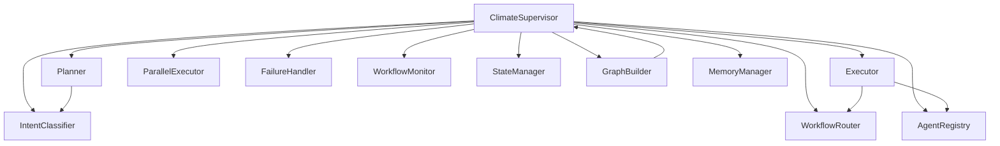

# Climate Supervisor

> **Component:** Climate Supervisor (Milestone 2)  
> **Status:** ✅ Complete  
> **Version:** 0.1.0  
> **Last Updated:** 2026-07-07  
> **Source:** `backend/agents/supervisor/`

---

## Purpose

The Climate Supervisor is the top-tier orchestration engine for Hyperion Climate Twin. Every user request passes through this supervisor, which classifies intent, plans execution across domain supervisors, routes and executes workflows (sequential or parallel), merges results, persists memory, and returns a structured response — all via a compiled LangGraph `StateGraph`.

---

## Architecture

```
ClimateSupervisor
    ├── IntentClassifier        → 9 intent categories
    ├── Planner                 → ExecutionPlan generation
    ├── WorkflowRouter          → Domain supervisor selection
    ├── Executor                → Sequential execution
    ├── ParallelExecutor        → Parallel execution
    ├── FailureHandler          → Error recovery
    ├── WorkflowMonitor         → Metrics collection
    ├── StateManager            → Workflow state tracking
    ├── AgentRegistry           → Domain supervisor registry
    └── GraphBuilder            → LangGraph compilation

LangGraph Pipeline:
    classify_intent → plan → execute → merge_results → store_memory → return_response
```

---

## Files Added

| File | Class(es) | Purpose |
|------|-----------|---------|
| `climate_supervisor.py` | `ClimateSupervisor` | Main orchestrator |
| `graph_builder.py` | `build_graph`, `compile_graph`, `run_graph` | LangGraph pipeline |
| `intent_classifier.py` | `IntentClassifier` | Query intent classification |
| `planner.py` | `Planner` | Execution plan generation |
| `workflow_router.py` | `WorkflowRouter` | Supervisor routing |
| `executor.py` | `Executor` | Sequential execution |
| `parallel_executor.py` | `ParallelExecutor` | Parallel execution |
| `failure_handler.py` | `FailureHandler` | Error handling |
| `workflow_monitor.py` | `WorkflowMonitor` | Metrics |
| `state_manager.py` | `StateManager` | State transitions |
| `agent_registry.py` | `AgentRegistry` | Supervisor registration |
| `execution_context.py` | Types + interfaces | Execution types, RL/Twin interfaces |

---

## Folder Structure

```
backend/agents/supervisor/
├── __init__.py
├── climate_supervisor.py
├── graph_builder.py
├── intent_classifier.py
├── planner.py
├── workflow_router.py
├── executor.py
├── parallel_executor.py
├── failure_handler.py
├── workflow_monitor.py
├── state_manager.py
├── agent_registry.py
└── execution_context.py

backend/tests/supervisor/
├── conftest.py
├── test_climate_supervisor.py
├── test_intent_classifier.py
├── test_planner.py
├── test_agent_registry.py
└── test_state_monitor.py
```

---

## Classes Created

### ClimateSupervisor

| Method | Description |
|--------|-------------|
| `initialize()` | Build and compile LangGraph |
| `process_request(request)` | Full pipeline entry point |
| `classify_intent(query)` | Intent classification |
| `plan(query, intent, supervisors)` | Execution planning |
| `execute(plan, context)` | Domain supervisor execution |
| `merge_results(execution_result)` | Result aggregation |
| `store_memory(state, response)` | Memory persistence |
| `return_response(state)` | Final response generation |
| `node_*` methods | LangGraph node implementations |
| `create(memory, ...)` | Factory method |

### IntentClassifier — 9 Intent Categories

| Intent | Description | Typical Supervisors |
|--------|-------------|-------------------|
| `NOWCAST` | Current conditions | Environmental |
| `FORECAST` | Future predictions | Environmental |
| `WHAT_IF` | Scenario simulation | Environmental, Infrastructure, Emergency |
| `RISK_ASSESSMENT` | Hazard risk analysis | Environmental, Emergency |
| `RESOURCE_PLANNING` | Resource allocation | Infrastructure |
| `EMERGENCY_RESPONSE` | Disaster response | Emergency |
| `POLICY_ANALYSIS` | Policy evaluation | Infrastructure |
| `DATA_QUERY` | Data retrieval | Environmental |
| `GENERAL_QA` | General questions | All available |

### AgentRegistry

| Method | Description |
|--------|-------------|
| `register(handler, ...)` | Register domain supervisor |
| `resolve(supervisor_id)` | Resolve by ID |
| `unregister(supervisor_id)` | Remove supervisor |
| `list_supervisors()` | List all registered |
| `health()` | Health check all |

### Execution Context Types

| Type | Purpose |
|------|---------|
| `IntentClassification` | Classified intent + confidence |
| `ExecutionPlan` | Steps, mode, supervisor list |
| `ExecutionResult` | Per-supervisor results |
| `MergedSupervisorResult` | Aggregated output |
| `SupervisorResponse` | Final user-facing response |
| `SupervisorExecutionContext` | Runtime context |
| `RLEngineInterface` | RL engine protocol (interface only) |
| `DigitalTwinInterface` | Digital twin protocol (interface only) |

---

## Interfaces

| Interface | Location | Status |
|-----------|----------|--------|
| `RLEngineInterface` | `execution_context.py` | Interface only — not implemented |
| `DigitalTwinInterface` | `execution_context.py` | Interface only — not implemented |
| `DomainSupervisorHandler` | `execution_context.py` | Implemented by domain supervisors |

---

## Design Decisions

| Decision | Rationale | ADR |
|----------|-----------|-----|
| LangGraph StateGraph | Native state management and branching | ADR-001 |
| Rule-based intent classifier | Deterministic, testable without LLM | — |
| Lazy imports in initialize/process_request | Avoid circular import with graph_builder | — |
| Separate Executor and ParallelExecutor | Clear execution mode separation | — |
| RL/Twin as interfaces | Decouple from unimplemented subsystems | — |

---

## Dependency Graph



---

## Execution Flow

```
process_request(AgentRequest)
  ├── _build_initial_state()
  ├── compiled.ainvoke(state)
  │     ├── node_classify_intent → intent
  │     ├── node_plan → execution plan
  │     ├── node_execute → domain supervisor results
  │     ├── node_merge_results → merged output
  │     ├── node_store_memory → memory persisted
  │     └── node_return_response → SupervisorResponse
  └── return SupervisorResponse
```

---

## Data Flow

```
AgentRequest
    → WorkflowState (initial)
    → IntentClassification
    → ExecutionPlan
    → list[ExecutionResult] (per domain supervisor)
    → MergedSupervisorResult
    → MemoryStoreRequest (conversation + workflow)
    → SupervisorResponse
```

---

## Interaction with Other Modules

| Module | Interaction |
|--------|------------|
| MemoryManager | `store_memory()` writes conversation turns and workflow metadata |
| Domain Supervisors | Invoked via `AgentRegistry.resolve()` in Executor |
| WorkflowState | Shared state across all graph nodes |
| AgentRequest/Response | Input/output contracts |
| AbstractTool | Optional tools registered on supervisor |

---

## Public APIs

| API | Signature |
|-----|-----------|
| `ClimateSupervisor.create` | `async (memory, registry?, ...) → ClimateSupervisor` |
| `ClimateSupervisor.process_request` | `async (request: AgentRequest) → SupervisorResponse` |
| `ClimateSupervisor.classify_intent` | `async (query: str) → IntentClassification` |
| `ClimateSupervisor.registry` | `property → AgentRegistry` |
| `ClimateSupervisor.monitor` | `property → WorkflowMonitor` |
| `build_graph(supervisor)` | `StateGraph` |
| `compile_graph(supervisor)` | `CompiledGraph` |
| `run_graph(compiled, state)` | `async → WorkflowState` |

---

## Private APIs

| API | Owner |
|-----|-------|
| `_build_initial_state()` | ClimateSupervisor |
| `_extract_query()` | ClimateSupervisor |
| `_get_context()` | ClimateSupervisor |
| `node_*` methods | ClimateSupervisor (graph-internal) |

---

## Configuration

| Setting | Location | Default |
|---------|----------|---------|
| Supervisor timeouts | `SupervisorConfig` | TBD |
| Max parallel supervisors | `SupervisorConfig` | TBD |

---

## Error Handling

| Component | Behavior |
|-----------|----------|
| `FailureHandler` | Captures exceptions, records in state metadata |
| `Executor` | Marks failed supervisors, continues with available |
| Graph nodes | Set `state["error"]` on unrecoverable failure |
| `AgentRegistry` | Raises on duplicate/missing registration |

---

## Logging

- Request lifecycle logged at INFO with `request_id`
- Intent classification logged at DEBUG
- Execution results logged at INFO per supervisor
- Failures logged at ERROR with stack trace

---

## Metrics

`WorkflowMonitor` tracks:

| Metric | Description |
|--------|-------------|
| `total_requests` | Cumulative request count |
| `successful_requests` | Completed without error |
| `failed_requests` | Failed requests |
| `average_latency_ms` | Rolling average latency |
| `intent_distribution` | Count per intent category |
| `supervisor_invocations` | Per-supervisor call count |

---

## Performance Considerations

- Parallel execution via `asyncio.gather` for independent supervisors
- Lazy graph compilation on first `initialize()`
- Memory search during `store_memory` is async but adds latency

---

## Scalability Considerations

- Single-process LangGraph execution
- AgentRegistry is in-memory (no distributed registry)
- Future: external checkpoint store for horizontal scaling

---

## Security Considerations

- Supervisor IDs validated on registration
- No user input passed directly to backend stores
- Execution context isolated per request

---

## Future Extensions

- LLM-based intent classifier
- LangGraph checkpoint persistence
- Subgraph composition for domain supervisors
- RL policy integration via `RLEngineInterface`
- Digital twin scenario management via `DigitalTwinInterface`

---

## Known Limitations

- Intent classifier is keyword-based, not LLM-powered
- No domain supervisors registered by default in `ClimateSupervisor.create()`
- RL and Digital Twin interfaces defined but not implemented
- No request timeout enforcement
- No rate limiting

---

## Test Coverage

| Test File | Tests | Status |
|-----------|-------|--------|
| `test_climate_supervisor.py` | 7 | ✅ |
| `test_intent_classifier.py` | 4 | ✅ |
| `test_planner.py` | 3 | ✅ |
| `test_agent_registry.py` | 5 | ✅ |
| `test_state_monitor.py` | 3 | ✅ |

**Total supervisor tests:** 22

---

## Related Documents

- [Development Log 002](../development_logs/002_climate_supervisor.md)
- [ADR-001](../decisions/ADR-001_langgraph_over_langchain.md)
- [ADR-002](../decisions/ADR-002_hierarchical_supervisors.md)
- [Supervisor Flow Diagram](../diagrams/supervisor_flow.md)
