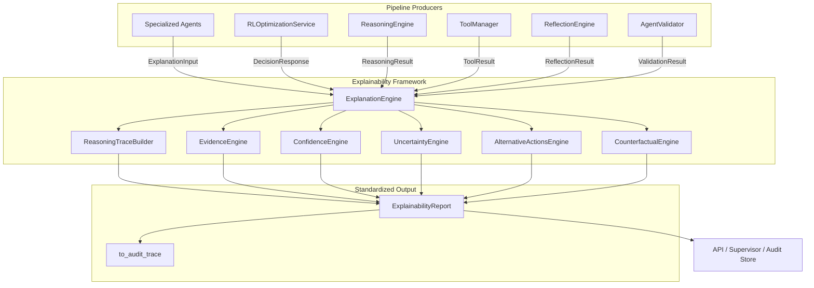
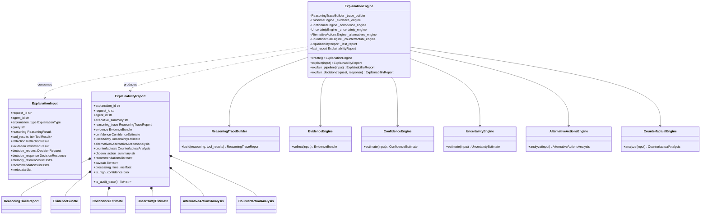
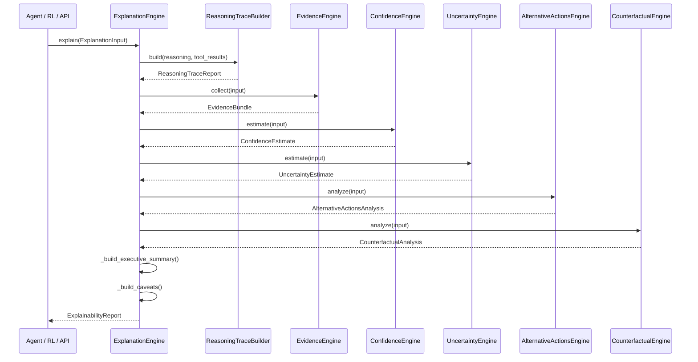
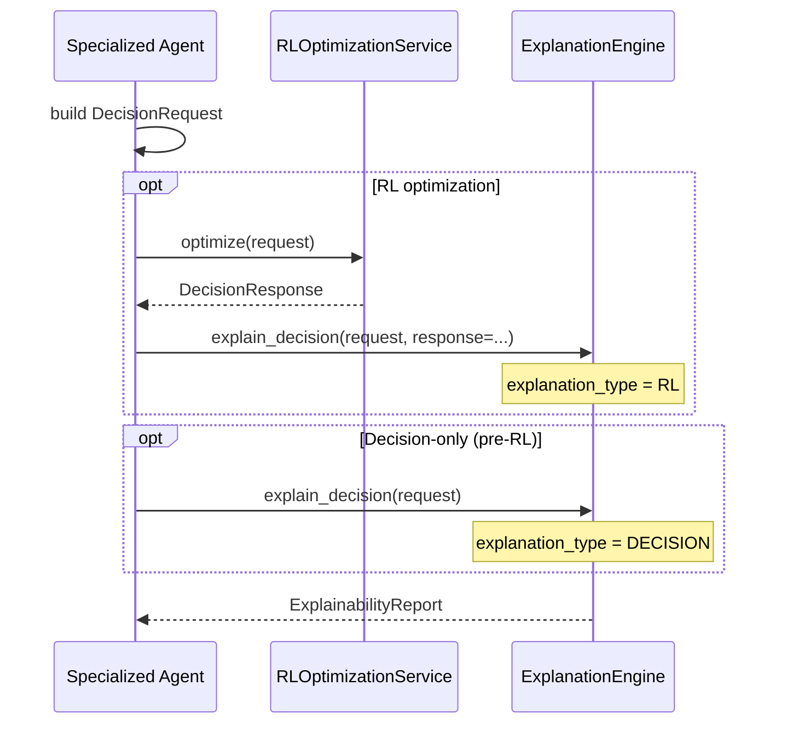
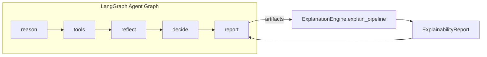
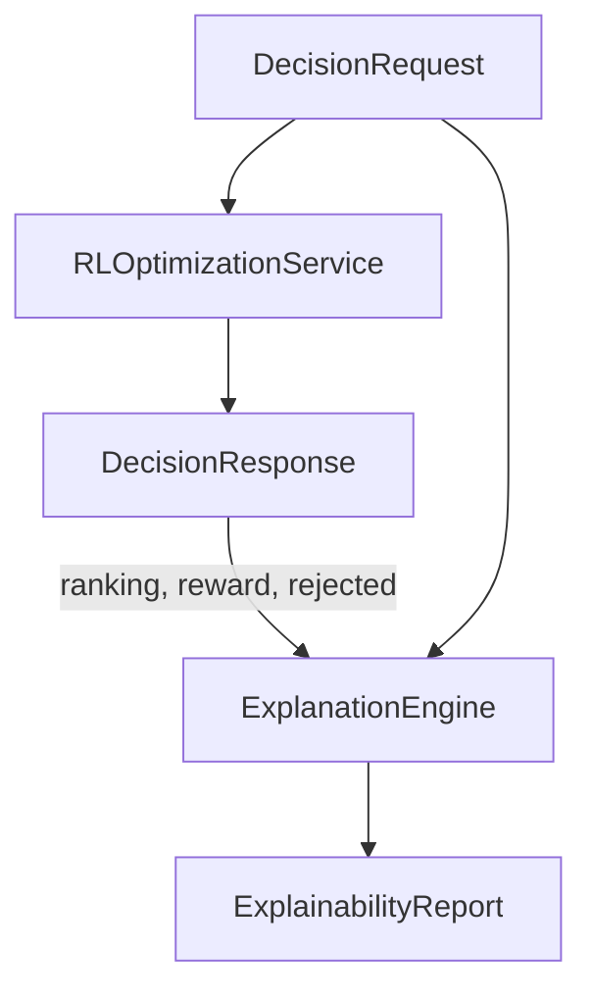
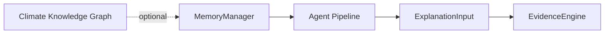
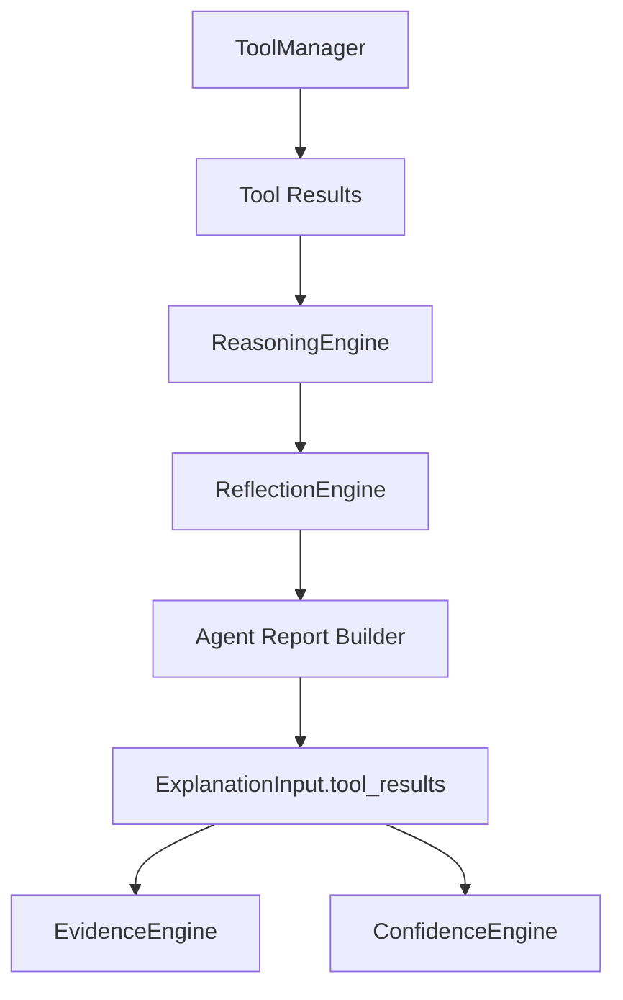
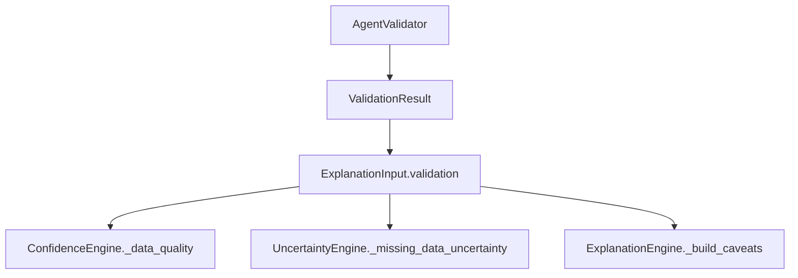
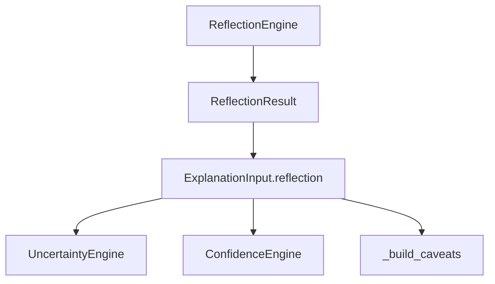

# Explainability Framework

> **Component:** Explainability Framework (XAI)  
> **Status:** ✅ Complete  
> **Version:** 1.0.0  
> **Last Updated:** 2026-07-07  
> **Source:** `backend/xai/`

---

## Purpose

The Explainability Framework is Hyperion's **centralized, agent-agnostic explainability layer** for climate decision intelligence. It transforms heterogeneous pipeline artifacts — reasoning traces, tool outputs, validation results, reflection findings, decision requests, and RL responses — into a single standardized `ExplainabilityReport` that any specialized agent (flood, water resource, heatwave) or downstream consumer can attach to recommendations without depending on agent-specific report schemas.

The framework solves four enterprise problems:

1. **Explanation fragmentation** — Each agent historically embedded reasoning in local report fields (`reasoning.trace`, domain-specific signal structs). XAI unifies these into one schema with executive summary, evidence bundles, confidence/uncertainty estimates, alternatives, and counterfactuals.
2. **Audit and compliance** — `ExplainabilityReport.to_audit_trace()` flattens key explanation lines for regulatory audit trails, human review queues, and API `reasoning_trace` fields.
3. **Decision transparency** — `AlternativeActionsEngine` and `CounterfactualEngine` explain *why* an action was chosen, what was rejected, and what would have happened under alternative paths — critical for public-sector climate response accountability.
4. **RL interpretability** — `explain_decision()` accepts unified `DecisionRequest` + `DecisionResponse` pairs so RL-optimized actions receive the same explanation depth as rule-based decisions.

Every climate recommendation in Hyperion should be accompanied by an `ExplainabilityReport`.

---

## Responsibilities

| Responsibility | Owner Module |
|----------------|--------------|
| Central orchestration and report assembly | `explanation_engine.py` |
| Unified input/output Pydantic schemas | `explanation_report.py` |
| Core enums and type definitions | `explanation_models.py` |
| Multi-dimensional confidence estimation | `confidence_engine.py` |
| Multi-dimensional uncertainty estimation | `uncertainty_engine.py` |
| Evidence collection and categorization | `evidence_engine.py` |
| Reasoning trace enrichment and narrative | `reasoning_trace.py` |
| Alternative and rejected action analysis | `alternative_actions.py` |
| Counterfactual what-if scenario generation | `counterfactual_engine.py` |
| Public package exports | `__init__.py` |

---

## Architecture



**Design principles:**

- **Agent-agnostic core** — `backend/xai/` has zero imports from `flood/`, `water_resource/`, or `heatwave/`. It consumes generic agent artifacts (`ReasoningResult`, `ToolResult`, `ValidationResult`, `ReflectionResult`) and unified decision schemas.
- **Composable sub-engines** — Each sub-engine is independently testable and async-capable; `ExplanationEngine` orchestrates them based on `ExplanationType`.
- **Pydantic v2 models** — All inputs and outputs are strongly typed with field validators, UUID auto-generation, and JSON serialization via `model_dump(mode="json")`.
- **Graceful degradation** — Missing artifacts produce empty or default sections rather than exceptions; minimal inputs still yield a valid `ExplainabilityReport`.
- **Scope-aware generation** — `ExplanationType` controls which sub-engines receive full pipeline data vs. stub/minimal inputs.

---

## Folder Structure

```
backend/xai/
├── __init__.py                 # Public exports (__all__)
├── explanation_engine.py       # ExplanationEngine — central orchestrator
├── explanation_report.py       # ExplanationInput, ExplainabilityReport, sub-report models
├── explanation_models.py       # ExplanationType, EvidenceSource, ConfidenceDimension, ...
├── confidence_engine.py        # ConfidenceEngine — 5-dimension confidence
├── uncertainty_engine.py       # UncertaintyEngine — 4-dimension uncertainty
├── evidence_engine.py          # EvidenceEngine — multi-source evidence collection
├── reasoning_trace.py          # ReasoningTraceBuilder — trace enrichment
├── alternative_actions.py      # AlternativeActionsEngine — chosen/alternative/rejected
└── counterfactual_engine.py    # CounterfactualEngine — what-if scenarios

backend/tests/xai/
├── conftest.py                 # Fixtures: build_xai_input, explanation_engine
├── test_xai_unit.py            # 7 unit tests (sub-engines, input validation)
└── test_xai_integration.py     # 6 integration tests (ExplanationEngine end-to-end)
```

---

## Class Diagram



---

## Execution Flow

### End-to-End: Pipeline Artifacts → ExplainabilityReport



### ExplanationType Scope Matrix

| Sub-Engine | REASONING | DECISION | RL | FULL_PIPELINE |
|------------|-----------|----------|-----|---------------|
| ReasoningTraceBuilder | ✅ Full | ❌ Empty trace | ❌ Empty trace | ✅ Full |
| EvidenceEngine | ✅ Full | ✅ Full | ✅ Full | ✅ Full |
| ConfidenceEngine | ✅ Always runs | ✅ Full | ✅ Full | ✅ Full |
| UncertaintyEngine | ✅ Always runs | ✅ Full | ✅ Full | ✅ Full |
| AlternativeActionsEngine | ✅ Always runs | ✅ Full | ✅ Full | ✅ Full |
| CounterfactualEngine | ✅ Always runs | ✅ Full | ✅ Full | ✅ Full |

> **Note:** Confidence, uncertainty, alternatives, and counterfactuals always invoke their sub-engines regardless of type; reasoning trace is the primary type-gated component. Evidence uses a minimal stub input when type is outside the full set.

### `explain_decision()` Convenience Flow



---

## Public APIs

### `ExplanationEngine` — Central API

| Method | Async | Description |
|--------|-------|-------------|
| `create()` | **Yes** | Factory constructor; returns configured engine instance |
| `explain(explanation_input)` | **Yes** | Generate full report from `ExplanationInput`; respects `explanation_type` |
| `explain_pipeline(explanation_input)` | **Yes** | Force `ExplanationType.FULL_PIPELINE` and delegate to `explain()` |
| `explain_decision(decision_request, *, decision_response, request_id, recommendations)` | **Yes** | Convenience wrapper; sets type to `RL` if response present, else `DECISION` |
| `last_report` (property) | No | Most recently generated `ExplainabilityReport` or `None` |

### `ExplanationInput`

| Field | Type | Description |
|-------|------|-------------|
| `request_id` | `str` | Correlation ID for tracing (required) |
| `agent_id` | `str` | Originating agent identifier (required) |
| `explanation_type` | `ExplanationType` | Scope of explanation (default `FULL_PIPELINE`) |
| `query` | `str` | Natural-language query for executive summary |
| `reasoning` | `ReasoningResult \| None` | Agent reasoning steps and metadata |
| `tool_results` | `list[ToolResult]` | Raw tool execution results |
| `tool_output_records` | `list[ToolOutputRecord]` | Serialized tool outputs (fallback for evidence) |
| `reflection` | `ReflectionResult \| None` | Reflection findings (simulation need, low confidence, etc.) |
| `validation` | `ValidationResult \| None` | Agent validation outcome |
| `decision_request` | `DecisionRequest \| None` | Unified decision request |
| `decision_response` | `DecisionResponse \| None` | RL or heuristic response with ranking |
| `memory_references` | `list[str]` | Shared memory keys for evidence provenance |
| `recommendations` | `list[str]` | Human-readable action recommendations |
| `metadata` | `dict` | Extension bag (e.g., `region_id`, `decision_type`) |

### `ExplainabilityReport`

| Field / Method | Type | Description |
|----------------|------|-------------|
| `explanation_id` | `str` | UUID, auto-generated |
| `request_id` | `str` | Links to originating request |
| `agent_id` | `str` | Originating agent |
| `explanation_type` | `ExplanationType` | Scope used for generation |
| `executive_summary` | `str` | One-paragraph decision overview with confidence/uncertainty |
| `reasoning_trace` | `ReasoningTraceReport` | Enriched step-by-step reasoning |
| `evidence` | `EvidenceBundle` | Categorized supporting evidence |
| `confidence` | `ConfidenceEstimate` | Multi-dimensional confidence |
| `uncertainty` | `UncertaintyEstimate` | Multi-dimensional uncertainty |
| `alternatives` | `AlternativeActionsAnalysis` | Chosen, alternative, and rejected actions |
| `counterfactuals` | `CounterfactualAnalysis` | What-if scenarios |
| `chosen_action_summary` | `str` | Detailed narrative of selected action |
| `recommendations` | `list[str]` | Action recommendations |
| `caveats` | `list[str]` | Warnings from validation, reflection, high uncertainty |
| `processing_time_ms` | `float` | Engine processing latency |
| `generated_at` | `datetime` | UTC timestamp |
| `metadata` | `dict` | Extension bag |
| `is_high_confidence` | property | `confidence.overall >= 0.7` and `uncertainty.overall <= 0.4` |
| `to_audit_trace()` | method | Flatten key lines for audit/API consumption |

### Sub-Engine Public Methods

| Engine | Method | Returns |
|--------|--------|---------|
| `ReasoningTraceBuilder` | `build(reasoning, *, tool_results)` | `ReasoningTraceReport` |
| `EvidenceEngine` | `collect(explanation_input)` | `EvidenceBundle` |
| `ConfidenceEngine` | `estimate(explanation_input)` | `ConfidenceEstimate` |
| `UncertaintyEngine` | `estimate(explanation_input)` | `UncertaintyEstimate` |
| `AlternativeActionsEngine` | `analyze(explanation_input)` | `AlternativeActionsAnalysis` |
| `CounterfactualEngine` | `analyze(explanation_input)` | `CounterfactualAnalysis` |

### Package Exports (`backend.xai`)

All public types are re-exported from `backend/xai/__init__.py` — import from the package root in application code.

### Usage Examples

```python
from backend.xai import ExplanationEngine, ExplanationInput, ExplanationType

engine = await ExplanationEngine.create()

# Full pipeline (agent post-invoke)
report = await engine.explain_pipeline(ExplanationInput(
    request_id="req-001",
    agent_id="flood_agent",
    query="Assess flood risk in Chennai",
    reasoning=reasoning_result,
    tool_results=tool_results,
    reflection=reflection_result,
    validation=validation_result,
    decision_request=decision_request,
    decision_response=decision_response,
    memory_references=["memory:working:flood_report:abc"],
    recommendations=["Issue flood warning"],
))

# Decision + RL convenience
report = await engine.explain_decision(
    decision_request,
    decision_response=rl_response,
    recommendations=["Deploy pumps"],
)

# Audit trace for API
audit_lines = report.to_audit_trace()
```

---

## Private Methods

### `ExplanationEngine`

| Symbol | Purpose |
|--------|---------|
| `_trace_builder` | `ReasoningTraceBuilder` instance |
| `_evidence_engine` | `EvidenceEngine` instance |
| `_confidence_engine` | `ConfidenceEngine` instance |
| `_uncertainty_engine` | `UncertaintyEngine` instance |
| `_alternatives_engine` | `AlternativeActionsEngine` instance |
| `_counterfactual_engine` | `CounterfactualEngine` instance |
| `_last_report` | Cache of most recent report |
| `_maybe_trace()` | Type-gated reasoning trace generation |
| `_maybe_evidence()` | Type-gated evidence collection |
| `_maybe_confidence()` | Delegates to confidence engine |
| `_maybe_uncertainty()` | Delegates to uncertainty engine |
| `_maybe_alternatives()` | Delegates to alternatives engine |
| `_maybe_counterfactuals()` | Delegates to counterfactual engine |
| `_build_executive_summary()` | Composes one-paragraph summary |
| `_chosen_action_summary()` | Narrates selected action with cost/benefit/risk |
| `_build_caveats()` | Aggregates validation, reflection, uncertainty warnings |

### `ConfidenceEngine`

| Symbol | Purpose |
|--------|---------|
| `_DEFAULT_WEIGHTS` | Dimension weights (model 0.25, data 0.25, forecast 0.20, tool 0.15, historical 0.15) |
| `_model_confidence()` | Average reasoning/reflection/decision/response confidence |
| `_data_quality()` | Validation outcome or tool success rate |
| `_forecast_reliability()` | Forecast reference presence in decision context |
| `_tool_consistency()` | Cross-tool score agreement (rainfall/river, temp/humidity) |
| `_historical_similarity()` | Historical analog signals from reasoning metadata or tools |
| `_build_summary()` | Human-readable confidence level narrative |

### `UncertaintyEngine`

| Symbol | Purpose |
|--------|---------|
| `_DEFAULT_WEIGHTS` | Dimension weights (missing_data 0.30, forecast/model 0.25 each, simulation 0.20) |
| `_forecast_uncertainty()` | Inverse of forecast availability |
| `_missing_data_uncertainty()` | Reflection gaps, validation issues, tool failures |
| `_model_uncertainty()` | Reasoning confidence gap + domain uncertainty signals |
| `_simulation_uncertainty()` | `need_simulation` flag without simulation reference |
| `_*_mitigations()` | Suggested mitigations per dimension when score ≥ 0.4 |
| `_build_summary()` | Human-readable uncertainty level narrative |

### `EvidenceEngine`

| Symbol | Purpose |
|--------|---------|
| `_collect_climate()` | Climate measurements from `DecisionContext.climate_state` |
| `_collect_forecast()` | Forecast reference metadata |
| `_collect_tool_evidence()` | Tool results and output records |
| `_evidence_from_tool_output()` | Per-tool key extraction + historical/digital twin specials |
| `_collect_historical()` | Filter historical event evidence |
| `_collect_digital_twin()` | Filter digital twin evidence |
| `_collect_reasoning()` | Reasoning steps and domain signals |
| `_collect_decision_rationale()` | Decision request rationale lines |
| `_summarize()` | Evidence count summary string |

### `ReasoningTraceBuilder`

| Symbol | Purpose |
|--------|---------|
| `_extract_stage()` | Pull stage name from step metadata |
| `_supporting_tools()` | Map reasoning stages to executed tool names |
| `_build_narrative()` | Human-readable step narratives |

### `AlternativeActionsEngine`

| Symbol | Purpose |
|--------|---------|
| `_explain_rejected()` | Map `RejectedAction` → `RejectedActionExplanation` |
| `_explain_alternatives()` | Build alternative explanations from ranking or possible_actions |
| `_why_not_chosen()` | Rank/score/constraint comparison narrative |
| `_compare_to_chosen()` | Net value and risk comparison |
| `_trade_offs()` | Cost/benefit/risk delta bullets |
| `_build_summary()` | Selection summary string |

### `CounterfactualEngine`

| Symbol | Purpose |
|--------|---------|
| `_alternative_action_scenarios()` | Per-action what-if (max 5 scenarios) |
| `_alternative_decision_scenarios()` | RL bypass and simulation counterfactuals |
| `_alternative_scenario_contexts()` | Worsening/improving regional scenarios |
| `_outcome_narrative()` | Action outcome description |
| `_delta_narrative()` | Reward delta comparison |
| `_build_summary()` | Scenario count summary |

### Module-Level Helper

| Symbol | Purpose |
|--------|---------|
| `evidence_summary()` | Short evidence count string for executive summary |

---

## LangGraph Integration

The Explainability Framework has **no direct LangGraph node registration**. Integration is **post-hoc** at agent invocation boundaries:



| Integration Point | Description |
|-------------------|-------------|
| Post-report hook | Agents call `explain_pipeline()` after building domain report |
| State attachment | `ExplainabilityReport` serialized into graph state `metadata.explanation` |
| Supervisor review | Climate supervisor may require `is_high_confidence` before auto-execution |
| Human-in-the-loop | Low-confidence reports trigger `need_human` escalation paths |

Future LangGraph wiring will add an optional `explain` node between `decide` and `END` that auto-invokes `ExplanationEngine` when `DecisionRequest.need_human` is false.

---

## Memory Integration

| Field | Role |
|-------|------|
| `ExplanationInput.memory_references` | List of shared memory keys passed to evidence collection |
| `EvidenceSource.MEMORY` | Evidence items tagged with provenance `shared_memory` |
| `EvidenceBundle.memory_references` | Echo of input references for report consumers |


Memory content is **not fetched** by the XAI layer — agents pass reference keys only. Full memory resolution remains an agent/supervisor responsibility.

---

## Decision Framework Integration

`ExplanationInput` accepts unified decision artifacts from `backend/decision/`:

| Field | Type | Role |
|-------|------|------|
| `decision_request` | `DecisionRequest \| None` | Actions, constraints, context, rationale for evidence and counterfactuals |
| `decision_response` | `DecisionResponse \| None` | Chosen action, ranking, rejections for alternatives and counterfactuals |

Sub-engine decision data consumption:

| Engine | Decision Data Used |
|--------|-------------------|
| `AlternativeActionsEngine` | `possible_actions`, `ranking`, `rejected_actions`, `chosen_action` |
| `ConfidenceEngine` | Request `confidence`, response `confidence`, forecast references |
| `CounterfactualEngine` | Non-chosen actions, `need_rl`, `need_simulation`, scenario context |
| `EvidenceEngine` | `rationale`, climate state, forecast reference, measurements |
| `UncertaintyEngine` | `need_simulation`, forecast availability, risk scores |

`explain_decision()` automatically sets `ExplanationType.RL` when `decision_response` is provided, else `ExplanationType.DECISION`, and injects `metadata.decision_type` from the request.

Heatwave agent reports include both pre-RL (`decision_request`) and post-RL (`rl_response`) payloads for contrastive explanations. Flood and water agents require schema migration to unified `DecisionRequest` before full `explain_decision()` compatibility.

---

## RL Integration



| RL Artifact | XAI Consumption |
|-------------|-----------------|
| `DecisionResponse.chosen_action` | `AlternativeActionsAnalysis.chosen_action` |
| `DecisionResponse.ranking` | Alternative explanations with rank/score/reward |
| `DecisionResponse.rejected_actions` | `RejectedActionExplanation` list |
| `DecisionResponse.reward` | Counterfactual baseline reward |
| `DecisionResponse.confidence` | `ConfidenceEngine._model_confidence()` |
| `DecisionRequest.need_rl` | Counterfactual "What if RL had not been used?" scenario |

RL explanations use `ExplanationType.RL` and include full alternative action analysis with optimization scores.

---

## Knowledge Graph Integration

The Explainability Framework has **no direct dependency** on `backend/knowledge_graph/`. Integration is indirect:

| Path | Description |
|------|-------------|
| Memory graph domain | Agents retrieve entity context via `MemoryManager.search_graph()` before building pipeline artifacts |
| `EvidenceItem.metadata` | Agents may attach graph entity IDs in tool output metadata |
| `ExplanationInput.metadata` | Extension point for graph traversal provenance |
| Future wiring | `GraphReasoningEngine` may enrich evidence with entity relationship narratives |



---

## Agent Pipeline Integration

How specialized agents produce consumable artifacts for XAI:

| Agent Artifact | XAI Field | Sub-Engine Consumer |
|----------------|-----------|---------------------|
| `ReasoningResult.steps` | `reasoning` | `ReasoningTraceBuilder`, `EvidenceEngine` |
| `ToolResult` list | `tool_results` | `EvidenceEngine`, `ConfidenceEngine` |
| `ReflectionResult` | `reflection` | `UncertaintyEngine`, `ConfidenceEngine`, caveats |
| `ValidationResult` | `validation` | `ConfidenceEngine`, `UncertaintyEngine`, caveats |
| Domain report recommendations | `recommendations` | `ExplainabilityReport.recommendations` |
| Pre/post RL payloads | `decision_request`, `decision_response` | All decision-aware engines |

**Current agent wiring status:**

| Agent | Auto-XAI on invoke | `explain_decision()` compatible |
|-------|-------------------|--------------------------------|
| Heatwave | ❌ Manual post-hoc | ✅ Unified schema |
| Flood | ❌ Manual post-hoc | ⚠️ Requires schema migration |
| Water Resource | ❌ Manual post-hoc | ⚠️ Requires schema migration |

Recommended invocation pattern after report generation:

```python
explanation = await ExplanationEngine().explain_pipeline(ExplanationInput(
    request_id=report.request_id,
    agent_id=self.agent_id,
    query=report.query,
    reasoning=reasoning_result,
    tool_results=tool_results,
    reflection=reflection_result,
    validation=validation_result,
    decision_request=decision_request,
    decision_response=rl_response,
    memory_references=memory_refs,
    recommendations=report.recommendations,
))
```

---

## Tool Architecture

XAI does not register or execute tools. Tool integration is **upstream** in the agent pipeline:



### Tool-Aware Evidence Extraction

| Tool Name | Special Handling |
|-----------|------------------|
| `historical_heatwave_tool` | Extracts `events[]` as `HISTORICAL_EVENT` evidence |
| `historical_flood_tool` | Extracts `events[]` as `HISTORICAL_EVENT` evidence |
| `digital_twin_tool` | Creates `DIGITAL_TWIN` evidence with LST/UHI metadata |
| Generic tools | Scalar keys extracted as `TOOL_OUTPUT` (skips `retrieved_at`, `events`, etc.) |

### Tool Consistency Scoring (`ConfidenceEngine`)

Cross-tool agreement checks:

- `temperature_tool.temperature_score` vs `humidity_tool.humidity_score`
- `rainfall_tool.rainfall_score` vs `river_tool.river_score`

Disagreement reduces `TOOL_CONSISTENCY` confidence dimension.

### Stage-to-Tool Mapping (`ReasoningTraceBuilder`)

| Reasoning Stage | Mapped Tool |
|-----------------|-------------|
| `temperature_trend` | `temperature_tool` |
| `humidity` / `heat_index` | `humidity_tool` |
| `urban_heat_island` | `lst_tool` |
| `population_exposure` | `population_tool` |
| `historical_comparison` | `historical_heatwave_tool` |

---

## Validation Pipeline

Agent validation results feed confidence, uncertainty, and caveats:



| Validation State | Confidence Impact | Uncertainty Impact | Caveats |
|------------------|--------------------|--------------------|---------|
| `valid=True`, no issues | Base 0.85 | No penalty | None |
| `valid=True`, warnings | Base 0.85 − issue penalty | +0.08 per issue (cap 0.35) | Top 3 error messages if invalid |
| `valid=False` | Base 0.45 − penalty | +0.08 per issue | Validation messages appended |
| No validation, tools present | Tool success rate | Tool failure ratio | None |

Validation is **optional** — absence falls back to tool success rate for data quality scoring.

---

## Reflection Pipeline

Reflection findings drive uncertainty estimation and caveats:



| Reflection Signal | Uncertainty Effect | Caveat Source |
|-------------------|-------------------|---------------|
| `NEED_FORECAST` | Forecast uncertainty → 0.85 | — |
| `MISSING_CONTEXT` | Missing data +0.35 | — |
| `NEED_SIMULATION` | Simulation uncertainty → 0.7 | — |
| `LOW_CONFIDENCE` | Model uncertainty floor +0.4 | — |
| `needs_another_agent` | Missing data +0.1 | — |
| `notes[]` | — | Top 3 notes appended to caveats |

`ReflectionResult.confidence` contributes to `ConfidenceEngine._model_confidence()`.

---

## Metrics

The Explainability Framework itself does not ship a dedicated metrics collector. Observability is provided through:

| Source | Metrics |
|--------|---------|
| `ExplainabilityReport.processing_time_ms` | End-to-end explanation generation latency |
| `ExplainabilityReport.confidence.overall` | Aggregated confidence score |
| `ExplainabilityReport.uncertainty.overall` | Aggregated uncertainty score |
| `ExplainabilityReport.is_high_confidence` | Binary quality gate |
| Structured logging | `explanation_generated` debug event |
| Sub-report summaries | Per-dimension weakest/dominant factor strings |

### Confidence Dimensions and Weights

| Dimension | Weight | Source Signals |
|-----------|--------|----------------|
| `MODEL` | 0.25 | Reasoning, reflection, decision, response confidence |
| `DATA_QUALITY` | 0.25 | Validation outcome, tool success rate |
| `FORECAST_RELIABILITY` | 0.20 | Forecast reference in decision context |
| `TOOL_CONSISTENCY` | 0.15 | Cross-tool score agreement |
| `HISTORICAL_SIMILARITY` | 0.15 | Historical analog flags and scores |

### Uncertainty Dimensions and Weights

| Dimension | Weight | Source Signals |
|-----------|--------|----------------|
| `MISSING_DATA` | 0.30 | Reflection gaps, validation issues, tool failures |
| `FORECAST` | 0.25 | Forecast reference absence |
| `MODEL` | 0.25 | Reasoning confidence gap, domain uncertainty |
| `SIMULATION` | 0.20 | `need_simulation` without simulation reference |

Recommended future metrics (not yet implemented):

- `explanation_generated_total` by `agent_id` and `explanation_type`
- `explanation_confidence_histogram`
- `explanation_high_confidence_ratio`
- `explanation_processing_ms` histogram

---

## Logging

All logging uses `backend.config.logger.get_logger` with structured key-value fields:

| Event | Level | Fields |
|-------|-------|--------|
| `explanation_generated` | DEBUG | `request_id`, `agent_id`, `confidence`, `uncertainty`, `processing_ms` |

Sub-engines do not emit separate log events — orchestration logging is centralized in `ExplanationEngine.explain()`.

---

## Error Handling

The Explainability Framework follows a **fail-open** design — missing or partial inputs produce degraded but valid reports rather than raising exceptions.

| Scenario | Behavior |
|----------|----------|
| No reasoning provided | Empty trace with narrative "No structured reasoning trace available" |
| No decision artifacts | Alternatives/counterfactuals return summary-only stubs |
| No tool results | Evidence from decision context only; data quality defaults to 0.5 |
| No validation | Falls back to tool success rate |
| No reflection | Default uncertainty scores without reflection penalties |
| Invalid Pydantic input | Standard Pydantic `ValidationError` at input construction |

There are **no custom XAI exceptions**. Callers should validate `ExplanationInput` at construction time and inspect report section completeness for quality gates.

### Quality Gates

| Gate | Condition | Recommended Action |
|------|-----------|-------------------|
| High confidence | `report.is_high_confidence` | Auto-approve for execution |
| Low confidence | `confidence.overall < 0.55` | Human review |
| High uncertainty | `uncertainty.overall >= 0.65` | Simulation or additional data collection |
| Elevated dimension | Any uncertainty component ≥ 0.55 | Caveat appended; check mitigations |

---

## Configuration

The Explainability Framework is **zero-config** by default. Customization is via direct sub-engine instantiation or future weight injection:

```python
from backend.xai import ExplanationEngine

engine = await ExplanationEngine.create()
```

| Constant | Location | Value |
|----------|----------|-------|
| Confidence dimension weights | `confidence_engine.py` `_DEFAULT_WEIGHTS` | model 0.25, data 0.25, forecast 0.20, tool 0.15, historical 0.15 |
| Uncertainty dimension weights | `uncertainty_engine.py` `_DEFAULT_WEIGHTS` | forecast 0.25, missing 0.30, model 0.25, simulation 0.20 |
| High confidence threshold | `ExplainabilityReport.is_high_confidence` | confidence ≥ 0.7, uncertainty ≤ 0.4 |
| Counterfactual action cap | `counterfactual_engine.py` | Max 5 alternative action scenarios |
| Caveat uncertainty threshold | `_build_caveats()` | Component score ≥ 0.55 |
| Mitigation threshold | `uncertainty_engine.py` | Score ≥ 0.4 triggers mitigations list |

---

## Performance

| Operation | Complexity | Notes |
|-----------|------------|-------|
| `explain()` | O(S + T + A + C) | S = reasoning steps, T = tool results, A = actions, C = counterfactual scenarios (capped at 5) |
| `ReasoningTraceBuilder.build()` | O(S) | Linear over reasoning steps |
| `EvidenceEngine.collect()` | O(T + M + R) | T = tools, M = measurements, R = rationale lines |
| `ConfidenceEngine.estimate()` | O(T) | Tool consistency pairwise checks |
| `UncertaintyEngine.estimate()` | O(F) | F = reflection findings |
| `AlternativeActionsEngine.analyze()` | O(A + R) | A = actions, R = ranking entries |
| `CounterfactualEngine.analyze()` | O(A) | Capped at 5 action scenarios |

Typical processing time is sub-millisecond to low single-digit milliseconds for standard flood/heatwave inputs (see `processing_time_ms` in test fixtures).

All sub-engine methods are `async` for consistency with the agent pipeline, though current implementations are CPU-bound synchronous work wrapped in async signatures.

---

## Scalability

| Concern | Current State | Scale Path |
|---------|---------------|------------|
| Engine state | `_last_report` in-memory only | Stateless deployment; pass report to caller |
| Evidence volume | Unbounded item list | Pagination or top-K evidence selection |
| Counterfactual count | Hard cap at 5 action scenarios | Configurable cap per deployment |
| Async signature | CPU-bound logic | Optional `run_in_executor` for heavy evidence parsing |
| Report storage | Not built-in | Serialize via Pydantic JSON to audit store |
| Batch explanation | Single input per call | Future batch API with shared sub-engine instances |

Multi-process deployments should treat `ExplanationEngine` as stateless except for optional `_last_report` debugging.

---

## Security

| Concern | Mitigation |
|---------|------------|
| Sensitive data in evidence | Evidence values are opaque; consumers must redact PII before external display |
| Tool output injection | Pydantic typed fields; scalar extraction only from tool dicts |
| Metadata bags | `metadata` dicts are untyped — sanitize on API serialization |
| Audit trace leakage | `to_audit_trace()` includes executive summary and caveats — review before public export |
| Agent impersonation | `agent_id` recorded for audit; not validated by XAI (caller responsibility) |
| Decision data integrity | XAI trusts input artifacts; validation is upstream in agent/decision layers |

---

## Known Limitations

1. **No auto-wiring** — Agents do not automatically invoke `ExplanationEngine` during `invoke()`; explanation is manual post-hoc.
2. **Schema bifurcation** — Flood and water agents use local decision schemas; full `explain_decision()` requires unified `DecisionRequest` migration.
3. **Memory references only** — XAI does not resolve memory content; keys are echoed as evidence labels.
4. **No knowledge graph** — No first-class CKG entity enrichment in evidence or counterfactuals.
5. **Fixed dimension weights** — Confidence and uncertainty weights are hardcoded, not configurable at runtime.
6. **CPU-bound async** — Sub-engines are async but perform synchronous computation.
7. **Limited tool consistency rules** — Only temperature/humidity and rainfall/river pairs are checked.
8. **Counterfactual narratives are heuristic** — Scenarios use template narratives, not simulation-backed outcomes.
9. **No persistence layer** — Reports exist only in memory unless caller serializes.
10. **Reasoning type gating is partial** — Only reasoning trace is type-gated; other engines always run with available data.

---

## Future Improvements

| Priority | Improvement |
|----------|-------------|
| P0 | Auto-wire `ExplanationEngine.explain_pipeline()` in all specialized agent `invoke()` paths |
| P0 | Migrate flood/water to unified `DecisionRequest` for full XAI compatibility |
| P1 | Add `ExplanationMetricsCollector` with Prometheus export |
| P1 | Configurable confidence/uncertainty dimension weights via constructor injection |
| P1 | Evidence top-K selection and relevance scoring |
| P2 | CKG-enriched evidence via `GraphReasoningEngine` entity narratives |
| P2 | Simulation-backed counterfactual outcomes from digital twin |
| P2 | LLM-augmented executive summary generation |
| P2 | Batch explanation API for multi-region scenarios |
| P3 | Explanation persistence repository with audit query API |
| P3 | LangGraph `explain` node with confidence gate routing |

---

## Testing Summary

**Total: 13 tests** — `backend/tests/xai/`

| Suite | File | Count | Coverage Focus |
|-------|------|-------|----------------|
| Unit | `test_xai_unit.py` | **7** | Sub-engines, input validation |
| Integration | `test_xai_integration.py` | **6** | ExplanationEngine end-to-end, agent scenarios |

### Unit Tests (7)

| Test | Validates |
|------|-----------|
| `test_reasoning_trace_builder` | 3 steps, narrative, confidence > 0.7, duration > 0 |
| `test_evidence_engine_collects_sources` | Items, tool evidence, historical events, memory refs, summary |
| `test_confidence_engine_dimensions` | Overall range, 5 components, historical ≥ 0.8, summary |
| `test_uncertainty_engine_dimensions` | Overall range, 4 components, simulation > 0.5, summary |
| `test_alternative_actions_engine` | Chosen action, alternatives, rejected, summary |
| `test_counterfactual_engine` | Question prefix, ≥ 2 scenarios, titles, summary |
| `test_explanation_input_validation` | Agent ID, explanation type, decision request presence |

### Integration Tests (6)

| Test | Validates |
|------|-----------|
| `test_explanation_engine_full_pipeline` | Full report sections, `last_report` cache, processing time |
| `test_explanation_engine_decision_only` | DECISION type alternatives, counterfactuals, chosen summary |
| `test_explanation_engine_rl_convenience` | RL type, recommendations, ranking via `explain_decision()` |
| `test_explainability_report_audit_trace` | `to_audit_trace()` length, `is_high_confidence` property |
| `test_heatwave_decision_explanation` | Heatwave agent path, simulation uncertainty, metadata |
| `test_explanation_with_minimal_input` | Graceful degradation with `full=False` stub |

### Test Fixtures (`conftest.py`)

| Fixture / Builder | Description |
|-------------------|-------------|
| `build_reasoning_result()` | 3-step flood reasoning with `flood_signals` metadata |
| `build_tool_results()` | Rainfall, river, historical flood, digital twin tools |
| `build_reflection_result()` | `NEED_SIMULATION` finding |
| `build_validation_result()` | Valid with forecast consistency warning |
| `build_decision_response()` | Flood decision with ranking and rejected action |
| `build_xai_input(full=True)` | Complete `ExplanationInput` for flood agent |
| `explanation_engine` | Async pytest fixture via `ExplanationEngine.create()` |

### Running Tests

```bash
python -m pytest backend/tests/xai/ -v
```

### Related Test Suites

| Suite | Relevance |
|-------|-----------|
| `backend/tests/decision/` | Decision artifacts consumed by XAI |
| `backend/tests/specialized/heatwave/` | Heatwave pipeline produces XAI-compatible artifacts |
| `backend/tests/rl/` | RL responses feed `explain_decision()` |

---

## Related Documents

- [Explainability Pipeline Diagram](../diagrams/explainability_pipeline.md)
- [Decision Framework](../decision/decision_framework.md)
- [Specialized Agent Framework](../agents/specialized_framework.md)
- [Heatwave Agent](../agents/heatwave_agent.md)
- [Flood Agent](../agents/flood_agent.md)
- [Agent → Decision → RL Flow](../diagrams/agent_decision_rl_flow.md)
- [RL Engine](../rl/README.md)
